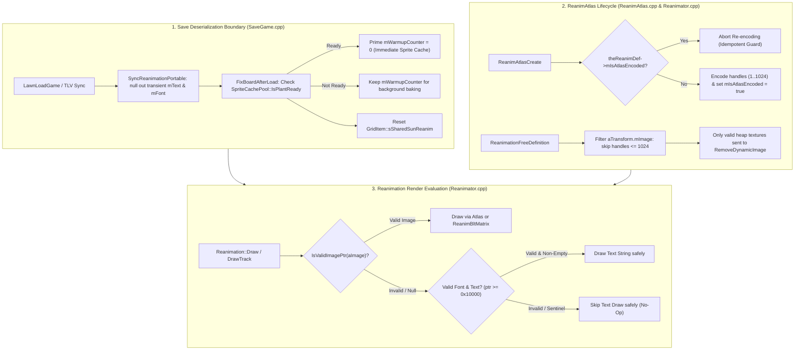

# Vasebreaker Save-Load Crash Elimination & Reanimation Hardening

*   **Author:** Francisco
*   **Status:** Draft
*   **Date:** 2026-11-21

--------------------------------------------------------------------------------

## Overview

During save restoration in Vasebreaker (Rompejarrones) on the Miyoo Mini Plus handheld (ARMv7-A dual-core Cortex-A7 @ 1.2 GHz, 128 MB RAM total, Linux OOM killer at ~83 MB RSS, combat RSS budget $\le 54.5$ MB), the game encounters fatal segmentation faults (`SIGSEGV`, Signal 11) at small address handles like `0x2f1` (decimal 753) and unmapped addresses like `0xdb842`.

Investigation of physical crash logs revealed that the crash is caused by a chain of interactions between atlas index encoding, uncached animation evaluation during save restoration, and unvalidated fallback text rendering:
1. `ReanimAtlas::ReanimAtlasCreate` encodes integer atlas indices into typed pointer fields (`ReanimatorTransform::mImage = (Image*)(aImageIndex + 1)`).
2. During save hydration in `SaveGame.cpp:FixBoardAfterLoad`, setting an artificial warmup delay (`mWarmupCounter = 2`) on restored plants forces them to bypass the pre-baked sprite cache on frames 0 and 1, falling back to the raw skeletal bone evaluation routine (`Reanimation::DrawTrack`).
3. In `Reanimation::DrawTrack`, when an image pointer is rejected or unassigned, execution unconditionally falls through to text rendering. In restored entities, transient text pointers (`aTransform.mText`) contain stale numeric handles (such as `0x2f1`), which are dereferenced by `*aTransform.mText != '\0'`, causing an immediate fatal null-page segmentation fault.
4. Calling `ReanimAtlasCreate` or `ReanimationFreeDefinition` on already-encoded definitions treats integer handles as valid pointers, causing secondary crashes in `aImage->mWidth` and corrupting memory management inside `RemoveDynamicImage`.

This design document specifies a zero-RAM architectural hardening plan to eliminate all save-load crashes in Vasebreaker and puzzle modes while maintaining strict 60 FPS performance and absolute memory safety.

--------------------------------------------------------------------------------

## The Problem

### 1. Pointer Dereference of Encoded Atlas Handles in Fallback Chain (`Reanimation::DrawTrack`)
When an entity reanimation draws without an atlas image bound (or when atlas handles fail `IsValidImagePtr`), execution drops into lines 963 and 1099 of `src/PvzpLib/Reanimator.cpp`:
```cpp
else if (aTransform.mFont != nullptr && aTransform.mText != nullptr && *aTransform.mText != '\0')
```
If `aTransform.mText` holds an integer atlas index (e.g. `0x2f1` / 753) or an uninitialized pointer from save deserialization, the machine instruction `ldrb r3, [r3]` dereferences the unmapped address, causing an immediate SIGSEGV. Furthermore, line 966 and line 1192 invoke `mFont->StringWidth(...)` and access `mFont->mAscent`, dereferencing `mFont`'s vtable without range or alignment validation.

### 2. Impure State Mutation & Uncached Bypass Window (`mWarmupCounter = 2`)
In `SaveGame.cpp:FixBoardAfterLoad`, setting `aPlant->mWarmupCounter = 2` forces `Plant::CanUseSpriteCache()` to return `false` on frames 0 and 1. This exposes the unbuffered fallback `Reanimation::DrawTrack` on frame 0, precisely when restored entities are most vulnerable. 
Additionally, `Plant::CanUseSpriteCache()` decrements `mWarmupCounter` directly inside a `const` query method called multiple times per tick (in both `Plant::Animate()` and `Plant::Draw()`), violating query idempotency and causing premature or inconsistent state progression.

### 3. Destructive In-Place Re-Encoding in `ReanimAtlasCreate` and Leaks in `ReanimationFreeDefinition`
In `ReanimAtlas.cpp:ReanimAtlasCreate`, image pointers in `ReanimatorDefinition` tracks are destructively rewritten to `(Image*)(aImageIndex + 1)` in-place. If an atlas is created a second time on an already-encoded definition (e.g. during save reload or level transition), line 223 dereferences `aImage->mWidth` on integer handles like `753`, segfaulting immediately. 
Conversely, in `ReanimationFreeDefinition`, skipping handles `<= 1000` prevents corrupting `RemoveDynamicImage`, but if done naively, leaks source textures stored in `mImageArray`.

--------------------------------------------------------------------------------

## Goals

*   **G-1 (Save-Load Crash Elimination):** Completely eliminate all `SIGSEGV` and `SIGBUS` crashes during save game loading and Vasebreaker level startup on the Miyoo Mini Plus handheld.
*   **G-2 (Reanimation Pipeline Boundary Hardening):** Guarantee that no encoded atlas handle (`<= 1024`) or invalid address (`< 0x10000`) is ever dereferenced as a string, font, or image pointer across `DrawTrack`, `GetTrackMatrix`, and blit functions.
*   **G-3 (Idempotent Asset Lifecycle):** Ensure `ReanimAtlasCreate` and `ReanimationFreeDefinition` autonomously recognize encoded states (`mIsAtlasEncoded`), preventing double-encoding corruption and resource manager image leaks.
*   **G-4 (Immediate Frame-0 Sprite Cache Dispatch):** Prime pre-baked restored plants (`SpriteCachePool::IsPlantReady`) with `mWarmupCounter = 0` so frame 0 renders directly from sprite sheets with 0 ms animation stutter.
*   **G-5 (Strict Zero-RAM Overhead):** Maintain 0 bytes of dynamic heap allocation, respecting the hardware limit ($\le 54.5$ MB combat RSS, $\ge 28.5$ MB safety headroom).

--------------------------------------------------------------------------------

## Non-Goals

*   **NG-1 (Save File Schema Alteration):** Modifying save file binary schemas or TLV chunk layouts. All sanitization is executed in RAM.
*   **NG-2 (Heap-Allocated Handle Tables):** Creating dynamic hash tables or map allocations for atlas handles. Zero-RAM in-place encoding remains.
*   **NG-3 (Modifying Low-Level Software Rasterizers):** Structural alterations to `PvzpBltMatrix` or `GLImage::BltMatrix`; safety invariants are enforced at the transform evaluation boundary.


--------------------------------------------------------------------------------

## Technical Plan

### 1. Architectural Overview & Component Data Flow

The solution establishes strict data invariants across three functional boundaries: **Save Deserialization**, **Asset Management**, and **Render Evaluation**. No unmapped pointer or numeric atlas handle can escape beyond its owning subsystem.



### 2. Module 1: Unified Sentinel Constants & Pointer Invariants

To eliminate disjoint magic numbers (`1000`, `10000`, `0x10000`), centralized compile-time sentinels are defined in `src/PvzpLib/Reanimator.h`:

```cpp
constexpr uintptr_t REANIM_ATLAS_HANDLE_MAX = 1024;
constexpr uintptr_t SYSTEM_POINTER_MIN       = 0x10000;

inline bool IsAtlasEncodedHandle(const void* thePtr)
{
    const uintptr_t aVal = reinterpret_cast<uintptr_t>(thePtr);
    return aVal > 0 && aVal <= REANIM_ATLAS_HANDLE_MAX;
}

inline bool IsValidMemoryPointer(const void* thePtr)
{
    const uintptr_t aVal = reinterpret_cast<uintptr_t>(thePtr);
    return aVal >= SYSTEM_POINTER_MIN;
}
```

In `src/PvzpLib/Definition.h`, `ReanimatorDefinition` is extended with:
```cpp
bool mIsAtlasEncoded = false;
```
This flag explicitly tracks whether `mTransforms` contains raw `Image*` pointers or encoded numeric tokens.

### 3. Module 2: Fallback Chain Hardening in `Reanimation::DrawTrack` and `GetTrackMatrix`

In `src/PvzpLib/Reanimator.cpp`:
1. In `Reanimation::DrawTrack` (lines 963 and 1099), gate text rendering:
```cpp
else if (IsValidMemoryPointer(aTransform.mFont) &&
         IsValidMemoryPointer(aTransform.mText) &&
         *aTransform.mText != '\0')
```
2. In `Reanimation::GetTrackMatrix` (line 1191), guard font access:
```cpp
if (IsValidMemoryPointer(aTransform.mFont))
{
    // safe to access aTransform.mFont->mAscent
}
```
3. At the entry point of `PvzpBltMatrix` (line 1010), verify `IsValidImagePtr(aImage)` before invoking the low-level blitter. If invalid, drop to a safe no-op.

### 4. Module 3: Idempotent Atlas Creation & Leak-Free Definition Teardown

In `src/PvzpLib/ReanimAtlas.cpp` (`ReanimAtlas::ReanimAtlasCreate`):
* Inspect `theReanimDef->mIsAtlasEncoded` and `theReanimDef->mReanimAtlas != nullptr`. If true, log an operational warning via `PvzpLogLn` and return immediately without modifying track transforms.
* Once atlas baking finishes and tokens are assigned, set `theReanimDef->mIsAtlasEncoded = true`.

In `src/PvzpLib/Reanimator.cpp` (`ReanimationFreeDefinition`):
* When collecting unique textures to remove via `aResMgr->RemoveDynamicImage(anImage)`, skip any pointer where `IsAtlasEncodedHandle(anImage)`.
* This preserves resource manager bookkeeping integrity and prevents segfaults when freeing atlas-backed definitions during level transitions.

### 5. Module 4: Frame-0 Sprite Cache Prime & Query Purity in `Plant`

In `src/Lawn/Plant.cpp`:
1. **Idempotent Query:** In `Plant::CanUseSpriteCache() const`, remove the `const_cast<Plant*>(this)->mWarmupCounter--` statement. `CanUseSpriteCache()` becomes a strictly pure query that returns `false` if `mWarmupCounter > 0` without side effects.
2. **Simulation Progression:** In `Plant::Update()`, advance the warmup state deterministically:
```cpp
if (mWarmupCounter > 0)
{
    mWarmupCounter--;
}
```

In `src/Lawn/System/SaveGame.cpp` (`FixBoardAfterLoad`):
* After synchronous cache preloading (`SpriteCachePool::PreloadSynchronous(theBoard)`), inspect each active restored plant:
```cpp
if (SpriteCachePool::IsPlantReady(aPlant->mSeedType))
{
    aPlant->mWarmupCounter = 0; // Immediate frame-0 sprite cache dispatch
}
```
Restored plants bypass the fragile fallback chain entirely on frame 0, rendering directly from pre-baked sprite sheets.

### 6. Module 5: Deserialization Boundary Sanitization & Puzzle Mode Lifecycles

In `src/Lawn/System/SaveGame.cpp`:
1. In `SyncReanimationPortable`:
   * For every restored track instance and blend transform, unconditionally initialize:
   ```cpp
   aTransform.mText = nullptr;
   aTransform.mFont = nullptr;
   ```
   Because text and font pointers are runtime transient pointers created dynamically by attachers, they have zero meaning upon disk deserialization. Nullifying them guarantees that no stale numeric handle can masquerade as a string pointer.
2. In `Board::DisposeBoard()` and `FixBoardAfterLoad()`:
   * Sanitize `GridItem::sSharedSunReanim` (used for transparent vases in Vasebreaker):
   ```cpp
   if (GridItem::sSharedSunReanim)
   {
       delete GridItem::sSharedSunReanim;
       GridItem::sSharedSunReanim = nullptr;
   }
   ```
   This prevents dangling pointers across level restarts.


--------------------------------------------------------------------------------

## Alternatives Considered

### 1. Scatter Handle Checks Across Low-Level Rasterizers (`PvzpBltMatrix`, `GLImage::BltMatrix`, `ReanimBltMatrix`)
*   **Mechanism:** Add checks (`reinterpret_cast<uintptr_t>(theImage) > 0x10000 && reinterpret_cast<uintptr_t>(theImage) % 4 == 0`) inside every leaf blit function.
*   **Trade-offs:** Adds defensive branches to tight inner loops executed thousands of times per second. Does not protect `*aTransform.mText` or `mFont->mAscent` which crash before reaching blit functions.
*   **Verdict:** *Rejected by author:* Littering low-level rasterization primitives with domain-specific handle bounds degrades instruction cache performance on the ARMv7 Cortex-A7 (1.2 GHz) and masks upstream state corruption. Safety invariants belong at the transform interpolation and dispatch stage (`DrawTrack`), leaving blitters lean and fast.

### 2. Dynamically Allocate External Atlas Index Lookup Tables
*   **Mechanism:** Replace the in-place pointer overloading `(Image*)(aImageIndex + 1)` with a heap-allocated `std::unordered_map<Image*, int>` or dynamic handle vector per definition.
*   **Trade-offs:** Preserves pointer type purity and avoids numeric token storage in pointer members, but introduces dynamic memory allocations and pointer indirections during level loading and asset lookups.
*   **Verdict:** *Rejected by author:* Allocating auxiliary lookup tables across ~120 reanimation definitions introduces heap fragmentation and increases combat RSS, threatening the strict $\le 54.5$ MB memory ceiling on the Miyoo Mini Plus and risking kernel OOM termination (~83 MB limit). Lightweight integer handle sentinels achieve zero-RAM safety without memory growth.

### 3. Reconstruct Atlases Per Restored Entity in `FixBoardAfterLoad`
*   **Mechanism:** When deserializing a save file, iterate over all restored plants, zombies, and board reanimations and invoke `ReanimationCreateAtlas` for each entity's definition.
*   **Trade-offs:** Attempts to repair missing or broken atlas bindings on a per-entity basis. However, definitions are globally shared across all instances of an archetype.
*   **Verdict:** *Rejected by author:* Blindly calling `ReanimationCreateAtlas` per restored entity in `FixBoardAfterLoad` repeatedly triggers the double-encoding defect on already-encoded definitions, causing immediate crashes in `aImage->mWidth` and introducing unnecessary CPU overhead during level initialization. Definition integrity must be managed declaratively at the definition level.


--------------------------------------------------------------------------------

## Detailed Implementation Plan

The implementation is executed as a unified, coordinated sequence touching the reanimation engine, asset definitions, save-game loader, plant entity lifecycle, and puzzle mode auxiliary caches.

### Touched Files and File-by-File Rationale

1. [src/PvzpLib/Reanimator.h](file:///c:/DEV/PVZ/src/PvzpLib/Reanimator.h)
   * **Changes:** Add centralized compile-time boundary sentinels `REANIM_ATLAS_HANDLE_MAX = 1024` and `SYSTEM_POINTER_MIN = 0x10000`. Provide inline predicate helpers `IsAtlasEncodedHandle(const void*)` and `IsValidMemoryPointer(const void*)`.
   * **Rationale:** Eliminates disjoint magic numbers across files and provides a single, audited memory safety contract for pointer dereferences.

2. [src/PvzpLib/Definition.h](file:///c:/DEV/PVZ/src/PvzpLib/Definition.h)
   * **Changes:** Add `bool mIsAtlasEncoded = false;` member to `ReanimatorDefinition`.
   * **Rationale:** Allows the reanimation system to distinguish between raw `Image*` texture references and in-place encoded atlas token integers without scanning track arrays or guessing memory addresses.

3. [src/PvzpLib/Reanimator.cpp](file:///c:/DEV/PVZ/src/PvzpLib/Reanimator.cpp)
   * **Changes:**
     * In `Reanimation::DrawTrack` (lines 963 and 1099), verify that `aTransform.mFont` and `aTransform.mText` satisfy `IsValidMemoryPointer` before evaluating `*aTransform.mText != '\0'` or invoking `mFont->StringWidth`.
     * In `Reanimation::GetTrackMatrix` (line 1191), guard font access before evaluating `mFont->mAscent`.
     * In `Reanimation::DrawTrack` (line 1010), verify `IsValidImagePtr(aImage)` before passing to `PvzpBltMatrix`.
     * In `ReanimationFreeDefinition` (lines 280–344), skip `aTransform.mImage` when `IsAtlasEncodedHandle(aTransform.mImage)` is true.
   * **Rationale:** Hardens the fallback rendering chain against null-page and unmapped pointer dereferences, while preventing resource manager corruption when atlas-backed definitions are freed.

4. [src/PvzpLib/ReanimAtlas.cpp](file:///c:/DEV/PVZ/src/PvzpLib/ReanimAtlas.cpp)
   * **Changes:**
     * In `ReanimAtlas::ReanimAtlasCreate`, check if `theReanimDef->mIsAtlasEncoded || theReanimDef->mReanimAtlas != nullptr`. If so, log a diagnostic warning and return early without mutating transforms.
     * After successfully encoding transforms to atlas indices, assign `theReanimDef->mIsAtlasEncoded = true;`.
   * **Rationale:** Guarantees idempotency of atlas generation, preventing destructive double-encoding and SIGSEGV crashes on `aImage->mWidth`.

5. [src/Lawn/Plant.cpp](file:///c:/DEV/PVZ/src/Lawn/Plant.cpp)
   * **Changes:**
     * In `Plant::CanUseSpriteCache() const`, remove the `const_cast<Plant*>(this)->mWarmupCounter--` statement. Ensure the function is a pure, idempotent query.
     * In `Plant::Update()`, decrement `mWarmupCounter` if `mWarmupCounter > 0`.
   * **Rationale:** Eliminates double-decrement state corruption caused by calling `CanUseSpriteCache()` across both `Animate()` and `Draw()`, and ensures warmup progression occurs deterministically during simulation updates.

6. [src/Lawn/System/SaveGame.cpp](file:///c:/DEV/PVZ/src/Lawn/System/SaveGame.cpp)
   * **Changes:**
     * In `FixBoardAfterLoad`, inspect all active restored plants: if `SpriteCachePool::IsPlantReady(aPlant->mSeedType)` is true, set `aPlant->mWarmupCounter = 0;`.
     * In `SyncReanimationPortable`, unconditionally nullify transient pointers on restored transforms: `aTransform.mText = nullptr; aTransform.mFont = nullptr;`.
     * In `FixBoardAfterLoad`, delete and reset `GridItem::sSharedSunReanim = nullptr;` if allocated.
   * **Rationale:** Dispatches restored plants directly to the pre-baked sprite cache on frame 0, sanitizes deserialized reanimation states to prevent stale numeric handles from being read as text, and eliminates dangling static pointers in puzzle mode.

7. [src/Lawn/Board.cpp](file:///c:/DEV/PVZ/src/Lawn/Board.cpp)
   * **Changes:** In `Board::DisposeBoard()`, ensure `GridItem::sSharedSunReanim` is safely freed and reset to `nullptr`.
   * **Rationale:** Guarantees that auxiliary puzzle mode reanimations do not persist as dangling pointers across session teardown and recreation.

8. [tests/test_release_package.py](file:///c:/DEV/PVZ/tests/test_release_package.py)
   * **Changes:** Verify that release binaries compile without warnings, maintain the zero-RAM growth budget, and package cleanly into distribution zip files.
   * **Rationale:** Continuous regression verification for release packaging.

### Execution Phases & Verification Gates

*   **Phase 1: Shared Sentinels & Definition State:** Implement `REANIM_ATLAS_HANDLE_MAX`, `SYSTEM_POINTER_MIN`, and `mIsAtlasEncoded`.
*   **Phase 2: Atlas Lifecycle & Engine Hardening:** Implement idempotency in `ReanimAtlasCreate`, handle skipping in `ReanimationFreeDefinition`, and pointer guards in `DrawTrack` / `GetTrackMatrix`.
*   **Phase 3: Save-Game Deserialization & Plant Query Purity:** Pure `CanUseSpriteCache()`, simulation-driven warmup progression, and frame-0 sprite cache priming in `FixBoardAfterLoad`.
*   **Phase 4: Auxiliary Resource Cleanup:** Teardown of `sSharedSunReanim` in `Board::DisposeBoard()` and `FixBoardAfterLoad`.
*   **Phase 5: Compilation & Physical Toolchain Verification:** Build via Docker `aemiii91/miyoomini-toolchain:latest`, verify zero warnings, strip executable, run test suite, and generate final release package.
