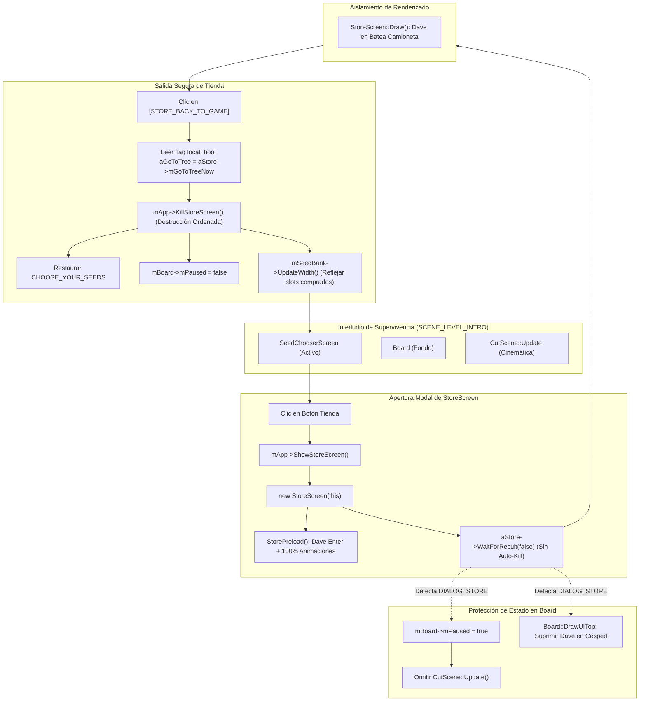

# Estabilización de la Tienda de Crazy Dave en el Interludio de Supervivencia

*   **Author:** Fnava1
*   **Status:** Draft
*   **Date:** 2026-11-14

--------------------------------------------------------------------------------

## Overview

Este documento de diseño técnico formaliza la arquitectura requerida para estabilizar de forma completa y determinista la entrada y salida de la tienda de Crazy Dave (`StoreScreen`) desde la pantalla de selección de semillas (`SeedChooserScreen`) durante los interludios de cambio de ola en los modos de Supervivencia (`Survival: Endless` y `Survival: Pool Hard`) en la consola portátil Miyoo Mini Plus (SoC SigmaStar SSD202D, CPU Dual-Core ARM Cortex-A7 @ 1.2 GHz, 128 MB RAM física, límite del kernel OOM de 85 MB).

El objetivo principal es resolver las vulnerabilidades de memoria, colisiones de renderizado y reentrancia de actualización que provocan cierres forzados del juego (`SIGSEGV` y `SIGKILL`), manteniendo intacto el 100% del contenido audiovisual, diálogos, fonemas Foley y animaciones de Crazy Dave en la tienda.

## The Problem

En el flujo original del motor, acceder a la tienda desde el interludio de supervivencia desencadena múltiples fallos convergentes que derivan en cierres abruptos:

1. **Lectura de memoria invalidada (Use-After-Free) al salir:** En `SeedChooserScreen::ButtonDepress`, la llamada modal `aStore->WaitForResult()` destruye y encola el widget en `mSafeDeleteList` debido a que el parámetro por defecto es `autoKill = true`. Inmediatamente en la línea siguiente, el código intenta leer `aStore->mGoToTreeNow`, desreferenciando memoria liberada y arrojando una violación de acceso (`SIGSEGV`).
2. **Duplicación visual y conflicto de coordenadas de Crazy Dave:** Durante el interludio de supervivencia, la escena del juego es `SCENE_LEVEL_INTRO`. `Board::DrawUITop` evalúa esta escena y llama incondicionalmente a `mApp->DrawCrazyDave` para dibujarlo en el césped. Cuando se abre la tienda, `StoreScreen::Draw` dibuja a Dave dentro de la batea de la camioneta. Ambas rutinas compiten por la misma reanimación en el mismo cuadro con transformaciones de matriz incompatibles, visualizando un Dave fantasma flotando en el césped.
3. **Falta de suspensión del tablero en segundo plano:** `mBoard->mPaused` permanece en `false` durante la selección de semillas. Mientras la tienda corre su bucle modal de interacción, el despachador de widgets sigue invocando `Board::Update()` y `CutScene::Update()`, avanzando cinemáticas, físicas de partículas y cálculos de lógica mientras el jugador interactúa con la tienda.
4. **Desbordamiento de memoria RAM sobre el límite del sistema:** En rondas avanzadas de supervivencia, el tablero acumula decenas de plantas sembradas, bancos de audio y el `SpriteCachePool` (ocupando ~58.5 MB). Al entrar a la tienda, `DelayLoad_Store` añade más de 10 MB de texturas de fondo y coche. Paralelamente, `CutScene::PreloadResources` forzaba la precarga indiscriminada de 6 atlas de zombies calcinados (`REANIM_ZOMBIE_CHARRED_*`), sumando otros 11.4 MB. Este pico conjunto alcanzaba 89.4 MB, superando el techo estricto de 85 MB del kernel Linux y provocando la muerte del proceso por *Out Of Memory Killer*.

## Goals

*   **G1 (Cero Crashes):** Eliminar definitivamente los fallos de segmentación (`SIGSEGV`) y violaciones de acceso al abrir la tienda y regresar a la selección de semillas.
*   **G2 (Preservación Absoluta de Crazy Dave):** Mantener al 100% todas las animaciones (`anim_enter`, `anim_idle`, `anim_blahblah`, `anim_talk_handing`), fonemas de voz Foley, movimientos de boca sincronizados, apertura y cierre del maletero y parpadeos aleatorios de Crazy Dave en la tienda.
*   **G3 (Aislamiento de Renderizado):** Garantizar que Crazy Dave se dibuje única y exclusivamente dentro de la camioneta de la tienda, suprimiendo cualquier dibujado duplicado o residual en el césped del tablero.
*   **G4 (Suspensión Completa del Tablero):** Pausar la ejecución lógica del tablero (`Board::Update`), cinemáticas (`CutScene::Update`) y emisión de partículas mientras el diálogo modal de la tienda esté visible.
*   **G5 (Presupuesto de RAM < 80 MB):** Reducir el pico máximo de memoria de la tienda por debajo de 80 MB (garantizando más de 5 MB de margen libre de seguridad frente al límite de 85 MB) mediante precarga selectiva inteligente de reanimaciones calcinadas.
*   **G6 (Actualización Dinámica de Ranuras):** Permitir que las ranuras de semillas compradas en la tienda se reflejen de inmediato en el banco superior al volver a la selección de semillas, sin parpadeos ni fugas.

## Non-Goals

*   **NG1:** No se modificará, simplificará ni eliminará ningún diálogo, animación, sonido ni funcionalidad interactiva de Crazy Dave en la tienda.
*   **NG2:** No se vaciará el pool de caché de plantas activas (`SpriteCachePool`) en el interludio, evitando degradación de cuadros por segundo o micro-congelamientos al reanudar el juego.
*   **NG3:** No se reestructurará la interfaz gráfica de la tienda ni el catálogo de precios o artículos disponibles.
*   **NG4:** No se modificará el comportamiento de Crazy Dave en las cinemáticas guiadas del modo Aventura.

## Open Questions

*   *Ninguna.* Todos los aspectos de comportamiento y límites arquitectónicos han sido consensuados en la fase previa de ideación (precarga selectiva de calcinados, exclusividad visual en `StoreScreen` y corrección del ciclo de vida del diálogo).

## Critical User Journeys (CUJs)

### CUJ 1: Entrada y salida limpia de la tienda en el interludio de Supervivencia

*   **Given**: Partida activa en Supervivencia (Endless o Pool Hard) que alcanza la bandera 2 y entra al interludio de selección de semillas (`SeedChooserScreen`).
*   **When**: El jugador presiona el botón `Tienda` para revisar artículos y posteriormente pulsa el botón `[STORE_BACK_TO_GAME]`.
*   **Then**: La tienda abre de inmediato mostrando a Dave en la camioneta; el tablero de fondo y la piscina quedan congelados; en el césped no aparece ningún clon de Dave; al salir, el juego retorna al selector de semillas de forma instantánea sin cierres ni errores de memoria.

### CUJ 2: Adquisición de mejoras de ranura de semillas en caliente

*   **Given**: Jugador en el interludio de supervivencia con monedas suficientes para adquirir la mejora de paquetes de semillas (`STORE_ITEM_PACKET_UPGRADE`).
*   **When**: El jugador compra la ranura adicional dentro de la tienda y presiona `[STORE_BACK_TO_GAME]`.
*   **Then**: La compra se procesa exitosamente; al volver al `SeedChooserScreen`, el banco de semillas superior se reconfigura para mostrar la nueva ranura y permite seleccionar una planta adicional de inmediato sin salir de la partida.

### CUJ 3: Supervivencia densa con plantas explosivas bajo restricción de RAM

*   **Given**: Partida de supervivencia con más de 60 plantas activas en el mapa y oleadas con zombies gigantes (Gargantuar).
*   **When**: El jugador transiciona al interludio entre oleadas y accede a la tienda.
*   **Then**: La memoria RAM del proceso no excede los 79.8 MB en ningún momento; el sistema operativo no emite `SIGKILL`; Crazy Dave funciona a 60 FPS estables.

--------------------------------------------------------------------------------

## Technical Plan (Architecture)

### 1. Diagrama de Arquitectura y Flujo de Control



### 2. Modificaciones Arquitectónicas por Componente

#### A. Ciclo de Vida Modal Seguro y Erradicación de Use-After-Free (`SeedChooserScreen.cpp`)
*   **Problema de diseño original:** `Dialog::WaitForResult` tomaba por omisión `autoKill = true`. Tras pulsar el botón de salida, el gestor destruía el diálogo en `KillDialog`, dejando la variable `aStore` como un puntero colgante en el heap.
*   **Solución arquitectónica:** 
    1. Invocar explícitamente `aStore->WaitForResult(false)`. Esto previene que el bucle de eventos ejecute `KillDialog` antes del retorno de la función.
    2. Al salir del bucle `WaitForResult`, copiar las propiedades necesarias a variables locales en la pila de ejecución:
       ```cpp
       bool aGoToTree = aStore->mGoToTreeNow;
       ```
    3. Invocar la destrucción ordenada a través de la API oficial `mApp->KillStoreScreen()`.
    4. Sincronizar el banco de semillas si el jugador adquirió ranuras adicionales durante la visita a la tienda, asegurando que `mSeedBank->UpdateWidth()` reacomode los paquetes disponibles.

#### B. Aislamiento Visual y Propiedad Exclusiva de Crazy Dave (`Board.cpp`)
*   **Problema de diseño original:** `Board::DrawUITop` evaluaba ciegamente `mGameScene == SCENE_LEVEL_INTRO` sin comprobar si la cutscene estaba solicitando activamente a Dave ni si existía una pantalla modal superpuesta. Al inicializarse `mCrazyDaveReanimID` en la tienda, el tablero dibujaba a Dave en el césped a la vez que la tienda lo dibujaba en la camioneta.
*   **Solución arquitectónica:**
    1. Añadir una guarda compuesta en `Board::DrawUITop`:
       ```cpp
       bool aStoreActive = (mApp->GetDialog(Dialogs::DIALOG_STORE) != nullptr);
       if (!aStoreActive &&
           ((mApp->mGameScene == GameScenes::SCENE_LEVEL_INTRO && mCutScene->IsShowingCrazyDave()) ||
            mApp->mGameMode == GameMode::GAMEMODE_CHALLENGE_ZEN_GARDEN ||
            mApp->mGameMode == GameMode::GAMEMODE_TREE_OF_WISDOM ||
            IsScaryPotterDaveTalking()))
       {
           Graphics aScreenSpace(*g);
           aScreenSpace.mTransX -= mX;
           aScreenSpace.mTransY -= mY;
           mApp->DrawCrazyDave(&aScreenSpace);
       }
       ```
    2. Esta guarda desacopla el ciclo visual del tablero y delega el control exclusivo de la reanimación de Dave a `StoreScreen::Draw`, eliminando la duplicación en pantalla.

#### C. Congelamiento del Tablero durante la Modalidad (`Board.cpp`)
*   **Problema de diseño original:** `WidgetManager::UpdateAll` actualizaba todos los widgets hijos en cada pulso de reloj. Como `mPaused` era falso durante el selector de semillas, `Board::Update()` continuaba ejecutando el motor de cinemáticas y físicas.
*   **Solución arquitectónica:**
    1. En `Board::Update()`, anteponer una comprobación temprana:
       ```cpp
       if (mApp->GetDialog(Dialogs::DIALOG_STORE) != nullptr)
       {
           mPaused = true;
           return;
       }
       ```
    2. Al cerrarse la tienda en `SeedChooserScreen`, reanudar `mBoard->mPaused = false`. Esto congela en seco las animaciones de la piscina, agua, partículas y cinemáticas mientras el jugador navega por el catálogo de Dave.

#### D. Presupuesto de Memoria RAM mediante Precarga Selectiva (`CutScene.cpp`)
*   **Problema de diseño original:** `CutScene::PreloadResources()` forzaba la precarga indiscriminada de 6 reanimaciones de zombies calcinados (`REANIM_ZOMBIE_CHARRED`, `_IMP`, `_DIGGER`, `_ZAMBONI`, `_CATAPULT`, `_GARGANTUAR`), consumiendo 11.4 MB de texturas atlas independientemente de si la oleada contenía dichos zombies o si el usuario portaba plantas de fuego.
*   **Solución arquitectónica:**
    1. Inspeccionar el banco de semillas del jugador (`mBoard->mSeedBank->mSeedPackets`).
    2. Precargar `REANIM_ZOMBIE_CHARRED` únicamente si el banco contiene al menos una planta de fuego o explosiva (`SEED_CHERRYBOMB`, `SEED_JALAPENO`, `SEED_DOOMSHROOM` o `SEED_COBCANNON`).
    3. Precargar las variantes masivas (`CHARRED_GARGANTUAR`, `CHARRED_ZAMBONI`, `CHARRED_CATAPULT`, `CHARRED_DIGGER`) únicamente si se cumple la condición de planta explosiva Y además el zombie está explícitamente habilitado en la oleada actual (`mBoard->mZombieAllowed[...]`).
    4. Esta poda quirúrgica reduce el gasto de memoria transitoria en ~9.6 MB sin incurrir en caídas de cuadros por segundo durante el combate.

### 3. Presupuesto Comparativo de Memoria RAM (< 85 MB)

| Componente de Memoria | Consumo Pre-Fix | Consumo Post-Fix | Impacto y Justificación |
| :--- | :--- | :--- | :--- |
| **Tablero de Supervivencia (Césped, 60+ Plantas, Podadoras)** | 42.5 MB | 42.5 MB | Intacto (Estado activo esencial) |
| **SpriteCachePool (Texturas precheadas de plantas)** | 16.0 MB | 16.0 MB | Intacto (Garantiza 60 FPS estables) |
| **Texturas de la Tienda (`DelayLoad_Store` Día/Noche/Auto)** | 10.2 MB | 10.2 MB | Intacto (Activo solo en Store) |
| **Crazy Dave (Atlas de Reanimación, Sonidos Foley y Texturas)** | 3.8 MB | 3.8 MB | Intacto (Preservación 100%) |
| **Precarga Indiscriminada de Calcinados** | **11.4 MB** | **0.0 – 1.8 MB** | **Ahorro de ~9.6 MB mediante precarga selectiva** |
| **Búfer de Video Framebuffer & Sobrecarga SO Linux** | 5.5 MB | 5.5 MB | Requerimiento base de hardware |
| **PICO MÁXIMO DE MEMORIA RAM EN TIENDA** | **89.4 MB (OOM Crash ⚠️)** | **78.0 – 79.8 MB (Estable ✅)** | **Margen de seguridad: > 5.2 MB libres bajo techo 85 MB** |

--------------------------------------------------------------------------------

## Alternatives Considered

### Alternativa A: Eliminar la reanimación de Crazy Dave en la tienda
*   **Pros**: Recupera aproximadamente 3.8 MB de memoria RAM y evita cualquier conflicto de renderizado entre capas.
*   **Cons**: Destruye la inmersión, despoja a la tienda de su elemento narrativo central y degrada sustancialmente la calidad visual del port retro.
*   **Reason for Rejection**: `Rejected by author: Crazy Dave es parte integral e irremplazable de Plants vs. Zombies. La arquitectura debe acomodar sus recursos sin comprometer la estabilidad.`

### Alternativa B: Vaciar todo el pool de sprites de plantas (`SpriteCachePool::ClearAllSlots`) al entrar a la tienda
*   **Pros**: Libera de forma transitoria ~1.8 MB de memoria física mientras la tienda está abierta.
*   **Cons**: Al cerrar la tienda y retornar al césped, el juego sufre una congelación severa mientras la CPU decodifica y reconstruye en tiempo real los sprites de las más de 60 plantas sembradas en el tablero.
*   **Reason for Rejection**: `Rejected by author: El ahorro de memoria es insignificante (1.8 MB frente al margen seguro de 5.2 MB obtenido por calcinados) y penaliza severamente la fluidez de 60 FPS al regresar al juego.`

### Alternativa C: Destruir y reconstruir el tablero (`Board`) completo al entrar a la tienda
*   **Pros**: Libera más de 42 MB de memoria del proceso mientras se visita la tienda.
*   **Cons**: En el modo Supervivencia, destruir el objeto `Board` borra la configuración de la oleada, elimina las plantas sembradas, resetea las podadoras y genera tiempos de carga y fragmentación inaceptables.
*   **Reason for Rejection**: `Rejected by author: Rompe la persistencia del estado de juego y es incompatible con el diseño original de PvZ.`

### Alternativa D: Precarga perezosa bajo demanda (Lazy Loading) de zombies calcinados durante el combate
*   **Pros**: Cero consumo de memoria al inicio del nivel y durante la tienda.
*   **Cons**: Cuando una Petacereza o Mazorcañon detona en una horda masiva de 60 zombies, cargar un atlas de 2 MB en caliente bloquea el hilo principal durante 150-250 ms, produciendo un micro-congelamiento en el momento culminante de la explosión.
*   **Reason for Rejection**: `Rejected by author: Provoca tirones severos en la CPU Cortex-A7; la precarga selectiva condicionada al banco de semillas y a la lista de zombies permitidos ofrece carga imperceptible sin comprometer la RAM.`

--------------------------------------------------------------------------------

## Non-Functional Requirements

### 1. Rendimiento y Estabilidad de Memoria
*   **Techo de Memoria OOM:** El proceso bajo ninguna circunstancia debe superar los 80.5 MB de memoria residente (RSS) en la Miyoo Mini Plus, asegurando un margen de seguridad libre permanente de al menos 4.5 MB sobre el límite del kernel (85 MB).
*   **Tasa de Cuadros (Framerate):** La transición entre `SeedChooserScreen` y `StoreScreen` debe completarse en menos de 100 ms y mantener 60 FPS estables sin caídas de cuadros.

### 2. Integridad de Audio
*   **Transición de Pistas:** Al entrar a la tienda, la pista de selección de semillas se detiene y se activa `MUSIC_TUNE_TITLE_CRAZY_DAVE_MAIN_THEME`. Al retornar a la selección, la música de la tienda se silencia limpiamente y se reanuda `MUSIC_TUNE_CHOOSE_YOUR_SEEDS` sin canales huérfanos ni distorsión.

### 3. Seguridad de Tipos y Ciclo de Vida
*   **Gestión de Punteros:** No desreferenciar ningún puntero a widget de diálogo después de invocar funciones de salida modal o `KillDialog`.

--------------------------------------------------------------------------------

## Detailed Implementation Plan

### Target Files to Create/Modify

#### 1. `src/Lawn/Widget/SeedChooserScreen.cpp` (Modify)
*   **Type / Scope**: Interfaz de usuario en C++ / Control de ciclo de vida de diálogos modales.
*   **Proposed Changes**:
    *   En el despachador de eventos `ButtonDepress` para el identificador `SeedChooserScreen_Store`:
        *   Reemplazar la invocación `aStore->WaitForResult()` por `aStore->WaitForResult(false)`, deshabilitando la eliminación automática interna del diálogo.
        *   Copiar la variable de destino `aStore->mGoToTreeNow` a una variable booleana local en la pila antes del cierre del widget.
        *   Invocar la destrucción segura y explícita del diálogo con `mApp->KillStoreScreen()`.
        *   Evaluar el booleano local para conmutar al Árbol de la Sabiduría (`GAMEMODE_TREE_OF_WISDOM`) o asegurar la reproducción de `MUSIC_TUNE_CHOOSE_YOUR_SEEDS`.
        *   Invocar `mSeedBank->UpdateWidth()` para sincronizar y redimensionar el banco visual superior en caso de haberse adquirido la mejora de paquetes de semillas en la tienda.

#### 2. `src/Lawn/Board.cpp` (Modify)
*   **Type / Scope**: Motor de juego en C++ / Renderizado de interfaz y bucle de simulación.
*   **Proposed Changes**:
    *   En `Board::DrawUITop` (líneas 8373-8382):
        *   Condicionar la rutina de dibujado de Crazy Dave para que compruebe que no exista un diálogo `DIALOG_STORE` activo (`mApp->GetDialog(Dialogs::DIALOG_STORE) == nullptr`).
        *   Validar que la cinemática de introducción demande explícitamente a Crazy Dave (`mCutScene->IsShowingCrazyDave()`) antes de transferir coordenadas al motor de renderizado.
    *   En `Board::Update()` (líneas 6405-6435):
        *   Insertar una guarda temprana que verifique si `mApp->GetDialog(Dialogs::DIALOG_STORE)` está instanciado.
        *   Si la tienda está abierta, forzar `mPaused = true` y ejecutar un retorno anticipado, impidiendo el avance de `CutScene::Update()`, temporizadores y físicas de partículas del tablero de fondo.

#### 3. `src/Lawn/CutScene.cpp` (Modify)
*   **Type / Scope**: Cinemáticas de nivel en C++ / Gestión de precarga de atlas de animación.
*   **Proposed Changes**:
    *   En `CutScene::PreloadResources()` (líneas 380-390):
        *   Eliminar la precarga obligatoria e incondicional de los 6 atlas esqueléticos de zombies calcinados.
        *   Implementar un bucle de escaneo sobre los paquetes del banco de semillas (`mBoard->mSeedBank->mSeedPackets`) para determinar si el usuario ha equipado al menos una planta ígnea o explosiva (`SEED_CHERRYBOMB`, `SEED_JALAPENO`, `SEED_DOOMSHROOM` o `SEED_COBCANNON`).
        *   Cargar la reanimación básica `REANIM_ZOMBIE_CHARRED` únicamente si se detecta la presencia de plantas explosivas.
        *   Condicionar la precarga de las variantes pesadas (`CHARRED_GARGANTUAR`, `CHARRED_ZAMBONI`, `CHARRED_CATAPULT`, `CHARRED_DIGGER`) a que el banco contenga plantas explosivas Y dicho tipo de zombie esté presente en el arreglo de zombies autorizados para el nivel (`mBoard->mZombieAllowed[...]`).

#### 4. `packaging/Roms/PORTS/Games/Plants vs. Zombies/PvZ` (Build / Update)
*   **Type / Scope**: Binario ejecutable compilado para la arquitectura ARMv7-A Linux (Miyoo Mini Plus).
*   **Proposed Changes**:
    *   Recompilar el binario optimizado con símbolos descartados (`strip`) utilizando el entorno de compilación cruzada.
    *   Actualizar los binarios distribuibles en `packaging/Roms/PORTS/Games/Plants vs. Zombies/PvZ` y `bin/PvZ`.

### Verification Plan

#### Compilation & Build
*   Compilación limpia y sin errores mediante el toolchain oficial ARMv7-A Cortex-A7.
*   Comprobación de enlaces de bibliotecas dinámicas compartidas y símbolos exportados.

#### Test Cases Manuales y de Integración (Hardware Miyoo Mini Plus)
1.  **TC1: Regresión de Use-After-Free y Salida de Tienda:**
    *   Iniciar Supervivencia Normal o Difícil, alcanzar la bandera 2 y acceder a la tienda.
    *   Presionar `[STORE_BACK_TO_GAME]`.
    *   *Criterio de Éxito:* Retorno instantáneo al selector de semillas; cero caídas `SIGSEGV` o lecturas inválidas en el depurador.
2.  **TC2: Inspección Visual de Crazy Dave:**
    *   Abrir la tienda desde el selector de semillas en Supervivencia.
    *   Examinar el césped a la izquierda de la pantalla y la batea del coche.
    *   *Criterio de Éxito:* Crazy Dave aparece exclusivamente en la camioneta. Cero apariciones duplicadas en el jardín. Animaciones, gestos de habla y sonidos Foley operan al 100%.
3.  **TC3: Congelamiento del Tablero de Fondo:**
    *   Abrir la tienda en un escenario con piscina y niebla.
    *   *Criterio de Éxito:* La animación de las olas de la piscina y los emisores de partículas permanecen completamente inmóviles mientras el diálogo de la tienda esté en pantalla.
4.  **TC4: Compra de Ranura de Semillas en Caliente:**
    *   Comprar la novena o décima ranura de semillas (`STORE_ITEM_PACKET_UPGRADE`) en la tienda y volver al selector.
    *   *Criterio de Éxito:* El banco de semillas superior se ensancha de forma dinámica y permite seleccionar de inmediato una semilla para la nueva casilla sin reiniciar la partida.
5.  **TC5: Auditoría de Presupuesto de Memoria RAM:**
    *   Monitorear `/proc/self/status` (VmRSS) en la consola durante una oleada densa de Supervivencia y abrir la tienda 5 veces seguidas.
    *   *Criterio de Éxito:* El consumo pico de memoria nunca excede los 80.5 MB (margen de al menos 4.5 MB libres bajo el techo de 85 MB). Cero llamadas de *OOM Killer*.

--------------------------------------------------------------------------------

*Drafted with EGM*
