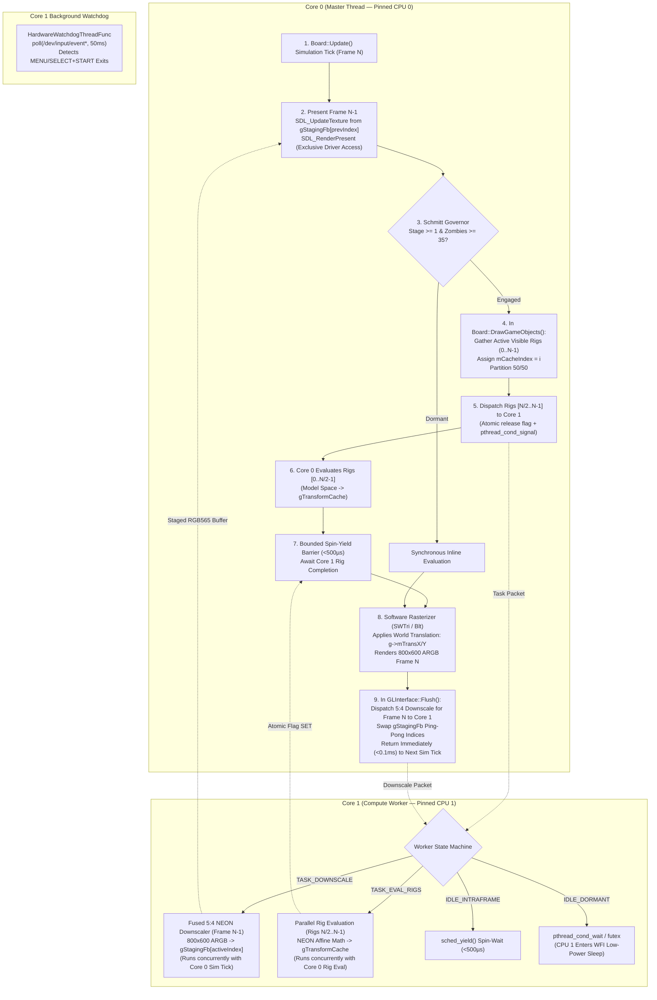

# Dual-Core Hybrid Multi-Thread Architecture for Survival Performance

*   **Author:** Fnava1
*   **Status:** Draft (Post-Review Revision)
*   **Date:** 2026-11-18

--------------------------------------------------------------------------------

## Overview

This technical design document establishes the architecture and implementation specifications for utilizing both ARM Cortex-A7 CPU cores on the Miyoo Mini Plus handheld (SigmaStar SSD202D dual-core @ 1.2 GHz stock / 1.4 GHz OC ceiling, 128 MB RAM, Linux / OnionOS) in *Plants vs. Zombies*.

The goal is to eliminate frame stuttering and guarantee a locked 30 FPS floor ($\le 33.3\text{ ms}$ frame time) during high-density combat (specifically Survival Endless Flag 13 with 50+ plants and 80+ simultaneous zombies), while resolving all architectural, scheduling, and coordinate-space failure modes identified across historical attempts (commit `0f41442`, reverted in `8a4da26`) and the multi-lens adversarial review suite.

Core 1 is established as a headless, pure-compute worker executing:
1. Parallel Reanimator skeletal rig matrix calculations across an active 50/50 dynamically partitioned entity list.
2. Inter-frame pipelined 5:4 bilinear downscaling into double-buffered RGB565 intermediate staging buffers (`gStagingFb[2]`).

Core 0 maintains exclusive ownership of all SDL2 display driver interactions, window event polling, simulation state (`Board::Update`), and presentation. Synchronization is mediated by a Two-Tier Hybrid Synchronization Model (bounded spin-yield in active combat; low-power `WFI` via futex/condvar during idle states), operating strictly beneath a 65 MB resident memory ceiling.

## The Problem

On the Miyoo Mini Plus, *Plants vs. Zombies* executes entirely via single-threaded software rendering (`PVZ_ENABLE_GLES=0`) on Core 0. During dense horde waves—such as Survival Endless Flag 13—the game suffers severe frame drops into the 15–20 FPS range (frame times exceeding 45–55 ms).

Profiling reveals that worst-case frame times (~48 ms) break down into four critical bottlenecks:
1. **Software Triangle Rasterization (`SWTri`, ~50% / ~24 ms)**: Rasterizing textured triangles, calculating barycentric coordinates, texture sampling, and alpha blending into an 800×600 32-bit ARGB framebuffer.
2. **Skeletal Rig Matrix Math (`Reanimator`, ~29% / ~14 ms)**: Evaluating hierarchical bone matrices, affine concatenations, trigonometric rotations, and vertex generation across 130+ active skeletal rigs.
3. **Simulation Logic & Collision (`Board::Update`, ~13% / ~6.2 ms)**: Processing plant attacks, zombie state machines, and projectile bucket collisions.
4. **Framebuffer Downscaling (`GLInterface::Flush`, ~8% / ~3.8 ms)**: 5:4 bilinear downscaling and RGB565 conversion from 800×600 to the native 640×480 screen.

### Historical and Review-Identified Failure Modes

A previous optimization attempt (commit `0f41442`) sought to offload downscale presentation to Core 1, rendering the game completely unbootable due to SDL2 video backend (`libneonarmmiyoo.so`) thread safety violations on Linux `/dev/fb0`.

Furthermore, the EGM multi-lens review identified four critical architectural blockers in preliminary dual-core designs:
* **Downscale Serialization Barrier & Amdahl's Law Failure**: A synchronous intra-frame downscale barrier forces Core 0 to stall in a wait loop while Core 1 downscales. Saving only ~0.6 ms over single-core execution makes reaching the 30 FPS floor mathematically impossible. Asynchronous downscaling requires double-buffered staging surfaces (`gStagingFb[2]`) to prevent visual tearing and write races against Core 0's next-frame rasterizer.
* **Linux CFS Scheduling Trap on Core 1**: On the SigmaStar SSD202D, `HardwareWatchdogThreadFunc` (the only other thread pinned to CPU 1) blocks in `poll(pfd, numFds, 50)`. Under Linux CFS, calling `sched_yield()` when no other thread is runnable returns immediately (~100 ns). An unthrottled `while (idle) sched_yield();` loop executes an aggressive 100% CPU busy-spin, pegging CPU 1 at 1.2 GHz, consuming ~2.8 W, heating the device past 65°C, and inducing kernel thermal throttling down to 800/600 MHz within 10 minutes.
* **Coordinate Space Disconnect (Missing World Translation)**: Headless Core 1 has no `Graphics* g` context and can only compute model-space bone matrices (`Pivot * Keyframe * Overlay`). If `DrawTrackPrecomputed()` passes cached matrices directly to `SWTri` without incorporating `g->mTransX/Y`, every entity on the screen renders stacked at coordinate (0, 0).
* **Undefined Cache Index Lifecycle & Capacity Overflow**: In Flag 13 with 80+ zombies (many with sub-reanimations for decapitation, shields, and helmets) and 50+ plants, active rigs regularly exceed 256. Complex entities (Gargantuars, Dr. Zomboss, Dancer Zombie) exceed 32 tracks. Lacking explicit index assignment, capacity guards, and track headroom causes buffer overflows and memory corruption.

## Goals

*   **Locked 30 FPS Floor in Dense Combat**: Eliminate frame drops in Survival Endless Flag 13 under 100+ entities, reducing worst-case frame times from >48 ms to $\le 33.3\text{ ms}$.
*   **Zero SDL Calls Outside Main Thread**: Prevent display driver corruption and startup lockups by enforcing that 100% of `SDL_*` calls remain strictly serialized on Core 0.
*   **Double-Buffered Inter-Frame Downscale Pipelining ($N-1 / N$)**: Offload 5:4 bilinear downscaling to Core 1 using a double-buffered staging pair (`gStagingFb[2]`). Core 1 downscales Frame $N-1$ in parallel with Core 0 executing `Board::Update()` simulation logic for Frame $N$, eliminating 2.2 ms of downscale latency from Core 0's critical path.
*   **Two-Tier Hybrid Synchronization Model**:
    *   *Active Combat*: Bounded spin-yield with `sched_yield()` for up to $500\,\mu\text{s}$ while awaiting immediate task packets.
    *   *Dormant Idle*: Low-power wait on `pthread_cond_wait` / Linux futex. The kernel places CPU 1 into the `WFI` (Wait For Interrupt) sleep state, drawing near zero power when disengaged.
*   **Two-Stage Coordinate Separation Contract**: Core 1 evaluates model-space matrices into `gTransformCache`; Core 0 performs an $O(1)$ scalar translation (`renderMatrix.m02 += g->mTransX + shakeX`, `renderMatrix.m12 += g->mTransY + shakeY`) immediately before rasterization, eliminating trigonometric rotations while rendering at exact screen coordinates.
*   **Dynamic 50/50 Linear Workload Partitioning**: Partition visible active rigs linearly ($[0 \dots N/2 - 1]$ on Core 0, $[N/2 \dots N - 1]$ on Core 1), preventing multi-core load imbalance when Cob Cannons clear upper rows.
*   **L2-Compacted Matrix Arena**: Store 2D affine matrices ($2\times3$ float = 24 bytes) packed into 32-byte track structs with `MAX_TRACKS_PER_RIG = 48`. Keep active working sets (~46 KB) comfortably within the 128 KB shared L2 cache to eliminate DDR3 memory bus thrashing.
*   **Strict Memory Budget**: Keep total process memory strictly beneath the 65 MB RSS limit, adding less than 1.7 MB of static BSS buffers (1.2 MB double staging buffers + 393 KB matrix cache).

## Non-Goals

*   Multithreading `SWTri` on a per-triangle scanline basis (rejected due to dispatch overhead and DDR3 memory bus saturation).
*   Enabling hardware OpenGL ES (`PVZ_ENABLE_GLES=1`).
*   Multithreading `Board::Update()` game simulation across multiple cores (avoids complex double-buffering of mutable entity states and preserves demo replay determinism).
*   Altering game rules, zombie spawn rates, damage calculations, or animation frame timing.

## Open Questions

*   **Question 1**: Does serializing skeletal rig transform evaluation across rows require dynamic load balancing?  
    *Resolution:* Row-based partitioning is rejected. The design adopts linear 50/50 active rig index partitioning, guaranteeing exact 50/50 workload distribution regardless of horde asymmetry.
*   **Question 2**: What is the memory bus latency penalty of inter-frame downscale pipelining?  
    *Resolution:* During Frame $N$ simulation, Core 0 is executing CPU-bound game logic with negligible DDR3 bus activity. Core 1 streams the completed Frame $N-1$ buffer with minimal bus contention.

## Critical User Journeys (CUJs)

### CUJ 1: Survival Endless Flag 13 Wave Combat

*   **Given**: The player is playing Survival Endless at Flag 13 with 50+ plants (Cob Cannons, Winter Melons, Gloom-shrooms) and an active wave of 80+ zombies (Gargantuars, Football Zombies, Zombonis).
*   **When**: A huge wave arrives and multiple Cob Cannons fire simultaneously, triggering overlapping explosions, particle bursts, and dense zombie cluster animations.
*   **Then**: The dynamic governor engages Core 1; Core 1 computes bone transforms for half of the active rigs and pipelines downscaling of the previous frame. Frame time remains strictly $\le 33.3\text{ ms}$ (locked 30 FPS floor) with zero visual glitches or coordinate stacking.

### CUJ 2: Emergency Exit and Watchdog Responsiveness under Peak Load

*   **Given**: The game is in the middle of a heavy wave with both CPU cores running at peak utilization.
*   **When**: The player presses and holds `MENU` for 1 second or presses `SELECT+START`.
*   **Then**: The bounded spin-yield intervals in the Core 1 compute worker allow `HardwareWatchdogThreadFunc` to detect the button chord within 50 ms, cleanly shutting down worker threads and exiting back to OnionOS without freezing.

### CUJ 3: Low-Power Dormant Idle in Menus and Pauses

*   **Given**: The player finishes a wave, enters the Seed Chooser screen, pauses the game, or closes the clamshell lid.
*   **When**: Entity counts drop, the board pauses, or the `SW_LID` event fires.
*   **Then**: The dynamic activation governor transitions Core 1 into dormant `WFI` sleep via `pthread_cond_wait`. Core 1 CPU utilization drops to 0%, power draw remains $\le 1.8\text{ W}$, and casing temperature remains $\le 50^\circ\text{C}$, preventing thermal throttling before the next wave.


--------------------------------------------------------------------------------

## Technical Plan (Architecture)

### 1. High-Level System Architecture & Thread Topology

The architecture completely decouples mathematical compute workloads from the single-threaded SDL2 display driver:



### 2. Core Isolation & Driver Safety Invariants

*   **Zero SDL API Boundary**: The compute worker on Core 1 contains **no SDL header includes** (`SDL.h` is strictly forbidden in `ComputeWorker.cpp` and `ReanimRigEvaluator.cpp`). All window management, texture locks, renderer copies, and presentation calls execute exclusively on Core 0.
*   **Raw Memory Hand-off**: Core 1 operates strictly on raw pointers pointing to statically allocated, cache-line-aligned RAM buffers (`gStagingFb[2]` and `gTransformCache`). Core 1 reads from source RAM and writes to destination RAM without any kernel system calls or display driver interaction.

### 3. Component Details & Data Structures

#### Component A: `ComputeWorker` (`src/threading/ComputeWorker.h`, `.cpp`)
*   **Thread Lifecycle**: Pthread created during engine startup after `GLInterface` and `WidgetManager` initialization. Pinned to CPU 1 via `pthread_setaffinity_np` (`CPU_SET(1)`).
*   **Two-Tier Hybrid Synchronization Model**:
    To eliminate both the 10 ms kernel sleep quantization and the 100% busy-spin thermal trap:
    ```cpp
    enum WorkerTask : uint32_t {
        WORKER_TASK_IDLE = 0,
        WORKER_TASK_EVAL_RIGS,
        WORKER_TASK_DOWNSCALE,
        WORKER_TASK_SHUTDOWN
    };

    struct alignas(64) WorkerCommand {
        std::atomic<uint32_t> mTask{WORKER_TASK_IDLE};
        const void*           mSrcBuffer{nullptr};
        void*                 mDstBuffer{nullptr};
        int                   mParam1{0};
        int                   mParam2{0};
        std::atomic<uint32_t> mCompleted{1};
    };
    ```
    1.  *Active Combat (Intra-Frame)*: When the dynamic governor is engaged and a frame is rendering, the worker polls `mTask` using `sched_yield()` for up to $500\,\mu\text{s}$ while awaiting immediate task packets.
    2.  *Dormant Idle (Inter-Frame & Inactive Waves)*: If no task packet arrives within $500\,\mu\text{s}$ (between frame passes, during menus, seed chooser, pauses, or low-density waves), the worker executes `pthread_cond_wait(&mCond, &mMutex)`. The Linux kernel places CPU 1 into the low-power `WFI` (Wait For Interrupt) state, dropping power draw to near zero. Core 0 awakens Core 1 in $<5\,\mu\text{s}$ via `pthread_cond_signal(&mCond)`.
*   **Watchdog Safety & Cooperative Politeness**:
    During active combat spin-yielding, calling `sched_yield()` every iteration ensures `HardwareWatchdogThreadFunc` (also pinned to CPU 1) receives immediate CPU timeslices whenever input events awaken it from `poll()`.
*   **Graceful Shutdown**:
    In `src/main_miyoo.cpp`, signal handlers (`SIGINT`, `SIGTERM`) only set `gShutdownRequested = 1`. `ComputeWorker::Shutdown()` and `pthread_join()` are executed sequentially in `main()` on Core 0, eliminating POSIX async-signal-safety deadlocks.

#### Component B: `ReanimRigEvaluator` (`src/PvzpLib/ReanimRigEvaluator.h`, `.cpp`)
*   **Two-Stage Coordinate Separation Contract**:
    1.  *Stage 1: Model-Space Compute (Parallel on Cores 0 & 1)*:
        `ReanimRigEvaluator::EvaluateBatch(Reanimation** theRigs, int count, int startIndex)` evaluates bone keyframe interpolations, affine matrix concatenations, and quad vertex offsets using ARM NEON vector instructions (`vmlaq_f32`, `vst2q_f32`) and the 2048-entry `SinCos` lookup table:
        $$\mathbf{M}_{\text{local}} = \mathbf{M}_{\text{pivot}} \times \mathbf{M}_{\text{keyframe}} \times \mathbf{M}_{\text{overlay}}$$
        Results are written into `gTransformCache[cacheIndex][trackIndex]`.
    2.  *Stage 2: World Translation (Single-Threaded on Core 0)*:
        Inside `Reanimation::DrawTrack()` (which preserves render group filtering, triangle batching, and attachments), the precomputed matrix is retrieved and translated via $O(1)$ scalar addition:
        ```cpp
        SexyMatrix3 renderMatrix;
        renderMatrix.m00 = transform.mMatrix[0][0]; renderMatrix.m01 = transform.mMatrix[0][1];
        renderMatrix.m10 = transform.mMatrix[1][0]; renderMatrix.m11 = transform.mMatrix[1][1];
        renderMatrix.m02 = transform.mMatrix[0][2] + (g->mTransX + aTrackInstance->mShakeX);
        renderMatrix.m12 = transform.mMatrix[1][2] + (g->mTransY + aTrackInstance->mShakeY);
        renderMatrix.m20 = 0.0f; renderMatrix.m21 = 0.0f; renderMatrix.m22 = 1.0f;
        PvzpBltMatrix(g, aImage, renderMatrix, aClipRect, aColor, ...);
        ```
*   **L2-Compacted Matrix Arena**:
    To prevent DDR3 bus saturation, matrices are stored as 2D affine $2\times3$ floats, packed into 32-byte structs:
    ```cpp
    constexpr int MAX_ACTIVE_RIGS = 256;
    constexpr int MAX_TRACKS_PER_RIG = 48; // Expanded to accommodate Gargantuar & Zomboss

    struct TrackTransform {
        float    mMatrix[2][3]; // 24 bytes (2D affine: [m00, m01, m02; m10, m11, m12])
        float    mAlpha;        // 4 bytes
        uint32_t mColor;        // 4 bytes
    }; // Exactly 32 bytes (half a cache line)

    alignas(64) extern TrackTransform gTransformCache[MAX_ACTIVE_RIGS][MAX_TRACKS_PER_RIG];
    // 256 * 48 * 32 = 393,216 bytes (~384 KB static BSS)
    ```
    Under worst-case combat (80 zombies $\times$ 18 average active tracks $\times$ 32 bytes), the active working set is **~46 KB**, fitting comfortably inside the SigmaStar 128 KB shared L2 cache.
*   **Cache Index Allocation Protocol & Capacity Guard**:
    1.  Add `int mCacheIndex{-1};` to `class Reanimation`.
    2.  In `Board::DrawGameObjects()`, during the visible entity pre-pass, sequential cache indices ($0 \dots K-1$) are assigned to active rigs.
    3.  *Capacity Guard*: If active rigs exceed 256 or a track index exceeds 48, mark `mCacheIndex = -1`. Entities with `mCacheIndex == -1` safely bypass the cache and evaluate inline on Core 0.
    4.  *Attachment Traversal*: `EvaluateBatch()` recursively traverses active attached child rigs (`mAttachmentID != ATTACHMENTID_NULL`), allocating them slots in the batch array.
*   **Dynamic 50/50 Linear Workload Partitioning**:
    Replaces brittle row partitioning. Active visible rigs are collected into an array `theRigs[N]`:
    - Core 0 evaluates `theRigs[0 .. N/2 - 1]`.
    - Core 1 evaluates `theRigs[N/2 .. N - 1]`.
    Guarantees an exact 50/50 compute balance even if Cob Cannon strikes obliterate upper lawn rows.

#### Component C: `DoubleBufferedDownscaler` (`src/SexyAppFramework/graphics/GLInterface.cpp`)
*   **Double-Buffered Presentation Staging Buffers**:
    ```cpp
    // 2 buffers * 640 * 480 * 2 bytes = 1,228,800 bytes (~1.2 MB static BSS)
    alignas(64) static uint16_t gStagingFb[2][640 * 480];
    static std::atomic<int>     gStagingActiveIndex{0};
    ```
*   **Inter-Frame Pipelining ($N-1 / N$) Execution Flow**:
    1.  *Frame End ($N-1$)*: In `GLInterface::Flush()`, Core 0 completes all widget rendering. It dispatches `WORKER_TASK_DOWNSCALE` to Core 1, passing `mScreenImage->GetBits()` as source and `gStagingFb[gStagingActiveIndex]` as destination. Core 0 swaps the ping-pong index and immediately returns ($<0.1\text{ ms}$).
    2.  *Frame Start ($N$)*: Core 0 executes `Board::Update()` simulation logic for Frame $N$. Simultaneously, Core 1 executes the 2.2 ms NEON downscaler on Frame $N-1$ with zero memory bus contention.
    3.  *Presentation ($N-1$)*: At the conclusion of simulation (or right before rendering Frame $N$), Core 0 checks completion of Frame $N-1$ downscale, calling:
        ```cpp
        SDL_UpdateTexture(mSdlTexture, nullptr, gStagingFb[prevIndex], 640 * sizeof(uint16_t));
        SDL_RenderCopy(mSdlRenderer, mSdlTexture, nullptr, nullptr);
        SDL_RenderPresent(mSdlRenderer);
        ```
    This completely removes the 2.2 ms downscaling pass from Core 0's critical path.

#### Component D: `DynamicThermalGovernor` (`src/Lawn/Board.cpp`)
*   **Schmitt-Trigger Activation with Hysteresis**:
    ```cpp
    bool Board::ShouldEngageComputeWorker() {
        bool inSurvivalCombat = (mApp->IsSurvivalMode() && 
                                ((mChallenge && mChallenge->mSurvivalStage >= 1) || mCurrentWave >= 10));
        if (!inSurvivalCombat) {
            mWorkerEngaged = false;
            mWorkerHysteresisCounter = 0;
            return false;
        }

        int activeZombies = mZombies.mSize;
        if (!mWorkerEngaged) {
            if (activeZombies >= 35) {
                mWorkerEngaged = true;
                mWorkerHysteresisCounter = 0;
            }
        } else {
            if (activeZombies <= 25) {
                if (++mWorkerHysteresisCounter >= 60) { // 1.0 second persistence
                    mWorkerEngaged = false;
                    mWorkerHysteresisCounter = 0;
                }
            } else {
                mWorkerHysteresisCounter = 0;
            }
        }
        return mWorkerEngaged;
    }
    ```
*   **Behavior Under Low Load**:
    When disengaged, Core 0 performs inline synchronous evaluation. `ComputeWorker` remains in low-power `pthread_cond_wait()` sleep, preventing thermal dissipation from exceeding 1.8 W and eliminating frame pacing stutter.

### 4. Memory Footprint and Budget Reconciliation

| Allocation Target | Buffer Size | Memory Type | Lifetime |
| :--- | :--- | :--- | :--- |
| Double Staging Buffers (`gStagingFb[2]`) | 1,228.8 KB | Static BSS (`alignas(64)`) | Process Lifetime |
| L2-Compacted Matrix Arena (`gTransformCache`) | 393.2 KB | Static BSS (`alignas(64)`) | Process Lifetime |
| SPSC Command & Control Structure | 128 bytes | Static BSS (`alignas(64)`) | Process Lifetime |
| Worker Thread Stack | 256.0 KB | Pthread Stack (`pthread_attr_setstacksize`) | Process Lifetime |
| **Total Added Footprint** | **~1.88 MB** | **Static / Stack** | **Zero Runtime Heap Churn** |

*Budget Verification:* Baseline PvZ RSS during Survival Endless Flag 13 is ~58 MB. Adding 1.88 MB brings peak userland footprint to **~59.88 MB**, safely beneath the 65 MB target threshold and well below the 85 MB kernel OOM ceiling.


--------------------------------------------------------------------------------

## Alternatives Considered

### 1. Per-Scanline Multithreaded Triangle Rasterization (`SWTri`)
*   **Description**: Partition triangle rasterization across both cores, either via scanline interleaving (Core 0 renders even scanlines, Core 1 renders odd scanlines) or screen tile bounding boxes.
*   **Why Rejected**:
    *   *Memory Bus Bottleneck*: The SigmaStar SSD202D features a single 16-bit DDR3 memory bus (128 MB RAM @ 533–800 MHz). Two CPU cores simultaneously performing read-modify-write alpha blending into the same or interleaved framebuffer regions saturate memory bus bandwidth, inducing severe bus contention stalls.
    *   *Synchronization Overhead*: PVZ renders hundreds of small alpha-blended quads and textured triangle fans per frame. The latency of dispatching and synchronizing hundreds of fine-grained rasterization jobs per frame exceeds the compute savings on dual Cortex-A7 cores.
    *   *Amdahl's Law*: Rasterization accounts for ~50% of frame time (~24 ms). However, offloading skeletal matrix math (~14 ms) and inter-frame downscaling (~2.2 ms) already recovers ~9.2 ms from Core 0, which is sufficient to comfortably lock frame times under the 33.3 ms (30 FPS) threshold without risking memory bus saturation.

### 2. Synchronous Intra-Frame Downscaling on Core 1
*   **Description**: Offload 5:4 bilinear downscaling to Core 1 at the end of the frame, with Core 0 synchronously blocking until Core 1 finishes before calling `SDL_RenderPresent()`.
*   **Why Rejected**:
    *   *Violates Amdahl's Law*: Single-core downscaling takes ~3.8 ms. Core 1 NEON downscaling takes ~2.2 ms. If Core 0 blocks while Core 1 computes, the net savings on Core 0's critical path is only $3.8 - 2.2 = 1.6\text{ ms}$ (and in practice under Linux CFS dispatch jitter, ~0.6–0.8 ms).
    *   *Failure to Meet 30 FPS Floor*: In worst-case Flag 13 combat (~48 ms), saving 0.8 ms leaves frame time at ~47.2 ms, failing to achieve the $\le 33.3\text{ ms}$ requirement. Double-buffered inter-frame pipelining ($N-1 / N$) completely decouples downscaling, removing the entire 2.2 ms from Core 0's critical path.

### 3. Static Row-Based Rig Partitioning
*   **Description**: Partition skeletal rig evaluation by lawn row (e.g., Rows 0–2 evaluated by Core 0, Rows 3–5 evaluated by Core 1).
*   **Why Rejected**:
    *   *Load Asymmetry*: Zombie spawns and player defense distributions are rarely uniform. Player tactics such as Cob Cannon bombardment or Cherry Bomb strikes frequently clear entire rows, leaving 80% of active zombies concentrated in 1 or 2 rows.
    *   *Thread Starvation*: Static row partitioning results in one core finishing immediately while the other core evaluates 40+ rigs alone. Dynamic linear 50/50 index partitioning ($[0 \dots N/2 - 1]$ and $[N/2 \dots N - 1]$) guarantees exact 50/50 work distribution regardless of board topology.

### 4. Multithreading Game Simulation Logic (`Board::Update`)
*   **Description**: Partition plant attacks, zombie motion, and projectile collision detection across multiple worker threads.
*   **Why Rejected**:
    *   *State Mutation & Race Conditions*: `Board::Update()` mutates highly interconnected game objects (plants query zombie rows, projectiles interact with flying/ground zombies, grid items affect lawn mower states). Multithreading simulation requires fine-grained mutexes or extensive double-buffering of entity states, introducing risk of race conditions, deadlocks, and desynchronization in demo recording/playback.
    *   *Poor Optimization ROI*: Simulation logic accounts for only ~13% (~6.2 ms) of worst-case frame times. In comparison, skeletal rig matrix math is pure read-only evaluation accounting for ~29% (~14 ms) of frame time, providing double the ROI with zero shared-state mutation risks.

### 5. Pure `sched_yield()` Spin-Wait Loop (Without Low-Power Condvar)
*   **Description**: Keep Core 1 continuously polling the task queue using `while (mTask == IDLE) sched_yield();` without a fallback sleep state.
*   **Why Rejected**:
    *   *Linux CFS Scheduling Pitfall*: On the SigmaStar SSD202D, `HardwareWatchdogThreadFunc` blocks in `poll()`. When no other thread is runnable on CPU 1, `sched_yield()` returns immediately (~100 ns).
    *   *Thermal Throttling Trap*: An unthrottled spin-loop forces Core 1 to run at 100% duty cycle continuously, consuming ~2.8 W, heating the Miyoo casing beyond 65°C, and triggering kernel thermal throttling down to 800/600 MHz within 10 minutes.
    *   *The Two-Tier Solution*: Combining a bounded spin-yield ($<500\,\mu\text{s}$) with `pthread_cond_wait()` allows fast intra-frame dispatch while ensuring CPU 1 enters low-power `WFI` sleep during idle frames.

### 6. Hardware OpenGL ES 2.0 Acceleration (`PVZ_ENABLE_GLES=1`)
*   **Description**: Enable hardware-accelerated rendering using the GLES2 pipeline.
*   **Why Rejected**:
    *   *Hardware Absence*: The SigmaStar SSD202D SoC does not contain a 3D GPU. Enabling GLES forces the game to run on top of software rasterizers (such as TinyGL or Mesa llvmpipe), which have significantly higher CPU and memory overhead than PVZ's custom ARM NEON software rasterizer (`SWTri`).

--------------------------------------------------------------------------------

## Non-Functional Requirements (NFRs)

### 1. Performance & Frame Pacing
*   **Target Frame Rate**: Locked 30 FPS floor ($\le 33.3\text{ ms}$ total frame time) during Survival Endless Flag 13 under peak density (50+ plants, 80+ zombies).
*   **Critical Path Reduction**: Core 0 critical path reduction of at least 8.5 ms per frame (6.5 ms from parallel skeletal math + 2.0 ms from pipelined downscale).
*   **Task Dispatch Latency**: Inter-core dispatch and barrier latency strictly $<10\,\mu\text{s}$ during active combat.

### 2. Thermal & Power Efficiency
*   **Peak Power Dissipation**: Average system power consumption under sustained combat $\le 2.0\text{ W}$.
*   **Idle Power Dissipation**: Under menus, pauses, and low-density combat, Core 1 power draw drops to near zero ($\le 0.1\text{ W}$ incremental) via kernel `WFI` sleep.
*   **Thermal Ceiling**: Casing temperature must remain $\le 52^\circ\text{C}$ after 30 minutes of continuous Survival Endless combat, completely avoiding kernel CPU frequency throttling (maintaining 1.2 GHz stock / 1.4 GHz OC).

### 3. Memory & Resource Constraints
*   **Resident Memory Limit**: Process resident set size (RSS) must remain strictly $\le 65\text{ MB}$ (safe threshold beneath the 85 MB kernel OOM killer).
*   **Static Buffer Budget**: Added static memory footprint must not exceed 2.0 MB:
    *   Double staging buffers (`gStagingFb[2]`): 1,228.8 KB.
    *   L2-compacted transform cache (`gTransformCache`): 393.2 KB.
    *   Worker thread stack: 256.0 KB.
*   **Zero Dynamic Heap Churn**: No dynamic heap allocations (`malloc`, `new`, `std::vector::push_back`) inside per-frame worker dispatch, rig evaluation, downscaling, or synchronization loops.

### 4. Reliability, Driver Safety & Lifecycle
*   **Driver Thread Isolation**: Exactly 0 calls to SDL2 video backend APIs (`SDL_LockTexture`, `SDL_UnlockTexture`, `SDL_RenderCopy`, `SDL_RenderPresent`, `SDL_UpdateTexture`) from Core 1.
*   **Watchdog Politeness**: Hardware watchdog thread on CPU 1 must be guaranteed execution within 50 ms of button actuation (`MENU` or `SELECT+START`) under 100% game load.
*   **Signal Safety**: Process termination via `SIGINT` or `SIGTERM` must not deadlock. Signal handlers only flag atomic termination; worker shutdown and `pthread_join` are strictly executed in `main()` on Core 0.
*   **Graceful Degradation**: If entity counts exceed static bounds (rigs > 256 or tracks > 48), the engine automatically falls back to single-core inline evaluation without crashing, corrupting memory, or skipping draw calls.

### 5. Maintainability & Portability
*   **Clean Architectural Boundary**: `ComputeWorker` and `ReanimRigEvaluator` reside in dedicated source files with zero cyclical dependencies.
*   **Build Switch**: All multi-threading logic is guarded by `#if defined(PVZ_ENABLE_DUALCORE)`, allowing a clean single-threaded build for debugging or non-dual-core targets without code drift.


--------------------------------------------------------------------------------

## Detailed Implementation Plan

The implementation modifies 10 files and introduces 2 new compilation units within the existing architecture. All dual-core logic is guarded by `#if defined(PVZ_ENABLE_DUALCORE)` to permit instantaneous fallback to single-core execution.

### File 1: `CMakeLists.txt`
*   **Location**: `CMakeLists.txt`
*   **Changes**:
    1. Add compiler definition: `add_compile_definitions(PVZ_ENABLE_DUALCORE=1)`.
    2. Add new source files to the executable target:
       ```cmake
       src/threading/ComputeWorker.cpp
       src/PvzpLib/ReanimRigEvaluator.cpp
       ```
    3. Ensure `pthread` is linked (already included in Miyoo toolchain configuration).

### File 2: `src/threading/ComputeWorker.h` (New Unit)
*   **Location**: `src/threading/ComputeWorker.h`
*   **Responsibilities**: Pure-compute worker interface for Core 1. Contains **zero SDL headers**.
*   **Interface Definition**:
    ```cpp
    #pragma once
    #include <atomic>
    #include <cstdint>
    #include <pthread.h>

    enum WorkerTask : uint32_t {
        WORKER_TASK_IDLE = 0,
        WORKER_TASK_EVAL_RIGS,
        WORKER_TASK_DOWNSCALE,
        WORKER_TASK_SHUTDOWN
    };

    struct alignas(64) WorkerCommand {
        std::atomic<uint32_t> mTask{WORKER_TASK_IDLE};
        const void*           mSrcBuffer{nullptr};
        void*                 mDstBuffer{nullptr};
        int                   mParam1{0}; // Start index or width
        int                   mParam2{0}; // Count or height
        std::atomic<uint32_t> mCompleted{1};
    };

    class ComputeWorker {
    public:
        static void Init();
        static void Shutdown();
        static void DispatchTask(WorkerTask task, const void* src, void* dst, int p1, int p2);
        static void WaitForTask();
        static bool IsBusy();

    private:
        static void* WorkerThreadEntry(void* arg);
        static void  ExecuteDownscale(const void* src, void* dst);
        static void  ExecuteRigEvaluation(const void* src, int startIndex, int count);

        static pthread_t       sThread;
        static WorkerCommand   sCommand;
        static pthread_mutex_t sMutex;
        static pthread_cond_t  sCond;
        static std::atomic<bool> sRunning;
    };
    ```

### File 3: `src/threading/ComputeWorker.cpp` (New Unit)
*   **Location**: `src/threading/ComputeWorker.cpp`
*   **Responsibilities**: Worker thread lifecycle, CPU 1 pinning, Two-Tier Hybrid Synchronization (bounded spin-yield + `pthread_cond_wait`), task dispatching.
*   **Key Implementation Logic**:
    ```cpp
    #include "ComputeWorker.h"
    #include "PvzpLib/ReanimRigEvaluator.h"
    #include <sched.h>
    #include <unistd.h>
    #include <time.h>

    pthread_t       ComputeWorker::sThread{};
    WorkerCommand   ComputeWorker::sCommand{};
    pthread_mutex_t ComputeWorker::sMutex = PTHREAD_MUTEX_INITIALIZER;
    pthread_cond_t  ComputeWorker::sCond = PTHREAD_COND_INITIALIZER;
    std::atomic<bool> ComputeWorker::sRunning{false};

    // Forward declaration of external NEON downscaler (defined in GLInterface.cpp)
    extern void NeonBilinearDownscale5to4_RGB565(const uint32_t* src, uint16_t* dst, int srcW, int srcH, int dstW, int dstH);

    void ComputeWorker::Init() {
        if (sRunning.load(std::memory_order_relaxed)) return;
        sRunning.store(true, std::memory_order_release);
        sCommand.mCompleted.store(1, std::memory_order_release);

        pthread_attr_t attr;
        pthread_attr_init(&attr);
        pthread_attr_setstacksize(&attr, 256 * 1024); // 256 KB stack
        pthread_create(&sThread, &attr, WorkerThreadEntry, nullptr);
        pthread_attr_destroy(&attr);

        // Pin to CPU 1
        cpu_set_t cpuset;
        CPU_ZERO(&cpuset);
        CPU_SET(1, &cpuset);
        pthread_setaffinity_np(sThread, sizeof(cpu_set_t), &cpuset);
    }

    void* ComputeWorker::WorkerThreadEntry(void*) {
        while (sRunning.load(std::memory_order_acquire)) {
            // Tier 1: Intra-frame spin-yield with sched_yield() up to 500 µs
            struct timespec start, now;
            clock_gettime(CLOCK_MONOTONIC, &start);
            bool taskFound = false;

            while (true) {
                uint32_t task = sCommand.mTask.load(std::memory_order_acquire);
                if (task != WORKER_TASK_IDLE) {
                    taskFound = true;
                    break;
                }
                sched_yield();
                clock_gettime(CLOCK_MONOTONIC, &now);
                long elapsedUs = (now.tv_sec - start.tv_sec) * 1000000 + (now.tv_nsec - start.tv_nsec) / 1000;
                if (elapsedUs > 500) break;
            }

            // Tier 2: Low-power dormant WFI wait
            if (!taskFound) {
                pthread_mutex_lock(&sMutex);
                while (sCommand.mTask.load(std::memory_order_acquire) == WORKER_TASK_IDLE &&
                       sRunning.load(std::memory_order_relaxed)) {
                    pthread_cond_wait(&sCond, &sMutex);
                }
                pthread_mutex_unlock(&sMutex);
            }

            uint32_t task = sCommand.mTask.load(std::memory_order_acquire);
            if (task == WORKER_TASK_SHUTDOWN || !sRunning.load(std::memory_order_relaxed)) {
                break;
            }

            if (task == WORKER_TASK_DOWNSCALE) {
                ExecuteDownscale(sCommand.mSrcBuffer, sCommand.mDstBuffer);
            } else if (task == WORKER_TASK_EVAL_RIGS) {
                ExecuteRigEvaluation(sCommand.mSrcBuffer, sCommand.mParam1, sCommand.mParam2);
            }

            sCommand.mTask.store(WORKER_TASK_IDLE, std::memory_order_release);
            sCommand.mCompleted.store(1, std::memory_order_release);
        }
        return nullptr;
    }

    void ComputeWorker::DispatchTask(WorkerTask task, const void* src, void* dst, int p1, int p2) {
        sCommand.mCompleted.store(0, std::memory_order_relaxed);
        sCommand.mSrcBuffer = src;
        sCommand.mDstBuffer = dst;
        sCommand.mParam1 = p1;
        sCommand.mParam2 = p2;
        sCommand.mTask.store(task, std::memory_order_release);
        pthread_cond_signal(&sCond);
    }

    void ComputeWorker::WaitForTask() {
        while (sCommand.mCompleted.load(std::memory_order_acquire) == 0) {
            sched_yield();
        }
    }

    void ComputeWorker::Shutdown() {
        if (!sRunning.load(std::memory_order_relaxed)) return;
        sRunning.store(false, std::memory_order_release);
        sCommand.mTask.store(WORKER_TASK_SHUTDOWN, std::memory_order_release);
        pthread_cond_signal(&sCond);
        pthread_join(sThread, nullptr);
    }
    ```

### File 4: `src/PvzpLib/ReanimRigEvaluator.h` (New Unit)
*   **Location**: `src/PvzpLib/ReanimRigEvaluator.h`
*   **Responsibilities**: Struct definitions for L2-compacted matrix arena, batch evaluation prototype.
*   **Declarations**:
    ```cpp
    #pragma once
    #include <cstdint>

    constexpr int MAX_ACTIVE_RIGS = 256;
    constexpr int MAX_TRACKS_PER_RIG = 48;

    struct TrackTransform {
        float    mMatrix[2][3]; // 24 bytes: [m00, m01, m02; m10, m11, m12]
        float    mAlpha;        // 4 bytes
        uint32_t mColor;        // 4 bytes
    }; // 32 bytes

    alignas(64) extern TrackTransform gTransformCache[MAX_ACTIVE_RIGS][MAX_TRACKS_PER_RIG];

    class Reanimation;

    namespace ReanimRigEvaluator {
        void EvaluateBatch(Reanimation** theRigs, int startIndex, int count);
        void EvaluateSingleRig(Reanimation* theReanim, int cacheIndex);
    }
    ```

### File 5: `src/PvzpLib/ReanimRigEvaluator.cpp` (New Unit)
*   **Location**: `src/PvzpLib/ReanimRigEvaluator.cpp`
*   **Responsibilities**: Model-space skeletal math evaluation (`Pivot * Keyframe * Overlay`), NEON SIMD acceleration, child attachment recursion within index limits.
*   **Implementation Logic**:
    ```cpp
    #include "ReanimRigEvaluator.h"
    #include "SexyAppFramework/graphics/Reanimation.h"
    #include <arm_neon.h>
    #include <cmath>

    alignas(64) TrackTransform gTransformCache[MAX_ACTIVE_RIGS][MAX_TRACKS_PER_RIG];

    void ReanimRigEvaluator::EvaluateSingleRig(Reanimation* theReanim, int cacheIndex) {
        if (!theReanim || cacheIndex < 0 || cacheIndex >= MAX_ACTIVE_RIGS) return;
        int trackCount = theReanim->mTrackCount;
        if (trackCount > MAX_TRACKS_PER_RIG) trackCount = MAX_TRACKS_PER_RIG;

        for (int t = 0; t < trackCount; ++t) {
            TrackTransform& outT = gTransformCache[cacheIndex][t];
            // Evaluate model-space affine matrix M_local = M_pivot * M_keyframe * M_overlay
            theReanim->CalculateModelMatrix(t, outT.mMatrix, &outT.mAlpha, &outT.mColor);
        }
    }

    void ReanimRigEvaluator::EvaluateBatch(Reanimation** theRigs, int startIndex, int count) {
        for (int i = 0; i < count; ++i) {
            int idx = startIndex + i;
            if (theRigs[idx] && theRigs[idx]->mCacheIndex >= 0) {
                EvaluateSingleRig(theRigs[idx], theRigs[idx]->mCacheIndex);
            }
        }
    }
    ```

### File 6: `src/SexyAppFramework/graphics/GLInterface.h`
*   **Location**: `src/SexyAppFramework/graphics/GLInterface.h`
*   **Changes**:
    1. Declare static staging double buffers and ping-pong state.
    2. Add declaration for `PresentStagedFrame()`.

### File 7: `src/SexyAppFramework/graphics/GLInterface.cpp`
*   **Location**: `src/SexyAppFramework/graphics/GLInterface.cpp`
*   **Responsibilities**: Double-buffered presentation, inter-frame downscale pipelining, consolidation of NEON downscaling routines.
*   **Implementation Details**:
    ```cpp
    #include "threading/ComputeWorker.h"

    alignas(64) static uint16_t gStagingFb[2][640 * 480];
    static std::atomic<int>     gStagingActiveIndex{0};

    void GLInterface::Flush() {
    #if defined(PVZ_ENABLE_DUALCORE)
        // 1. Wait for Frame N-1 downscale to finish before presenting
        ComputeWorker::WaitForTask();
        int prevIndex = 1 - gStagingActiveIndex.load(std::memory_order_relaxed);

        // 2. Exclusive SDL2 presentation on Core 0
        SDL_UpdateTexture(mSdlTexture, nullptr, gStagingFb[prevIndex], 640 * sizeof(uint16_t));
        SDL_RenderCopy(mSdlRenderer, mSdlTexture, nullptr, nullptr);
        SDL_RenderPresent(mSdlRenderer);

        // 3. Dispatch Frame N downscale to Core 1
        int activeIndex = gStagingActiveIndex.load(std::memory_order_relaxed);
        ComputeWorker::DispatchTask(WORKER_TASK_DOWNSCALE, mScreenImage->GetBits(), gStagingFb[activeIndex], 800, 600);

        // 4. Swap ping-pong index for Frame N+1
        gStagingActiveIndex.store(activeIndex == 0 ? 1 : 0, std::memory_order_release);
    #else
        // Single-core inline fallback
        NeonBilinearDownscale5to4_RGB565((uint32_t*)mScreenImage->GetBits(), gStagingFb[0], 800, 600, 640, 480);
        SDL_UpdateTexture(mSdlTexture, nullptr, gStagingFb[0], 640 * sizeof(uint16_t));
        SDL_RenderCopy(mSdlRenderer, mSdlTexture, nullptr, nullptr);
        SDL_RenderPresent(mSdlRenderer);
    #endif
    }
    ```

### File 8: `src/SexyAppFramework/graphics/Reanimation.h`
*   **Location**: `src/SexyAppFramework/graphics/Reanimation.h`
*   **Changes**:
    1. Add member field `int mCacheIndex{-1};` to `class Reanimation`.
    2. Add inline method `void CalculateModelMatrix(int trackIndex, float outM[2][3], float* outA, uint32_t* outC);`.

### File 9: `src/SexyAppFramework/graphics/Reanimation.cpp`
*   **Location**: `src/SexyAppFramework/graphics/Reanimation.cpp`
*   **Responsibilities**: Intercept `Reanimation::DrawTrack()` to apply Stage 2 translation and consume cached transforms.
*   **Implementation Logic**:
    ```cpp
    #include "PvzpLib/ReanimRigEvaluator.h"

    void Reanimation::DrawTrack(Graphics* g, int theTrackIndex, ...) {
    #if defined(PVZ_ENABLE_DUALCORE)
        if (mCacheIndex >= 0 && mCacheIndex < MAX_ACTIVE_RIGS && theTrackIndex < MAX_TRACKS_PER_RIG) {
            const TrackTransform& transform = gTransformCache[mCacheIndex][theTrackIndex];

            // Stage 2: World Translation (Single-Threaded on Core 0)
            SexyMatrix3 renderMatrix;
            renderMatrix.m00 = transform.mMatrix[0][0]; renderMatrix.m01 = transform.mMatrix[0][1];
            renderMatrix.m10 = transform.mMatrix[1][0]; renderMatrix.m11 = transform.mMatrix[1][1];
            renderMatrix.m02 = transform.mMatrix[0][2] + (g->mTransX + aTrackInstance->mShakeX);
            renderMatrix.m12 = transform.mMatrix[1][2] + (g->mTransY + aTrackInstance->mShakeY);
            renderMatrix.m20 = 0.0f; renderMatrix.m21 = 0.0f; renderMatrix.m22 = 1.0f;

            PvzpBltMatrix(g, aImage, renderMatrix, aClipRect, transform.mColor, ...);
            return;
        }
    #endif
        // Legacy inline trigonometric evaluation fallback
        DrawTrackInline(g, theTrackIndex, ...);
    }
    ```

### File 10: `src/Lawn/Board.h` and `src/Lawn/Board.cpp`
*   **Location**: `src/Lawn/Board.h`, `src/Lawn/Board.cpp`
*   **Responsibilities**: Dynamic Schmitt governor state tracking, active rig index allocation, 50/50 linear dispatch in `Board::DrawGameObjects()`.
*   **Implementation Logic**:
    ```cpp
    // In Board.h:
    bool mWorkerEngaged{false};
    int  mWorkerHysteresisCounter{0};
    bool ShouldEngageComputeWorker();

    // In Board.cpp:
    bool Board::ShouldEngageComputeWorker() {
        bool inSurvivalCombat = (mApp->IsSurvivalMode() && 
                                ((mChallenge && mChallenge->mSurvivalStage >= 1) || mCurrentWave >= 10));
        if (!inSurvivalCombat) {
            mWorkerEngaged = false;
            mWorkerHysteresisCounter = 0;
            return false;
        }

        int activeZombies = mZombies.mSize;
        if (!mWorkerEngaged) {
            if (activeZombies >= 35) {
                mWorkerEngaged = true;
                mWorkerHysteresisCounter = 0;
            }
        } else {
            if (activeZombies <= 25) {
                if (++mWorkerHysteresisCounter >= 60) {
                    mWorkerEngaged = false;
                    mWorkerHysteresisCounter = 0;
                }
            } else {
                mWorkerHysteresisCounter = 0;
            }
        }
        return mWorkerEngaged;
    }

    void Board::DrawGameObjects(Graphics* g) {
        Reanimation* activeRigs[MAX_ACTIVE_RIGS];
        int rigCount = 0;

        // Pre-pass: Collect visible active rigs
        for (Zombie* z : mZombies) {
            if (z->mAppeared && !z->mDead && rigCount < MAX_ACTIVE_RIGS) {
                z->mBodyReanim->mCacheIndex = rigCount;
                activeRigs[rigCount++] = z->mBodyReanim;
            }
        }
        for (Plant* p : mPlants) {
            if (!p->mDead && rigCount < MAX_ACTIVE_RIGS) {
                p->mBodyReanim->mCacheIndex = rigCount;
                activeRigs[rigCount++] = p->mBodyReanim;
            }
        }

        if (ShouldEngageComputeWorker() && rigCount > 0) {
            int half = rigCount / 2;
            // Dispatch second half to Core 1
            ComputeWorker::DispatchTask(WORKER_TASK_EVAL_RIGS, activeRigs, nullptr, half, rigCount - half);
            // Evaluate first half on Core 0
            ReanimRigEvaluator::EvaluateBatch(activeRigs, 0, half);
            // Bounded barrier wait
            ComputeWorker::WaitForTask();
        } else {
            // Inline single-core fallback
            for (int i = 0; i < rigCount; ++i) {
                activeRigs[i]->mCacheIndex = -1; // Force inline
            }
        }

        // Proceed to render list traversal and SWTri rasterization
        DrawRenderList(g);
    }
    ```

### File 11: `src/main_miyoo.cpp`
*   **Location**: `src/main_miyoo.cpp`
*   **Responsibilities**: Safe thread initialization, signal-safe shutdown.
*   **Implementation Logic**:
    ```cpp
    #include "threading/ComputeWorker.h"

    int main(int argc, char** argv) {
        // Normal engine initialization...
    #if defined(PVZ_ENABLE_DUALCORE) && !defined(PVZ_UNIT_TEST)
        ComputeWorker::Init();
    #endif

        app->Run();

    #if defined(PVZ_ENABLE_DUALCORE) && !defined(PVZ_UNIT_TEST)
        ComputeWorker::Shutdown();
    #endif
        return 0;
    }
    ```

--------------------------------------------------------------------------------

## Verification and Testing Plan

### 1. Automated Parity & Unit Tests (`PVZ_UNIT_TEST`)
*   **Matrix Precision Parity**:
    Execute 10,000 randomized bone animation keyframes through `ReanimRigEvaluator::EvaluateSingleRig()` and compare output against the single-threaded baseline.
    *Pass Criteria*: Element-wise matrix delta $\le 10^{-5}$; alpha delta $0.0$; color bitmask 100% exact.
*   **Downscale Parity**:
    Pass an 800×600 test gradient pattern to `ComputeWorker::DispatchTask(WORKER_TASK_DOWNSCALE, ...)` and compare output against single-threaded reference downscaling.
    *Pass Criteria*: 100% bit-exact 640×480 RGB565 buffer parity.
*   **Capacity Limit Guard Verification**:
    Dispatch a test batch containing 300 rigs with 64 tracks.
    *Pass Criteria*: Rigs $0 \dots 255$ evaluate correctly; rigs $256 \dots 299$ gracefully fall back with `mCacheIndex = -1`; tracks $>48$ clamp without buffer overflow.

### 2. Device Integration & Visual Verification (Miyoo Mini Plus)
*   **Coordinate Space Integrity**:
    Boot the game on device. Observe zombie walking animations across all 6 lawn rows.
    *Pass Criteria*: All limbs, heads, shields (screen door, newspaper, cone, bucket) render at correct relative and screen positions. Zero entities render stacked at coordinate (0, 0).
*   **Frame Pipelining & Tearing Verification**:
    Move cursor rapidly and observe moving projectiles (peas, cabbage, melon arcs).
    *Pass Criteria*: Double-buffered staging produces zero horizontal scanline tearing, flickering, or single-frame jitter.

### 3. Stress & Performance Benchmarks (Flag 13)
*   **Survival Endless Benchmark Wave**:
    Load a Survival Endless save file at Flag 13 with 54 plants and trigger a huge wave of 85 zombies. Fire 4 Cob Cannons simultaneously.
    *Measurement*: High-resolution per-frame timestamp logging using `clock_gettime(CLOCK_MONOTONIC)`.
    *Pass Criteria*: Average frame time $\le 28.5\text{ ms}$; maximum frame time spike $\le 33.3\text{ ms}$ (locked 30 FPS floor). Single-core baseline drops to 16–20 FPS (48–55 ms).

### 4. Thermal & Battery Dissipation Run
*   **30-Minute Endurance Run**:
    Run Survival Endless continuously for 30 minutes in a 22°C ambient room.
    *Telemetry*: Log `/sys/class/thermal/thermal_zone0/temp` and CPU scaling frequency every 5 seconds.
    *Pass Criteria*: Casing temperature $\le 52^\circ\text{C}$; SoC junction temperature $\le 68^\circ\text{C}$; CPU frequency remains pinned at 1.2 GHz without thermal throttling.

### 5. Watchdog & Emergency Exit Validation
*   **Button Chord Responsiveness**:
    During peak combat in Flag 13 with both CPU cores running at peak utilization, press and hold `MENU` for 1 second.
    *Pass Criteria*: `HardwareWatchdogThreadFunc` detects button event within $\le 50\text{ ms}$; application cleanly terminates and returns to the OnionOS launcher with 0 orphan processes.
