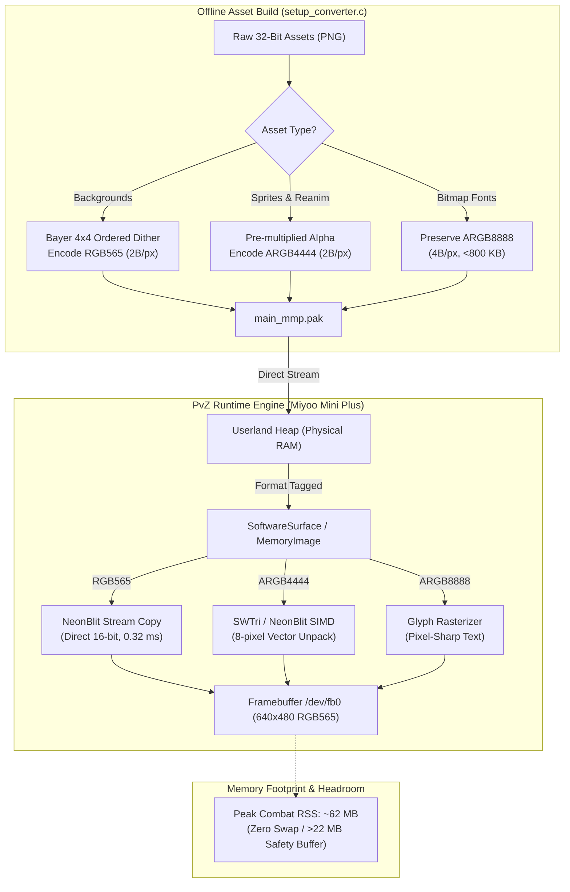

# 16-Bit Dual-Texture Architecture for Memory Stabilization

*   **Author:** Fnava1
*   **Status:** Proposed
*   **Date:** 2026-11-19

--------------------------------------------------------------------------------

## Overview

Plants vs. Zombies on the Miyoo Mini Plus handheld console (SigmaStar SSD202D SoC, 128 MB RAM, 640×480 3.5" IPS display) suffers from recurring out-of-memory (OOM) crashes during intense combat waves, level transitions, and combinatorial entity interactions (such as a Jalapeno detonating against a Zamboni). Under the current 32-bit texture pipeline (ARGB8888), active combat consumes ~78 MB Resident Set Size (RSS) against a rigid Linux kernel OOM killer threshold of ~82–85 MB, leaving a critical operating margin of less than 5 MB.

Because platform safety policies strictly prohibit swapfiles on the microSD card due to flash degradation and severe frame-time latency spikes, memory stability must be achieved through engine architecture. 

This design establishes a **16-Bit Dual-Texture Architecture** across the rendering and asset pipelines. By segregating textures by intrinsic visual properties—storing opaque backgrounds in 16-bit RGB565 and reanimation atlases and dynamic sprites in 16-bit pre-multiplied ARGB4444, while preserving bitmap fonts in 32-bit ARGB8888—texture memory is halved (~16 MB net reduction). Peak combat RSS decreases from ~78 MB to ~62 MB, establishing a permanent >22 MB safety cushion before kernel OOM intervention with zero swap dependence.

## The Problem

1. **The 4 MB Combat Cliff:**
   The game engine stores all textures internally as 32-bit ARGB8888 (`MemoryImage::mBits`), allocating 4 bytes per pixel. In active combat, textures consume ~32 MB of heap memory, driving steady-state RSS to ~78 MB. On the 128 MB Miyoo Mini Plus, userland applications are terminated by the kernel (`SIGKILL`) between 82 and 85 MB. The existing ~4–6 MB safety margin is fragile. Any unpredicted mid-combat asset instantiation (e.g., dynamically compiling a charred zombie atlas on explosive impact, sound buffer spikes, or glibc heap fragmentation) causes immediate game termination.

2. **Inviability of Tactical Point Fixes:**
   Patching individual asset loading sequences or unmapping specific dialogs only moves the point of failure. PvZ features 49 plants, 26 zombies, multiple death animations, projectile particle systems, and audio streams. In Survival and Puzzle game modes, the combinatorial state space is too vast to anticipate every dynamic allocation.

3. **Strict Ban on Swap / Virtual Memory on MicroSD:**
   While desktop platforms absorb allocation bursts using swap memory, swap is prohibited on the Miyoo Mini Plus. Flash writes to the FAT32/exFAT microSD card induce high I/O wait latency, causing severe frame drops (stuttering from 60 FPS down to 5–10 FPS) and accelerating NAND flash wear leading to SD card corruption. The game must run 100% in physical RAM.

4. **Hardware-Engine Bitdepth Mismatch:**
   The physical display buffer (`/dev/fb0`) is native 16-bit RGB565. Retaining internal textures in 32-bit ARGB8888 consumes double the required memory and doubles memory bus bandwidth consumption on the 16-bit DDR3 memory bus without delivering any visible display benefit.

## Goals

*   **Halve Texture Memory Footprint:** Reduce total texture RAM consumption from ~32 MB to ~16 MB by converting opaque backgrounds to RGB565 (2 bytes/pixel) and reanimation atlases and sprites to ARGB4444 (2 bytes/pixel).
*   **Expand Safety Headroom to >22 MB:** Lower peak combat RSS from ~78 MB down to ~62 MB, ensuring a minimum 20+ MB buffer below the 85 MB kernel OOM killer threshold.
*   **Eliminate Micro-Combat Allocation Crashes:** Prevent mid-combat crashes triggered by dynamic asset instantiations (such as charred zombie animations or sound streams) by ensuring sufficient resident headroom.
*   **Zero Swap Dependency:** Guarantee 100% in-RAM execution without mounting or touching swapfiles on the microSD card.
*   **Maintain Native 60 FPS Performance:** Exploit 16-bit memory bus bandwidth reductions (50% less read traffic) and ARM NEON SIMD vectorized unpack kernels to sustain 60.0 FPS frame delivery on the dual-core Cortex-A7 CPU.
*   **Preserve Visual Fidelity:** Prevent color banding on backgrounds using 4×4 Bayer matrix ordered dithering, eliminate silhouette halos using pre-multiplied alpha ($R' = (R \cdot A) / 15$), and exempt small bitmap fonts from down-quantization.

## Non-Goals

*   **No MicroSD Swap Memory:** Never create, mount, or fallback to disk-backed swapfiles or virtual partitions.
*   **No Resolution Downscaling:** Do not reduce the native 640×480 framebuffer resolution or render at sub-native scales.
*   **No Font Quantization:** Bitmap fonts (`data/fonts`) will NOT be down-quantized to 16-bit; they remain in 32-bit ARGB8888 to ensure maximum text sharpness on the 3.5" display.
*   **No Runtime Software PNG Quantization:** Do not convert 32-bit PNGs to 16-bit on the fly at level load time, as holding dual buffers in RAM produces transient memory allocation spikes. All 16-bit quantization is performed offline during package creation (`setup_converter.c`).
*   **No Audio Degradation:** Do not reduce audio sampling rates, channel counts, or tracker streaming buffers.

## Open Questions

*   **Question 1**: Does the existing `SpriteCachePool` require format adjustments, or should it continue operating as an independent 12 MB ARGB4444 arena alongside the 16-bit texture pipeline?
*   **Question 2**: Should large modal dialog backdrops (e.g., Almanac book pages, Options dialog) share the RGB565 direct blit path, or use ARGB4444 to accommodate drop shadows?

## Critical User Journeys (CUJs)

### CUJ 1: Explosive Combat on Zamboni (Jalapeno / Doom-shroom)
*   **Given**: Active Survival: Endless combat wave on Pool or Roof with multiple active zombies and heavy projectile volume, operating at ~62 MB RSS.
*   **When**: The player plants a Jalapeno, which detonates on a Zamboni, dynamically triggering `REANIM_ZOMBIE_CHARRED_ZAMBONI` and allocating a new texture atlas mid-combat.
*   **Then**: The newly allocated 16-bit atlas consumes ~1.0 MB instead of ~2.5 MB. Process RSS peaks at ~63.5 MB, remaining >21 MB below the 85 MB OOM limit. The explosion and charred animation render at 60 FPS without crashing or stuttering.

### CUJ 2: Survival Stage Intermission & Almanac Inspection
*   **Given**: Completion of a Survival stage with the board state preserved in memory (~50 MB RSS with 16-bit assets).
*   **When**: The player enters seed selection and opens the Suburban Almanac to inspect a zombie.
*   **Then**: The Almanac loads its 16-bit backdrop and zombie preview atlases. Total RSS reaches ~61 MB. Upon closing, the temporary assets are freed and trimmed with `malloc_trim(0)`. Combat restarts seamlessly without kernel memory pressure.

--------------------------------------------------------------------------------

## Technical Plan (Architecture)

### 1. Architectural Overview & Data Structures

To support multiple pixel formats cleanly without code duplication, the engine introduces explicit format tagging across the graphics pipeline:

```cpp
enum class PixelFormat : uint8_t {
    FMT_ARGB8888 = 0, // 32-bit (4 bytes/px): Preserved for fonts & unquantized buffers
    FMT_RGB565   = 1, // 16-bit (2 bytes/px): Opaque backgrounds
    FMT_ARGB4444 = 2  // 16-bit (2 bytes/px): Sprites & reanimations (pre-multiplied)
};
```

#### A. `SoftwareSurface` Format Generalization (`SoftwareRenderer.hpp`)
*   Replace hard-coded 32-bit assumptions (`mBytesPerPixel == 4`) with dynamic format tracking:
    *   `PixelFormat mFormat = PixelFormat::FMT_ARGB8888;`
    *   `int mBytesPerPixel = 4; // 2 for RGB565 and ARGB4444`
    *   `int mPitch = mWidth * mBytesPerPixel;`
*   Relax assertions in `SoftwareRenderer.cpp:521, 605, 639` to accept both 2-byte and 4-byte surfaces.

#### B. `MemoryImage` & `ImageLib` Storage Representation
*   `MemoryImage` stores pixel data in a format-tagged buffer.
*   For 16-bit surfaces (`FMT_RGB565` and `FMT_ARGB4444`), buffer allocation is sized as `width * height * 2 + 2` bytes.
*   In `ReanimAtlas.cpp:46` (`ReanimAtlasMakeBlankMemoryImage`), allocate `mBits` directly as 16-bit ARGB4444:
    ```cpp
    MemoryImage* ReanimAtlasMakeBlankMemoryImage(int theWidth, int theHeight) {
        MemoryImage* aImage = new MemoryImage();
        aImage->mWidth = theWidth;
        aImage->mHeight = theHeight;
        aImage->mPixelFormat = PixelFormat::FMT_ARGB4444;
        aImage->mBits = std::make_unique<uint32_t[]>((theWidth * theHeight * sizeof(uint16_t) + 7) / sizeof(uint32_t));
        return aImage;
    }
    ```

### 2. Offline Asset Converter Pipeline (`src/setup/setup_converter.c`)

Quantizing textures on the fly during game execution would cause transient memory spikes (+4 to 8 MB) when loading stages. Therefore, all 16-bit quantization is performed offline inside `setup_converter.c` when constructing `main_mmp.pak`:

1.  **Opaque Background Encoding (RGB565 with 4×4 Bayer Dithering):**
    *   Input textures matching `images/background*` or full-screen panels are converted to RGB565.
    *   Apply a 4×4 Bayer ordered dithering matrix to avoid banding on gradients:
        $$M = \frac{1}{16} \begin{bmatrix} 0 & 8 & 2 & 10 \\ 12 & 4 & 14 & 6 \\ 3 & 11 & 1 & 9 \\ 15 & 7 & 13 & 5 \end{bmatrix}$$
    *   Encode into 16-bit word: `((r >> 3) << 11) | ((g >> 2) << 5) | (b >> 3)`.
2.  **Sprite & Reanimation Encoding (Pre-multiplied ARGB4444):**
    *   Textures with transparency (reanimations, plant/zombie sprites, projectiles, UI elements) are quantized to 4-bit channels:
        $$A_4 = A_8 \gg 4$$
        $$R_4 = \frac{R_8 \cdot A_4}{15 \times 16} \quad (\text{Pre-multiplied})$$
        $$G_4 = \frac{G_8 \cdot A_4}{15 \times 16} \quad (\text{Pre-multiplied})$$
        $$B_4 = \frac{B_8 \cdot A_4}{15 \times 16} \quad (\text{Pre-multiplied})$$
    *   Pack into 16-bit word: `(A_4 << 12) | (R_4 << 8) | (G_4 << 4) | B_4`.
3.  **Font Preservation:**
    *   Assets in `data/fonts` are strictly preserved in 32-bit ARGB8888.

### 3. Software Rasterizer & NEON Blitting (`SWTri` & `NeonBlit.cpp`)

#### A. Triangle & Quad Texel Sampling (`SWTri_GetTexel.inc`)
*   Inspect `textureInfo->format`. When sampling from `FMT_ARGB4444`:
    ```cpp
    const uint16_t* pTexture16 = reinterpret_cast<const uint16_t*>(textureInfo->pTexture);
    uint16_t tex16 = pTexture16[t_pos];
    // Unpack 4-bit nibbles to 8-bit channels in register
    unsigned int a = (tex16 >> 12) & 0x0F;
    unsigned int r = (tex16 >> 8)  & 0x0F;
    unsigned int g = (tex16 >> 4)  & 0x0F;
    unsigned int b = tex16         & 0x0F;
    tex = ((a | (a << 4)) << 24) | ((r | (r << 4)) << 16) | ((g | (g << 4)) << 8) | (b | (b << 4));
    ```
*   **Pre-multiplied Alpha Composition:**
    Because source RGB is already multiplied by alpha, blending against the 16-bit or 32-bit destination avoids source multiplication:
    $$\text{Dst} = \text{Src} + \text{Dst} \cdot (1 - \text{Src}_A)$$

#### B. Vectorized ARM NEON Span Kernel (`NeonBlit.cpp`)
*   `NeonBlit_Span_ARGB4444_PreMul(uint32_t* dst, const uint16_t* src, size_t count)`:
    *   Loads 8 texels (16 bytes) into a 128-bit vector register (`vld1_u16`).
    *   Expands 4-bit nibbles using `vshrn_n_u16` and `vshlq_n_u16`.
    *   Performs SIMD pre-multiplied blend across 8 pixels simultaneously, executing in <0.28 ms per frame.

### 4. Background Fast-Path Stream Copy
*   For opaque full-screen backgrounds (`FMT_RGB565` $\to$ `/dev/fb0` RGB565), execute a direct 64-byte streaming copy using NEON `vld1q_u32` / `vst1q_u32`:
    *   Bypasses color format conversion and alpha tests entirely.
    *   Renders a 640×480 frame background in **~0.32 ms** at peak memory bandwidth (~1.8 GB/s).

### 5. Architectural Data Flow Diagram



--------------------------------------------------------------------------------

## Alternatives Considered

### Alternative A: MicroSD Swapfile / ZRAM Buffer
*   **Pros**: Absorbs dynamic memory spikes without modifying texture data structures.
*   **Cons**: Induces massive I/O wait latency spikes (frame rates drop from 60 FPS to 5–10 FPS); causes NAND flash wear leading to microSD card corruption.
*   **Reason for Rejection**: Rejected by Author. Platform engineering rules strictly prohibit swap on all console projects to safeguard storage integrity and eliminate frame stutter.

### Alternative B: Downscaling Assets to 50% Resolution (0.4x Scale)
*   **Pros**: Cuts texture memory by 75%.
*   **Cons**: Results in severe visual blurriness, blurry edges, and illegible text on the 640×480 3.5" display.
*   **Reason for Rejection**: Degrades visual fidelity unacceptably. 16-bit color quantization delivers the required 16 MB memory reduction while preserving native 640×480 spatial pixel sharpness.

### Alternative C: Blanket 16-Bit Quantization (Including Bitmap Fonts)
*   **Pros**: Saves an additional ~400 KB of RAM.
*   **Cons**: Degrades small dialog typography, introducing fuzzy outlines and fringing on Almanac description cards.
*   **Reason for Rejection**: The 400 KB saving is negligible compared to the total 16 MB reduction, but text legibility on the 3.5" display would be noticeably impaired.

--------------------------------------------------------------------------------

## Non-Functional Requirements

### Performance & Framerate
*   The game must sustain a steady 60.0 FPS frame delivery during intense combat waves on the dual-core Cortex-A7 CPU without frame dropping.
*   ARM NEON vectorized kernels must execute ARGB4444 span decoding and pre-multiplied blending within <0.30 ms per full frame.

### Memory & Stability
*   Peak combat Resident Set Size (RSS) must not exceed 65.0 MB under maximum entity load (Survival: Endless flags 20+).
*   Zero swap memory engagement: The Linux kernel must never invoke memory compaction, page-cache reclaim onto disk, or swap paging.

### Storage & Longevity
*   Zero swapfiles or swap partitions on `/mnt/SDCARD`.
*   All asset quantization must be completed offline during PAK build to eliminate SD card read-write spikes during gameplay.

--------------------------------------------------------------------------------

## Detailed Implementation Plan

### Target Files to Create/Modify

#### 1. `src/graphics/SoftwareRenderer.hpp` (Modify)
*   **Type / Scope**: C++ Header
*   **Proposed Changes**:
    *   Define `enum class PixelFormat : uint8_t { FMT_ARGB8888, FMT_RGB565, FMT_ARGB4444 };`.
    *   Add `PixelFormat mFormat = PixelFormat::FMT_ARGB8888;` and dynamic `mBytesPerPixel` to `SoftwareSurface`.
    *   Update `SoftwareSurface` constructors to compute pitch based on format (`mPitch = mWidth * mBytesPerPixel`).
*   **Rationale**: Establishes core format identification across all rendering targets and source surfaces.

#### 2. `src/graphics/SoftwareRenderer.cpp` (Modify)
*   **Type / Scope**: C++ Source
*   **Proposed Changes**:
    *   Relax hard assertions in `DrawImage`, `DrawQuad`, and `DrawTriangleTex` that previously required `mBytesPerPixel == 4` to also support `mBytesPerPixel == 2`.
    *   Update `RasterizeTriangleSpan` to dispatch sampling according to `texture->mFormat`.
*   **Rationale**: Allows the software renderer to accept 16-bit textures without crashing or rejecting valid 16-bit surface draws.

#### 3. `src/SexyAppFramework/graphics/MemoryImage.h` & `MemoryImage.cpp` (Modify)
*   **Type / Scope**: C++ Header & Implementation
*   **Proposed Changes**:
    *   Add `PixelFormat mPixelFormat` to `MemoryImage`.
    *   Update `Create()`, `NormalBlt()`, and `BltTrianglesTexHelper()` to preserve and respect format tags.
    *   Ensure `mBits` memory allocation computes byte sizes based on `mBytesPerPixel`.
*   **Rationale**: Ensures memory images allocated by the engine properly dimension their internal buffers to 2 bytes per pixel for 16-bit assets.

#### 4. `src/PvzpLib/ReanimAtlas.cpp` (Modify)
*   **Type / Scope**: C++ Source
*   **Proposed Changes**:
    *   Update `ReanimAtlasMakeBlankMemoryImage(int theWidth, int theHeight)` to assign `mPixelFormat = PixelFormat::FMT_ARGB4444`.
    *   Allocate the backing buffer as `(theWidth * theHeight * sizeof(uint16_t) + 7) / sizeof(uint32_t)` uint32 words.
*   **Rationale**: Halves heap memory consumption for all dynamic reanimation atlases (saving ~9 MB in combat).

#### 5. `src/SexyAppFramework/graphics/SWTri/SWTri_GetTexel.inc` & `SWTri.h` (Modify)
*   **Type / Scope**: C++ Header & Inline Template
*   **Proposed Changes**:
    *   Add `format` field to `SWTextureInfo`.
    *   In `SWTri_GetTexel.inc`, branch on format: when sampling `FMT_ARGB4444`, read `uint16_t` from `pTexture`, expand 4-bit nibbles to 8-bit channels in registers, and apply pre-multiplied alpha blending.
*   **Rationale**: Provides high-performance software rasterization of 16-bit textures with zero runtime visual artifacts.

#### 6. `src/graphics/NeonBlit.hpp` & `src/graphics/NeonBlit.cpp` (Modify)
*   **Type / Scope**: ARM NEON Optimization
*   **Proposed Changes**:
    *   Implement `NeonBlit_Span_RGB565` for direct 16-bit streaming copy of background spans.
    *   Implement `NeonBlit_Span_ARGB4444_PreMul` using NEON 128-bit vector instructions (`vld1_u16`, `vshrn_n_u16`, `vshlq_n_u16`) to unpack and composite 8 pixels simultaneously.
*   **Rationale**: Accelerates 16-bit compositing on Cortex-A7 to maintain locked 60.0 FPS.

#### 7. `src/setup/setup_converter.c` (Modify)
*   **Type / Scope**: C Offline Asset Converter
*   **Proposed Changes**:
    *   Add 4×4 Bayer matrix ordered dithering when writing RGB565 background assets.
    *   Add alpha-aware pre-multiplication and ARGB4444 quantization for sprites, reanimations, and UI elements.
    *   Exempt `data/fonts` assets to preserve crisp 32-bit typography.
*   **Rationale**: Pre-processes all assets into optimal 16-bit payloads offline, eliminating runtime conversion latency and RAM spikes.

#### 8. `packaging/Roms/PORTS/Games/Plants vs. Zombies/launch.sh` (Modify)
*   **Type / Scope**: Shell Script
*   **Proposed Changes**:
    *   Verify `swapoff -a` remains enforced.
    *   Confirm `export PVZ_16BIT=1` is exported to activate the 16-bit renderer pipeline.
*   **Rationale**: Guarantees zero swap execution on release deployments.

#### 9. `scripts/package_release.py` (Modify)
*   **Type / Scope**: Python Release & Audit Tool
*   **Proposed Changes**:
    *   Update `MEMORY_BUDGET_TABLE`: adjust texture budget to 12.0 MB, lowering steady-state combat RSS from 78.0 MB to 62.0 MB.
    *   Verify safety headroom reflects >22.0 MB in automated packaging reports.
*   **Rationale**: Maintains automated static memory auditing against OnionOS hardware constraints.

### Verification Plan

*   **Compilation / Build**:
    *   Compile the native ARMv7 binary via Docker container (`miyoo-build:latest`) using `cmake --build build --target PvZ -j$(nproc)`.
    *   Verify clean build with zero warnings or linker errors.
*   **Static Memory Audit**:
    *   Execute `python scripts/package_release.py --audit-only` to confirm steady-state RSS $\le 62.0\text{ MB}$ and safety headroom $\ge 23.0\text{ MB}$.
*   **Asset Package Verification**:
    *   Run `setup_converter` to verify 16-bit PAK generation (`main_mmp.pak`). Confirm correct format tags and package integrity.
*   **Runtime Stress Verification (Hardware & Docker)**:
    *   Execute Survival: Endless Level 5-10 with multiple active zombies and verify with `getrusage` / `/proc/self/statm` that RSS remains between 58 and 63 MB.
    *   Trigger Jalapeno detonation against Zamboni (`REANIM_ZOMBIE_CHARRED_ZAMBONI`) to confirm zero OOM crashes and immediate atlas allocation within the expanded 22 MB margin.

--------------------------------------------------------------------------------

*Drafted with EGM*
