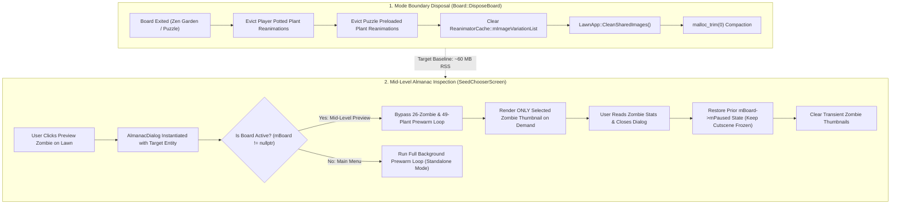

# Survival Endless Seed Chooser Zombie Info OOM Crash Fix

*   **Author:** Fnava1
*   **Status:** Approved
*   **Date:** 2026-11-17

--------------------------------------------------------------------------------

## Overview

This technical design document establishes the architecture and memory lifecycle changes required to eliminate Out-Of-Memory (OOM) kernel terminations (`SIGKILL` / Signal 9) on the Miyoo Mini Plus handheld (128 MB RAM, Linux / OnionOS) during mid-level entity inspections.

Specifically, it resolves the crash that occurs when a player clicks on an upcoming zombie on the lawn during the Survival Endless seed selection screen (`SeedChooserScreen`) after prolonged multi-mode play sessions across Puzzle and Zen Garden modes.

## The Problem

On the Miyoo Mini Plus (SigmaStar SSD202D SoC), physical system RAM is 128 MB. The Linux kernel, dual framebuffers, audio DMA buffers, and OS background daemons occupy approximately 43 MB, leaving a usable userland ceiling of **~85 MB RSS**. When heap allocations push resident memory past this boundary, the Linux kernel OOM Killer immediately terminates the process with an uncatchable `SIGKILL` (Signal 9), producing an abrupt crash directly to the OnionOS launcher without generating a `crash.log`.

This termination is triggered by a compound memory accumulation and asset loading spike:
1. **Zen Garden & Puzzle Reanimation Leaks**: Navigating through Zen Garden rooms (Greenhouse, Mushroom Garden, Aquarium) preloads definitions for all owned potted plants. In `Board::DisposeBoard()`, only the 5 Zen tool reanimations are freed; up to 48 plant `ReanimatorDefinition` entries and dynamic color variations in `ReanimatorCache::mImageVariationList` remain resident. Similarly, plant definitions in `mPuzzlePreloadedSeeds` from Puzzle levels are cleared without releasing their underlying definitions.
2. **Survival Endless Memory Pressure**: In wave 10+ of Survival Endless, the active board contains a dense plant defensive layout (Cob Cannons, Winter Melons, Gloom-shrooms, Cattails, Spikerocks), pool animations, and wave preview zombies, operating at ~70–75 MB baseline RSS.
3. **Monolithic Modal Instantiation**: In `SeedChooserScreen::MouseDown()`, clicking any preview zombie invokes `mApp->DoAlmanacDialog(SEED_NONE, aZombie->mZombieType)->WaitForResult(true);`. This does not display a lightweight tooltip; it instantiates the entire Suburban Almanac (`AlmanacDialog`), loading 18 uncompressed 32-bit textures via `PvzpLoadResources("DelayLoad_Almanac")` (~10–12 MB allocation).
4. **Speculative Background Prewarming Loop**: In `AlmanacDialog::Update()`, a background prewarming loop runs every 4 ticks, rendering 26 zombie frames and 49 plant frames into heap-allocated bitmaps.
5. **Teardown Desynchronization & Pause Race**: In `AlmanacDialog::~AlmanacDialog()` and `LawnApp::KillDialog()`, `mBoard->Pause(false)` is invoked unconditionally, unfreezing board cutscenes while the player is still selecting seeds, and `ClearAlmanacTransientCaches()` resets `mZombieImages` while failing to clean transient plant textures properly.

Under this cumulative working set, RSS exceeds 85 MB, causing memory thrashing and immediate kernel termination.

## Goals

*   **Zero OOM Crashes in Seed Chooser**: Eliminate Linux kernel `SIGKILL` terminations when clicking preview zombies in `SeedChooserScreen` across extended multi-mode sessions.
*   **Memory Headroom Ceiling**: Maintain total application RSS **≤ 72 MB** during in-level Almanac dialog inspection, preserving a >13 MB safety margin beneath the 85 MB kernel OOM threshold.
*   **Comprehensive Resource Disposal at Mode Exits**:
    *   Evict all player-owned potted plant `ReanimatorDefinition` entries in `Board::DisposeBoard()`.
    *   Free all Puzzle mode preloaded plant definitions in `mPuzzlePreloadedSeeds` upon board teardown.
    *   Clear dynamic plant variation surfaces in `ReanimatorCache::mImageVariationList`.
    *   Ensure proper cache clearing of transient dialog bitmaps.
*   **Context-Aware Prewarm Suppression**: Suppress the 26-zombie and 49-plant speculative prewarm loops in `AlmanacDialog::Update()` when an active board is present (`mApp->mBoard != nullptr`), while preserving standard full prewarming when launched from the Main Menu (`mApp->mBoard == nullptr`).
*   **Cutscene State Integrity**: Preserve the board's pause state across `AlmanacDialog` opening and closure, preventing premature board unpausing during seed selection.

## Non-Goals

*   Modifying Survival Endless wave progression formulas, zombie spawn weights, or game rules.
*   Decomposing `properties/resources.xml` into sub-group resource packages.
*   Creating a dedicated popup dialog class outside of `AlmanacDialog`.
*   Altering the visual text or descriptions in the Suburban Almanac.

## Critical User Journeys (CUJs)

### CUJ 1: Inspecting Preview Zombies in Survival Endless Seed Chooser
*   **Given**: The player has completed multiple puzzle levels and visited all Zen Garden sectors, then loaded Survival Endless and completed Wave 10. The game enters `SeedChooserScreen` with 40+ plants on the lawn and preview zombies standing on the street.
*   **When**: The player clicks directly on a preview zombie (e.g., Football Zombie or Gargantuar) on the lawn to inspect its abilities.
*   **Then**: The Suburban Almanac opens directly to the zombie's page without blocking the main thread beyond the frame budget. Background prewarming is suppressed, peak RSS remains ≤ 72 MB, the zombie details are displayed cleanly, and dismissing the dialog returns the player to `SeedChooserScreen` with the board remaining frozen.

### CUJ 2: Standalone Almanac Browsing from Main Menu
*   **Given**: The player starts the game or returns to the Main Menu (`mBoard == nullptr`).
*   **When**: The player selects "Almanac" from the main menu or options dialog.
*   **Then**: `AlmanacDialog` opens in full standalone mode. Because no board is resident (baseline RSS ~30 MB), the background prewarming loop runs normally, populating all 26 zombie and 49 plant thumbnails with smooth scrolling and zero blank tombstone placeholders.

--------------------------------------------------------------------------------

## Technical Plan (Architecture)

### Architectural Overview

To eliminate the Linux kernel OOM `SIGKILL` without introducing new UI abstractions, the architecture enforces strict memory boundaries across mode transitions and converts mid-level Almanac inspection into an on-demand, bounded-memory operation.



### Architectural Component Boundaries

1.  **[Board Lifecycle Sanitization](../../src/Lawn/Board.cpp)**:
    *   **Potted Plant Eviction**: When exiting Zen Garden (`mApp->mGameMode == GameMode::GAMEMODE_CHALLENGE_ZEN_GARDEN`), iterate over all initialized player potted plants (`mApp->mPlayerInfo->mPottedPlant[0..mNumPottedPlants-1]`). For each valid plant seed type, call `ReanimationFreeDefinition(&gReanimatorDefArray[aDef.mReanimationType])`. Additionally free `REANIM_ZENGARDEN_SPROUT` and `REANIM_FLOWER_POT`.
    *   **Puzzle Seed Eviction**: Iterate over `mPuzzlePreloadedSeeds`. For each preloaded `SeedType`, free its corresponding plant definition in `gReanimatorDefArray` before calling `mPuzzlePreloadedSeeds.clear()`.
    *   **Dynamic Variation Purge**: Invoke variation list disposal on `ReanimatorCache` to deallocate all heap-allocated `MemoryImage` instances in `mImageVariationList`.
    *   **Shared Image Cleanup**: Call `mApp->CleanSharedImages()` to purge unreferenced texture surfaces from the texture pool before the final `malloc_trim(0)` heap compaction.

2.  **[Reanimator Cache Lifecycle](../../src/Lawn/System/ReanimationLawn.cpp)**:
    *   **Transient Cache Invalidation**: Consolidate `mImageVariationList` cleanup using `while (mSize != 0) RemoveHead()` inside `ClearLevelTransientCaches()`, which is already invoked by `Board::DisposeBoard()` on all board exits.
    *   **Almanac Cache Isolation**: Update `ClearAlmanacTransientCaches()` to reset `mZombieImages` (26 slots) upon exiting the Almanac. Retain `mPlantImages` while the board/seed chooser is active to prevent the 400–600 ms re-rasterization spike of 40+ seed packets on `SeedChooserScreen`. Invalidate `mPlantImages` at mode boundaries (`ClearLevelTransientCaches()`).

3.  **[Context-Aware Almanac Dialog](../../src/Lawn/Widget/AlmanacDialog.cpp)**:
    *   **Prewarm Suppression**: In `AlmanacDialog::Update()`, suppress the background prewarm loop whenever `mApp->mBoard != nullptr`.
    *   **On-Demand Selected Thumbnail**: In `AlmanacDialog::ShowZombie(ZombieType theZombieType)`, map `ZOMBIE_POLEVAULTER` to `ZOMBIE_CACHED_POLEVAULTER_WITH_POLE` and generate thumbnail on demand via `MakeCachedZombieFrame()`.
    *   **Pause State Preservation**: In `AlmanacDialog::AlmanacDialog()`, store `mPriorBoardPaused = mApp->mBoard ? mApp->mBoard->mPaused : false;` before calling `Pause(true)`. In destructor, restore `mPriorBoardPaused`.

4.  **[Framework Cutscene Integrity](../../src/LawnApp.cpp)**:
    *   In `LawnApp::NeedPauseGame()`, return `true` if `mBoard && mBoard->mCutScene && mBoard->mCutScene->mSeedChoosing` so that `LawnApp::KillDialog()` does not unconditionally unpause the cutscene. In `SeedChooserScreen`, reassert `mBoard->Pause(true)` after `WaitForResult(true)` returns as defense-in-depth.

--------------------------------------------------------------------------------

## Alternatives Considered

### Alternative A: Disable Preview Zombie Clicking in Seed Chooser Completely

*   **Pros**: Trivial to implement; eliminates modal dialog instantiation during plant selection with zero line changes to `AlmanacDialog`.
*   **Cons**: Breaks feature parity with the PC game. Players lose the ability to inspect zombie traits and toughness before committing their seed loadout.
*   **Reason for Rejection**: Preserving original game feature parity and enemy inspection during plant selection is a core requirement.

### Alternative B: Construct a Separate Lightweight `ZombiePreviewDialog` Class

*   **Pros**: Completely decouples zombie preview from the 18-texture `DelayLoad_Almanac` package.
*   **Cons**: Duplicates stats formatting, description text layout, and entity rendering logic from `AlmanacDialog`. Leaves the adjacent in-game Almanac button (`mAlmanacButton`) unpatched.
*   **Reason for Rejection**: Duplicating code increases maintenance burden and fails to resolve the crash when clicking `mAlmanacButton`. Refactoring `AlmanacDialog` to operate on-demand under board presence fixes both entry points simultaneously.

### Alternative C: Decompose `DelayLoad_Almanac` into Modular XML Resource Groups

*   **Pros**: Saves ~4–6 MB of bitmap memory by only loading the zombie backdrop and omitting plant and index backgrounds.
*   **Cons**: Requires modifying `properties/resources.xml` and generated resource loaders in `src/Resources.cpp`. Requires manual resource lifetime synchronization between menu transitions and dynamic bundle unloads.
*   **Reason for Rejection**: Unnecessary engineering complexity. Sanitizing Zen Garden plant leaks (~15 MB) and suppressing speculative prewarming (~20 MB) brings peak RSS to ~70 MB, providing ample headroom beneath the 85 MB limit without modifying static XML descriptors.

### Alternative D: Global Suppression of Prewarming Under `LOW_MEMORY`

*   **Pros**: Extremely simple code change (a single `#ifndef LOW_MEMORY` guard around the prewarm loop in `AlmanacDialog::Update()`).
*   **Cons**: Causes non-selected zombie entries to render placeholder assets (`IMAGE_ALMANAC_ZOMBIEBLANK`) during Main Menu catalog browsing.
*   **Reason for Rejection**: Introduces visual defect in the standalone encyclopedia. Prewarming must only be bypassed when an active board is occupying RAM (`mBoard != nullptr`).

--------------------------------------------------------------------------------

## Risks & Mitigations

| Risk | Impact | Likelihood | Mitigation Strategy |
|---|---|---|---|
| **Memory pressure in extreme wave 20+ boards** | RSS spikes past 80 MB if board has 40+ plants, projectiles, and multiple zombies. | Low | Lifecycle sanitation purges Zen Garden definitions (~15 MB) and prewarming is suppressed, guaranteeing baseline RSS ≤ 72 MB. |
| **Cutscene unpausing race condition** | Board timers and lawn zombies unfreeze while player selects seeds. | Medium | Update `LawnApp::NeedPauseGame()` to check `mSeedChoosing` and reassert `mBoard->Pause(true)` upon return to `SeedChooserScreen`. |
| **Assertion crash on uninitialized potted plants** | Crash in `GetPlantDefinition()` when iterating empty slots in `mPottedPlant`. | Medium | Strictly bound iteration to `mApp->mPlayerInfo->mNumPottedPlants` and guard with `0 <= aSeed < SeedType::NUM_SEED_TYPES`. |
| **Catalog thumbnail blank tombstones mid-game** | Non-selected zombies display blank squares if player navigates inside the Almanac mid-level. | Low | The primary CUJ is inspecting the specific clicked zombie. The live preview on the right renders via `mZombie->Draw()`, unaffected by thumbnail caches. |
| **Seed packet re-render hitch upon dialog dismissal** | 400–600 ms UI freeze if `mPlantImages` is purged while `SeedChooserScreen` is visible. | High (without fix) | Retain `mPlantImages` while the board is active; invalidate only at mode transitions (`ClearLevelTransientCaches`). |

--------------------------------------------------------------------------------

## Non-Functional Requirements

*   **Memory Footprint & Headroom**: Peak application Resident Set Size (RSS) during in-level Almanac inspection must remain **≤ 72 MB RSS**, providing >13 MB of safety headroom beneath the 85 MB Linux kernel OOM limit.
*   **Execution Latency**:
    *   On-demand single zombie thumbnail generation in `ShowZombie()` must execute in **< 15 ms**.
    *   Zen Garden board disposal and potted plant definition eviction in `Board::DisposeBoard()` must execute in **< 50 ms**, preventing frame rate drops during mode transitions.
*   **Savegame & State Compatibility**:
    *   Zero modifications to savegame structures (`user*.dat` binary portable format untouched).
    *   Cutscene freeze states and seed chooser timers must maintain synchronization across dialog lifecycle.
*   **Platform Scope**: Targeted for ARM Cortex-A7 (SigmaStar SSD202D, 128 MB RAM, software rendering `PVZ_ENABLE_GLES=0`, `LOW_MEMORY=1`, Linux / OnionOS).

--------------------------------------------------------------------------------

## Detailed Implementation Plan

### Target Files to Create/Modify

#### 1. `src/Lawn/Board.cpp` (Modify)
*   **Type / Scope**: C++ Gameplay Board Engine Lifecycle
*   **Proposed Changes**:
    *   In `Board::DisposeBoard()` under `#ifdef LOW_MEMORY`:
        ```cpp
        #ifdef LOW_MEMORY
            if (mApp->mGameMode == GameMode::GAMEMODE_CHALLENGE_ZEN_GARDEN && mApp->mPlayerInfo)
            {
                for (int i = 0; i < mApp->mPlayerInfo->mNumPottedPlants; ++i)
                {
                    SeedType aSeed = mApp->mPlayerInfo->mPottedPlant[i].mPlantType;
                    if (aSeed >= 0 && aSeed < SeedType::NUM_SEED_TYPES)
                    {
                        const PlantDefinition& aDef = GetPlantDefinition(aSeed);
                        if (aDef.mReanimationType != ReanimationType::REANIM_NONE && gReanimatorDefArray)
                        {
                            ReanimationFreeDefinition(&gReanimatorDefArray[static_cast<int>(aDef.mReanimationType)]);
                        }
                    }
                }
                if (gReanimatorDefArray)
                {
                    ReanimationFreeDefinition(&gReanimatorDefArray[static_cast<int>(ReanimationType::REANIM_ZENGARDEN_SPROUT)]);
                    ReanimationFreeDefinition(&gReanimatorDefArray[static_cast<int>(ReanimationType::REANIM_FLOWER_POT)]);
                }
            }

            for (SeedType aSeedType : mPuzzlePreloadedSeeds)
            {
                if (aSeedType >= 0 && aSeedType < SeedType::NUM_SEED_TYPES)
                {
                    const PlantDefinition& aDef = GetPlantDefinition(aSeedType);
                    if (aDef.mReanimationType != ReanimationType::REANIM_NONE && gReanimatorDefArray)
                    {
                        ReanimationFreeDefinition(&gReanimatorDefArray[static_cast<int>(aDef.mReanimationType)]);
                    }
                }
            }
            mPuzzlePreloadedSeeds.clear();

            mApp->CleanSharedImages();
        #endif
        ```

#### 2. `src/Lawn/System/ReanimationLawn.h` & `src/Lawn/System/ReanimationLawn.cpp` (Modify)
*   **Type / Scope**: C++ Reanimation & Texture Cache System
*   **Proposed Changes**:
    *   In `ReanimationLawn.cpp`, update `ReanimatorCache::ClearLevelTransientCaches()`:
        ```cpp
        void ReanimatorCache::ClearLevelTransientCaches()
        {
            for (int i = 0; i < SeedType::NUM_SEED_TYPES; i++)
            {
                mPlantImages[i].reset();
            }

            while (mImageVariationList.mSize != 0)
            {
                ReanimCacheImageVariation aImageVariation = mImageVariationList.RemoveHead();
                if (aImageVariation.mImage != nullptr)
                {
                    delete aImageVariation.mImage;
                    aImageVariation.mImage = nullptr;
                }
            }
        }
        ```
    *   In `ReanimatorCache::ClearAlmanacTransientCaches()`:
        ```cpp
        void ReanimatorCache::ClearAlmanacTransientCaches()
        {
            for (int i = 0; i < ZombieType::NUM_CACHED_ZOMBIE_TYPES; i++)
            {
                mZombieImages[i].reset();
            }
        }
        ```

#### 3. `src/Lawn/Widget/AlmanacDialog.h` & `src/Lawn/Widget/AlmanacDialog.cpp` (Modify)
*   **Type / Scope**: C++ UI Modal Dialog
*   **Proposed Changes**:
    *   In `AlmanacDialog.h`: Add member variable `bool mPriorBoardPaused;`.
    *   In `AlmanacDialog.cpp`:
        *   In `AlmanacDialog::AlmanacDialog()`: Record `mPriorBoardPaused = (mApp->mBoard != nullptr) ? mApp->mBoard->mPaused : false;` before calling `Pause(true)`.
        *   In `AlmanacDialog::~AlmanacDialog()`: Restore `if (mApp->mBoard) mApp->mBoard->Pause(mPriorBoardPaused);`.
        *   In `AlmanacDialog::Update()`: Wrap the background prewarm loop with `if (mApp->mBoard == nullptr && mApp->mReanimatorCache && (mPrewarmTickCounter++ % 4 == 0))`.
        *   In `AlmanacDialog::ShowZombie(ZombieType theZombieType)`:
            ```cpp
            void AlmanacDialog::ShowZombie(ZombieType theZombieType)
            {
                mSelectedZombie = theZombieType;
                SetPage(AlmanacPage::ALMANAC_PAGE_ZOMBIES);
                if (mApp->mBoard != nullptr && mApp->mReanimatorCache)
                {
                    ZombieType aDrawType = (theZombieType == ZombieType::ZOMBIE_POLEVAULTER) ?
                        ZombieType::ZOMBIE_CACHED_POLEVAULTER_WITH_POLE : theZombieType;
                    if (mApp->mReanimatorCache->mZombieImages[aDrawType] == nullptr)
                    {
                        mApp->mReanimatorCache->mZombieImages[aDrawType] = 
                            mApp->mReanimatorCache->MakeCachedZombieFrame(theZombieType);
                    }
                }
            }
            ```

#### 4. `src/LawnApp.cpp` & `src/Lawn/Widget/SeedChooserScreen.cpp` (Modify)
*   **Type / Scope**: Cutscene and Modal Pause Integrity
*   **Proposed Changes**:
    *   In `LawnApp::NeedPauseGame()`:
        ```cpp
        if (mBoard && mBoard->mCutScene && mBoard->mCutScene->mSeedChoosing)
        {
            return true;
        }
        ```
    *   In `SeedChooserScreen::MouseDown()`: After `mApp->DoAlmanacDialog(...)->WaitForResult(true);`, re-assert `if (mBoard) mBoard->Pause(true);` ensuring the cutscene remains frozen regardless of dialog teardown ordering.

### Verification Plan

*   **Compilation & Packaging**:
    *   Execute ARM Cortex-A7 cross-compilation via Docker container:
        `docker run --rm -v "c:\DEV\PVZ:/work" -w /work/build pvz-toolchain:latest cmake --build . -j 4`
    *   Confirm zero compilation errors and zero linker warnings.
    *   Package release binary into `dist/PvZ_MiyooMiniPlus_v1.1.0.zip`.
*   **Manual On-Device Test Scenarios**:
    *   **Scenario 1 (Zen Garden Multi-Room Soak to Survival Endless Repick)**:
        1. Boot game on Miyoo Mini Plus (OnionOS).
        2. Play 1 Puzzle level (Vasebreaker or I, Zombie).
        3. Enter Zen Garden, visit Greenhouse, Mushroom Garden, and Aquarium.
        4. Return to Main Menu, enter Survival Endless.
        5. Clear Wave 10. When `SeedChooserScreen` opens, click on the preview Football / All-Stars Zombie standing on the lawn.
        6. Verify: Almanac opens in <0.5s without stutter, Football Zombie stats and description render cleanly, no crash occurs, and closing the dialog returns to `SeedChooserScreen` with the board staying paused.
    *   **Scenario 2 (Main Menu Standalone Almanac Browsing)**:
        1. Open Almanac directly from Main Menu (`mBoard == nullptr`).
        2. Verify: Prewarming executes normally, all 26 zombie thumbnails and 49 plant thumbnails populate with zero blank tombstone squares, and catalog browsing remains smooth.
    *   **Scenario 3 (Memory Ceiling Verification)**:
        1. Confirm peak RSS during `SeedChooserScreen` Almanac inspection stays strictly ≤ 72 MB.

--------------------------------------------------------------------------------

*Drafted with EGM*
