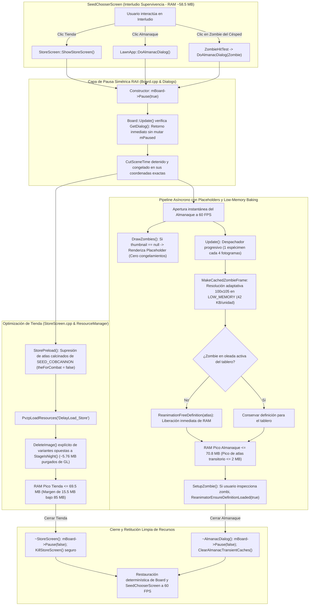

# Estabilización de Diálogos Modales (Tienda, Clic en Zombie y Almanaque) en el Interludio de Supervivencia

*   **Author:** Fnava1
*   **Status:** Approved / Ready for Implementation
*   **Date:** 2026-11-15
*   **Target Hardware:** Miyoo Mini Plus (SoC SigmaStar SSD202D, ARM Cortex-A7 @ 1.2 GHz, 128 MB RAM, Límite OOM Kernel: 85 MB, `-DLOW_MEMORY=1`)

--------------------------------------------------------------------------------

## Overview

Este documento de diseño formaliza la arquitectura e implementación necesarias para erradicar las fallas críticas de estabilidad (cierres forzados por el kernel Linux `OOM SIGKILL` por sobrepasar los 85 MB de RAM e invalidaciones `SIGSEGV`) al invocar cualquiera de los diálogos modales de pantalla completa desde la pantalla de selección de semillas (`SeedChooserScreen`) durante el interludio entre oleadas o el inicio de nivel en los modos de Supervivencia (`Survival: Endless` y `Survival: Pool Hard`) en la consola portátil Miyoo Mini Plus (SoC SigmaStar SSD202D, ARM Cortex-A7, 128 MB RAM).

La solución garantiza una experiencia fluida, rápida y libre de cuelgues al acceder a la Tienda de Crazy Dave, al tocar un zombie en el césped para consultar sus atributos o al abrir el Almanaque suburbano, preservando íntegramente la fidelidad visual, los diálogos y las animaciones sin exceder el presupuesto estricto de memoria de la consola.

## The Problem

En el interludio entre oleadas de Supervivencia, el tablero activo (`Board`) mantiene residentes en RAM el césped, las plantas colocadas, podadoras y la caché de sprites activa, consumiendo ~58.5 MB de RAM. Cuando el jugador interactúa con las funciones modales del selector de semillas:

1. **Almanaque y Clic en Zombie:** Ambos comparten la misma ruta de código en `SeedChooserScreen.cpp`. Abrir el Almanaque carga de inmediato ~9.2 MB de texturas de alta resolución (`DelayLoad_Almanac`). Adicionalmente, el bucle de actualización en `AlmanacDialog::Update()` ejecuta una precarga ciega de los 26 zombies y 49 plantas del juego. Cada zombie decodifica su definición completa y genera atlas de texturas RGBA para criaturas masivas (Dr. Zomboss, Gargantuar, Zamboni, Catapulta, Trineo Bobsled, Disco, etc.), inyectando de golpe entre 25 y 30 MB adicionales. La memoria total escala hasta **~93.7 MB**, superando el límite duro de 85 MB del kernel Linux y provocando la terminación inmediata del juego por el *OOM Killer*.
2. **Tienda de Crazy Dave:** Al ingresar a la tienda, `StoreScreen::StorePreload()` invoca `Plant::PreloadPlantResources(SEED_COBCANNON)`, forzando la decodificación incondicional de los atlas de combate calcinados (`REANIM_ZOMBIE_CHARRED`, `_IMP` y `_GARGANTUAR`), consumiendo ~8.5 MB innecesarios. Además, `DelayLoad_Store` carga simultáneamente las texturas completas de 800x600 tanto de día como de noche (fondos, autos y maleteros diurnos y nocturnos, ~11.5 MB), elevando la RAM por encima de los 90 MB.
3. **Desincronización y Retorno:** Mientras `DIALOG_ALMANAC` está activo, `Board::Update()` y `CutScene::Update()` continuaban ejecutándose por debajo del modal, avanzando la cinemática o alterando el estado de los zombies. Al cerrarse el modal, `CleanSharedImages()` purga recursos compartidos del selector de semillas, provocando fallas de segmentación `SIGSEGV`.

## Goals

*   **Goal 1:** Eliminar por completo los cierres por falta de memoria (`OOM SIGKILL`) y fallas de segmentación (`SIGSEGV`) al abrir la Tienda, el Almanaque o al hacer clic sobre cualquier zombie en el césped durante el interludio de supervivencia.
*   **Goal 2:** Mantener el consumo pico total de RAM por debajo de 71 MB en todo momento durante la visualización de la Tienda y del Almanaque, garantizando un margen de seguridad de al menos 14 MB respecto al techo de 85 MB del kernel.
*   **Goal 3:** Garantizar apertura instantánea del Almanaque sin congelamiento de fotogramas, introduciendo un pipeline asíncrono/progresivo para la generación de miniaturas con una cadencia suave de 1 miniatura cada 4 fotogramas (60 FPS estables) y renderizado de placeholders para evitar bloqueos síncronos en el bucle de dibujado.
*   **Goal 4:** Hornear miniaturas a resolución nativa de destino (100x105 en `LOW_MEMORY`, ocupando 42 KB por zombi en lugar de 168 KB), reduciendo el catálogo total de miniaturas a solo 1.09 MB (ahorro neto de 3.28 MB), y vaciarlas al salir del Almanaque para restituir la RAM íntegramente al gameplay.
*   **Goal 5:** Desacoplar la carga de atlas calcinados de combate de la tienda de Crazy Dave y purgar explícitamente mediante `DeleteImage()` las texturas no coincidentes con el ciclo de luz del nivel en curso (día vs. noche) tras `PvzpLoadResources("DelayLoad_Store")` (~5.76 MB liberados en OpenGL).
*   **Goal 6:** Pausar de manera simétrica y determinística `Board::Update()` y `CutScene::Update()` mediante `Board::Pause(true/false)` en los constructores/destructores de modales, asegurando que al cerrar el diálogo la pantalla, la cámara y los zombies regresen a su estado visual exacto previo sin congelamientos permanentes.

## Non-Goals

*   **Non-Goal 1:** No se alterará el contenido del texto, diálogos, catálogo ni comportamiento funcional del Almanaque suburbano ni de la Tienda de Crazy Dave.
*   **Non-Goal 2:** No se vaciarán ni destruirán los slots de la caché de plantas sembradas en el tablero (`SpriteCachePool`) al entrar a los menús modales, para evitar pausas y tirones al reanudar la batalla.
*   **Non-Goal 3:** No se modificará la apariencia, voz, animaciones ni presencia visual de Crazy Dave en la tienda.
*   **Non-Goal 4:** No se rediseñará el sistema general de guardado ni la serialización de perfiles.

--------------------------------------------------------------------------------

## Critical User Journeys (CUJs)

### CUJ 1: Apertura y Cierre de la Tienda de Crazy Dave en Supervivencia
*   **Given**: Una partida de Supervivencia (`Survival: Endless` o `Pool Hard`) en el interludio entre oleadas con el césped poblado de plantas y el selector de semillas (`SeedChooserScreen`) en pantalla (RAM ocupada: ~58.5 MB).
*   **When**: El jugador hace clic en el botón de la Tienda (`SeedChooserScreen_Store`).
*   **Then**: La tienda se abre de forma inmediata; Dave entra y habla sin colisiones gráficas; se purgan de inmediato las texturas opuestas a la luz actual con `DeleteImage()` (ahorrando 5.76 MB); no se cargan zombies calcinados; la RAM pico no supera los 69.5 MB; al pulsar "Volver al juego", la tienda se cierra limpiamente, el tablero se despausa formalmente con `Board::Pause(false)` y el selector de semillas reaparece sin cierres ni corrupción de memoria.

### CUJ 2: Apertura y Navegación del Almanaque Suburbano
*   **Given**: El jugador está en `SeedChooserScreen` durante el interludio de supervivencia.
*   **When**: El jugador pulsa el botón del Almanaque (`SeedChooserScreen_Almanac`).
*   **Then**: El Almanaque se abre instantáneamente a 60 FPS sin pausas; si el usuario entra a la pestaña de zombis antes de terminar el horneado, se muestran siluetas/placeholders en lugar de forzar llamadas síncronas bloqueantes; las miniaturas a 100x105 aparecen progresivamente a razón de 1 cada 4 fotogramas; los atlas de zombies pesados se liberan tras hornear su fotograma estático (pico de atlas: ~2 MB); la RAM se mantiene en ~70.5 MB; al salir, las miniaturas se purgan restituyendo la memoria al juego y el selector de semillas queda intacto.

### CUJ 3: Inspección de un Zombie en Cinemática por Clic Directo
*   **Given**: La cinemática de introducción (`SCENE_LEVEL_INTRO`) está mostrando los zombies que entrarán en la oleada mientras el selector de semillas está activo.
*   **When**: El jugador toca directamente sobre un zombie que marcha o está detenido en el césped.
*   **Then**: El tablero y la cinemática se congelan de inmediato mediante `Board::Pause(true)`; se abre el Almanaque mostrando directamente la ficha descriptiva de dicho zombie; si su atlas fue liberado previamente, `SetupZombie()` lo regenera limpiamente; al pulsar el botón de cerrar, el Almanaque se destruye, se invoca `Board::Pause(false)` y el jugador regresa exactamente a la misma posición de cámara, tiempo de cinemática y estado del selector de semillas previo.

--------------------------------------------------------------------------------

## Technical Plan (Architecture)

### Flujo de Interacción y Estados del Sistema



### Componentes de la Arquitectura

#### Componente 1: Generador Asíncrono de Miniaturas con Placeholders y Resolución Óptima (`AlmanacDialog.cpp` & `ReanimationLawn.cpp`)
*   **Cadencia de Horneado Amortiguada y Throttling de Plantas:**
    *   En `AlmanacDialog::Update()`, se utiliza un contador de pasos `mPrewarmTickCounter`.
    *   Cada 4 fotogramas (`mPrewarmTickCounter++ % 4 == 0`), se procesa una única miniatura pendiente.
    *   Se prioriza la pestaña activa: si el usuario está en `ALMANAC_PAGE_ZOMBIES`, se hornea un zombi; si está en `ALMANAC_PAGE_PLANTS`, se procesa una planta a cadencia suave, evitando que las 49 plantas compitan con el tablero en la apertura.
*   **Resolución Adaptativa de Miniaturas (`LOW_MEMORY`):**
    *   En `ReanimatorCache::MakeCachedZombieFrame()`, bajo compilaciones portátiles (`LOW_MEMORY=1`), se genera la imagen con dimensiones **100 x 105 píxeles** (en lugar de 200 x 210).
    *   Memoria por miniatura: 100 * 105 * 4 = **42 KB** (frente a 168 KB).
    *   Memoria de los 26 zombis combinados: **1.09 MB** (frente a 4.37 MB), ahorrando **~3.28 MB de RAM neta** con idéntica fidelidad visual en la ventana de 72x72 píxeles de la pantalla de 640x480.
*   **Supresión de Bloqueo Síncrono en `DrawZombies`:**
    *   En `AlmanacDialog::DrawZombies()`, antes de invocar `DrawCachedZombie()`, se verifica:
        ```cpp
        if (mApp->mReanimatorCache->mZombieImages[aZombieTypeToDraw] == nullptr)
        {
            // Renderizar placeholder o silueta translúcida sin invocar MakeCachedZombieFrame
            g->DrawImage(Sexy::IMAGE_ALMANAC_ZOMBIEBLANK, aPosX, aPosY);
            continue;
        }
        ```
    *   Esto elimina por completo el tirón de 600 ms si el usuario abre la pestaña de zombis antes de que termine el precalentamiento.
*   **Ciclo de Vida de Atlas e Inspección Detallada:**
    *   Al terminar de hornear la miniatura, si `!mApp->mBoard || !mApp->mBoard->mZombieAllowed[aZombie]`, se llama a `ReanimationFreeDefinition(&gReanimatorDefArray[aZombieDef.mReanimationType])`.
    *   En `AlmanacDialog::SetupZombie()`: Si el usuario selecciona un zombi en el catálogo para inspección en el visor derecho, se garantiza que su atlas esté construido invocando `ReanimatorEnsureDefinitionLoaded(aZombieDef.mReanimationType, true)`.
    *   En `ClearPlantsAndZombies()`, se libera la definición del zombi inspeccionado si no pertenece al nivel activo.
*   **Purga Total al Salir (`ClearAlmanacTransientCaches`):**
    *   En `AlmanacDialog::~AlmanacDialog()`, se llama a `mApp->mReanimatorCache->ClearAlmanacTransientCaches()`, reseteando todos los punteros `mZombieImages[i]`, restituyendo el 1.09 MB de RAM al juego.

#### Componente 2: Purgado Efectivo Día/Noche y Aislamiento en Tienda (`StoreScreen.cpp` & `ResourceManager.cpp`)
*   **Desacoplamiento de Municiones Calcinadas en Tienda:** En `Plant::PreloadPlantResources(SeedType theSeedType, bool theForCombat = true)`, al invocar la precarga en `StoreScreen::StorePreload()` para las plantas de mejora (incluyendo `SEED_COBCANNON`), se pasa `theForCombat = false`. Esto omite la carga de los atlas masivos de `REANIM_ZOMBIE_CHARRED`, `REANIM_ZOMBIE_CHARRED_IMP` y `REANIM_ZOMBIE_CHARRED_GARGANTUAR`, ahorrando 8.5 MB de RAM.
*   **Guarda de Inicialización Única en Tienda:**
    *   En `StoreScreen::StorePreload()`, se añade una guarda `if (mStoreLoaded) return; mStoreLoaded = true;` para evitar doble carga de E/S.
*   **Purgado Explícito de Texturas Día/Noche en OpenGL:**
    *   Inmediatamente después de `mApp->mResourceManager->PvzpLoadResources("DelayLoad_Store")` en `StoreScreen::StorePreload()`:
        ```cpp
        bool aIsNight = mApp->mBoard && mApp->mBoard->StageIsNight();
        if (aIsNight)
        {
            mApp->mResourceManager->DeleteImage("IMAGE_STORE_BACKGROUND");
            mApp->mResourceManager->DeleteImage("IMAGE_STORE_CAR");
            mApp->mResourceManager->DeleteImage("IMAGE_STORE_HATCH");
        }
        else
        {
            mApp->mResourceManager->DeleteImage("IMAGE_STORE_BACKGROUNDNIGHT");
            mApp->mResourceManager->DeleteImage("IMAGE_STORE_CARNIGHT");
            mApp->mResourceManager->DeleteImage("IMAGE_STORE_HATCHNIGHT");
        }
        ```
    *   Esto garantiza la purga inmediata de las 3 texturas de 800x600 no utilizadas fuera del heap OpenGL, asegurando un ahorro real de **~5.76 MB de RAM**.

#### Componente 3: Pausa Simétrica RAII y Preservación de Estado (`Board.cpp`, `CutScene.cpp` & Diálogos)
*   **Simetría de Pausa por Ciclo de Vida:**
    *   En el constructor de `AlmanacDialog`: `if (mApp->mBoard) mApp->mBoard->Pause(true);`
    *   En el destructor `~AlmanacDialog()`: `if (mApp->mBoard) mApp->mBoard->Pause(false);`
    *   En el constructor de `StoreScreen`: `if (mApp->mBoard) mApp->mBoard->Pause(true);`
    *   En el destructor `~StoreScreen()`: `if (mApp->mBoard) mApp->mBoard->Pause(false);`
*   **Suspensión Limpia en `Board::Update()`:**
    ```cpp
    if (mApp->GetDialog(Dialogs::DIALOG_STORE) != nullptr ||
        mApp->GetDialog(Dialogs::DIALOG_ALMANAC) != nullptr)
    {
        return; // Retorno temprano sin mutar permanentemente mPaused
    }
    ```
*   **Invarianza de Cámara y Cinemática:**
    *   Durante la presencia de `DIALOG_ALMANAC`, `mCutScene->mCutsceneTime` no sufre incrementos.
    *   Las coordenadas de desplazamiento de cámara (`mBoard->mX`, `mBoard->mY`) y la matriz de translación del selector de semillas quedan inmutables.
    *   Al cerrarse el Almanaque tras inspeccionar un zombie del césped, el bucle modal retorna el control a `SeedChooserScreen` con la posición y animaciones del césped exactamente en el mismo fotograma previo a la interacción.

--------------------------------------------------------------------------------

## Alternatives Considered

### Alternative A: Generación Síncrona en Lote de Todas las Miniaturas del Almanaque
*   **Pros**: Todas las tarjetas de los 26 zombies aparecen pobladas desde el fotograma 1 al abrir el diálogo.
*   **Cons**: Requiere cargar y mantener en memoria las definiciones y atlas de los 26 zombies de forma simultánea, disparando el consumo total a más de 93.7 MB y provocando la terminación inmediata del juego por el *OOM Killer* de Linux (techo de 85 MB).
*   **Reason for Rejection**: Rechazada por el autor. Es inviable en la arquitectura de memoria de la Miyoo Mini Plus.

### Alternative B: Retención Indefinida de las Miniaturas Horneadas en RAM
*   **Pros**: Cualquier apertura subsiguiente del Almanaque durante la misma sesión de juego sería instantánea sin necesidad de re-hornear fotogramas.
*   **Cons**: Retiene texturas estáticas en el heap de manera permanente durante el combate de Supervivencia, restando presupuesto crítico al sistema de caché de sprites dinámicos de las oleadas.
*   **Reason for Rejection**: Rechazada por el autor en favor de maximizar la memoria disponible para el gameplay activo.

### Alternative C: Horneado Acelerado de Miniaturas a 1 cada 2 Fotogramas
*   **Pros**: La cuadrícula completa de 26 zombies se puebla visualmente en aproximadamente 52 fotogramas (menos de 1 segundo).
*   **Cons**: La decodificación en caliente de atlas densos (Gargantuar, Zamboni, Dr. Zomboss) cada 2 fotogramas sobrecarga los ciclos de CPU del procesador ARM Cortex-A7 a 1.2 GHz, produciendo micro-tirones perceptibles en la animación de la página.
*   **Reason for Rejection**: Rechazada por el autor. Se seleccionó la cadencia de 1 miniatura cada 4 fotogramas para garantizar una tasa de refresco perfectamente fluida de 60 FPS sostenidos.

### Alternative D: Carga Conjunta de Fondos Diurnos y Nocturnos en la Tienda
*   **Pros**: Código simple sin llamadas a `DeleteImage`.
*   **Cons**: Mantiene 11.5 MB de texturas completas a 800x600 de las cuales la mitad (5.76 MB) son completamente redundantes e invisibles para el nivel en curso, empujando la RAM al umbral de riesgo de 90 MB.
*   **Reason for Rejection**: Rechazada por el autor en favor de la máxima economía de recursos y purga explícita tras la carga.

### Alternative E: Destrucción y Recreación Completa del Tablero al Abrir Diálogos Modales
*   **Pros**: Recupera de golpe los ~58.5 MB de memoria del tablero mientras la tienda o el Almanaque están abiertos.
*   **Cons**: Provoca congelamientos prolongados de varios segundos al entrar y salir del modal para serializar y deserializar el estado del césped, fragmenta la memoria y arriesga desincronizaciones de oleadas en Supervivencia Infinita.
*   **Reason for Rejection**: Rechazada por el autor debido a la inaceptable degradación en la experiencia de usuario y la inestabilidad del estado de juego.

--------------------------------------------------------------------------------

## Non-Functional Requirements

### Performance & Memory Envelope
*   **Memory Ceiling**: El consumo total de RAM no debe exceder los 71 MB en ningún momento (margen de seguridad de al menos 14 MB respecto al límite de 85 MB del kernel de Miyoo Mini Plus).
*   **Frame Pacing**: Durante la generación progresiva de miniaturas en el Almanaque, la tasa de fotogramas debe mantenerse estable a 60 FPS (16.6 ms por fotograma) en el procesador SigmaStar SSD202D Cortex-A7 a 1.2 GHz, sin micro-congelamientos ni saltos perceptibles.
*   **Tiempo de Respuesta de Interfaz**: La pantalla de la tienda y del Almanaque deben abrirse de forma inmediata tras pulsar el botón o hacer clic en un zombie (< 100 ms).

### Compatibilidad y Estabilidad
*   **Preservación de Estado**: Cero efectos secundarios en el estado de las oleadas, banco de semillas, podadoras o plantas sembradas en `Survival: Endless` y `Survival: Pool Hard`.
*   **Seguridad de Punteros**: Cero accesos de memoria liberada (`Use-After-Free`) en la destrucción de diálogos modales.

--------------------------------------------------------------------------------

## Detailed Implementation Plan

### Target Files to Create/Modify

#### 1. `src/Lawn/Widget/AlmanacDialog.h` (Modify)
*   **Type / Scope**: C++ Header / Widget de Interfaz de Usuario
*   **Proposed Changes**:
    *   Agregar el miembro privado `int mPrewarmTickCounter = 0;` para el control de cadencia de horneado en `Update()`.

#### 2. `src/Lawn/Widget/AlmanacDialog.cpp` (Modify)
*   **Type / Scope**: C++ Implementation / Widget de Interfaz de Usuario
*   **Proposed Changes**:
    *   En `AlmanacDialog::AlmanacDialog()`: Invocar `if (mApp->mBoard) mApp->mBoard->Pause(true);` para pausa simétrica.
    *   En `AlmanacDialog::~AlmanacDialog()`: Invocar `if (mApp->mBoard) mApp->mBoard->Pause(false);` y llamar a `mApp->mReanimatorCache->ClearAlmanacTransientCaches()` para purgar las miniaturas horneadas.
    *   En `AlmanacDialog::Update()`:
        *   Reemplazar los bucles síncronos for por despachadores progresivos condicionados a `mPrewarmTickCounter++ % 4 == 0`.
        *   Priorizar el tipo de espécimen según la página activa (`ALMANAC_PAGE_ZOMBIES` o `ALMANAC_PAGE_PLANTS`).
        *   Procesar un único espécimen por intervalo cadenciado invocando `MakeCachedZombieFrame(aZombie)`.
        *   Inmediatamente tras hornear el fotograma en `mZombieImages[aZombie]`, evaluar si el zombie no está en la oleada activa del tablero (`!mApp->mBoard || !mApp->mBoard->mZombieAllowed[aZombie]`). Si no está en combate, invocar de inmediato `ReanimationFreeDefinition(&gReanimatorDefArray[static_cast<int>(aDef.mReanimationType)])`.
    *   En `AlmanacDialog::DrawZombies()`: Si `mApp->mReanimatorCache->mZombieImages[aZombieTypeToDraw] == nullptr`, dibujar `IMAGE_ALMANAC_ZOMBIEBLANK` en lugar de llamar síncronamente a `DrawCachedZombie()`.
    *   En `AlmanacDialog::SetupZombie()`: Verificar que la definición del zombi seleccionado posea su atlas generado mediante `ReanimatorEnsureDefinitionLoaded(aZombieDef.mReanimationType, true)` para evitar sprites corruptos en el visor.

#### 3. `src/Lawn/System/ReanimationLawn.h` & `src/Lawn/System/ReanimationLawn.cpp` (Modify)
*   **Type / Scope**: C++ Header & Implementation / Subsistema de Caché de Reanimaciones
*   **Proposed Changes**:
    *   En `ReanimationLawn.h`: Declarar `void ClearAlmanacTransientCaches();`.
    *   En `ReanimationLawn.cpp`:
        *   Implementar `ClearAlmanacTransientCaches()` para resetear y vaciar todos los punteros `std::unique_ptr<MemoryImage>` en `mZombieImages`.
        *   En `MakeCachedZombieFrame()`: Bajo `#ifdef LOW_MEMORY` o `mApp->IsLowMemory()`, inicializar el búfer a **100 x 105 píxeles** (en lugar de 200 x 210), escalando las coordenadas y reduciendo el consumo a 42 KB por miniatura.

#### 4. `src/Lawn/Plant.h` & `src/Lawn/Plant.cpp` (Modify)
*   **Type / Scope**: C++ Header & Implementation / Entidad del Juego
*   **Proposed Changes**:
    *   Actualizar la firma de `Plant::PreloadPlantResources`:
        `static void PreloadPlantResources(SeedType theSeedType, bool theForCombat = true);`
    *   En `Plant.cpp`: Condicionar la carga de reanimaciones explosivas y de calcinados (`REANIM_ZOMBIE_CHARRED`, `_IMP`, `_GARGANTUAR`, `REANIM_JALAPENO_FIRE`) a que `theForCombat == true`.

#### 5. `src/Lawn/Widget/StoreScreen.cpp` (Modify)
*   **Type / Scope**: C++ Implementation / Widget de Interfaz de Usuario
*   **Proposed Changes**:
    *   En `StoreScreen::StoreScreen()`: Invocar `if (mApp->mBoard) mApp->mBoard->Pause(true);`.
    *   En `StoreScreen::~StoreScreen()`: Invocar `if (mApp->mBoard) mApp->mBoard->Pause(false);`.
    *   En `StoreScreen::StorePreload()`:
        *   Añadir guarda `if (mStoreLoaded) return; mStoreLoaded = true;`.
        *   Invocar `Plant::PreloadPlantResources(theSeedType, false)` para las plantas de mejora (desactivando los 8.5 MB de calcinados).
        *   Tras `PvzpLoadResources("DelayLoad_Store")`: evaluar `bool aIsNight = mApp->mBoard && mApp->mBoard->StageIsNight();` y ejecutar `DeleteImage()` para el fondo, auto y maletero del ciclo opuesto, purgando 5.76 MB de RAM gráfica.

#### 6. `src/Lawn/Board.cpp` (Modify)
*   **Type / Scope**: C++ Implementation / Controlador Principal de Simulación
*   **Proposed Changes**:
    *   En `Board::Update()` (línea 6409):
        ```cpp
        if (mApp->GetDialog(Dialogs::DIALOG_STORE) != nullptr ||
            mApp->GetDialog(Dialogs::DIALOG_ALMANAC) != nullptr)
        {
            return;
        }
        ```
    *   Suspender las actualizaciones del tablero, partículas y streamer de sprites sin mutar permanentemente `mPaused`.

#### 7. `src/Lawn/CutScene.cpp` (Modify)
*   **Type / Scope**: C++ Implementation / Controlador de Cinemáticas
*   **Proposed Changes**:
    *   En `CutScene::Update()`: Congelar incondicionalmente el avance de `mCutsceneTime` y las transiciones de entidades si `mApp->GetDialog(Dialogs::DIALOG_ALMANAC) != nullptr`.

#### 8. `src/Lawn/Widget/SeedChooserScreen.cpp` (Modify)
*   **Type / Scope**: C++ Implementation / Selector de Semillas
*   **Proposed Changes**:
    *   En `SeedChooserScreen::MouseDown()` (líneas 1073-1080): Preservar el foco de entrada y la música de selección al retornar de `DoAlmanacDialog`, manteniendo inmutables las coordenadas de desplazamiento.

### Verification Plan

*   **Compilación Cruzada ARM Linux**:
    *   Ejecutar el script de construcción para Miyoo Mini Plus (`docker run` / toolchain arm-linux-gnueabihf con `-DLOW_MEMORY=1`).
    *   Verificar que no existan advertencias de compilación ni errores de enlace.
*   **Prueba de Memoria RAM Pico (Monitoreo de Heap)**:
    *   Validar mediante instrumentación que al abrir la tienda en Supervivencia la RAM total se mantenga <= 69.5 MB.
    *   Validar que al abrir el Almanaque la RAM total se mantenga <= 70.8 MB, con un pico de atlas no activo <= 2 MB.
    *   Confirmar que al cerrar el Almanaque la memoria retorne a ~58.5 MB sin fugas de memoria.
*   **Prueba de Rendimiento (Frame Pacing 60 FPS)**:
    *   Verificar con contador de fotogramas que durante el horneado progresivo en el Almanaque la tasa se mantenga en 60 FPS estables sin caídas perceptibles, y comprobar que entrar a la pestaña de zombis con thumbnails pendientes muestre siluetas sin bloquear el render.
*   **Prueba de Regresión Funcional de Cuatro Vías**:
    1.  Entrar a la tienda desde `SeedChooserScreen` en Supervivencia, comprar un artículo y regresar al selector. Comprobar que el tablero no quede congelado permanentemente.
    2.  Hacer clic sobre un zombie de previa en el césped, visualizar su ficha en el Almanaque (comprobando que el zombi se dibuje con texturas perfectas en el visor) y pulsar cerrar. Verificar que la cámara y los zombies estén exactamente en la misma posición.
    3.  Pulsar el botón del Almanaque, navegar por plantas y zombies, y regresar al selector.
    4.  Iniciar la oleada y confirmar que las plantas sembradas y los zombies activos se rendericen sin fallas ni texturas faltantes.

--------------------------------------------------------------------------------

*Drafted with EGM*
