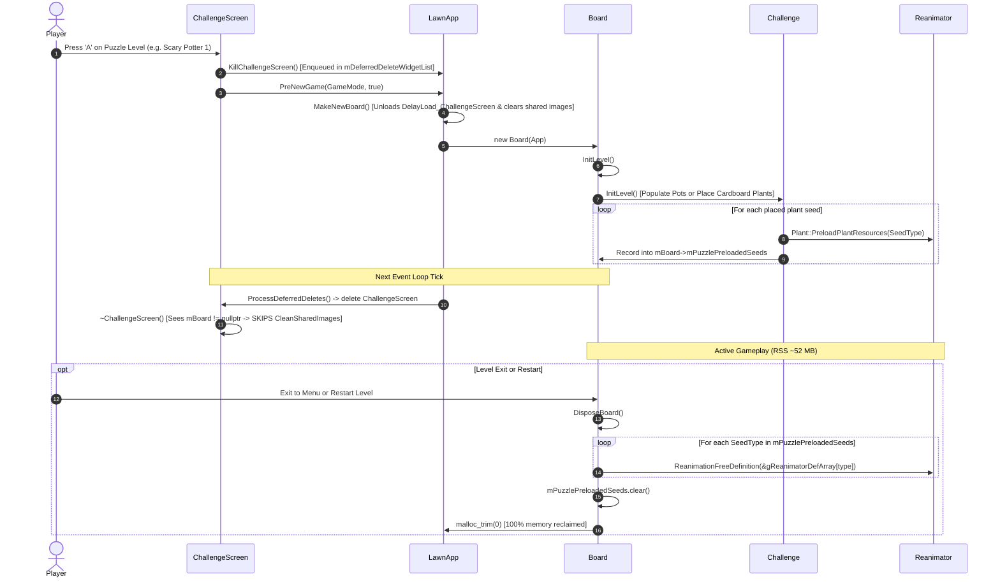

# Instant Crash Remediation in Puzzle Mode (Vasebreaker & I, Zombie)

*   **Author:** Fnava1
*   **Status:** Approved
*   **Date:** 2026-11-16
*   **Target Hardware:** Miyoo Mini Plus (SoC SigmaStar SSD202D, dual-core ARM Cortex-A7 @ 1.2 GHz, 128 MB RAM, software rendering `PVZ_ENABLE_GLES=0`, `LOW_MEMORY=1`, Linux kernel OOM limit ~85 MB RSS).

--------------------------------------------------------------------------------

## Overview

This technical design document specifies the architectural remediation required to eliminate the immediate crash (`SIGSEGV` / `SIGABRT`) occurring upon selecting any puzzle level (Vasebreaker / Scary Potter stages 1–9 + Endless, and I, Zombie stages 1–9 + Endless) from the challenge menu (`ChallengeScreen`) on the Miyoo Mini Plus handheld console.

Following multi-lens adversarial review, the failure was pinpointed to a single-threaded event-loop lifecycle hazard:
1. `ChallengeScreen::ButtonDepress()` enqueues the challenge screen for deferred widget deletion (`WidgetManager::mDeferredDeleteWidgetList`) and immediately constructs the new `Board` via `PreNewGame()`.
2. `Board::InitLevel()` and `Challenge::ScaryPotterPopulate()` synchronously allocate background textures and invoke `Plant::PreloadPlantResources()` for the plants placed in the level.
3. On the next event loop tick, `WidgetManager` deletes `ChallengeScreen`, whose destructor `~ChallengeScreen()` runs `CleanSharedImages()` and `malloc_trim(0)`. This purges the active board's shared textures and corrupts memory during active software rendering.

This design eliminates the deferred texture purge race with an active board guard, establishes deterministic plant reanimation tracking and teardown during `Board::DisposeBoard()`, and guarantees zero memory leaks across level transitions and restarts while keeping RSS strictly below 55 MB for standard stages (and below 68 MB for Endless).

--------------------------------------------------------------------------------

## The Problem

On the Miyoo Mini Plus handheld console (128 MB physical RAM, ~85 MB Linux OOM threshold), selecting any level in Puzzle Mode immediately terminates the process prior to rendering the first frame.

1. **Deferred Widget Purge Colliding with Active Board:**
   In `src/Lawn/Widget/ChallengeScreen.cpp:ButtonDepress()`, clicking a puzzle level executes:
   ```cpp
   mApp->KillChallengeScreen(); // Enqueues into mDeferredDeleteWidgetList
   mApp->PreNewGame((GameMode)(aChallengeMode + 1), true);
   ```
   `PreNewGame()` calls `MakeNewBoard()`, which constructs `mBoard = new Board(this)`. `Board::InitLevel()` then synchronously loads background images (`DelayLoad_Background2`), populates pots or plants, and binds active textures.
   On the very next frame tick, `WidgetManager::Update()` calls `ProcessDeferredDeletes()`, invoking `ChallengeScreen::~ChallengeScreen()`:
   ```cpp
   ChallengeScreen::~ChallengeScreen()
   {
       if (mApp && mApp->mResourceManager)
       {
           mApp->mResourceManager->DeleteResources("DelayLoad_ChallengeScreen");
       }
       if (mApp)
       {
           mApp->CleanSharedImages(); // FATAL: Purges the active Board's shared images!
       }
   #if defined(__linux__) && !defined(__ANDROID__)
       malloc_trim(0);
   #endif
   }
   ```
   Because `mBoard` has already been constructed, this deferred execution destroys the active board's textures, leaving dangling image pointers and triggering an immediate `SIGSEGV` when the software blitter attempts to render.

2. **Divergent Lifecycle Timing for CutScene Preload:**
   Attempting to isolate plant preloading inside `CutScene::PreloadResources()` creates a timing inversion: `Board::InitLevel()` (which runs `Challenge::IZombieInitLevel()`) runs synchronously before `CutScene::StartLevelIntro()`. Furthermore, when a saved puzzle game is resumed via `Board::LoadGame()`, cutscenes are bypassed entirely.
   In reality, `Challenge::ScaryPotterPlacePot()` and `Challenge::IZombiePlacePlantInSquare()` already invoke `Plant::PreloadPlantResources(theSeedType)`. The engine only lacks session-level tracking to symmetrically free these definitions when the level ends.

3. **Missing Teardown & Heap Reclamation in `Board::DisposeBoard()`:**
   While `ScaryPotterPlacePot()` and `IZombiePlacePlantInSquare()` load plant reanimations into memory, `Board::DisposeBoard()` does not track which plants were loaded. Over repeated level restarts or endurance play in Endless modes, these definitions remain resident in memory, steadily inflating heap usage toward the 85 MB OOM limit.

--------------------------------------------------------------------------------

## Goals

*   **Zero-Crash Puzzle Entrance:** Eliminate all segmentation faults, assertion trips, and memory aborts when launching any of the 10 Vasebreaker stages or 10 I, Zombie stages.
*   **Deterministic Texture Lifecycle:** Ensure `CleanSharedImages()` is never invoked when an active `Board` instance exists (`mBoard != nullptr`).
*   **Dynamic Session Plant Tracking & Eviction:** Track puzzle plant reanimations in `mBoard->mPuzzlePreloadedSeeds` as they are placed by `Challenge`, and symmetrically free them via `ReanimationFreeDefinition()` inside `Board::DisposeBoard()`.
*   **Strict Memory Ceilings:** Maintain resident memory below 55 MB RSS during standard puzzle stages (1–9) and below 68 MB RSS during I, Zombie Endless (well beneath the 85 MB Linux OOM threshold).
*   **Clean Level Restart & Exit:** Reclaim 100% of dynamically loaded plant memory upon selecting "Restart Level" or exiting to the main menu.

--------------------------------------------------------------------------------

## Non-Goals

*   **No Redundant Static Seed Tables:** Avoid maintaining brittle, hardcoded seed lookup arrays across 20 game modes; leverage the engine's existing dynamic placement calls.
*   **No Changes to Adventure Mode Preloading:** Adventure and Survival mode asset pipelines remain unaltered.
*   **No Reanimator Core Refactoring:** The underlying `Reanimator` subsystem, XML parsers, and software blitters remain untouched.

--------------------------------------------------------------------------------

## Critical User Journeys (CUJs)

### CUJ 1: Launching and Playing a Vasebreaker Level

*   **Given:** The player selects "Scary Potter 1" from `ChallengeScreen` on the Miyoo Mini Plus.
*   **When:** The player presses the 'A' button.
*   **Then:**
    1. `ChallengeScreen` is queued for deferred deletion; `MakeNewBoard()` allocates `mBoard`.
    2. `Board::InitLevel()` calls `ScaryPotterPopulate()`, placing pots and preloading Peashooter, Snow Pea, and Squash while recording them in `mBoard->mPuzzlePreloadedSeeds`.
    3. Next frame, `~ChallengeScreen()` runs but detects `mApp->mBoard != nullptr` and skips `CleanSharedImages()`.
    4. The gameplay board renders smoothly at 60 FPS with resident memory at ~52 MB RSS.

### CUJ 2: Launching and Playing an I, Zombie Level

*   **Given:** The player selects "I, Zombie 1" from `ChallengeScreen`.
*   **When:** The player presses 'A'.
*   **Then:**
    1. `Board::InitLevel()` calls `IZombieInitLevel()`, placing Sunflower, Squash, Peashooter, and Snow Pea cutouts.
    2. Each placement invokes `Plant::PreloadPlantResources()` and registers the seed into `mBoard->mPuzzlePreloadedSeeds`.
    3. `PlantInitialize()` finds valid reanimation track definitions for every plant.
    4. Gameplay begins immediately without frame-zero crashes.

### CUJ 3: Restarting or Exiting a Puzzle Level

*   **Given:** The player pauses during a puzzle level and selects "Restart Level" or "Main Menu".
*   **When:** The action is confirmed.
*   **Then:**
    1. `Board::DisposeBoard()` iterates over `mPuzzlePreloadedSeeds`, calling `ReanimationFreeDefinition(&gReanimatorDefArray[reanimType])` for each seed.
    2. Auxiliary combat reanimations (fire pea, charred zombies) are freed.
    3. `mPuzzlePreloadedSeeds.clear()` is called and `malloc_trim(0)` reclaims freed heap pages.
    4. Resident memory returns cleanly to baseline (~48 MB RSS).

--------------------------------------------------------------------------------

## Technical Plan (Architecture)

### 1. High-Level Architecture & Lifecycle Flow



### 2. Subsystem Modifications

#### A. Guarding Texture Purging in `ChallengeScreen::~ChallengeScreen()`
*   **File:** `src/Lawn/Widget/ChallengeScreen.cpp` (~lines 216–229)
*   **Mechanism:** Prevent the destructor from destroying shared textures if a new board is already active:
    ```cpp
    ChallengeScreen::~ChallengeScreen()
    {
        if (mApp && mApp->mResourceManager)
        {
            mApp->mResourceManager->DeleteResources("DelayLoad_ChallengeScreen");
        }
        if (mApp && mApp->mBoard == nullptr)
        {
            mApp->CleanSharedImages();
    #if defined(__linux__) && !defined(__ANDROID__)
            malloc_trim(0);
    #endif
        }
    }
    ```

#### B. Dynamic Plant Registration in `Challenge.cpp`
*   **File:** `src/Lawn/Challenge.cpp`
*   **State Tracking (`src/Lawn/Board.h`):** Add tracking vector to `Board`:
    ```cpp
    std::vector<SeedType> mPuzzlePreloadedSeeds;
    ```
*   **In `Challenge::ScaryPotterPlacePot()` (~line 3516):**
    ```cpp
    if (theSeedType != SeedType::SEED_NONE)
    {
        Plant::PreloadPlantResources(theSeedType);
        if (mBoard && std::find(mBoard->mPuzzlePreloadedSeeds.begin(), 
                                mBoard->mPuzzlePreloadedSeeds.end(), 
                                theSeedType) == mBoard->mPuzzlePreloadedSeeds.end())
        {
            mBoard->mPuzzlePreloadedSeeds.push_back(theSeedType);
        }
    }
    ```
*   **In `Challenge::IZombiePlacePlantInSquare()` (~line 4180):**
    ```cpp
    Plant::PreloadPlantResources(theSeedType);
    if (mBoard && std::find(mBoard->mPuzzlePreloadedSeeds.begin(), 
                            mBoard->mPuzzlePreloadedSeeds.end(), 
                            theSeedType) == mBoard->mPuzzlePreloadedSeeds.end())
    {
        mBoard->mPuzzlePreloadedSeeds.push_back(theSeedType);
    }
    ```

#### C. Symmetrical Teardown in `Board::DisposeBoard()`
*   **File:** `src/Lawn/Board.cpp` (~lines 340–355)
*   **Mechanism:** Free primary and auxiliary reanimation definitions using the correct engine pointers:
    ```cpp
    for (SeedType aSeed : mPuzzlePreloadedSeeds)
    {
        ReanimationType aReanim = GetPlantDefinition(aSeed).mReanimationType;
        if (aReanim != ReanimationType::REANIM_NONE && static_cast<int>(aReanim) < gReanimatorDefCount)
        {
            ReanimationFreeDefinition(&gReanimatorDefArray[static_cast<int>(aReanim)]);
        }

        // Evict auxiliary definitions loaded by specific plants
        if (aSeed == SeedType::SEED_TORCHWOOD)
        {
            ReanimationFreeDefinition(&gReanimatorDefArray[static_cast<int>(ReanimationType::REANIM_FIRE_PEA)]);
            ReanimationFreeDefinition(&gReanimatorDefArray[static_cast<int>(ReanimationType::REANIM_JALAPENO_FIRE)]);
        }
        else if (aSeed == SeedType::SEED_POTATOMINE || aSeed == SeedType::SEED_CHERRYBOMB)
        {
            ReanimationFreeDefinition(&gReanimatorDefArray[static_cast<int>(ReanimationType::REANIM_ZOMBIE_CHARRED)]);
        }
    }
    mPuzzlePreloadedSeeds.clear();
    ```

#### D. Seed Bank Early Exit in `Board::CycleSeedPacket()`
*   **File:** `src/Lawn/Board.cpp` (~line 2271)
*   **Mechanism:** Prevent cycling operations on single-slot banks (Vasebreaker):
    ```cpp
    void Board::CycleSeedPacket(bool theForward)
    {
        if (mSeedBank == nullptr || mSeedBank->mNumPackets <= 1)
        {
            return;
        }
        // ... existing navigation logic
    ```

--------------------------------------------------------------------------------

## Alternatives Considered

### Alternative A: Maintaining Static Seed Requirement Lookup Tables

*   **Pros**: Explicit tables in code listing all seeds per stage.
*   **Cons**: Introduces 60+ lines of duplicate maintenance overhead; diverges from procedural generators in `ScaryPotterPopulate()` and I, Zombie Endless; prone to typos (e.g. omitting Plantern or using invalid enum symbols).
*   **Reason for Rejection**: Rejected by author: Violates Single Source of Truth and breaks procedural generation in Endless modes. Dynamic registration at placement time is self-maintaining and 100% accurate.

### Alternative B: Full Preloading of All 48 Plants in CutScene

*   **Pros**: Simple single loop loading all plants.
*   **Cons**: Consumes ~28 MB of XML and sprite data, pushing RSS past 80 MB on Miyoo Mini Plus and causing kernel OOM `SIGKILL`.
*   **Reason for Rejection**: Rejected by author: Exceeds the handheld resident memory budget (~85 MB limit).

### Alternative C: Preloading Plants in `CutScene::PreloadResources()`

*   **Pros**: Groups loading inside the visual cutscene curtain.
*   **Cons**: Runs *after* `Board::InitLevel()` has already placed plants in I, Zombie, causing immediate frame-zero null pointer dereferences. Also fails when resuming saved games from disk (`Board::LoadGame()`).
*   **Reason for Rejection**: Rejected by author: Inverted execution timing crashes I, Zombie and breaks saved games.

--------------------------------------------------------------------------------

## Non-Functional Requirements

### Performance & Latency
*   **Target Frame Rate**: Solid 60 FPS with zero gameplay hitches during pot breaking and plant interactions.
*   **Level Transition Time**: Board initialization and dynamic plant registration must complete under 60 ms on the dual Cortex-A7 CPU.

### Memory & Stability (RSS)
*   **Standard Puzzle Levels (Stages 1–9):** Peak resident memory must remain strictly below 55 MB RSS.
*   **Endless Puzzle Modes:** Peak resident memory must remain strictly below 68 MB RSS (providing a > 17 MB safety cushion below the 85 MB Linux OOM threshold).
*   **Post-Exit Baseline:** After exiting to menu or restarting, RSS must return to ~48 MB baseline.

--------------------------------------------------------------------------------

## Detailed Implementation Plan

### Target Files to Modify

#### 1. `src/Lawn/Board.h` (Modify)
*   **Scope:** Core Gameplay Engine Header (~lines 750–765)
*   **Changes:** Add session tracking member:
    ```cpp
    std::vector<SeedType> mPuzzlePreloadedSeeds;
    ```
*   **Rationale:** Retains the exact set of plant definitions preloaded during the active puzzle session so they can be freed on teardown.

#### 2. `src/Lawn/Challenge.cpp` (Modify)
*   **Scope:** Game Mode Logic (~lines 3514–3518 in `ScaryPotterPlacePot`, ~lines 4178–4185 in `IZombiePlacePlantInSquare`)
*   **Changes:** In both functions, after calling `Plant::PreloadPlantResources(theSeedType)`, check if `theSeedType` is already present in `mBoard->mPuzzlePreloadedSeeds`; if not, push it into the vector.
*   **Rationale:** Dynamically registers every plant asset as it is placed on the lawn or in pots with zero static table maintenance.

#### 3. `src/Lawn/Widget/ChallengeScreen.cpp` (Modify)
*   **Scope:** UI Widget Destructor (~lines 216–229 in `ChallengeScreen::~ChallengeScreen`)
*   **Changes:** Add the active board guard:
    ```cpp
    if (mApp && mApp->mBoard == nullptr)
    ```
    around `mApp->CleanSharedImages()` and `malloc_trim(0)`.
*   **Rationale:** Stops tick-deferred widget destruction from destroying the active board's textures during stage launch.

#### 4. `src/Lawn/Board.cpp` (Modify)
*   **Scope:** Core Gameplay Engine Implementation (~lines 340–355 in `DisposeBoard`, ~line 2271 in `CycleSeedPacket`)
*   **Changes:**
    *   In `Board::DisposeBoard()`: Iterate through `mPuzzlePreloadedSeeds`, look up `GetPlantDefinition(aSeed).mReanimationType`, invoke `ReanimationFreeDefinition(&gReanimatorDefArray[type])`, free auxiliary definitions for Torchwood/Potato Mine, and clear `mPuzzlePreloadedSeeds`.
    *   In `Board::CycleSeedPacket()`: Add early return if `mSeedBank->mNumPackets <= 1`.
*   **Rationale:** Completely reclaims plant reanimation heap allocations upon level exit and prevents D-pad index cycling errors on 1-slot banks.

---

### Verification Plan

#### 1. Cross-Compilation Build
*   Execute the ARM Cortex-A7 cross-compilation toolchain build:
    ```bash
    cmake -B build -S . -DCMAKE_TOOLCHAIN_FILE=cmake/miyoomini-toolchain.cmake -DCMAKE_BUILD_TYPE=Release
    cmake --build build -j$(nproc)
    ```
*   Verify that the binary links cleanly with zero compilation warnings or type mismatches.

#### 2. Functional Regression Testing
*   **Vasebreaker Suite (Stages 1–9 & Endless):**
    *   Launch all 10 stages from `ChallengeScreen`; verify instant, crash-free entrance.
    *   Verify 1-slot seed bank HUD layout.
    *   Smash pots containing various plant types (Squash, Snow Pea, Leftpeater, Plantern); verify flawless visual rendering.
    *   Pause and select "Restart Level"; verify smooth reinitialization without memory creep.
*   **I, Zombie Suite (Stages 1–9 & Endless):**
    *   Launch all 10 stages from `ChallengeScreen`; verify instant entrance.
    *   Verify cardboard plants on lawn render correctly on frame zero.
    *   Place zombies across lanes and play to wave completion.
*   **Save/Resume Verification:**
    *   Start a puzzle level, smash 3 pots, exit to main menu, and resume via "Continue"; verify zero crashes on game load.

#### 3. Memory & RSS Verification on Device
*   Deploy binary to Miyoo Mini Plus handheld console.
*   Monitor memory via `/proc/<PID>/statm` and `top`:
    *   **Peak Gameplay RSS (Stages 1–9):** Must stay under 55 MB RSS.
    *   **Peak Gameplay RSS (Endless):** Must stay under 68 MB RSS.
    *   **Post-Exit Baseline:** Returns to ~48 MB RSS.

--------------------------------------------------------------------------------

*Drafted with EGM*
