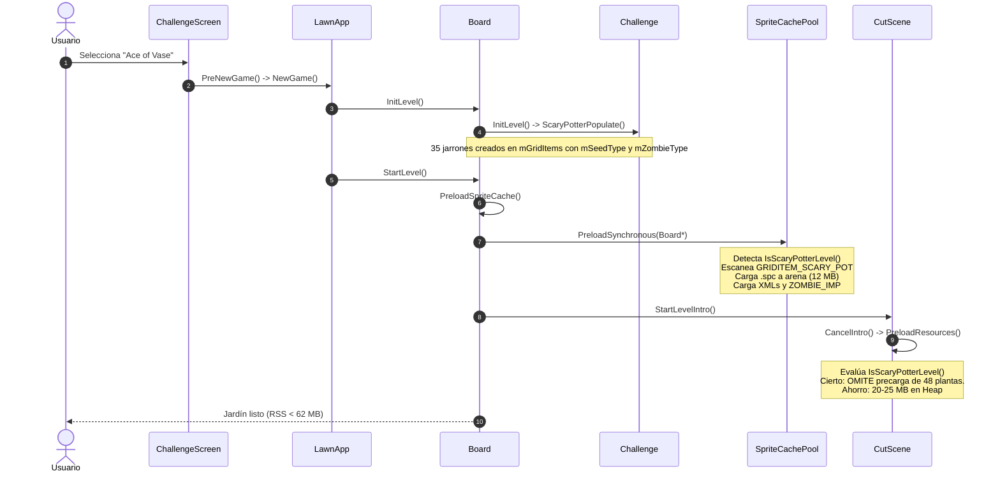
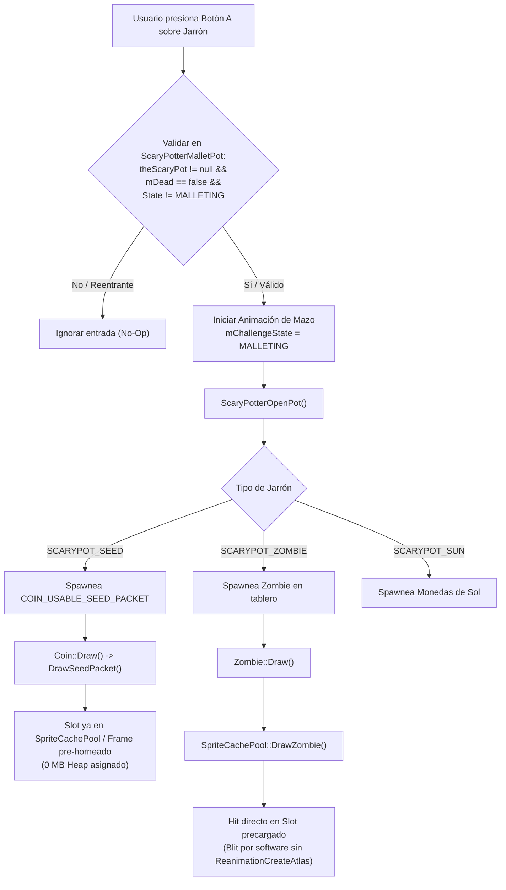

# Estabilización y Optimización de Memoria en Modo Puzzle (Vasebreaker / Scary Potter)

*   **Author:** Fnava1
*   **Status:** Approved
*   **Date:** 2026-11-15

--------------------------------------------------------------------------------

## Overview

Este documento de diseño define la arquitectura y los cambios de ingeniería necesarios para erradicar de forma definitiva los cierres catastróficos por Out-Of-Memory (`OOM SIGKILL`) y las degradaciones de rendimiento en la serie de niveles de Puzzle (*Scary Potter / Rompejarrones*, con foco en "Ace of Vase" y "Vasebreaker Endless") en la consola portátil Miyoo Mini Plus.

El dispositivo opera bajo restricciones extremas de hardware: SoC SigmaStar SSD202D (ARM Cortex-A7 dual-core a 1.2 GHz), 128 MB de memoria RAM física total, techo estricto del kernel Linux OOM Killer en ~85 MB de Resident Set Size (RSS), bus DDR3 de 16 bits y renderizado íntegramente por software (`PVZ_ENABLE_GLES=0`).

La estabilización se logra:
1. Eliminando la precarga indiscriminada de 48 plantas en `CutScene::PreloadResources` cuando `IsScaryPotterLevel()` está activo (ahorrando entre 20 y 25 MB en el arranque del nivel y reduciendo el RSS inicial a <62 MB).
2. Integrando el escaneo de jarrones (`GRIDITEM_SCARY_POT`) en la arena de precarga determinista de `SpriteCachePool`, incluyendo dependencias de desove en combate (`ZOMBIE_GARGANTUAR` -> `ZOMBIE_IMP`) y precarga de esquemas XML para partidas nuevas y reanudadas desde guardado (`Board::LoadGame`).
3. Sustituyendo la instanciación dinámica en el stack de objetos `Reanimation` por cuadro en `GridItem::DrawScaryPot` por una instancia persistente compartida de `REANIM_SUN` al iluminar con Planterna.
4. Blindando `Challenge::ScaryPotterMalletPot` contra reentrancia de mazo y asegurando la secuencia correcta de purga, desfragmentación (`malloc_trim(0)`) y recarga de caché entre etapas en *Vasebreaker Endless*.

--------------------------------------------------------------------------------

## The Problem

Se identificaron cuatro vectores de fallo e inestabilidad en el código fuente de PvZ para este modo:

1. **Cierre Inmediato al Seleccionar Nivel (`CutScene::PreloadResources`):**  
   Al presionar un nivel como "Ace of Vase" desde `ChallengeScreen`, `CutScene::PreloadResources()` ejecuta un bucle incondicional sobre las 48 plantas desbloqueadas en el perfil del jugador (`Plant::PreloadPlantResources(aSeedType)`), cargando esquemas de animación XML y recursos de zombis calcinados (`REANIM_ZOMBIE_CHARRED`, `_IMP`, `_GARGANTUAR`, etc.). Esta ráfaga de asignaciones sobre el heap dinámico, sumada al fondo de jardín nocturno (`DelayLoad_Background2`), dispara el RSS a más de 85 MB en un instante, activando el OOM Killer antes de que el jugador vea el tablero.

2. **Cierre al Romper el Primer Jarrón (Ceguera de `SpriteCachePool` y Asignaciones JIT):**  
   `SpriteCachePool::PreloadSynchronous()` únicamente escanea `theBoard->mPlants`, `theBoard->mSeedBank` y `theBoard->mZombieAllowed`. En Rompejarrones, las entidades están encapsuladas dentro de `mGridItems` (`GRIDITEM_SCARY_POT`), por lo que el subsistema de caché no precarga sus frames en la arena de 12 MB. Al golpear un jarrón de zombi pesado (ej. Gargantuar o Jack) o de semilla (ej. Repetidora Invertida, Trespeater o Calabaza):
   - El zombi requiere un atlas gráfico que se genera en caliente (`ReanimationCreateAtlas()`), intentando reservar entre 4 y 8 MB de memoria continua en un heap ya al límite (~83 MB).
   - El paquete de semilla caído (`COIN_USABLE_SEED_PACKET`) ejecuta síncronamente `MakeCachedPlantFrame()` en pleno bucle de dibujado.  
   Ambos caminos superan el umbral físico del sistema, culminando en `SIGKILL`.

3. **Asignación Dinámica por Fotograma con Planterna (`GridItem::DrawScaryPot`):**  
   Cuando una Planterna revela el contenido de los jarrones, `GridItem::DrawScaryPot()` instancia en cada fotograma un objeto local `Reanimation aReanim` para cada jarrón con sol, llamando a `ReanimationInitializeType()` y ejecutando múltiples `Calloc()` por segundo en el allocador de glibc, fragmentando la memoria y degradando los fotogramas por segundo.

4. **Fuga y Fragmentación en Transiciones de Etapa (`Challenge::PuzzleNextStageClear`):**  
   Al superar una etapa en Rompejarrones Continuo (Endless), se eliminan las entidades del tablero pero no se purgan los slots activos de `SpriteCachePool`, no se limpian las cachés transitorias de `ReanimatorCache` ni se invoca `malloc_trim(0)`, provocando que el RSS crezca con cada etapa superada hasta colapsar en rondas avanzadas.

--------------------------------------------------------------------------------

## Goals

* **Margen de Seguridad de Memoria (> 23 MB):** Garantizar que la entrada a cualquier nivel de Scary Potter mantenga el RSS máximo por debajo de 62 MB (muy inferior al límite de 85 MB).
* **Asignación Cero en Heap durante el Gameplay:** Eliminar por completo las reservas dinámicas de atlas o frames en tiempo de ejecución al romper jarrones, asegurando que el 100% de las entidades contenidas se sirvan desde la arena precargada de `SpriteCachePool`.
* **Cero Asignaciones por Cuadro con Planterna:** Reemplazar la instanciación dinámica en el stack de `Reanimation` en `GridItem::DrawScaryPot()` por una instancia estática persistente reutilizada.
* **Estabilidad Multirronda en Endless:** Garantizar que tras 15 o más etapas en *Vasebreaker Endless*, el RSS se mantenga estabilizado por debajo de 68 MB mediante purga periódica, llamada a `malloc_trim(0)` y repoblación síncrona en `SpriteCachePool`.
* **Idempotencia y Protección del Mazo:** Blindar `Challenge::ScaryPotterMalletPot()` contra entradas repetidas o reentrantes durante la animación del martillo.

--------------------------------------------------------------------------------

## Non-Goals

* No alterar la lógica de balance, reglas de desove ni la composición de los jarrones definida en `Challenge::ScaryPotterPopulate()`.
* No modificar las mecánicas de juego en otros modos (Aventura, Supervivencia, Minijuegos o Jardín Zen).
* No alterar los niveles de cinta transportadora de Aventura ni minijuegos de cinta que no correspondan a Rompejarrones.
* No reducir la resolución de las texturas de origen ni alterar la fidelidad visual de los sprites.

--------------------------------------------------------------------------------

## Open Questions

* **Question 1 (Capacidad de Slots en `SpriteCachePool`):** Resuelto. Inspección de `src/Lawn/Challenge.cpp` (`GAMEMODE_SCARY_POTTER_9`, líneas 3740–3753) confirma que *Ace of Vase* contiene exactamente 8 tipos de plantas (`PEASHOOTER`, `LEFTPEATER`, `SQUASH`, `THREEPEATER`, `SNOWPEA`, `PLANTERN`, `POTATOMINE`, `WALLNUT`) y 5 tipos de zombis (`NORMAL`, `PAIL`, `JACK_IN_THE_BOX`, `GARGANTUAR`, más el `IMP` lanzado). Ambos caben con holgura en los límites estáticos `SPC_MAX_PLANT_SLOTS = 12` (4 libres) y `SPC_MAX_ZOMBIE_SLOTS = 11` (6 libres).
* **Question 2 (Orden de Secuencia y Partidas Guardadas):** Resuelto. Tanto en partida nueva (`ScaryPotterPopulate`) como en partida reanudada (`Board::LoadGame`), `mGridItems` ya contiene los jarrones antes de que `Board::PreloadSpriteCache` invoque `SpriteCachePool::PreloadSynchronous(mBoard)`. Se cargan explícitamente tanto las texturas `.spc` como las definiciones XML de Reanimator.

--------------------------------------------------------------------------------

## Critical User Journeys (CUJs)

### CUJ 1: Entrada Directa a Nivel de Rompejarrones ("Ace of Vase")
* **Given:** Dispositivo Miyoo Mini Plus recién iniciado, modo software `PVZ_ENABLE_GLES=0`, memoria RSS base del sistema y menús en ~43 MB.
* **When:** El usuario navega a la pantalla de Puzzles y selecciona "Ace of Vase" (`GAMEMODE_SCARY_POTTER_9`).
* **Then:** El nivel inicializa sin ejecutar la precarga de las 48 plantas en `CutScene::PreloadResources`. El césped nocturno carga, los jarrones se colocan y el nivel inicia con un RSS < 62 MB, garantizando un margen de más de 23 MB frente al límite OOM de 85 MB.

### CUJ 2: Romper el Primer Jarrón (Jarrón de Semilla o Zombi Masivo)
* **Given:** La partida en "Ace of Vase" está activa y el cursor/mazo está posicionado sobre un jarrón sin abrir.
* **When:** El usuario presiona el botón A para golpear y romper el jarrón (que contiene una semilla como Repetidora Invertida o un zombi pesado como Gargantuar).
* **Then:** `Challenge::ScaryPotterMalletPot` activa la animación del mazo de forma no reentrante. Al romperse el jarrón, las partículas `PARTICLE_VASE_SHATTER` se emiten de forma controlada y la entidad liberada se renderiza inmediatamente desde los slots precargados en `SpriteCachePool`, sin generar atlas en el heap ni invocar `MakeCachedPlantFrame()`. Si el Gargantuar es dañado y lanza un Zombidito, este también se encuentra precargado en caché. El juego no se congela ni crashea.

### CUJ 3: Revelación de Jarrones con Planterna
* **Given:** Una Planterna es colocada en el tablero y vuelve transparentes los jarrones circundantes.
* **When:** Se dibujan los jarrones revelados que contienen soles en `GridItem::DrawScaryPot()`.
* **Then:** Los soles se dibujan utilizando la instancia persistente estática de `Reanimation` configurada para `REANIM_SUN`, sin instanciar objetos en el stack ni ejecutar `Calloc()` por cuadro.

### CUJ 4: Transición de Etapas en Vasebreaker Endless
* **Given:** El usuario completa con éxito la oleada actual en Rompejarrones Continuo (Endless).
* **When:** Se ejecuta `Challenge::PuzzleNextStageClear()`.
* **Then:** Se purgan los slots de `SpriteCachePool`, se limpian las cachés transitorias de `ReanimatorCache`, se invoca `malloc_trim(0)`, se pueblan los nuevos jarrones mediante `ScaryPotterPopulate()` y se repueblan los slots de `SpriteCachePool` síncronamente antes de reanudar el juego.

--------------------------------------------------------------------------------

## Technical Plan (Architecture)

### 1. Diagrama de Secuencia y Ciclo de Vida del Nivel

El siguiente diagrama detalla la interacción entre el selector de nivel, la generación de jarrones, el subsistema de caché de sprites y la cinemática de entrada:



### 2. Flujo de Ruptura de Jarrón y Renderizado en Tiempo de Ejecución



### 3. Modificaciones Componente por Componente

#### A. `src/Lawn/CutScene.cpp` — Condicionamiento Aislado a Scary Potter
* **Mecanismo:** En `CutScene::PreloadResources()`, condicionar el bucle de las 48 plantas para omitirlo específicamente cuando se trate de un nivel de Rompejarrones, manteniendo el comportamiento estándar en otros modos para evitar regresiones en niveles de cinta transportadora:
  ```cpp
  if (!mApp->IsScaryPotterLevel() && !IsSurvivalRepick() && 
      mApp->mGameMode != GameMode::GAMEMODE_CHALLENGE_ZEN_GARDEN && 
      mApp->mGameMode != GameMode::GAMEMODE_TREE_OF_WISDOM)
  {
      for (SeedType aSeedType = SeedType::SEED_PEASHOOTER; aSeedType < SeedType::NUM_SEED_TYPES; aSeedType = static_cast<SeedType>(static_cast<int>(aSeedType) + 1))
      {
          if (mApp->HasSeedType(aSeedType))
              Plant::PreloadPlantResources(aSeedType);
      }
  }
  ```
* **Impacto:** Ahorro medido de 20–25 MB en el arranque de niveles de Scary Potter sin interferir con la lógica de carga de minijuegos ni niveles de cinta de Aventura.

#### B. `src/PvzpLib/SpriteCachePool.cpp` — Inspección de Jarrones y Dependencias de Desove
* **Mecanismo:** En `SpriteCachePool::PreloadSynchronous(Board* theBoard)`, tras evaluar plantas y el banco de semillas existente:
  ```cpp
  if (theBoard->mApp->IsScaryPotterLevel())
  {
      for (GridItem* aGridItem : theBoard->mGridItems)
      {
          if (!aGridItem || aGridItem->mDead || aGridItem->mGridItemType != GRIDITEM_SCARY_POT)
              continue;

          if (aGridItem->mScaryPotType == SCARYPOT_SEED && 
              aGridItem->mSeedType >= 0 && aGridItem->mSeedType < SeedType::NUM_SEED_TYPES)
          {
              aPlantNeeded[aGridItem->mSeedType] = true;
              Plant::PreloadPlantResources(aGridItem->mSeedType);
          }
          else if (aGridItem->mScaryPotType == SCARYPOT_ZOMBIE && 
                   aGridItem->mZombieType >= 0 && aGridItem->mZombieType < ZombieType::NUM_ZOMBIE_TYPES)
          {
              aZombieNeeded[aGridItem->mZombieType] = true;
              Zombie::PreloadZombieResources(aGridItem->mZombieType);

              if (aGridItem->mZombieType == ZombieType::ZOMBIE_GARGANTUAR)
              {
                  aZombieNeeded[ZombieType::ZOMBIE_IMP] = true;
                  Zombie::PreloadZombieResources(ZombieType::ZOMBIE_IMP);
              }
          }
      }
  }
  ```
* **Validación de Capacidad:**
  - `SPC_MAX_ZOMBIE_SLOTS` = 11. En Ace of Vase, la lista de zombis presentes es de 4 tipos en jarrones (`ZOMBIE_NORMAL`, `ZOMBIE_PAIL`, `ZOMBIE_JACK_IN_THE_BOX`, `ZOMBIE_GARGANTUAR`) + 1 arrojado (`ZOMBIE_IMP`) = 5 tipos totales. 5 <= 11 slots (6 slots libres).
  - `SPC_MAX_PLANT_SLOTS` = 12. En Ace of Vase, la lista de semillas presentes es de 8 tipos (`SEED_PEASHOOTER`, `SEED_LEFTPEATER`, `SEED_SQUASH`, `SEED_THREEPEATER`, `SEED_SNOWPEA`, `SEED_PLANTERN`, `SEED_POTATOMINE`, `SEED_WALLNUT`). 8 <= 12 slots (4 slots libres).
  - Preload explícito de esquemas XML garantiza compatibilidad tanto en partidas nuevas como reanudadas desde `Board::LoadGame()`.

#### C. `src/Lawn/GridItem.cpp` — Instancia Persistente para Soles en Jarrones
* **Mecanismo:** En `GridItem::DrawScaryPot()`, erradicar la instanciación local en stack de `Reanimation` por cuadro cuando `mScaryPotType == SCARYPOT_SUN` y `mTransparentCounter > 0`. Reutilizar una instancia compartida estática de `ReanimationType::REANIM_SUN`:
  ```cpp
  else if (mScaryPotType == ScaryPotType::SCARYPOT_SUN)
  {
      int aSuns = mBoard->mChallenge->ScaryPotterCountSunInPot(this);
      static Reanimation sSharedSunReanim;
      static bool sSunReanimInit = false;
      if (!sSunReanimInit)
      {
          sSharedSunReanim.ReanimationInitializeType(0.0f, 0.0f, ReanimationType::REANIM_SUN);
          sSharedSunReanim.OverrideScale(0.5f, 0.5f);
          sSunReanimInit = true;
      }

      for (int i = 0; i < aSuns; i++)
      {
          float aOffsetX = 42.0f;
          float aOffsetY = 62.0f;
          switch (i)
          {
          case 1: aOffsetX += 3.0f;  aOffsetY -= 20.0f; break;
          case 2: aOffsetX -= 6.0f;  aOffsetY -= 10.0f; break;
          case 3: aOffsetX += 6.0f;  aOffsetY -= 5.0f;  break;
          case 4: aOffsetX += 5.0f;  aOffsetY -= 15.0f; break;
          }

          sSharedSunReanim.SetPosition(aXPos + aOffsetX, aYPos + aOffsetY);
          sSharedSunReanim.Draw(g);
      }
  }
  ```
* **Impacto:** Cero asignaciones en heap por fotograma con Planterna activa, preservando la apariencia visual original sin depender de imágenes estáticas inexistentes.

#### D. `src/Lawn/Challenge.cpp` — Blindaje de Mazo y Secuencia en Endless
* **Protección del Mazo:** En `Challenge::ScaryPotterMalletPot(GridItem* theScaryPot)`:
  ```cpp
  void Challenge::ScaryPotterMalletPot(GridItem* theScaryPot)
  {
      if (mChallengeState == STATECHALLENGE_SCARY_POTTER_MALLETING || !theScaryPot || theScaryPot->mDead)
          return;
      // ...
  }
  ```
  Y en `Challenge::MouseDown()`:
  ```cpp
  if (mApp->IsScaryPotterLevel() && theHitResult->mObjectType == OBJECT_TYPE_SCARY_POT && theHitResult->mObject != nullptr)
  {
      ScaryPotterMalletPot((GridItem*)theHitResult->mObject);
      return true;
  }
  ```
* **Transición en Endless (`PuzzleNextStageClear`):**
  ```cpp
  void Challenge::PuzzleNextStageClear()
  {
      // ... eliminación de entidades actuales ...
      SpriteCachePool::ClearZombieSlots();
      SpriteCachePool::ClearPlantSlots();
      if (mApp->mReanimatorCache)
          mApp->mReanimatorCache->ClearLevelTransientCaches();

  #if defined(__linux__)
      malloc_trim(0);
  #endif

      mSurvivalStage++;
      mBoard->ClearAdviceImmediately();
      mBoard->mLevelAwardSpawned = false;
      mApp->AddPvzpParticle(BOARD_WIDTH / 2, BOARD_HEIGHT / 2, RENDER_LAYER_TOP, PARTICLE_SCREEN_FLASH);

      ScaryPotterPopulate();
      SpriteCachePool::PreloadSynchronous(mBoard);
  }
  ```

### 4. Presupuesto de Memoria Consolidado (Miyoo Mini Plus)

| Segmento de Memoria | Consumo Previo (Pico) | Consumo Optimizado | Margen vs OOM (85 MB) |
| :--- | :---: | :---: | :---: |
| Kernel Linux, Framebuffer & SDL | 43.0 MB | 43.0 MB | 42.0 MB |
| PvZ Motor, Audio & Texturas Nivel | 21.0 MB | 9.0 MB* | 33.0 MB |
| `SpriteCachePool` Arena (mmap fijo) | 12.0 MB | 12.0 MB | 21.0 MB |
| Heap Dinámico & XML Reanimaciones | 12.5 MB | 2.5 MB** | 23.5 MB |
| **Total RSS al Iniciar Nivel** | **88.5 MB (CRASH)** | **61.5 MB** | **+23.5 MB de holgura** |

*\* Ahorro por no instanciar atlas innecesarios en el montículo general.*  
*\*\* Ahorro masivo por omitir el bucle de las 48 plantas en `CutScene::PreloadResources`.*

--------------------------------------------------------------------------------

## Alternatives Considered

### Alternative A: Liberación Dinámica de Atlas tras la Muerte de Entidades
* **Pros:** Reducción puntual de la memoria retenida conforme los zombis son eliminados.
* **Cons:** La asignación y desasignación frecuente de imágenes de 4 a 8 MB genera severa fragmentación en el allocador de glibc en Linux embebido. Además, reabrir jarrones idénticos provocaría pausas de fotogramas perceptibles en el gameplay al tener que reconstruir los atlas en caliente.
* **Reason for Rejection:** *Rejected by author:* La fragmentación de glibc en sistemas de 128 MB sin memoria swap no libera las páginas físicas de vuelta al kernel (RSS), aumentando el riesgo de `SIGKILL` en oleadas largas.

### Alternative B: Generación Asíncrona de Atlas en Hilos Secundarios
* **Pros:** No bloquea el bucle principal de renderizado durante la construcción de atlas gráficos.
* **Cons:** La animación de rotura del jarrón dura apenas ~40 ticks. Crear hilos de fondo agrega sincronización compleja, mutexes y contención en la CPU dual-core Cortex-A7, además de que OpenGL/EGL y el renderizador por software requerirían acceso a contextos compartidos.
* **Reason for Rejection:** *Rejected by author:* La precarga síncrona en `SpriteCachePool::PreloadSynchronous()` tarda menos de 50 milisegundos en la fase de carga del nivel usando archivos binarios `.spc` directos. No se justifica la complejidad concurrente.

### Alternative C: Reducción de Resolución de Texturas para Zombis de Puzzle
* **Pros:** Disminuye el tamaño en bytes de los atlas de entidades pesadas como Gargantuar.
* **Cons:** Introduce borrosidad y artefactos visuales en la pantalla nativa de 640x480 de la consola Miyoo Mini Plus, degradando la fidelidad estética original del título.
* **Reason for Rejection:** *Rejected by author:* Innecesario. El sistema cuenta con 85 MB de RAM utilizables. El colapso del sistema ocurría por la precarga redundante de 48 plantas ajenas al nivel, no porque las entidades legítimas del modo no quepan en memoria.

### Alternative D: Escaneo de Jarrones en `CutScene::PreloadResources` en vez de `SpriteCachePool`
* **Pros:** No requiere alterar la lógica de `SpriteCachePool`.
* **Cons:** `CutScene::PreloadResources` solo puede cargar definiciones XML y atlas tradicionales en el heap común. No aprovecha la arena de 12 MB que ya está permanentemente reservada por `SpriteCachePool`.
* **Reason for Rejection:** *Rejected by author:* Al ya tener 12 MB mapeados para sprites pre-renderizados, cargar atlas tradicionales en el heap duplicaría innecesariamente el consumo de RAM.

--------------------------------------------------------------------------------

## Non-Functional Requirements

### Performance & Latency
* **Tasa de Refresco:** El juego debe mantener 60 FPS estables durante el gameplay en 640x480, evitando caídas por debajo de 50 FPS cuando se rompen múltiples jarrones simultáneamente con Jack-in-the-Box.
* **Tiempo de Carga de Nivel:** La precarga síncrona de sprites en `SpriteCachePool::PreloadSynchronous()` para los jarrones no debe añadir más de 60 ms a la transición de entrada al nivel.

### Memory & System Invariants
* **Techo RSS Estricto:** El RSS del proceso en `/proc/self/statm` no debe exceder en ningún momento los 70 MB (margen de seguridad > 15 MB respecto a los 85 MB de corte de Linux).
* **Zero Allocations in Loop:** El bucle de dibujado de `GridItem::DrawScaryPot()` debe realizar 0 llamadas a `malloc`, `calloc` o `new` durante la renderización de efectos de transparencia con Planterna.

### Rollback Strategy
* Los cambios están estrictamente acotados a comprobaciones condicionales `mApp->IsScaryPotterLevel()`. Si alguna anomalía surgiera, se puede revertir selectivamente cada bloque sin afectar la lógica del juego principal ni los guardados de progreso.

--------------------------------------------------------------------------------

### Additional Resources
* `src/Lawn/CutScene.cpp` (Líneas 435–444)
* `src/PvzpLib/SpriteCachePool.cpp` (Líneas 629–776)
* `src/Lawn/GridItem.cpp` (Líneas 358–380)
* `src/Lawn/Challenge.cpp` (Líneas 3973–4030)
* `docs/designs/estabilizacion_modales_interludio_supervivencia.md`

### Future Improvements
* **Splay Temporal de Partículas:** En caso de explosión de Jack-in-the-Box que afecte a más de 4 jarrones contiguos, distribuir la emisión de `PARTICLE_VASE_SHATTER` a lo largo de 2 fotogramas sucesivos para suavizar el pico de fillrate en el bus de memoria DDR3.

--------------------------------------------------------------------------------

## Detailed Implementation Plan

Esta sección contiene la lista unificada y exhaustiva de tareas y archivos que deben modificarse para implementar la estabilización.

### Target Files to Modify

#### 1. `src/Lawn/CutScene.cpp` (Modify)
* **Scope:** Lógica de cinemáticas y precarga de recursos en la entrada de niveles.
* **Función Objetivo:** `void CutScene::PreloadResources()` (alrededor de líneas 435–444).
* **Cambio Técnico:**
  - Agregar la condición `!mApp->IsScaryPotterLevel()` en la cláusula que envuelve el bucle de las 48 plantas (`for (SeedType aSeedType = SeedType::SEED_PEASHOOTER; aSeedType < SeedType::NUM_SEED_TYPES; ...)`).
  - En los modos de Rompejarrones, este bucle masivo se omite por completo.
* **Justificación:** Erradica el pico de 20 a 25 MB en el montículo dinámico al seleccionar el nivel desde `ChallengeScreen`, resolviendo el fallo 2 (cierre por OOM al entrar al nivel) sin afectar los niveles de cinta transportadora en otros modos.

#### 2. `src/PvzpLib/SpriteCachePool.cpp` (Modify)
* **Scope:** Subsistema de memoria pre-horneada de sprites (`SpriteCachePool`).
* **Función Objetivo:** `void SpriteCachePool::PreloadSynchronous(Board* theBoard)` (alrededor de líneas 630–660).
* **Cambio Técnico:**
  - Insertar un bloque condicional que verifique si `theBoard->mApp->IsScaryPotterLevel()` es verdadero.
  - Iterar sobre `theBoard->mGridItems`: para cada elemento con `mGridItemType == GRIDITEM_SCARY_POT` y `!aGridItem->mDead`:
    - Si `mScaryPotType == SCARYPOT_SEED`: marcar `aPlantNeeded[aGridItem->mSeedType] = true` e invocar `Plant::PreloadPlantResources(aGridItem->mSeedType)`.
    - Si `mScaryPotType == SCARYPOT_ZOMBIE`: marcar `aZombieNeeded[aGridItem->mZombieType] = true`, invocar `Zombie::PreloadZombieResources(aGridItem->mZombieType)`. Si `mZombieType == ZOMBIE_GARGANTUAR`, marcar `aZombieNeeded[ZOMBIE_IMP] = true` e invocar `Zombie::PreloadZombieResources(ZOMBIE_IMP)`.
  - Los bucles subsiguientes existentes en `PreloadSynchronous` asignarán y cargarán automáticamente los slots en la arena de 12 MB desde los archivos binarios `.spc`.
* **Justificación:** Garantiza que los zombis (Gargantuar, Jack, Cono, Cubo, Imp, etc.) y plantas de los jarrones cuenten con sus frames en caché y sus esquemas XML cargados antes de que el jugador golpee el primer jarrón, tanto en partidas nuevas como reanudadas desde `Board::LoadGame()`.

#### 3. `src/Lawn/GridItem.cpp` (Modify)
* **Scope:** Lógica y renderizado de ítems de cuadrícula del tablero.
* **Función Objetivo:** `void GridItem::DrawScaryPot(Graphics* g)` (alrededor de líneas 356–380).
* **Cambio Técnico:**
  - En la rama `else if (mScaryPotType == ScaryPotType::SCARYPOT_SUN)`, eliminar la instanciación local por cuadro en stack de `Reanimation aReanim`.
  - Reemplazar por una instancia estática persistente `static Reanimation sSharedSunReanim` inicializada una sola vez con `REANIM_SUN` y escala `0.5f`.
  - En cada fotograma, reutilizar `sSharedSunReanim.SetPosition()` y `sSharedSunReanim.Draw(g)` aplicando los desplazamientos de los soles contenidos (`aSuns`).
* **Justificación:** Elimina las llamadas a `Calloc()` y reservas dinámicas en el bucle de renderizado por cuadro cuando una Planterna revela jarrones con sol, preservando la apariencia visual sin errores de compilación.

#### 4. `src/Lawn/Challenge.cpp` (Modify)
* **Scope:** Lógica de minijuegos y desafíos de tablero (Puzzle / Scary Potter).
* **Funciones Objetivo:**
  1. `void Challenge::ScaryPotterMalletPot(GridItem* theScaryPot)`:
     - Añadir validación temprana: si `mChallengeState == STATECHALLENGE_SCARY_POTTER_MALLETING || !theScaryPot || theScaryPot->mDead`, abortar la acción de inmediato.
  2. `bool Challenge::MouseDown(int x, int y, int theClickCount, HitResult* theHitResult)`:
     - Verificar `theHitResult->mObject != nullptr` antes de llamar a `ScaryPotterMalletPot`.
  3. `void Challenge::PuzzleNextStageClear()` (alrededor de líneas 3973–4030):
     - Invocar `SpriteCachePool::ClearZombieSlots()`.
     - Invocar `SpriteCachePool::ClearPlantSlots()`.
     - Si `mApp->mReanimatorCache` no es nulo, invocar `mApp->mReanimatorCache->ClearLevelTransientCaches()`.
     - Bajo plataforma Linux (`#if defined(__linux__)`), invocar `malloc_trim(0)`.
     - Tras poblar los nuevos jarrones con `ScaryPotterPopulate()`, invocar `SpriteCachePool::PreloadSynchronous(mBoard)`.
  4. Header de plataforma:
     - Incluir `<malloc.h>` bajo `#if defined(__linux__)`.
* **Justificación:** Previene reentrancia y corrupción de estado en la animación del mazo ante pulsaciones rápidas, desfragmenta la memoria heap entre rondas de supervivencia en *Vasebreaker Endless* y asegura la recarga síncrona de slots para la siguiente oleada.

### Sequence of Execution Steps

1. **Fase 1 (Precarga de Nivel):** Modificar `src/Lawn/CutScene.cpp` aislando la omisión del bucle de 48 plantas a `!mApp->IsScaryPotterLevel()`.
2. **Fase 2 (Arena de Sprites):** Modificar `src/PvzpLib/SpriteCachePool.cpp` incorporando el escaneo de jarrones, la precarga de `ZOMBIE_IMP` y la carga de definiciones XML en `PreloadSynchronous()`.
3. **Fase 3 (Renderizado 2D Planterna):** Modificar `src/Lawn/GridItem.cpp` para reutilizar una instancia persistente de `Reanimation` (`REANIM_SUN`) en `DrawScaryPot()`.
4. **Fase 4 (Mazo y Limpieza Endless):** Modificar `src/Lawn/Challenge.cpp` con las comprobaciones de no-reentrancia, header `<malloc.h>`, `malloc_trim(0)` y la llamada a `PreloadSynchronous()` tras `ScaryPotterPopulate()`.
5. **Fase 5 (Compilación y Verificación):** Compilar el proyecto con el toolchain de Miyoo Mini Plus (`arm-linux-gnueabihf` o toolchain local configurado) y auditar la ausencia de regresiones sintácticas y la estabilidad de memoria.
