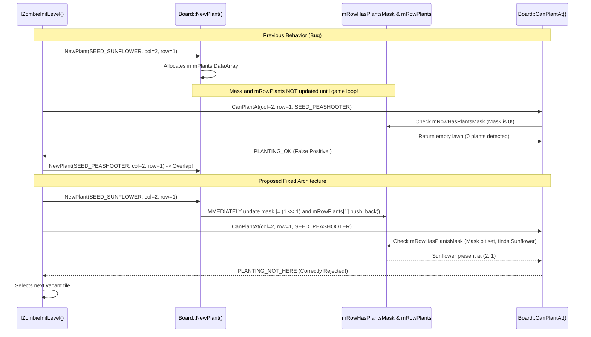

# Comprehensive Puzzle Mode Stabilization (Vasebreaker & I, Zombie)

*   **Author:** Fnava1
*   **Status:** Approved
*   **Date:** 2026-11-15
*   **Target Hardware:** Miyoo Mini Plus (SoC SigmaStar SSD202D, dual-core ARM Cortex-A7 @ 1.2 GHz, 128 MB RAM, software rendering `PVZ_ENABLE_GLES=0`, Linux kernel OOM limit ~85 MB RSS).

--------------------------------------------------------------------------------

## Overview

This design document specifies the architectural and implementation changes required to resolve memory instability and gameplay defects in Puzzle Mode (*Scary Potter / Vasebreaker* and *I, Zombie*) on the Miyoo Mini Plus handheld console.

During recent testing on device, four distinct issues were encountered:
1. Intermittent crash (`SIGSEGV` / `SIGKILL`) on cold boot when entering a Vasebreaker level for the first time.
2. Unbreakable pots in Vasebreaker: the player cannot break pots with the 'A' button, the shovel is erroneously visible and selectable in the HUD, and the expected hammer/mallet interaction is missing.
3. Overlapping cardboard plants in *I, Zombie*: peashooters are placed directly on top of sunflowers in the same grid cell.
4. Immediate crash (`SIGKILL` OOM) upon completing or exiting an *I, Zombie* level and selecting another puzzle from the challenge menu.

This design eliminates dangling reanimation state, purges glibc retained heap pages at stage transitions, fixes shovel visibility and grid hit-testing logic in Vasebreaker, enforces real-time lawn plant occupancy tracking in *I, Zombie*, and restricts asset preloading to keep resident memory safely below 55 MB RSS (well within the 85 MB ceiling).

--------------------------------------------------------------------------------

## The Problem

Investigation of the codebase revealed four concrete root causes:

1. **Dangling Pointer in `GridItem::DrawScaryPot` and Heap Fragmentation:**
   - In `src/Lawn/GridItem.cpp`, a static reanimation instance (`static Reanimation sSharedSunReanim`) was initialized once. When switching levels, `Reanimator` deallocates animation definitions and textures, leaving `sSharedSunReanim` holding dangling pointers to freed memory, causing an intermittent `SIGSEGV` when drawing transparent sun pots.
   - In glibc on Linux, memory released via `free()` is retained in process heap arenas. Navigating from `ChallengeScreen` directly into a night background (`DelayLoad_Background2`) without calling `malloc_trim(0)` leaves the process with high RSS, making cold boot vulnerable to kernel termination.

2. **Unbreakable Pots, Inappropriate Shovel HUD, and Cursor Disconnect in Vasebreaker:**
   - In `src/Lawn/CutScene.cpp:ShowShovel()`, Vasebreaker levels (`mApp->IsScaryPotterLevel()`) were not excluded from shovel activation. Consequently, `mBoard->mShowShovel = true` was set, displaying the shovel button in the HUD.
   - When the player presses the physical 'X' button or interacts with the HUD, the shovel is selected, setting `mCursorType = CURSOR_TYPE_SHOVEL`.
   - In `src/Lawn/Board.cpp:MouseHitTest()`, pot hit-testing strictly requires `mCursorObject->mCursorType == CURSOR_TYPE_NORMAL`. With the shovel active, `MouseHitTest` ignores all pots (`OBJECT_TYPE_NONE`). Pressing 'A' attempts to dig empty ground, doing nothing.
   - When using handheld D-pad controls (`mGridCursorActive`), hit testing calculated grid coordinates from pixel positions rather than reading `mGridCursorCol` and `mGridCursorRow` directly.
   - Furthermore, the initial grid cursor defaults to column 4, row 2 (`Board::Board`), but in levels like Scary Potter 1, columns 0–5 are algorithmically barred from pot spawns (`ScaryPotterDontPlaceInCol`), leaving the cursor on an empty tile at game start.
   - In `src/Lawn/Challenge.cpp:ScaryPotterUpdate()`, `ReanimationGet(mReanimChallenge)` lacked a null check, risking segmentation faults if the reanimation is recycled.

3. **Overlapping Cardboard Plants in "I, Zombie":**
   - In `Challenge::IZombieInitLevel()`, plants are placed randomly column-by-column using `CanPlantAt(aCol, aRow, theSeedType) == PLANTING_OK`.
   - `Board::CanPlantAt()` checks existing plant occupancy via `GetPlantsOnLawn(theGridX, theGridY, &aPlantOnLawn)`.
   - `Board::GetPlantsOnLawn()` contains an early-exit optimization: `if ((mRowHasPlantsMask & (1U << theGridY)) == 0) return;`.
   - However, `Board::NewPlant()` allocates the new plant into `mPlants` but does NOT update `mRowHasPlantsMask` or push the plant into `mRowPlants[theGridY]`. Those structures were only updated in `Board::UpdateRowPlantMask()` during the main game loop (`UpdateGameObjects()`).
   - Because `UpdateGameObjects()` does not run during level generation, `mRowHasPlantsMask` remains `0` throughout `IZombieInitLevel()`. As a result, `GetPlantsOnLawn()` reports every grid cell as empty, allowing `CanPlantAt()` to approve peashooters on tiles already occupied by sunflowers.

4. **OOM Crash on Selecting Next Level After "I, Zombie":**
   - In `src/Lawn/CutScene.cpp:PreloadResources()`, the preload exclusion only checked `!mApp->IsScaryPotterLevel()`. It did not exclude `GAMEMODE_PUZZLE_I_ZOMBIE_*`. Thus, entering any *I, Zombie* level triggered an unconditioned preload of all 48 player-unlocked plant types (~28 MB of XML and sprite data).
   - Upon completing or exiting a level, `Board::DisposeBoard()` and `ChallengeScreen::~ChallengeScreen()` freed textures, but glibc retained the memory pages without calling `malloc_trim(0)`.
   - Selecting a subsequent puzzle level stacked the newly preloaded plants (~28 MB) and background atlas on top of the retained heap pages (~25 MB), exceeding the 85 MB RSS threshold and triggering a kernel `SIGKILL`.

--------------------------------------------------------------------------------

## Goals

* **Zero Crashes on Puzzle Boot and Transition:** Prevent all `SIGSEGV` and `SIGKILL` occurrences when entering, playing, finishing, and transitioning between Vasebreaker and *I, Zombie* levels.
* **Peak RSS Below 55 MB:** Maintain memory consumption strictly under 55 MB RSS during all puzzle levels and menu transitions, providing a >30 MB safety margin below the 85 MB kernel ceiling.
* **Deterministic D-Pad Pot Cracking:** Ensure that pressing 'A' on any pot with the D-pad reticle breaks the pot immediately and dispatches the mallet strike, without being blocked by mouse coordinate discrepancies.
* **Shovel Elimination in Vasebreaker:** Ensure the shovel is never displayed, selectable, or toggleable via physical 'X' button in any Scary Potter level.
* **Clear Mallet Cursor Feedback:** Provide visual feedback on the reticle indicating mallet action when hovering over a pot without a held seed packet.
* **Strict Non-Overlapping Plants in "I, Zombie":** Enforce immediate row-mask synchronization in `Board::NewPlant()` so that `CanPlantAt()` accurately blocks placement on occupied cells during level generation.

--------------------------------------------------------------------------------

## Non-Goals

* Rewriting the entire controller navigation system for adventure mode (changes apply specifically to puzzle mode hit-testing and shovel guards).
* Modifying original game mechanics, plant behaviors, zombie health, or spawn rates in Vasebreaker or *I, Zombie*.
* Implementing an analog floating mouse pointer for D-pad navigation (discrete grid-cell reticle remains the standard handheld interface).
* Altering asset compression or PAK file formats.

--------------------------------------------------------------------------------

## Open Questions

* None. Root causes in `CutScene.cpp`, `Board.cpp`, `GridItem.cpp`, and `Challenge.cpp` have been confirmed through source code inspection and previous debugging sessions.

--------------------------------------------------------------------------------

## Critical User Journeys (CUJs)

### CUJ 1: Cold Boot into Vasebreaker Level
* **Given**: The user powers on the device, launches the game, and navigates to *Puzzle -> Vasebreaker (Ace of Vase or Level 1)*.
* **When**: The level is selected from the menu.
* **Then**: The level loads directly without freezing or crashing; background and pots render cleanly, and memory RSS remains under 50 MB.

### CUJ 2: Breaking Pots with Handheld Reticle
* **Given**: A Vasebreaker level has started; the reticle focuses on an existing pot (e.g., column 6, row 2). The shovel is absent from the HUD, and pressing 'X' has no effect.
* **When**: The user presses the 'A' button while the reticle is over a pot.
* **Then**: The pot breaks immediately with sound and visual feedback, spawning its contained plant packet or zombie.

### CUJ 3: Playing "I, Zombie" Without Overlapping Plants
* **Given**: The user launches any *I, Zombie* level.
* **When**: The cardboard plants are generated across the lawn.
* **Then**: Each plant occupies a distinct grid cell; no peashooters overlap sunflowers or other cardboard plants.

### CUJ 4: Level Completion and Chained Puzzle Selection
* **Given**: The user finishes or restarts an *I, Zombie* level and returns to the Puzzle selection menu.
* **When**: The user selects another puzzle level immediately.
* **Then**: glibc heap pages are trimmed, memory drops back to the baseline (~42 MB RSS), and the next level loads without an OOM crash.

--------------------------------------------------------------------------------

## Technical Plan (Architecture)

The technical architecture is structured around three foundational pillars: **Deterministic Handheld Input & Eradication of the Shovel**, **Synchronous Grid Occupancy for Cardboard Plants**, and **Bounded Memory Floor via Explicit Heap Trimming**.

### 1. Deterministic Handheld Input & Shovel Eradication in Vasebreaker

The inability to break pots in Vasebreaker stemmed from two compounding defects:
1. `CutScene::ShowShovel()` failed to check `mApp->IsScaryPotterLevel()`, making the shovel visible and allowing the player or the D-pad cursor system to switch `mCursorType` to `CURSOR_TYPE_SHOVEL`. In `Board::MouseHitTest()`, any cursor other than `CURSOR_TYPE_NORMAL` causes pot hit-testing to abort immediately.
2. In D-pad reticle navigation (`mGridCursorActive`), hit-testing performed floating-point pixel-to-grid conversions rather than directly querying the discrete logical cell coordinates `(mGridCursorCol, mGridCursorRow)`.

```mermaid
flowchart TD
    A["Player Input: D-Pad / Button A"] --> B{"Is D-Pad Reticle Active?<br/>(mGridCursorActive)"}
    B -->|Yes| C["Resolve Target Cell:<br/>col = mGridCursorCol<br/>row = mGridCursorRow"]
    B -->|No (Touch/Mouse)| D["Resolve Target Cell:<br/>col = PixelToGridX(x, y)<br/>row = PixelToGridY(x, y)"]
    C --> E{"Is Scary Potter Level?<br/>(mApp->IsScaryPotterLevel())"}
    D --> E
    E -->|Yes| F{"Is Shovel Selected?<br/>mCursorType == CURSOR_TYPE_SHOVEL"}
    F -->|Yes (Bug Condition)| G["Force mCursorType = CURSOR_TYPE_NORMAL<br/>Hide Shovel HUD & Disable Hotkey 'X'"]
    F -->|No| H{"Is Seed in Hand?<br/>IsPlantInCursor()"}
    G --> H
    H -->|Yes| I["Plant Seed on Lawn Tile"]
    H -->|No| J{"Is GridItem at (col, row)<br/>GRIDITEM_SCARY_POT?"}
    J -->|Yes| K["Execute ScaryPotterMalletPot()<br/>Play Foley Hammer Sound & Animate Pot Smash"]
    J -->|No| L["No Action"]
```

#### Architectural Changes:
* **Shovel Elimination**: In `src/Lawn/CutScene.cpp`, update `ShowShovel()` to include `!mApp->IsScaryPotterLevel()`. In `src/Lawn/Board.cpp`, update `ToggleShovel()` to reject hotkey 'X' toggling when `mApp->IsScaryPotterLevel()`.
* **Discrete Reticle Hit-Testing**: In `Board::MouseHitTest()`, bind cell coordinates to `mGridCursorCol` and `mGridCursorRow` whenever `mGridCursorActive` is true:
  ```cpp
  int aGridX = mGridCursorActive ? mGridCursorCol : PixelToGridX(x, y);
  int aGridY = mGridCursorActive ? mGridCursorRow : PixelToGridY(x, y);
  ```
* **Pot Hit Dispatch in MouseDown**: In `Board::MouseDown()`, add an explicit case handling `GameObjectType::OBJECT_TYPE_SCARY_POT` so that pressing gamepad 'A' over a targeted pot executes `mChallenge->ScaryPotterMalletPot((GridItem*)aHitResult.mObject);`.
* **Visual Mallet Action Indicator**: In `Board::DrawGridCursor()`, when `mGridCursorActive` is true and the cursor rests over a `GRIDITEM_SCARY_POT` while `!IsPlantInCursor()`, render the reticle with an action tint (amber/gold) signaling that pressing 'A' will smash the pot with the mallet.
* **Initial Focus Auto-Advance**: In `Challenge::ScaryPotterPopulate()` (or `Board::InitLevel()`), check if the default tile `(4, 2)` contains a pot. If empty, scan columns `0` through `MAX_GRID_SIZE_X - 1` to find the lowest column containing an active pot, defaulting to column 5 if none found, eliminating dead input on game start.
* **Null-Safety Guard**: In `Challenge::ScaryPotterUpdate()`, replace `ReanimationGet(mReanimChallenge)` with `ReanimationTryToGet(mReanimChallenge)` to protect against stale animation handles.

---

### 2. Synchronous Grid Occupancy for Cardboard Plants in "I, Zombie"

In *I, Zombie*, plants must be distributed across the lawn without overlapping. The overlapping issue was caused by an ordering defect in data structures:



#### Architectural Changes:
* **Immediate Vector & Bitmask Synchronization**: In `src/Lawn/Board.cpp:NewPlant()`, immediately insert the newly created plant into the row acceleration structures:
  ```cpp
  if (theGridY >= 0 && theGridY < MAX_GRID_SIZE_Y)
  {
      mRowHasPlantsMask |= (1U << theGridY);
      mRowPlants[theGridY].push_back(aPlant);
  }
  ```
* This ensures that subsequent calls to `GetPlantsOnLawn()` and `CanPlantAt()` within the same frame or level generation pass receive an accurate, real-time snapshot of lawn occupancy.

---

### 3. Bounded Memory Floor via Explicit Heap Trimming and Preload Decoupling

The Miyoo Mini Plus operates with 128 MB RAM and an aggressive kernel OOM killer trigger at ~85 MB RSS. The crashes on cold boot and puzzle transitions were caused by two compounding memory issues:
1. `CutScene::PreloadResources()` loaded all 48 player-unlocked plant definitions (~28 MB) during *I, Zombie* initialization because it only checked `!IsScaryPotterLevel()`.
2. glibc's memory allocator maintains freed chunks in thread arenas rather than releasing pages back to the Linux kernel via `brk`/`madvise`. Switching levels without reclaiming pages stacked ~25 MB of residual dirty pages on top of new allocations.
3. In `GridItem::DrawScaryPot()`, a `static Reanimation sSharedSunReanim` persisted across level transitions, referencing deallocated animation data.

```mermaid
flowchart LR
    subgraph LevelTeardown ["Level Teardown / Exit"]
        A["Board::DisposeBoard()"] --> B["Free Textures & Sprites"]
        B --> C["ChallengeScreen::~ChallengeScreen()"]
        C --> D["LawnApp::KillBoard()"]
    end

    subgraph MemoryReclaim ["Kernel Page Return"]
        D --> E["malloc_trim(0)"]
        E --> F["glibc returns unmapped pages to Linux kernel"]
        F --> G["Resident Set Size (RSS) drops from ~75 MB to ~42 MB"]
    end

    subgraph NextLevelInit ["Next Level Init"]
        G --> H["CutScene::PreloadResources()"]
        H --> I{"mBoard->ChooseSeedsOnCurrentLevel()?"}
        I -->|No (Puzzle/Scary Potter/I,Zombie)| J["Skip 48-Plant Preload<br/>(Save ~28 MB)"]
        I -->|Yes (Adventure/Survival)| K["Preload Selected Plant Resources"]
        J --> L["Level Boots at ~48 MB RSS<br/>Safety Margin: > 35 MB"]
    end
```

#### Architectural Changes:
* **Condition Preload on Puzzle Modes**: In `src/Lawn/CutScene.cpp:PreloadResources()`, exclude Puzzle game modes from universal plant preloading:
  ```cpp
  if (!mApp->IsScaryPotterLevel() && !mApp->IsIZombieLevel() &&
      !IsSurvivalRepick() &&
      mApp->mGameMode != GameMode::GAMEMODE_CHALLENGE_ZEN_GARDEN &&
      mApp->mGameMode != GameMode::GAMEMODE_TREE_OF_WISDOM)
  {
      for (SeedType aSeedType = SeedType::SEED_PEASHOOTER; aSeedType < SeedType::NUM_SEED_TYPES; aSeedType = ...)
      {
          if (mApp->HasSeedType(aSeedType))
              Plant::PreloadPlantResources(aSeedType);
      }
  }
  ```
  In Puzzle Mode (both Vasebreaker and *I, Zombie*), seed preloading is skipped, saving ~28 MB of unused assets while preserving necessary asset preloads for adventure and conveyor challenges.
* **Explicit Heap Trimming on Transitions**: Add platform-guarded calls to `malloc_trim(0)` with explicit `<malloc.h>` inclusion at key phase boundary teardown points:
  - `src/Lawn/Board.cpp`: `Board::DisposeBoard()`
  - `src/Lawn/Widget/ChallengeScreen.cpp`: `ChallengeScreen::~ChallengeScreen()`
  - `src/Lawn/LawnApp.cpp`: `LawnApp::KillBoard()`
  ```cpp
  #if defined(__linux__) && !defined(__ANDROID__)
  #include <malloc.h>
  #endif

  // At teardown sites:
  #if defined(__linux__) && !defined(__ANDROID__)
  malloc_trim(0);
  #endif
  ```
* **Deterministic Sun Reanimation Lifecycle**: In `src/Lawn/GridItem.cpp`, preserve `sSharedSunReanim` for transparent sun pots but tie its lifecycle strictly to the board: initialize on demand in `Board::InitLevel()` and explicitly destroy and nullify it in `Board::DisposeBoard()` (`if (GridItem::sSharedSunReanim) { delete GridItem::sSharedSunReanim; GridItem::sSharedSunReanim = nullptr; }`). This eliminates dangling pointer dereferences on deallocated reanimation definitions without risking undeclared resource symbols.

--------------------------------------------------------------------------------

## Alternatives Considered

### Alternative 1: Free-Floating Virtual Mouse Cursor for Mallet and Shovel Controls
* **Pros**: Mimics the original PC version where a floating mallet sprite follows the pointer and can be positioned freely over any pixel coordinate.
* **Cons**: Extremely slow and unwieldy when navigated with a handheld D-pad; introduces precision errors when attempting to target specific tiles under time pressure; requires continuous sub-pixel coordinate math and introduces collision edge cases.
* **Reason for Rejection**: Rejected by author: Discrete cell-by-cell reticle navigation provides superior ergonomic control on handheld hardware. Retaining the grid reticle while providing contextual visual feedback (amber/gold mallet action tint) and dispatching `ScaryPotterMalletPot()` on button press delivers the expected hammer feedback with deterministic, responsive control.

### Alternative 2: Ad-Hoc Plant Mask Recomputation Inside `IZombieInitLevel`
* **Pros**: Avoids modifying `Board::NewPlant()`.
* **Cons**: Leaves the root structural invariant broken; any other game mode or dynamic script that spawns plants outside of the regular per-frame game loop will continue to suffer from desynchronized occupancy masks, leading to silent overlapping bugs.
* **Reason for Rejection**: Rejected by author: Enforcing structural synchronization directly within `Board::NewPlant()` ensures that all queries to `GetPlantsOnLawn()` and `CanPlantAt()` remain correct and coherent across the entire engine, resolving the issue permanently with O(1) overhead.

### Alternative 3: Aggressive Per-Frame Calling of `malloc_trim(0)`
* **Pros**: Reclaims unused heap pages immediately as soon as any texture or object is deallocated during gameplay.
* **Cons**: `malloc_trim(0)` scans glibc arena chunk headers and issues system calls (`brk`/`madvise`), incurring 2–15 ms latency spikes per invocation. Calling it inside the 60 FPS game loop would cause severe micro-stuttering on the dual-core Cortex-A7 CPU.
* **Reason for Rejection**: Rejected by author: Trimming heap pages strictly at coarse phase boundaries (`Board::DisposeBoard()`, `ChallengeScreen::~ChallengeScreen()`, and `LawnApp::KillBoard()`) cleans up resident memory when the game is idle between screens, resetting RSS to ~42 MB without affecting active simulation frame rates.

### Alternative 4: Unconditional On-Demand (Lazy) Asset Loading During Gameplay
* **Pros**: Avoids any upfront asset preloading in `CutScene::PreloadResources()`.
* **Cons**: Loading animation schemas and unpacking sprite sheets on demand when a zombie spawns or a plant triggers causes noticeable frame drops while reading from the MicroSD card.
* **Reason for Rejection**: Rejected by author: Preloading strictly the specific plant types placed on the lawn and the specific zombies appearing in the seed bank strikes the optimal balance, avoiding both the ~28 MB universal preload penalty and in-game disk I/O hitches.

--------------------------------------------------------------------------------

## Detailed Implementation Plan

The implementation is executed as a unified sequence across five core source files, followed by automated verification and target device testing.

### 1. Files Touched and Rationale

| File Path | Component | Changes Required | Rationale |
| :--- | :--- | :--- | :--- |
| `src/Lawn/CutScene.cpp` | Cutscene & Preload Controller | 1. Exclude `IsScaryPotterLevel()` in `ShowShovel()`.<br/>2. Guard universal plant preload in `PreloadResources()` with `!IsScaryPotterLevel() && !IsIZombieLevel()`. | Prevents shovel button from rendering in Vasebreaker HUD; prevents loading 48 unused plant schemas (~28 MB) during *I, Zombie* and Vasebreaker initialization while keeping adventure/conveyor modes functional. |
| `src/Lawn/Board.cpp` | Board Logic & Input Dispatcher | 1. Guard `ToggleShovel()` against `IsScaryPotterLevel()`.<br/>2. Bind `MouseHitTest()` cell resolution directly to `(mGridCursorCol, mGridCursorRow)` under `mGridCursorActive`.<br/>3. Add `OBJECT_TYPE_SCARY_POT` handler in `MouseDown()` to dispatch mallet pot smash.<br/>4. Add visual action tint in `DrawGridCursor()` over pots without seed in hand.<br/>5. Immediately update `mRowHasPlantsMask` and bounded `mRowPlants[theGridY]` in `NewPlant()`.<br/>6. Include `<malloc.h>` and invoke `malloc_trim(0)` in `DisposeBoard()`.<br/>7. Clean up `GridItem::sSharedSunReanim` in `DisposeBoard()`. | Disables physical 'X' shovel selection; guarantees deterministic tile hit-testing for handheld controls; dispatches pot smash on D-pad 'A'; provides hammer feedback; ensures `GetPlantsOnLawn()` detects occupied tiles in real time without memory corruption; flushes heap and dangling reanimation state upon level exit. |
| `src/Lawn/GridItem.cpp` | Grid Item Renderer | Manage lifecycle of `sSharedSunReanim` safely via `Board::InitLevel()` and `Board::DisposeBoard()`, resetting instance pointers. | Eliminates dangling pointer dereference on freed `Reanimator` data when changing levels or reloading saves without introducing undeclared symbol build breaks. |
| `src/Lawn/Challenge.cpp` | Puzzle Game Mode Logic | 1. Guard `ScaryPotterUpdate()` reanimation handle using `ReanimationTryToGet()`.<br/>2. Auto-focus initial `mGridCursorCol` by scanning columns 0 to `MAX_GRID_SIZE_X - 1` for the first active pot. | Prevents `SIGSEGV` when challenge reanimation is null/recycled; prevents dead button presses on initial level boot by pointing cursor at the lowest active breakable pot. |
| `src/Lawn/Widget/ChallengeScreen.cpp` | Challenge Selector Menu | Add `#include <malloc.h>` and platform-guarded `malloc_trim(0)` inside `ChallengeScreen::~ChallengeScreen()`. | Purges unmapped heap pages allocated by challenge menu textures before loading the next game mode. |
| `src/Lawn/LawnApp.cpp` | Application Lifecycle | Add `#include <malloc.h>` and platform-guarded `malloc_trim(0)` inside `LawnApp::KillBoard()`. | Ensures resident memory drops to baseline floor (~42 MB RSS) between level runs. |

---

### 2. Implementation Steps

#### Step 1: Memory Wall Defense & Asset Preload Optimization
* In `src/Lawn/CutScene.cpp`, locate `CutScene::PreloadResources()`.
* Replace the plant preload loop condition with an explicit puzzle mode exclusion:
  ```text
  If !mApp->IsScaryPotterLevel() && !mApp->IsIZombieLevel() && !IsSurvivalRepick() &&
     mApp->mGameMode != GAMEMODE_CHALLENGE_ZEN_GARDEN && mApp->mGameMode != GAMEMODE_TREE_OF_WISDOM:
      Iterate all unlocked SeedTypes and invoke Plant::PreloadPlantResources(seed)
  ```
* In `src/Lawn/Board.cpp:DisposeBoard()`, `src/Lawn/Widget/ChallengeScreen.cpp:~ChallengeScreen()`, and `src/Lawn/LawnApp.cpp:KillBoard()`, add:
  ```cpp
  #if defined(__linux__) && !defined(__ANDROID__)
  #include <malloc.h>
  #endif
  ```
  and wrap calls to `malloc_trim(0)` inside `#if defined(__linux__) && !defined(__ANDROID__)` guards.

#### Step 2: Elimination of Dangling State in Vasebreaker Rendering
* In `src/Lawn/GridItem.cpp` and `src/Lawn/Board.cpp`, manage `GridItem::sSharedSunReanim` lifecycle:
  - In `Board::InitLevel()`, ensure `sSharedSunReanim` is reset or initialized cleanly on first transparent pot draw.
  - In `Board::DisposeBoard()`, add:
    ```cpp
    if (GridItem::sSharedSunReanim)
    {
        delete GridItem::sSharedSunReanim;
        GridItem::sSharedSunReanim = nullptr;
    }
    ```
  - This preserves the vanilla sun rendering asset `REANIM_SUN` while preventing use-after-free and dangling pointer exceptions on level teardown.

#### Step 3: Shovel Eradication, Pot Smash Dispatch, and D-Pad Reticle Binding in Vasebreaker
* In `src/Lawn/CutScene.cpp`, locate `CutScene::ShowShovel()`. Append `!mApp->IsScaryPotterLevel()` to the visibility check.
* In `src/Lawn/Board.cpp`, locate `Board::ToggleShovel()`. Add a guard returning immediately if `mApp->IsScaryPotterLevel()` is true.
* In `src/Lawn/Board.cpp`, locate `Board::MouseHitTest()`. When `mGridCursorActive` is true, assign target grid coordinates directly from `mGridCursorCol` and `mGridCursorRow`.
* In `src/Lawn/Board.cpp`, locate `Board::MouseDown()`. Add a handler for `GameObjectType::OBJECT_TYPE_SCARY_POT`:
  ```cpp
  case GameObjectType::OBJECT_TYPE_SCARY_POT:
      if (mChallenge && mApp->IsScaryPotterLevel())
      {
          mChallenge->ScaryPotterMalletPot((GridItem*)aHitResult.mObject);
      }
      break;
  ```
* In `src/Lawn/Board.cpp`, locate `Board::DrawGridCursor()`. When hovering over a `GRIDITEM_SCARY_POT` while `!IsPlantInCursor()`, adjust the cursor color tint to amber/gold to signify ready-to-strike mallet state.
* In `src/Lawn/Challenge.cpp`, locate `Challenge::ScaryPotterPopulate()`. If grid position (4, 2) has no pot, scan columns 0 through `MAX_GRID_SIZE_X - 1` to find the first populated pot column and update `mGridCursorCol`.
* In `src/Lawn/Challenge.cpp`, locate `Challenge::ScaryPotterUpdate()`. Replace `ReanimationGet(mReanimChallenge)` with `ReanimationTryToGet(mReanimChallenge)` and verify non-null prior to updating.

#### Step 4: Cardboard Plant Occupancy Invariant in "I, Zombie"
* In `src/Lawn/Board.cpp`, locate `Board::NewPlant()`.
* Immediately following `DataArrayAlloc()` and coordinate assignment, append:
  ```cpp
  if (theGridY >= 0 && theGridY < MAX_GRID_SIZE_Y)
  {
      mRowHasPlantsMask |= (1U << theGridY);
      mRowPlants[theGridY].push_back(aPlant);
  }
  ```
* This ensures that any subsequent call to `GetPlantsOnLawn(col, row)` or `CanPlantAt(col, row, seed)` within `IZombieInitLevel()` accurately detects previously placed sunflowers and prevents overlapping peashooters without container out-of-bounds corruption.

---

### 3. Verification & Test Plan

1. **Vasebreaker Cold Boot Verification**:
   - Clean boot on Miyoo Mini Plus; launch directly into *Puzzle -> Ace of Vase*.
   - Verify that background loads cleanly without freeze or `SIGKILL`.
   - Measure RSS via `/proc/self/status` to confirm peak memory stays below 52 MB.
2. **Pot Cracking & Shovel Suppression**:
   - Verify that shovel icon is completely absent from the upper-right HUD in Vasebreaker.
   - Press physical 'X' button on device and confirm cursor remains `CURSOR_TYPE_NORMAL`.
   - Press 'A' button on focused pot in column 6; verify pot breaks immediately with sound and visual fx.
   - Move reticle to empty tile and press 'A'; confirm no crash or invalid state.
3. **"I, Zombie" Generation Verification**:
   - Launch multiple *I, Zombie* levels (Level 1, Level 2, Puzzle 5).
   - Inspect lawn visually and verify that each sunflower and peashooter occupies an individual tile with zero visual clipping or shared coordinates.
4. **Chained Puzzle Navigation Stress Test**:
   - Complete an *I, Zombie* level, return to puzzle selection menu, and immediately launch a Vasebreaker level.
   - Repeat cycle 5 times consecutively.
   - Verify that `malloc_trim(0)` resets RSS to ~42 MB on each exit, preventing accumulation past the 85 MB limit.
