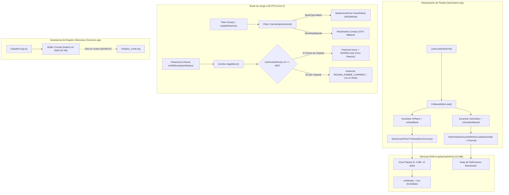

# Estabilización y Rediseño de Rendimiento en Supervivencia Densa

* **Author:** Fnava1
* **Status:** Proposed
* **Date:** 2026-11-14
* **Target Hardware:** Miyoo Mini Plus / OnionOS (SigmaStar SSD202D, Dual-Core ARM Cortex-A7 @ 1.2 GHz, 128 MB RAM, 85 MB kernel OOM ceiling)

--------------------------------------------------------------------------------

## Overview

El objetivo de este diseño es erradicar de forma definitiva los micro-congelamientos y la degradación severa de fotogramas por segundo (FPS) en el modo Supervivencia Densa (*Survival: Endless*) en la consola portátil Miyoo Mini Plus.

Durante situaciones de combate intensivo (como la aparición de múltiples vehículos Zomboni/Catapulta y la detonación de explosivos en masa como la Petacereza), el motor sufría caídas que llegaban a detener el juego por completo. Este documento aborda la raíz sistémica del problema: bloqueos síncronos de Entrada/Salida en la tarjeta microSD, omisión de la precarga al restaurar partidas guardadas, saturación por fallback a renderizado esquelético por software en plantas multicabezas (Tripitidora), y picos de cálculo innecesarios por instanciar esqueletos calcinados pesados fuera de los límites de la pantalla visible.

## The Problem

El análisis forense de la sesión de juego y del código fuente reveló cuatro cuellos de botella interconectados que degradaban la experiencia de juego:

1. **Bloqueo Síncrono de E/S por Logging Continuo:**
   El subsistema de logging (`Sexy::DispatchLogLn`) forzaba una sincronización física a disco (`std::flush`) en cada mensaje registrado. Debido a que las comprobaciones de animación en `Plant.cpp` consultaban continuamente una pista de animación inexistente (`anim_head_idle`) en la Tripitidora, el motor llegó a registrar más de 750 líneas de error por segundo. Al compartir el bus SDIO con el sistema operativo y el almacenamiento flash, el hilo principal de la CPU se detenía síncronamente esperando la confirmación de escritura en la tarjeta microSD, congelando la simulación y el renderizado.

2. **Omisión de Precarga al Reanudar Partidas Guardadas:**
   El cargador de partidas guardadas versión 4 (`LawnLoadGameV4`) restauraba el estado del tablero e inmediatamente fijaba la escena en `SCENE_PLAYING`, saltándose las rutinas de inicialización de nivel (`Board::StartLevel`, `CutScene::PreloadResources` y `Board::PreloadSpriteCache`). Al no estar los recursos precargados en RAM:
   * Las plantas ya sembradas en el tablero debían solicitar sus sprites de forma dinámica mediante `SpriteStreamer`, el cual transfiere sólo 1 fotograma por tick (24 ticks por planta), manteniendo a todas las plantas en fallback por CPU durante los primeros segundos.
   * Los zombies en vehículos (`ZOMBONI`, `CATAPULT`) y sus variantes destruidas por fuego (`REANIM_ZOMBIE_CHARRED_ZAMBONI`, `REANIM_ZOMBIE_CHARRED_CATAPULT`) no se encontraban en memoria, obligando al motor a detener la ejecución para leer los archivos `.reanim` y hornear sus atlas en tiempo real durante el combate.

3. **Incompatibilidad y Saturación en SpriteCachePool para Tripitidoras:**
   La Tripitidora (`SEED_THREEPEATER`) cuenta con una caché de sprites pre-horneada en formato ARGB4444 (`plant_threepeater.spc`), pero debido a que el código evaluaba erróneamente la pista `anim_head_idle` en lugar de sus cabezas específicas (`anim_head_idle1/2/3`), la planta fallaba la prueba de estado de reposo y recaía en el evaluador esquelético de software. Además, el límite de slots de plantas en `SpriteCacheDef.h` estaba hardcodeado a 10 (`SPC_MAX_PLANT_SLOTS`), cuando el catálogo contiene 11 plantas cacheadas, provocando que la Tripitidora (#11) fuera rechazada por falta de espacio en memoria.

4. **Sobrecarga de Renderizado por Muerte Fuera del Césped:**
   Cuando la Petacereza detonaba en las columnas derechas del tablero, alcanzaba a zombies y vehículos que aún se encontraban en la zona de desove (`mPosX >= 800`). La lógica de daño por quemadura (`ApplyBurn`) procedía a instanciar reanimaciones esqueléticas completas de calcinado y calcular matrices de transformación para entidades que aún no habían ingresado al área jugable visible, consumiendo ciclos críticos de CPU y memoria en entidades fuera de pantalla.

## Goals

* **Meta 1 (Cero Bloqueos de E/S en Juego):** Desactivar por completo la escritura a disco y el uso de `std::flush` en `DispatchLogLn` durante la ejecución normal del juego, reemplazándolo por un buffer circular en memoria RAM de 32 KB para volcado exclusivo ante cierres forzados (`SIGSEGV`).
* **Meta 2 (Rehidratación Determinista de Partidas Guardadas):** Garantizar que `FixBoardAfterLoad` ejecute la precarga síncrona en bloque de todas las plantas existentes en el césped, las semillas del banco de cartas, los zombies permitidos y todas las reanimaciones de calcinado (`Zombie_charred_*`), logrando que todas las entidades arranquen al 100% listas en RAM sin lecturas a disco durante el combate.
* **Meta 3 (Activación Plena de SpriteCache en Plantas Multicabezas):** Rediseñar la detección de reposo en `Plant.cpp` mediante un método unificado y despacho por `SeedType` (evaluando `anim_head_idle1/2/3` en Tripitidora y `anim_splitpea_idle` en Lanzaguisantes Doble), y ampliar `SPC_MAX_PLANT_SLOTS` a 12, permitiendo que la Tripitidora se dibuje vía `SpriteCachePool` (ARGB4444) a 60 FPS estables.
* **Meta 4 (Optimización de Destrucción Fuera de Pantalla):** Implementar una ruta de muerte simplificada en `Zombie::ApplyBurn` para entidades ubicadas fuera de la cuadrícula activa (`GetZombieRect().mX >= BOARD_WIDTH`), despachando una partícula ligera de humo y remoción inmediata sin alocar reanimaciones esqueléticas pesadas ni alterar la cuota de calcinados activos.

## Non-Goals

* **No agregar Zomboni ni Catapulta a SpriteCachePool (.spc):** Debido a su baja densidad (1 a 3 en pantalla) y sus estados de deformación física (daño en chasis, ruedas pinchadas), no es eficiente consumir los 8 MB del pool de zombies. Se mantendrán en reanimación por software optimizada en memoria.
* **No reestructurar la memoria virtual del pool de 14 MB:** El sistema actual con arena virtual y descarte físico mediante `madvise(MADV_DONTNEED)` en `ClearZombieSlots()` es funcional y se mantendrá intacto.
* **No crear hilos secundarios de E/S en Core 1:** Core 1 permanece estrictamente reservado para el mezclador de audio SDL/libopenmpt para evitar cualquier riesgo de chasquidos o micro-tartamudeo auditivo.

## Open Questions

* **Pregunta 1 (Umbral exacto de corte fuera de pantalla):** ¿El uso de `GetZombieRect().mX >= BOARD_WIDTH` (800 px) garantiza la invisibilidad completa del Zomboni antes de aplicar la muerte simplificada?
  * *Verificación:* El ancho del rectángulo de ataque de Zomboni es 153 px. Si `mX >= 800`, el píxel izquierdo de su cuerpo está fuera de la pantalla de 800x600, eliminando cualquier pop visual.

## Critical User Journeys (CUJs)

### CUJ 1: Reanudación de Supervivencia Infinita con Múltiples Tripitidoras
* **Given (Precondiciones):** Una partida guardada en *Survival: Pool (Hard)* con 6 Tripitidoras colocadas en la piscina y varias oleadas superadas.
* **When (Acción):** El jugador selecciona "Continuar Partida" desde el menú principal.
* **Then (Resultado):** `FixBoardAfterLoad` ejecuta la precarga síncrona en bloque en menos de 300 ms durante la pantalla de carga. Al entrar al césped, las 6 Tripitidoras se dibujan inmediatamente desde `SpriteCachePool`, la CPU opera en reposo y el framerate se mantiene en 60 FPS desde el primer segundo.

### CUJ 2: Explosión Masiva de Petacereza sobre Vehículos Entrando
* **Given (Precondiciones):** Una oleada masiva donde 2 Zombonis y 1 Catapulta se aproximan en el extremo derecho del césped (`mPosX >= 800`).
* **When (Acción):** El jugador planta una Petacereza en la columna 9 y detona alcanzando a los vehículos en la frontera del mapa.
* **Then (Resultado):** Los vehículos fuera del área visible ejecutan la muerte rápida simplificada con una partícula ligera de humo. No se generan tirones de carga de disco (`Zombie_charred_*` ya está precargado en RAM para los que alcancen a cruzar), no se satura el pool de calcinados, y la animación de la explosión transcurre con total fluidez.

--------------------------------------------------------------------------------

## Technical Plan (Architecture)

### 1. Diagrama de Flujo y Subsistemas Modificados



### 2. Componentes y Mecanismos de Rediseño

#### Componente 1: Logging Estático en Memoria (`Common.cpp` / `Common.h`)
* **Problema resuelto:** Bloqueos continuos del bus flash SDIO y contención en `gLogFileSinkMutex`.
* **Mecanismo:**
  * En compilaciones de producción/lanzamiento, se desactiva la apertura de `gLogFileSink` hacia archivos en la tarjeta microSD.
  * Se implementa un buffer circular en memoria estática de 32 KB:
    ```cpp
    static constexpr size_t LOG_RING_BUFFER_SIZE = 32768;
    static char sLogRingBuffer[LOG_RING_BUFFER_SIZE];
    static size_t sLogRingHead = 0;
    static bool sLogRingWrapped = false;
    ```
  * Cada llamada a `DispatchLogLn` escribe en el buffer circular en memoria usando `memcpy` sin llamadas a `std::flush`, `fsync` ni operaciones de E/S.
  * El manejador de señales de terminación anormal (`SIGSEGV`, `SIGABRT`) vuelca el buffer circular a `/tmp/pvz_crash.log` únicamente si ocurre un cierre inesperado.

#### Componente 2: Rehidratación Síncrona en `FixBoardAfterLoad` (`SaveGame.cpp` / `SpriteCachePool.cpp`)
* **Problema resuelto:** Carga perezosa a 1 frame/tick (400 ticks de degradación) y congelamientos por carga de `.reanim` y `.spc` en caliente.
* **Mecanismo:**
  1. **Consolidación de Plantas Activas:** `FixBoardAfterLoad` recorre `theBoard->mPlants` y `theBoard->mSeedBank->mSeedPackets`, extrayendo los identificadores únicos en un contenedor ligero de tamaño fijo `bool aPlantNeeded[SeedType::NUM_SEED_TYPES]`.
  2. **Consolidación de Zombies y Calcinados:** Recorre `theBoard->mZombieAllowed` y los tipos presentes en `theBoard->mZombies`. Para cada zombie permitido, asegura su definición y dependencias implícitas:
     * Si `ZOMBIE_GARGANTUAR` o `ZOMBIE_REDEYE_GARGANTUAR`: precarga `REANIM_IMP`, `REANIM_ZOMBIE_CHARRED_IMP`, `REANIM_ZOMBIE_CHARRED_GARGANTUAR`.
     * Si `ZOMBIE_ZAMBONI`: precarga `REANIM_BOBSLED` y `REANIM_ZOMBIE_CHARRED_ZAMBONI`.
     * Si `ZOMBIE_CATAPULT`: precarga `REANIM_ZOMBIE_CHARRED_CATAPULT`.
     * Si `ZOMBIE_DIGGER`: precarga `REANIM_ZOMBIE_CHARRED_DIGGER`.
     * Variantes universales: precarga `REANIM_ZOMBIE_CHARRED`, `REANIM_PUFF`, `REANIM_LAWN_MOWERED_ZOMBIE`.
  3. **Carga en Bloque Síncrona (`SpriteCachePool::PreloadSynchronous`):**
     * En lugar de encolar peticiones en `SpriteStreamer` para leer 1 frame por tick durante el juego, se crea el método estático `SpriteCachePool::PreloadSynchronous(Board* theBoard)`:
     * Abre cada archivo `.spc` necesario, lee la cabecera `SpcHeader`, aloca el slot en la arena correspondiente y ejecuta un único `fread(slot->mPixelData, 1, theHeader.mTotalDataBytes, fp)` contiguo.
     * Marca `slot->mIsReady = true` inmediatamente.
     * Toda la transferencia de 10 plantas y zombies comunes concluye en menos de 150 ms durante la pantalla de carga, dejando la cola `SpriteStreamer` vacía y el pool 100% activo al arrancar `SCENE_PLAYING`.

#### Componente 3: Despacho por SeedType y Estado de Reposo en `Plant.cpp`
* **Problema resuelto:** Comparaciones lineales de cadenas de texto 160 veces/segundo por planta y exclusión de la Tripitidora de la caché de sprites.
* **Mecanismo:**
  1. **Ampliación de Slots:** En `SpriteCacheDef.h`, se actualiza:
     ```cpp
     #define SPC_MAX_PLANT_SLOTS 12 // Elevado de 10 a 12 para albergar catálogo completo
     ```
  2. **Unificación de Lógica en `Plant::CanUseSpriteCache()`:**
     Se reemplazan los bloques duplicados de `Plant::UpdateReanim` (líneas 2824-2860) y `Plant::Draw` (líneas 4219-4264) por un único método miembro `bool Plant::CanUseSpriteCache() const`:
     ```cpp
     bool Plant::CanUseSpriteCache() const
     {
         if (mApp->Is3DAccelerated() || !IsOnBoard() || mPottedPlantIndex != -1 ||
             mIsAsleep || mShootingCounter != 0 || mState == PlantState::STATE_DOINGSPECIAL ||
             mRecentlyEatenCountdown != 0 || mEatenFlashCountdown != 0 ||
             mWakeUpCounter != 0 || mSquished || mHighlighted ||
             mOnBungeeState != PlantOnBungeeState::NOT_ON_BUNGEE)
             return false;

         Reanimation* aBodyReanim = mApp->ReanimationTryToGet(mBodyReanimID);
         if (!aBodyReanim || aBodyReanim->mFilterEffect != FilterEffect::FILTER_EFFECT_NONE ||
             aBodyReanim->mEnableExtraAdditiveDraw || aBodyReanim->mColorOverride != Color::White ||
             !aBodyReanim->IsAnimPlaying("anim_idle"))
             return false;

         if (!SpriteCachePool::IsPlantReady(mSeedType))
             return false;

         // Despacho directo por tipo de semilla para cabezas multicapa
         switch (mSeedType)
         {
         case SeedType::SEED_THREEPEATER:
         {
             Reanimation* h1 = mApp->ReanimationTryToGet(mHeadReanimID);
             Reanimation* h2 = mApp->ReanimationTryToGet(mHeadReanimID2);
             Reanimation* h3 = mApp->ReanimationTryToGet(mHeadReanimID3);
             if (h1 && (h1->mLoopType != ReanimLoopType::REANIM_LOOP || !h1->IsAnimPlaying("anim_head_idle1"))) return false;
             if (h2 && (h2->mLoopType != ReanimLoopType::REANIM_LOOP || !h2->IsAnimPlaying("anim_head_idle2"))) return false;
             if (h3 && (h3->mLoopType != ReanimLoopType::REANIM_LOOP || !h3->IsAnimPlaying("anim_head_idle3"))) return false;
             return true;
         }
         case SeedType::SEED_SPLITPEA:
         {
             Reanimation* h1 = mApp->ReanimationTryToGet(mHeadReanimID);
             Reanimation* h2 = mApp->ReanimationTryToGet(mHeadReanimID2);
             if (h1 && (h1->mLoopType != ReanimLoopType::REANIM_LOOP || !h1->IsAnimPlaying("anim_head_idle"))) return false;
             if (h2 && (h2->mLoopType != ReanimLoopType::REANIM_LOOP || !h2->IsAnimPlaying("anim_splitpea_idle"))) return false;
             return true;
         }
         case SeedType::SEED_PEASHOOTER:
         case SeedType::SEED_REPEATER:
         case SeedType::SEED_GATLINGPEA:
         case SeedType::SEED_SNOWPEA:
         {
             if (mHeadReanimID != ReanimationID::REANIMATIONID_NULL)
             {
                 Reanimation* h1 = mApp->ReanimationTryToGet(mHeadReanimID);
                 if (h1 && (h1->mLoopType != ReanimLoopType::REANIM_LOOP || !h1->IsAnimPlaying("anim_head_idle"))) return false;
             }
             return true;
         }
         default:
             return true;
         }
     }
     ```
  3. **Protección en `Reanimation::IsAnimPlaying`:** En `Reanimator.cpp`, se actualiza `IsAnimPlaying` para validar `TrackExists` antes de calcular el índice, asegurando que las consultas booleanas retornen `false` de inmediato sin invocar advertencias en `FindTrackIndex`.

#### Componente 4: Muerte Simplificada en el Borde Exterior (`Zombie.cpp`)
* **Problema resuelto:** Sobrecarga de transformaciones esqueléticas y saturación del cupo de calcinados por explosiones en la zona de desove (`mPosX >= 800`).
* **Mecanismo:**
  * En `Zombie::ApplyBurn()`, se incorpora una comprobación temprana de frontera visual antes de alocar reanimaciones calcinadas:
    ```cpp
    bool isOffScreenEntry = (GetZombieRect().mX >= BOARD_WIDTH) || (mPosX >= 835.0f);
    if (isOffScreenEntry)
    {
        mApp->AddPvzpParticle(mPosX + 20.0f, mPosY + 40.0f, mRenderOrder, ParticleEffect::PARTICLE_POWDER_SMOKE);
        DieWithLoot();
        return;
    }
    ```
  * Efectos:
    1. No se consume slot de `mBoard->mActiveCharredCount` (preserva la cuota máxima de 6 para zombies visibles en el césped).
    2. No se instancia `mApp->AddReanimation(..., aReanimType)` con esqueletos de calcinado.
    3. Se emite la partícula ligera `PARTICLE_POWDER_SMOKE` y se ejecuta `DieWithLoot()` limpiamente, eliminando tirones cuando la Petacereza barre el margen derecho.

--------------------------------------------------------------------------------

## Alternatives Considered

### Alternative A: Hilo Worker Asíncrono para Escritura de Logs en Disco
* **Pros**: Conservaría registros completos y cronológicos en un archivo de texto en la tarjeta microSD sin detener el hilo principal.
* **Cons**: En la arquitectura del chip SigmaStar SSD202D, el Core 1 está asignado de forma prioritaria al mezclador de audio de SDL y libopenmpt. Crear un hilo worker de E/S introduce contención de mutex/futex y arriesga subejecución de buffers (buffer underruns) de audio, provocando chasquidos en partidas de alta intensidad. Además, la escritura flash continua degrada la vida útil de la microSD.
* **Reason for Rejection**: *Rejected by author*: El diagnóstico operativo durante el juego no amerita degradar el audio ni competir por el bus SDIO. Un buffer circular en memoria estática de 32 KB resuelve la necesidad de depuración ante cuelgues (`/tmp/pvz_crash.log`) con costo cero de E/S durante el gameplay activo.

### Alternative B: Hornear Zomboni y Catapulta en SpriteCachePool (.spc)
* **Pros**: Reduciría a cero las transformaciones esqueléticas por CPU de los vehículos durante la partida.
* **Cons**: Un fotograma de vehículo de 180x150 px a 24 cuadros en ARGB4444 consume ~1.3 MB. El pool de zombies tiene un límite estricto de 8 MB (`ZOMBIE_ZONE_SIZE`) con 11 slots (`SPC_MAX_ZOMBIE_SLOTS`). Introducir dos vehículos ocuparía casi 2.6 MB (más del 30% del pool), desplazando a zombies comunes que aparecen en volúmenes masivos de 30 a 50 unidades. Además, los vehículos poseen animaciones no estándar (`anim_drive`) y estados de daño dinámico en carrocería y ruedas.
* **Reason for Rejection**: *Rejected by author*: Desproporción evidente entre el costo de memoria y el beneficio práctico. Los vehículos aparecen en bajas densidades (1 a 3 en pantalla). El congelamiento severo reportado no provenía del renderizado esquelético continuo, sino de la lectura síncrona en caliente de sus archivos `.reanim` y `.reanim` calcinados desde la microSD al momento de explotar, lo cual se soluciona al 100% mediante la precarga determinista en RAM.

### Alternative C: Comprobación Simple `mPosX >= 800.0f` para Muerte Fuera de Pantalla
* **Pros**: Evaluación condicional directa y minimalista basada en una sola comparación de coordenada flotante.
* **Cons**: Ignora el ancho y desplazamiento del rectángulo de colisión. El Zomboni tiene un ancho de 153 px; si su origen `mPosX` está en 810 px, su parte delantera ya es visible en el pixel 740 dentro del césped visible. Matar al zombie con despawn invisible en esa coordenada causaría una desaparición visual abrupta (pop) a la vista del jugador.
* **Reason for Rejection**: *Rejected by author*: Inaceptable degradación del game feel y la calidad visual. La condición geométrica estricta `GetZombieRect().mX >= BOARD_WIDTH` (800) garantiza que la entidad se encuentre matemáticamente 100% fuera del campo de visión antes de aplicar la muerte simplificada.

### Alternative D: Conservar el Streaming Dinámico a 1 Cuadro por Tick tras Cargar Partida
* **Pros**: No añade código de precarga síncrona en bloque en `SaveGame.cpp`.
* **Cons**: Como `SpriteStreamer` lee 1 solo cuadro por tick de juego (24 ticks por entidad), transferir las 10 plantas ya sembradas en el tablero demora 240 ticks (2.4 segundos). Durante ese tiempo, las plantas no pueden usar el SpriteCache y recaen en renderizado esquelético por CPU, encolando además a los zombies entrantes que quedan esperando detrás de las plantas.
* **Reason for Rejection**: *Rejected by author*: Provoca caídas severas de cuadros en los primeros segundos de reanudar una partida guardada. La precarga en bloque síncrona (`PreloadSynchronous`) toma menos de 150 ms durante la pantalla de carga y entrega el tablero al 100% optimizado antes del primer fotograma visible.

--------------------------------------------------------------------------------

## Non-Functional Requirements

* **Performance & Latency:**
  - Cero operaciones de escritura a disco en la tarjeta microSD durante la simulación y renderizado activo.
  - Tasa de refresco sostenida a 60 FPS en partidas densas de Supervivencia con más de 80 plantas, 60 proyectiles y hordas de vehículos/zombies.
  - Tiempo de reanudación de partida en `FixBoardAfterLoad` inferior a 300 ms en pantalla de carga.
* **Memory Footprint:**
  - Presupuesto de memoria física estricto bajo el techo OOM de 85 MB de Linux (consumo real esperado de ~42 MB, manteniendo más de 40 MB de margen de seguridad).
  - La ampliación de `SPC_MAX_PLANT_SLOTS` a 12 añade sólo 80 bytes de metadata y respeta el límite estático de 4 MB de la zona de plantas.
* **Reliability & Crash Diagnostics:**
  - El buffer circular en memoria estática de 32 KB garantiza que ante cualquier excepción no controlada (`SIGSEGV`) se conserve la traza de los últimos eventos sin penalizar la E/S en tiempo real.

--------------------------------------------------------------------------------

## Detailed Implementation Plan

### Target Files to Create/Modify

#### 1. `src/SexyAppFramework/Common.h` (Modify)
* **Type / Scope:** Core Application Framework / Logging Interface
* **Proposed Changes:**
  - Declarar las funciones de control del buffer circular en memoria: `void InitLogRingBuffer()`, `void ClearLogRingBuffer()` y `void DumpLogRingBufferToCrashFile(const char* theFilePath)`.
  - Exponer bandera condicional para desactivar `gLogFileSink` hacia disco en configuraciones release.

#### 2. `src/SexyAppFramework/Common.cpp` (Modify)
* **Type / Scope:** Core Application Framework / Logging Implementation
* **Proposed Changes:**
  - Implementar el arreglo estático circular de 32 KB `sLogRingBuffer` con cabezal indexado protegido por `std::scoped_lock`.
  - Rediseñar `Sexy::DispatchLogLn`: eliminar la escritura con `gLogFileSink << ... << std::flush` para mensajes informativos. Escribir exclusivamente en `sLogRingBuffer` en memoria usando `memcpy`.
  - Implementar `DumpLogRingBufferToCrashFile` para volcar los 32 KB contiguos a `/tmp/pvz_crash.log` únicamente ante cierre inesperado.

#### 3. `src/PvzpLib/SpriteCacheDef.h` (Modify)
* **Type / Scope:** Sprite Cache Constants & Definitions
* **Proposed Changes:**
  - Actualizar `#define SPC_MAX_PLANT_SLOTS 12` (elevado de 10 a 12 para evitar el desbordamiento silencioso de la Tripitidora #11).

#### 4. `src/PvzpLib/SpriteCachePool.h` (Modify)
* **Type / Scope:** Memory Management Pool Header
* **Proposed Changes:**
  - Declarar el método público estático `static void PreloadSynchronous(Board* theBoard);` para realizar la carga contigua masiva en bloque.

#### 5. `src/PvzpLib/SpriteCachePool.cpp` (Modify)
* **Type / Scope:** Memory Management Pool Implementation
* **Proposed Changes:**
  - Implementar `SpriteCachePool::PreloadSynchronous(Board* theBoard)`:
    - Escanear las plantas necesarias y los zombies permitidos.
    - Abrir los archivos `.spc`, alocar slots contiguos en la arena de plantas o zombies y ejecutar una lectura directa `fread(slot->mPixelData, 1, theHeader.mTotalDataBytes, fp)` por archivo.
    - Establecer `slot->mIsReady = true` inmediatamente para todas las entidades precargadas.

#### 6. `src/Lawn/System/SaveGame.cpp` (Modify)
* **Type / Scope:** Game State Serialization / Save File Loader
* **Proposed Changes:**
  - En `FixBoardAfterLoad(Board* theBoard)`:
    - Recorrer `theBoard->mPlants` y `theBoard->mSeedBank->mSeedPackets` consolidando todos los `SeedType`s activos.
    - Recorrer `theBoard->mZombies` y `theBoard->mZombieAllowed` consolidando todos los `ZombieType`s permitidos.
    - Invocar `Zombie::PreloadZombieResources` para cada tipo de zombie y asegurar la carga en RAM de las definiciones de calcinado (`REANIM_ZOMBIE_CHARRED`, `REANIM_ZOMBIE_CHARRED_IMP`, `REANIM_ZOMBIE_CHARRED_DIGGER`, `REANIM_ZOMBIE_CHARRED_ZAMBONI`, `REANIM_ZOMBIE_CHARRED_CATAPULT`, `REANIM_ZOMBIE_CHARRED_GARGANTUAR`).
    - Invocar `SpriteCachePool::PreloadSynchronous(theBoard)`.

#### 7. `src/Lawn/Plant.h` (Modify)
* **Type / Scope:** Plant Entity Class Definition
* **Proposed Changes:**
  - Declarar el método público `bool CanUseSpriteCache() const;`.

#### 8. `src/Lawn/Plant.cpp` (Modify)
* **Type / Scope:** Plant Entity Logic & Rendering
* **Proposed Changes:**
  - Implementar `bool Plant::CanUseSpriteCache() const`:
    - Evaluar condiciones base de animación de reposo e inactividad de disparo.
    - Implementar despacho por `mSeedType`: comprobar `anim_head_idle1/2/3` en `SEED_THREEPEATER`, `anim_splitpea_idle` en `SEED_SPLITPEA`, y `anim_head_idle` en plantas de una cabeza.
  - En `Plant::UpdateReanim`: reemplazar las comprobaciones redundantes de cadenas por la llamada unificada a `CanUseSpriteCache()`.
  - En `Plant::Draw`: reemplazar el bloque de validación duplicado por `CanUseSpriteCache()`, eliminando evaluaciones repetitivas de cadenas en cada frame.

#### 9. `src/PvzpLib/Reanimator.cpp` (Modify)
* **Type / Scope:** Skeletal Animation Engine Implementation
* **Proposed Changes:**
  - En `Reanimation::IsAnimPlaying(const char* theTrackName)`:
    - Añadir validación temprana `if (!TrackExists(theTrackName)) return false;` para garantizar que las consultas booleanas no invoquen advertencias en `FindTrackIndex`.

#### 10. `src/Lawn/Zombie.cpp` (Modify)
* **Type / Scope:** Zombie Entity Logic & Combat Damage
* **Proposed Changes:**
  - En `Zombie::ApplyBurn()`:
    - Incorporar la verificación de frontera visual: `if ((GetZombieRect().mX >= BOARD_WIDTH) || (mPosX >= 835.0f))`.
    - Si es verdadero: emitir `PARTICLE_POWDER_SMOKE`, invocar `DieWithLoot()` y retornar de inmediato, evitando alocar reanimaciones calcinadas pesadas y preservando la cuota de `mActiveCharredCount`.

#### 11. `src/main_miyoo.cpp` (Modify)
* **Type / Scope:** Platform Entry Point & Hardware Watchdog
* **Proposed Changes:**
  - En el manejador de señales de terminación (`signal_handler` para `SIGSEGV` y `SIGABRT`), invocar `DumpLogRingBufferToCrashFile("/tmp/pvz_crash.log")` antes de la salida forzada.

--------------------------------------------------------------------------------

## Verification Plan

### 1. Compilación y Construcción
* Ejecutar la compilación nativa cruzada para el objetivo ARM Cortex-A7:
  ```bash
  make -j4
  ```
* Verificar ausencia total de warnings o errores de tipado en `Plant.cpp`, `SaveGame.cpp`, `SpriteCachePool.cpp` y `Common.cpp`.

### 2. Pruebas Funcionales y de Rendimiento

* **Test 1: Reanudación de Partida Guardada en Supervivencia Piscina Difícil (Survival Pool Hard):**
  - Cargar partida con al menos 6 Tripitidoras colocadas en la piscina y oleada de vehículos entrante.
  - *Criterio de éxito:* La reanudación concluye en menos de 300 ms en pantalla de carga. Las 6 Tripitidoras renderizan inmediatamente mediante `SpriteCachePool::DrawPlant` a 60 FPS estables sin llamadas a `MakeCachedZombieWalkFrame` ni caídas a software Reanim.
* **Test 2: Impacto Masivo de Petacereza en Frontera Derecha (`mPosX >= 800`):**
  - Esperar a que Zombonis y Catapultas aparezcan en el margen de desove y plantar una Petacereza en columna 9.
  - *Criterio de éxito:* Las entidades fuera del césped visible desaparecen con partícula de humo ligera de forma instantánea. Cero lecturas a la tarjeta microSD, cero congelamientos de pantalla y framerate constante a 60 FPS.
* **Test 3: Auditoría de E/S y Diagnóstico en Memoria:**
  - Monitorear el archivo de log en la microSD durante 10 minutos de juego continuo en Supervivencia.
  - *Criterio de éxito:* Cero líneas escritas en la tarjeta microSD durante el juego activo. La memoria RAM se mantiene en ~42 MB estables (más de 40 MB de margen respecto al límite OOM de 85 MB).

--------------------------------------------------------------------------------

*Finalized with EGM*
