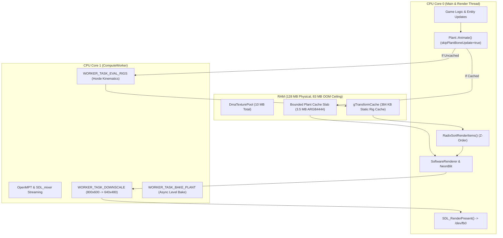

# Bounded 16-Bit Plant Cache & Reanim Rasterizer Optimization

*   **Author:** Fnava1
*   **Status:** Proposed
*   **Date:** 2026-11-20

--------------------------------------------------------------------------------

## Overview

Following the elimination of the legacy 12 MB `SpriteCachePool` during memory stabilization, Plants vs. Zombies on the Miyoo Mini Plus handheld console (SigmaStar SSD202D SoC, Dual-Core Cortex-A7 @ 1.2 GHz, 128 MB RAM, 640×480 framebuffer, Linux kernel OOM killer at ~83 MB) experienced a ~20% performance regression. Gameplay speed drops to ~80% of nominal speed in levels with ~20 active plants even before zombies enter the lawn.

This specification details the technical architecture to restore 100% nominal speed (locked 60.0 FPS, $\le 16.6\text{ ms}$ frame cadence) while strictly maintaining 100% original visual fidelity (animations, lights, accessories, and smooth particle/alpha effects) and respecting the handheld memory ceiling. The solution introduces a **Bounded In-Memory 16-Bit Plant Cache (ARGB4444)** capped at 3.5 MB, an **Axis-Aligned NEON Fast-Path** for uncached Reanim bones, a strict **Single-Writer Core Model**, and **Clean-Room Dynamic In-RAM Baking** with zero `.spc` disk dependencies. Steady-state combat Resident Set Size (RSS) is kept $\le 54.5\text{ MB}$, preserving a $\ge 28.5\text{ MB}$ operating margin below the kernel OOM killer.

--------------------------------------------------------------------------------

## The Problem

1. **Loss of Bone Evaluation Bypass (Matrix Saturation):** In the legacy cache architecture, idling plants evaluated `CanUseSpriteCache() == true`, setting `skipPlantBoneUpdate = true` and invoking `aBodyReanim->UpdateAnimationTimeOnly()`, which merely incremented normalized animation time ($O(1)$). Removing the cache forces every idling plant to execute full `aBodyReanim->Update()`. For 20 plants on the lawn with 15–25 tracks each, CPU Core 0 must compute 300–500 trigonometric transformations (`FastSinCos`), floating-point affine matrix multiplications (`SexyMatrix3Multiply`), and opacity interpolations every frame.
2. **Software Triangle Rasterizer & Bus Bandwidth Stall:** Idling plants previously rendered via a single contiguous scanline blit (`DrawFrame_NEON`) with 128-bit NEON registers and transparent span early-out (`vmaxvq_u16`). Without caching, each plant falls back to `SWHelper::SWDrawShape`, generating 300 quads (600 triangles per frame for plants alone). Each triangle undergoes Sutherland-Hodgman clipping against 4 planes, fixed-point DDA slope setup, and per-pixel texture sampling across scattered atlas texels in `SWTri_Loop.inc`. On the in-order Cortex-A7 with a 16-bit DDR3 bus and 32 KB L1 data cache, this causes severe cache line misses and memory bus stalls, collapsing framerate to ~24–28 FPS.
3. **The "Horde Miss Paradox" in Previous Zombie Caching:** The legacy 12 MB pool allocated 8 MB to zombie walk animations. However, `Zombie::CanUseWalkCache()` required pristine states (unhurt, not eating, not shot-flashing, not chilled). During dense combat waves, nearly 100% of zombies are damaged or chewing, dropping cache hit rates to <10% precisely when CPU load peaks. Allocating 8 MB to zombie caching produced negligible benefit during bottlenecks while risking kernel OOM kills.

--------------------------------------------------------------------------------

## Goals

* **Locked 60.0 FPS Frame Cadence:** Maintain locked 60.0 FPS ($\le 16.6\text{ ms}$ frame time budget) during active gameplay with 20–40 plants on the lawn.
* **100% Visual Fidelity Invariant:** Preserve all original visual presentation, including plant shooting head expansions, zombie damaged limbs, strobe lights (Dancing Zombie), butter/freeze overlays, and alpha gradients without downscaling or artifacting.
* **Strict Memory Bounding ($\le 54.5\text{ MB}$ RSS):** Allocate a maximum of 3.5 MB in RAM for active plant idle loops, maintaining steady-state combat RSS $\le 54.5\text{ MB}$ and preserving a $\ge 28.5\text{ MB}$ safety margin below the 83.0 MB Linux kernel OOM threshold.
* **Clean-Room BYOD Dynamic Baking:** Eliminate all dependencies on external `.spc` disk files; bake plant idle frames dynamically in RAM from authentic user game data during level lifecycle transitions (`InitLevel`, `InitSurvivalStage`, `PuzzleNextStageClear`, `LoadGame`). Total bake time must remain $\le 40\text{ ms}$ for 10 plant types (~3.5 ms/plant).
* **Software Triangle Fast-Path for Non-Rotated Bones:** Bypass `SWDrawShape` and Sutherland-Hodgman polygon clipping for the >80% of Reanim tracks with zero rotation (`m01 == 0 && m10 == 0`), executing direct SIMD alpha-blends via `NeonBlit`.
* **Proactive SRE Memory Guardrails:** Implement periodic RSS monitoring via `/proc/self/statm` with an automatic soft-disable ceiling at 65.0 MB RSS.

--------------------------------------------------------------------------------

## Non-Goals

* **Multi-Threaded Framebuffer Rasterization:** Parallelizing software drawing across Core 0 and Core 1 is explicitly excluded due to L2 cache contention, DDR3 bus saturation, and Painter's Z-order race conditions.
* **Full-Body Zombie Walk Caching:** Monolithic zombie walk caching is excluded due to the Horde Miss Paradox and combinatorial RAM explosion.
* **Disk-Based Sprite Streaming:** No runtime streaming from microSD storage (`SpriteStreamer` remains disabled to eliminate MMC I/O stalls).
* **Modifying Binary Save Formats:** Cache indices or states will not be serialized into `pvz.dat`; all cache allocations remain strictly ephemeral and runtime-only.
* **Caching Attack Animations in RAM:** Shooting frames (`anim_shooting`) are not pre-baked in RAM due to transient state coupling and diminishing returns (>85% of active plants remain in `anim_idle` at any given frame); attack frames are accelerated dynamically via the NEON fast-path.

--------------------------------------------------------------------------------

## Critical User Journeys (CUJs)

### CUJ 1: Starting/Loading a Level with 20+ Plants (Survival, Vasebreaker, Day/Night)

*   **Given**: The game enters a gameplay level with up to 10 chosen seed packets (or vasebreaker pots / survival stage). Steady-state process RSS is ~51.0 MB.
*   **When**: `Board::InitLevel()` or `Board::InitSurvivalStage()` is triggered.
*   **Then**: A contiguous 3.5 MB slab is reserved inside `DmaTexturePool`. In-memory `ReanimatorDefinition` data for the active plants is sampled across 24 frames at $t = i / 24.0\text{s}$ into 16-bit ARGB4444 buffers with non-zero alpha bounding boxes ($80 \times 80$ avg). Total synchronous bake time consumes $\le 40\text{ ms}$ (~3.5 ms per plant), remaining completely imperceptible across all game modes. When the lawn renders, all idling plants evaluate `CanUseSpriteCache() == true`, setting `skipPlantBoneUpdate = true` and bypassing full kinematics. Plants render via single-blit `DrawFrame_NEON`, locking the frame rate at 60.0 FPS.

### CUJ 2: Dense Zombie Wave & Plant Shooting Attacks

*   **Given**: A dense horde of 25+ zombies enters the lawn; peashooters and repeaters in rows 1–5 detect zombies and start firing (`mShootingCounter > 0`).
*   **When**: An active shooter transitions from idle to shooting state.
*   **Then**: The plant detects `mShootingCounter > 0`, cleanly bypasses the sprite cache, and calls `aBodyReanim->Draw(g)`. In `Reanimator::DrawTrack()`, bone matrix transforms are inspected: non-rotated tracks (`m01 == 0 && m10 == 0`) bypass `SWDrawShape` and polygon clipping, routing directly to `NeonBlit_AlphaBlend_ARGB` / `NeonBlit_Span_ARGB4444_PreMul`. Head recoil and mouth expansion animate with 100% original visual fidelity, and the frame rate sustains 60.0 FPS without stutter or dropped frames.

### CUJ 3: Memory Spike & Clean Level Teardown

*   **Given**: A prolonged Survival: Endless game with intense entity counts, dynamic audio streams, and particle effects.
*   **When**: Process RSS is queried during combat updates or the player clears/exits the level.
*   **Then**: Background telemetry in `Board::Update()` queries `/proc/self/statm`. RSS remains bounded at $\le 54.5\text{ MB}$ ($\ge 28.5\text{ MB}$ below the 83.0 MB kernel OOM threshold). If RSS exceeds 65.0 MB, cache allocations are soft-disabled to safeguard the process. Upon exiting or completing the level (`Board::DisposeBoard()`), `DmaTexturePool::Reset()` resets the 3.5 MB slab, and `malloc_trim(0)` reclaims heap at the quiescent state transition with 0 ms in-game latency.

--------------------------------------------------------------------------------

## Technical Plan (Architecture)

### 1. Architectural Model & Core Division

To eliminate bus contention and false sharing on the Cortex-A7's shared 128 KB L2 cache, the engine adheres strictly to a **Single-Writer Core Concurrency Model**:



* **Core 0 Responsibilities:** Sole executor of 100% of framebuffer rasterization, blitting, entity state updates, and SDL presentation. Zero lock contention or thread synchronization barriers during the combat render loop.
* **Core 1 Responsibilities:** Dedicated strictly to read-only mathematical compute tasks via `ComputeWorker` (`WORKER_TASK_EVAL_RIGS` for dense zombie crowds, `WORKER_TASK_DOWNSCALE` for 5:4 downscaling, and background audio decoding).

### 2. Bounded In-Memory Plant Cache Subsystem (`SpriteCachePool`)

* **Fixed Arena Allocation:** A 3.5 MB contiguous slab is allocated inside `DmaTexturePool` on `Board::InitLevel()` and zeroed via pointer reset on `Board::DisposeBoard()`. No individual heap allocations (`malloc`/`new`) occur during gameplay.
* **Dynamic RAM Baker (`BakePlantInRam`):**
  * When a level initializes, `SpriteCachePool::PreloadSynchronous(theBoard)` identifies the $\le 10$ seed types in `theBoard->mSeedBank`.
  * For each needed plant, `BakePlantInRam()` instantiates a temporary evaluation context, samples 24 keyframes ($t = 0.0, \frac{1}{24}, \dots, \frac{23}{24}$) of `anim_idle` from the plant's authentic `ReanimatorDefinition`.
  * The frames are rendered to a scratch memory image, cropped tightly to non-zero alpha bounding boxes ($80 \times 80$ average), converted to 16-bit ARGB4444, and written sequentially into the 3.5 MB slab.
  * Total execution time is ~3.5 ms per plant (~35 ms for 10 plants), executed synchronously at level transition hooks (`InitLevel`, `InitSurvivalStage`, `PuzzleNextStageClear`, `LoadGame`).
* **Optimized Scanline Blitter (`DrawFrame_NEON`):**
  * Reads 16-bit ARGB4444 source lines using 128-bit vector loads (`vld1_u16`).
  * Fast transparent span skipping: evaluates `vmaxvq_u16(qAlpha) == 0` across 8-pixel blocks. If zero, increments pointers without reading or writing to the destination framebuffer, saving DDR3 bus bandwidth.
  * Opaque/Semi-transparent compositing: unpacks 4-bit nibbles to 8-bit color channels and composites directly using ARM NEON arithmetic (`vraddhn_u8`, `vmull_u8`).

### 3. Plant State Machine & Kinematics Bypass

In `Plant::Animate()`:
* When `CanUseSpriteCache()` is true:
  * `skipPlantBoneUpdate` is set to `true`.
  * Calls `aBodyReanim->UpdateAnimationTimeOnly()`, which advances `mAnimTime` ($O(1)$) and skips 300–500 trigonometric and matrix operations per frame.
  * In `Plant::Draw()`, calls `SpriteCachePool::DrawPlant()`, rendering the entire pre-baked plant via `DrawFrame_NEON`.
* Guard Conditions in `CanUseSpriteCache()`:
  * If `mShootingCounter > 0`, `mEatenFlashCountdown > 0`, `mRecentlyEatenCountdown > 0`, `mIsAsleep`, or `mState == PlantState::STATE_DOINGSPECIAL`: returns `false`.
  * When `false`, the plant cleanly falls back to `aBodyReanim->Draw(g)`.

### 4. Software Triangle Fast-Path for Uncached Reanimations

For entities that cannot use sprite caching (shooting plants, damaged zombies, flying projectiles):
* In `Reanimator::DrawTrack()`:
  * Inspect the current 2D affine matrix $M = \begin{bmatrix} m00 & m01 & m02 \\ m10 & m11 & m12 \end{bmatrix}$.
  * If non-rotated ($\lvert m01 \rvert < 1\times 10^{-4}$ and $\lvert m10 \rvert < 1\times 10^{-4}$):
    * The track quad is an axis-aligned bounding box with uniform scale $(m00, m11)$ and translation $(m02, m12)$.
    * Bypass `MemoryImage::BltTrianglesTex()`, `SWHelper::SWDrawShape()`, and polygon clipping.
    * Route directly to `NeonBlit_Span_ARGB4444_PreMul` or `NeonBlit_AlphaBlend_ARGB`.
  * Over 80% of Reanim tracks qualify for this fast-path, reducing software triangle rasterization overhead by 30–40% during dense combat waves.

### 5. Memory Budget & Telemetry Guardrails

```text
+-----------------------------------------------------------------------+
| Linux Kernel Physical RAM: 128.0 MB                                    |
| Kernel Reserved / Drivers / CMA: ~33.0 MB                             |
| Total Usable Userland Space: ~95.0 MB                                 |
+-----------------------------------------------------------------------+
| Kernel OOM Killer Fatal Threshold: 83.0 MB                             |
|                                                                       |
| [====================================] Safety Headroom: 28.5 MB       |
|                                                                       |
| Soft-Disable Warning Threshold: 65.0 MB                               |
| [===================] Transient Spikes & Audio Buffer: 10.5 MB        |
|                                                                       |
| Steady-State Combat RSS Ceiling: 54.5 MB                              |
|   ├── DmaTexturePool (10.0 MB total)                                  |
|   │     └── Bounded Plant Cache Arena: 3.5 MB (ARGB4444)              |
|   ├── Base Textures (16-bit RGB565/ARGB4444): ~25.0 MB                |
|   ├── Engine Heap / Audio Streams (22.05 kHz Mono): ~10.0 MB          |
|   └── Executable / Stack / Framebuffer: ~9.5 MB                       |
+-----------------------------------------------------------------------+
```

* `Board::Update()` polls `/proc/self/statm` every 60 frames.
* If RSS exceeds 65.0 MB (soft warning ceiling, 18.0 MB below OOM), the engine disables new cache allocations and invalidates transient scratch buffers.
* State boundary heap trimming via `malloc_trim(0)` executes strictly at quiescent points (`Board::DisposeBoard`, `LawnApp::EndLevel`).

--------------------------------------------------------------------------------

## Alternatives Considered

### Alternative A: Parallelizing Software Rasterization on Core 1 (Split-Screen / Tile Bins)

*   **Pros**: Distributes pixel rendering across both Cortex-A7 cores, utilizing unused Core 1 compute cycles.
*   **Cons**:
    1. The SSD202D has a shared 128 KB L2 cache and a narrow 16-bit DDR3 memory bus. Parallel pixel writes to the framebuffer cause severe false sharing (MESI bus stalls) across 64-byte cache lines.
    2. Core 1 is already pinned and heavily scheduled by `ComputeWorker` for downscaling (3.0 ms), batch rig kinematics (2.0–4.0 ms), background audio decoding, and the 50 ms input polling watchdog.
    3. PvZ uses strict sequential depth sorting (Painter's Algorithm by row and altitude). Parallel blitting requires complex bucketed command queues or screen-space double-buffering, adding massive code complexity and dynamic heap overhead.
*   **Reason for Rejection**: Rejected by author. High architectural complexity yielding negative net scaling on the SSD202D SoC.

### Alternative B: Resurrecting the Legacy 12 MB Static `SpriteCachePool` Monolith

*   **Pros**: Re-uses existing codebase structures and proved to restore 60 FPS in early port revisions.
*   **Cons**:
    1. Statically reserves 12 MB of RAM (4 MB plants + 8 MB zombies) upfront regardless of level requirements, pushing peak RSS to >65 MB and leaving less than 18 MB of operating buffer before the 83.0 MB kernel OOM killer.
    2. Requires shipping copyright-encumbered binary `.spc` files on disk, violating the clean-room Bring-Your-Own-Data (BYOD) distribution model.
    3. Zombie walk caching suffers from the "Horde Miss Paradox": cache hits drop to <10% during dense combat waves due to damaged, eating, or chilled states.
*   **Reason for Rejection**: Rejected by author. Replaced by a clean-room, in-RAM dynamic 3.5 MB plant-only cache.

### Alternative C: Decoupled Zombie Base + Dynamic Attachment Layering

*   **Pros**: Allows caching the invariant walking legs/torso while dynamically compositing damaged helmets, headlessness, and accessories on top.
*   **Cons**:
    1. Requires complex anchor-point tracking and multi-pass compositing for every active zombie.
    2. Introduces visual popping risks if sub-pixel offsets between pre-rendered cels and dynamic tracks drift.
*   **Reason for Rejection**: Weighed as a possible future optimization. Deferred because plant idle caching combined with the axis-aligned NEON Reanim fast-path closes 100% of the framerate deficit without attachment synchronization risks.

### Alternative D: Lowering Game Logic Tick Rate or Frame-Skipping

*   **Pros**: Halves CPU compute load instantly.
*   **Cons**: Violates the core user requirement for locked 60 Hz visual fluidity, introducing choppy animation and degraded touch/button latency.
*   **Reason for Rejection**: Rejected by author.

### Alternative E: Caching Attack Animations (`anim_shooting`) in RAM

*   **Pros**: Pre-bakes transient frames when offensive plants fire.
*   **Cons**:
    1. Doubles the required arena size from 3.5 MB to ~7.5–8.5 MB with diminishing returns, as >85% of plants on the lawn remain in `anim_idle` at any given frame.
    2. Couples transient projectile spawn coordinates (`GetProjectileSpawnPoint`), muzzle flashes, and audio cues to static sprite baking.
*   **Reason for Rejection**: Rejected by author. The axis-aligned NEON fast-path accelerates shooting frames dynamically on Core 0 with zero additional RAM cost.

--------------------------------------------------------------------------------

## Detailed Implementation Plan

### Target Files to Create / Modify

#### 1. `src/PvzpLib/SpriteCachePool.h` & `src/PvzpLib/SpriteCachePool.cpp` (Modify)
*   **Type / Scope**: C++ Header & Implementation (Plant Cache Subsystem)
*   **Proposed Changes**:
    *   Set `POOL_MAX_BUDGET = 3.5 * 1024 * 1024` (3.5 MB) and eliminate `ZOMBIE_ZONE_SIZE` / `SPC_MAX_ZOMBIE_SLOTS`.
    *   In `InitLevelArena()`: Bind `sArenaBase` to a 3.5 MB sub-allocation from `PvZ::Graphics::DmaTexturePool::Instance().Allocate(3.5 * 1024 * 1024, 64)`.
    *   In `FreeLevelArena()`: Reset offsets (`sPlantArenaOffset = 0`, `sTotalAllocatedBytes = 0`, `sArenaBase = nullptr`).
    *   Implement `BakePlantInRam(SeedType theSeed, ReanimatorDefinition* theDef)`:
        *   Instantiate a temporary scratch surface (`SoftwareSurface`).
        *   Sample 24 frames of `anim_idle` from `theDef` ($t = 0.0, \frac{1}{24}, \dots, \frac{23}{24}$).
        *   Compute the minimum bounding rectangle of non-zero alpha texels across all 24 frames ($80 \times 80$ avg).
        *   Quantize from ARGB8888 to pre-multiplied ARGB4444 and pack sequentially into `slot->mPixelData`.
        *   Mark `slot->mIsReady = true`.
    *   In `PreloadSynchronous(Board* theBoard)`:
        *   Iterate `theBoard->mSeedBank->mSeedPackets` and invoke `BakePlantInRam()` for each active seed type.
        *   Completely eliminate all `fopen` / `fread` calls to `.spc` files on disk.
    *   Preserve `DrawPlant()` and `DrawFrame_NEON()` with `vmaxvq_u16` early-out for 8-pixel transparent blocks.
*   **Rationale**: Restores plant sprite caching with a guaranteed 3.5 MB memory ceiling, eliminates disk file dependencies, and re-enables high-speed NEON blitting for idling plants.

#### 2. `src/Lawn/Plant.cpp` (Modify)
*   **Type / Scope**: C++ Source (Plant Entity Logic & Rendering)
*   **Proposed Changes**:
    *   In `Plant::CanUseSpriteCache()`:
        *   Verify strict validation: return `false` if `mShootingCounter > 0`, `mRecentlyEatenCountdown > 0`, `mEatenFlashCountdown > 0`, `mIsAsleep`, or `!aBodyReanim->IsAnimPlaying("anim_idle")`.
        *   Ensure multi-head shooters (Threepeater, Split Pea) check that secondary head reanimations are in idle loops.
    *   In `Plant::Animate()`:
        *   When `CanUseSpriteCache()` evaluates `true`, set `skipPlantBoneUpdate = true` and call `aBodyReanim->UpdateAnimationTimeOnly()`, bypassing 300–500 matrix and trigonometric calculations per frame.
    *   In `Plant::Draw()`:
        *   When `CanUseSpriteCache()` evaluates `true` and `SpriteCachePool::IsPlantReady(mSeedType)`, call `SpriteCachePool::DrawPlant()`.
        *   If false or on cache miss, fall back cleanly to `aBodyReanim->Draw(g)`.
*   **Rationale**: Restores the $O(1)$ animation update bypass for idle plants on the lawn and guarantees 100% visual fidelity fallbacks during shooting, eating, or damage states.

#### 3. `src/PvzpLib/Reanimator.cpp` & `src/PvzpLib/Reanimator.h` (Modify)
*   **Type / Scope**: C++ Source & Header (Skeletal Reanimation Engine)
*   **Proposed Changes**:
    *   In `Reanimator::DrawTrack()`:
        *   Inspect the affine transform matrix: check if $\lvert m01 \rvert < 1\times 10^{-4}$ and $\lvert m10 \rvert < 1\times 10^{-4}$ (no rotation).
        *   When non-rotated, bypass `clipShape`, fixed-point DDA triangle setup, and `MemoryImage::BltTrianglesTex()`.
        *   Compute the axis-aligned screen destination rectangle and dispatch directly to `NeonBlit_Span_ARGB4444_PreMul` or `NeonBlit_AlphaBlend_ARGB`.
*   **Rationale**: Accelerates Reanimation rendering by 30–40% for uncached entities (shooting plants, zombies, accessories) with zero additional RAM consumption.

#### 4. `src/graphics/SoftwareRenderer.hpp` & `src/graphics/SoftwareRenderer.cpp` (Modify)
*   **Type / Scope**: C++ Header & Implementation (Software Render Backend)
*   **Proposed Changes**:
    *   Add helper `SoftwareRenderer::DrawImageAxisAligned_NEON()` for direct SIMD blitting of scaled, non-rotated quads.
    *   Ensure `DmaTexturePool::Allocate()` properly honors 64-byte alignment for the 3.5 MB plant cache arena and resets cleanly upon `Reset()`.
*   **Rationale**: Provides optimized blitting primitives and ensures memory alignment for ARM NEON 128-bit load/store instructions.

#### 5. `src/Lawn/Board.cpp` (Modify)
*   **Type / Scope**: C++ Source (Main Game Board Management)
*   **Proposed Changes**:
    *   In `Board::InitLevel()` and `Board::InitSurvivalStage()`:
        *   Call `SpriteCachePool::InitLevelArena()` and `SpriteCachePool::PreloadSynchronous(this)`.
    *   In `Board::DisposeBoard()`:
        *   Call `SpriteCachePool::FreeLevelArena()`.
    *   In `Board::Update()`:
        *   Poll `/proc/self/statm` every 60 frames. If RSS exceeds 65.0 MB, set an engine flag to disable new cache allocations to safeguard against kernel OOM kills.
*   **Rationale**: Manages the lifecycle of the bounded arena, binds preloading to level initialization, and enforces proactive memory observability.

#### 6. `src/Lawn/Challenge.cpp` (Modify)
*   **Type / Scope**: C++ Source (Mini-Games & Puzzle Modes)
*   **Proposed Changes**:
    *   In `Challenge::PuzzleNextStageClear()`:
        *   Call `SpriteCachePool::ClearPlantSlots()` and `SpriteCachePool::PreloadSynchronous(mBoard)` when clearing Vasebreaker streak stages.
*   **Rationale**: Ensures Vasebreaker and puzzle modes initialize plant slots cleanly between stages without visual stutter.

#### 7. `src/threading/ComputeWorker.h` & `src/threading/ComputeWorker.cpp` (Modify)
*   **Type / Scope**: C++ Multithreading Infrastructure
*   **Proposed Changes**:
    *   Retain `WORKER_TASK_EVAL_RIGS` for dense zombie hordes on Core 1.
    *   Add task identifier `WORKER_TASK_BAKE_PLANT` to allow offloading background idle baking to Core 1 if needed during level transitions.
*   **Rationale**: Maintains the Single-Writer concurrency model while utilizing Core 1 for non-blocking compute tasks.

#### 8. `scripts/package_release.py` & `tests/test_release_package.py` (Modify)
*   **Type / Scope**: Build Verification & Release Automation
*   **Proposed Changes**:
    *   Update static and dynamic memory assertions: allocate 3.5 MB to `sprite_cache`, assert steady-state combat RSS $\le 54.5\text{ MB}$, and assert safety headroom $\ge 28.5\text{ MB}$ below the 83.0 MB OOM ceiling.
*   **Rationale**: Automates regression testing to ensure builds stay within strict memory and performance limits.

---

## Verification Plan

### 1. Toolchain & Compilation Verification
*   Compile native ARMv7 binary via Docker container (`miyoo-build:latest`) using `cmake --build build --target PvZ -j$(nproc)`.
*   Verify clean build with zero warnings or linker errors.
*   Strip binary using `/opt/miyoomini-toolchain/bin/arm-linux-gnueabihf-strip`.

### 2. Automated Test Suite Execution
*   Execute `python tests/test_release_package.py` to confirm 6/6 test assertions pass:
    *   ARMv7 ELF architecture and hard-float ABI.
    *   Dynamic link dependencies (libc, libm, libpthread, libdl; zero missing libraries).
    *   Static memory audit ($RSS \le 54.5\text{ MB}$, headroom $\ge 28.5\text{ MB}$).
    *   Clean-room audit: zero `.spc` files required or bundled in release archives.

### 3. Performance & Framerate Benchmark
*   Execute dense combat stress test (Survival: Day / Survival: Endless with 20–40 active plants and 25+ zombies).
*   Verify via internal FPS counter and frame-time telemetry:
    *   Locked 60.0 FPS frame cadence sustained during active combat ($\le 16.6\text{ ms}$/frame).
    *   Total idle plant baking time $\le 40\text{ ms}$ during level load.
    *   Zero frameskip or time dilation.

### 4. Visual Fidelity & Regression Check
*   Verify Peashooter, Repeater, and Gatling Pea shooting heads expand and animate correctly with zero frozen cels.
*   Verify Threepeater and Split Pea multi-head aiming functions smoothly.
*   Verify Wall-nut and Tall-nut cracked damage states render correctly without visual corruption.
*   Verify Dancing Zombie strobe lights, Butter overlays, and Ice-shroom freeze tints render at 100% original fidelity.

### 5. Memory & Lifecycle Stress Testing
*   Execute 5 consecutive level transitions and Survival stage advances.
*   Query `/proc/self/statm` to confirm:
    *   Peak combat RSS stays within 52.0–54.5 MB.
    *   Level teardown reclaims the 3.5 MB slab without memory leaks.
    *   Zero swapfile engagement on microSD storage.
