# Optimización de Entidades Críticas: Focos del Zombie Bailarín, Control de Vanguardia en Zombiditos, Desacople de Zombiestein y Salpicadura de Proyectiles (Supervivencia Infinita)

* **Author:** Fnava1
* **Status:** Proposed
* **Date:** 2026-11-14
* **Target Platform:** Miyoo Mini Plus / OnionOS (SigmaStar SSD202D, Dual-Core Cortex-A7 @ 1.2 GHz, 128 MB RAM, 85 MB hard Linux OOM ceiling)

--------------------------------------------------------------------------------

## Overview

Tras la optimización de hordas comunes y el cacheado elástico de plantas y zombies en el `SpriteCachePool` (14 MB), el rendimiento de *Plants vs. Zombies* en la consola Miyoo Mini Plus alcanza los 60 FPS estables durante el juego regular. Sin embargo, en las fases avanzadas del modo **Supervivencia Infinita** (*Survival: Endless*), se presentan caídas severas de fluidez (descendiendo hasta 15–22 FPS) ante la aparición simultánea de tres situaciones críticas:
1. La coreografía de focos translúcidos del **Zombie Bailarín (`ZOMBIE_DANCER`)** y sus cuatro acompañantes.
2. El lanzamiento masivo de **Zombiditos (`ZOMBIE_IMP`)** mordiendo calabazas en las columnas 2–4.
3. El bombardeo simultáneo de **Melones de Invierno y Mazorcas** sobre acumulaciones densas de **Zombiestein (`ZOMBIE_GARGANTUAR`)**.

Este documento de diseño formaliza una estrategia de optimización de **alto retorno de inversión (ROI)**, **coste cero o mínimo de RAM** y **preservación total de la estética visual**, eliminando los cuellos de botella algorítmicos y gráficos sin degradar la rotación de proyectiles ni la iluminación característica del juego.

---

## The Problem

1. **Sobrecarga Extrema por Remuestreo Bilineal en los Focos del Zombie Bailarín:**
   En [`Zombie::DrawDancerReanim`](file:///c:/DEV/PVZ/src/Lawn/Zombie.cpp#L5809-L5824), el motor invoca `PvzpDrawImageScaledF` con factor de escala `4.0f, 4.0f` y colorización dinámica activa para `IMAGE_SPOTLIGHT` e `IMAGE_SPOTLIGHT2`. Esto obliga a `PvzpBltMatrix` a realizar un remuestreo bilineal por software en la CPU fila por fila. Además, debido a que el origen geométrico del foco se posiciona en $y = -480$, el rasterizador procesa cientos de scanlines transparentes completamente fuera del área visible de la pantalla ($640 \times 480$), colapsando el presupuesto de frame en la CPU Cortex-A7.

2. **Tormenta de Vanguardia en Zombiditos Comedores (`mIsEating`):**
   En [`Board::UpdateRowZombieMask`](file:///c:/DEV/PVZ/src/Lawn/Board.cpp#L5598-L5608), la condición `if (aZombie == first || aZombie == second || aZombie->mIsEating)` promueve incondicionalmente a 60 Hz vanguardia a cualquier zombie que se encuentre mordiendo una planta. Cuando los Zombiestein lanzan decenas de zombiditos a las columnas 2–4, todos comienzan a morder calabazas a la vez (`mIsEating == true`). Esto anula por completo el sistema de decimiación de hordas, forzando a que entre 10 y 20 zombiditos por fila ejecuten el pipeline completo de Reanimation por software a 60 FPS, provocando un colapso instantáneo de la tasa de cuadros.

3. **Bug Latente de Doble Tick en `Zombie::DrawReanim` para Entidades No Cacheadas:**
   En [`Zombie::DrawReanim`](file:///c:/DEV/PVZ/src/Lawn/Zombie.cpp#L5947-L5951), existe la guarda:
   ```cpp
   if (!mBonesCalculatedThisTick && aBodyReanim)
   {
       aBodyReanim->Update();
       mBonesCalculatedThisTick = true;
   }
   ```
   Si se intenta decimar a un zombie no alojado en `SpriteCachePool` (como Zombiestein o los Bailarines) omitiendo el cálculo óseo en `UpdateReanim()`, `mBonesCalculatedThisTick` queda en `false`. Al momento del renderizado, `DrawReanim()` detecta la bandera apagada y fuerza `aBodyReanim->Update()`. Esto tiene dos consecuencias catastróficas:
   - **Cero ahorro de CPU:** El cálculo esquelético solo se pospuso del paso de actualización al paso de dibujado.
   - **Aceleración visual al doble de velocidad:** `UpdateAnimationTimeOnly()` se ejecuta dos veces en un solo tick (en `UpdateReanim` y dentro de `DrawReanim->Update`), haciendo que la entidad camine y anime a 2x de velocidad.

4. **Ineficiencia Cuadrática en `Projectile::DoSplashDamage` y Saturación de Partículas:**
   En [`Projectile::DoSplashDamage`](file:///c:/DEV/PVZ/src/Lawn/Projectile.cpp#L487-L535), cada impacto de Melón, Melón de Invierno o Mazorca realiza dos recorridos completos consecutivos sobre `mBoard->mZombies` (toda la lista global de hasta 60 zombies), llamando repetidamente a `IsZombieHitBySplash`, `GetZombieRect` y `GetRectOverlap` incluso para zombies en filas lejanas que no pueden ser alcanzados. Asimismo, proyectiles secundarios instancian sistemas de partículas continuos (`PARTICLE_SNOWPEA_TRAIL`, `PARTICLE_PUFFSHROOM_TRAIL`) que saturan el gestor de partículas cuando coexisten docenas de proyectiles en vuelo.

---

## Goals

1. **Preservar el 100% de la Estética de los Focos del Zombie Bailarín:**
   Mantener intacto el aspecto, translucidez y coloración dinámica de los focos, reduciendo más del 90% de su coste de CPU mediante pre-baking de 5 superficies a resolución 1x en memoria fija (~200 KB) y recorte superior ($y \ge 0$), reemplazando el remuestreo bilineal 4x por un blit directo 1:1.
2. **Eliminar la Tormenta de Vanguardia en Zombiditos Comedores:**
   Limitar en [`Board::UpdateRowZombieMask`](file:///c:/DEV/PVZ/src/Lawn/Board.cpp#L5598-L5608) la promoción a vanguardia de 60 Hz por `mIsEating` a un máximo estricto de $\le 2$ zombies comedores por hilera. Los comedores adicionales deciman limpiamente a 30 Hz. Como el daño a plantas se aplica por ticks de edad (`mZombieAge % 4 == 0`), el DPS y el tiempo de destrucción de las calabazas se mantienen 100% idénticos.
3. **Preservar al 100% la Rotación y Renderizado Fluido de Proyectiles:**
   Mantener inalterada la rotación continua y física parabólica de melones, coles y estrellas a 60 FPS en `PvzpBltMatrix`.
4. **Optimizar `Projectile::DoSplashDamage` a Coste Cero de RAM:**
   Reducir el espacio de búsqueda únicamente a las 3 hileras adyacentes a la colisión ($r \in [\text{row}-1, \text{row}+1]$) y unificar el cálculo en un solo pase de intersección utilizando un búfer en pila seguro (`Zombie* aHitZombies[256]`), eliminando el 60% de las comprobaciones redundantes.
5. **Throttling Dinámico de Partículas de Estela en Proyectiles:**
   Omitir la instanciación de emisores de partículas de estela (`PARTICLE_SNOWPEA_TRAIL`, `PARTICLE_PUFFSHROOM_TRAIL`) cuando la cantidad total de proyectiles en pantalla supere los 15, evitando la saturación del procesador de partículas.
6. **Corregir el Bug Latente en `Zombie::DrawReanim` para LOD Esquelético:**
   Permitir que entidades no cacheadas (Zombiestein y Bailarines) puedan decimar su tasa de actualización esquelética sin que `DrawReanim` fuerce un `Update()` redundante ni duplique la velocidad de su animación corporal.

---

## Non-Goals

1. **No aplanar, congelar ni eliminar la rotación de ningún proyectil volador:**
   Los melones normales, melones congelados, coles y estrellas rotarán continuamente en vuelo tal como en el juego original.
2. **No alterar trayectorias, velocidades, valores de daño ni temporizaciones de juego:**
   La jugabilidad, físicas de impacto y balance de Supervivencia Infinita se mantienen matemáticamente intactos.
3. **No pre-hornear hojas de sprites 2D para Zombiestein:**
   La combinatoria de armas (poste, señal, zombie), zombidito a cuestas y niveles de daño exigiría más de 30 MB de RAM, provocando Out of Memory (OOM) en la Miyoo Mini Plus.
4. **No implementar intercambio frágil de instancias esqueléticas (*Skeletal Sharing*) entre bailarines:**
   Las amputaciones individuales de cabeza/brazos y la divergencia de `RenderGroup` provocan artefactos y desincronizaciones visuales. Se prioriza el pre-baking de luces (Pilar 1) que resuelve el cuello de botella real.

---

## Open Questions

*No existen preguntas abiertas críticas.* Todas las disyuntivas arquitectónicas y riesgos identificados durante la fase conceptual fueron auditados y resueltos por el enjambre de 7 revisores Goldfish.

---

## Critical User Journeys (CUJs)

### CUJ 1: Entrada en Escena del Zombie Bailarín con Focos Activos
* **Given:** El jugador se encuentra en una oleada densa de Supervivencia Infinita con defensas completas y 40+ zombies en pantalla.
* **When:** Aparece un Zombie Bailarín en el extremo derecho e invoca a sus 4 bailarines de apoyo, encendiendo los focos giratorios de discoteca.
* **Then:** Los haces de luz iluminan el césped con su coloración y translucidez originales; la tasa de refresco no sufre caídas abruptas porque los focos se renderizan como blits directos 1:1 pre-escalados sin remuestreo bilineal 4x.

### CUJ 2: Bombardeo Masivo de Zombiditos sobre Filas de Calabazas
* **Given:** Varios Zombiestein avanzan en el jardín y lanzan simultáneamente entre 12 y 20 Zombiditos hacia las columnas interiores (2 a 4).
* **When:** Los Zombiditos aterrizan sobre las calabazas e inician de inmediato la acción de morder (`mIsEating == true`).
* **Then:** En lugar de promover a los 20 zombiditos a 60 Hz colapsando la CPU, el motor promueve un máximo de 2 por fila a 60 Hz y decima suavemente al resto a 30 Hz. Las calabazas se degradan exactamente a la misma velocidad por ticks y la tasa de refresco permanece estable.

### CUJ 3: Impacto Simultáneo de Melones de Invierno en Combate Masivo
* **Given:** Una batería de 10 Melones de Invierno dispara ráfagas continuas hacia una acumulación de 50+ zombies en el frente.
* **When:** Los melones alcanzan el grupo objetivo e invocan `DoSplashDamage`.
* **Then:** Los melones rotan con suavidad visual a 60 FPS durante toda su parábola de vuelo; al impactar, el cálculo de salpicadura evalúa únicamente las 3 hileras adyacentes en un solo pase, aplicando daño y ralentización instantáneamente sin micro-tirones.

### CUJ 4: Avance de Zombiestein Secundarios en Oleadas Avanzadas
* **Given:** Múltiples Zombiestein caminan por el césped detrás de los zombies de vanguardia.
* **When:** El sistema de hordas asigna a los Zombiestein secundarios una tasa de actualización decimada (30 Hz).
* **Then:** `Zombie::DrawReanim` dibuja la entidad a partir de las matrices previas sin invocar `aBodyReanim->Update()`; el Zombiestein camina con su velocidad normal de desplazamiento y animación (sin aceleración al doble) y libera valiosos ciclos de CPU.

--------------------------------------------------------------------------------

## Technical Plan (Architecture)

### 1. Architectural Overview & Component Interaction

El plan técnico desacopla los cuellos de botella de renderizado en cuatro componentes específicos del motor, preservando las invariantes de PopCap Games y las optimizaciones previas de `SpriteCachePool`:

```mermaid
flowchart TD
    subgraph RenderSubsystem["1. Renderizado de Focos (Zombie Bailarín)"]
        A["Zombie::DrawDancerReanim()"] --> B{"¿Focos Pre-horneados?"}
        B -- "Sí" --> C["gPrebakedSpotlights[colorIdx]"]
        C --> D["Fast Blit 1:1 directo (y >= 0)"]
        B -- "No" --> E["Fallback PvzpDrawImageScaledF (4x bilineal)"]
    end

    subgraph MaskSubsystem["2. Máscara de Hordas y Vanguardia (Zombiditos)"]
        F["Board::UpdateRowZombieMask()"] --> G["Evaluar zombies de hilera r"]
        G --> H{"aZombie->mIsEating?"}
        H -- "Sí" --> I{"eatingVanguards < 2?"}
        I -- "Sí" --> J["mIsHordeVanguard = true (60 Hz)"]
        I -- "No" --> K["mIsHordeVanguard = false (30 Hz)"]
        H -- "No" --> L["Asignar por first / second"]
    end

    subgraph CollisionSubsystem["3. Salpicadura de Proyectiles (DoSplashDamage)"]
        M["Impacto de Proyectil en (col, row)"] --> N["Iterar solo mRowZombies[row-1 .. row+1]"]
        N --> O["IsZombieHitBySplash() -> Búfer en Pila aHitZombies[256]"]
        O --> P["Calcular aSplashDamage desde aHitCount"]
        P --> Q["Bucle directo sobre aHitZombies (Pase Único)"]
    end

    subgraph SkeletalSubsystem["4. Pipeline Esquelético Corregido (Zombie::DrawReanim)"]
        R["Zombie::UpdateReanim()"] --> S{"skipHordeBoneUpdate?"}
        S -- "Sí" --> T["UpdateAnimationTimeOnly() (mBonesCalculatedThisTick = false)"]
        S -- "No" --> U["aBodyReanim->Update() (mBonesCalculatedThisTick = true)"]
        T --> V["Zombie::DrawReanim()"]
        U --> V
        V --> W["Renderizar DrawRenderGroup() con mTransforms previas (Sin forzar Update)"]
    end
```



---

### 2. Pilar 1: Pre-baking y Fast Blit de Focos del Zombie Bailarín (`IMAGE_SPOTLIGHT`)

#### Diagnóstico del Flujo Actual
En [`Zombie::DrawDancerReanim`](file:///c:/DEV/PVZ/src/Lawn/Zombie.cpp#L5809-L5824), cada foco activo ejecuta:
```cpp
g->SetColorizeImages(true);
g->SetColor(aSpotlightColor);
PvzpDrawImageScaledF(g, Sexy::IMAGE_SPOTLIGHT, theDrawX, -480.0f, 4.0f, 4.0f);
g->SetColorizeImages(false);
```
- `Sexy::IMAGE_SPOTLIGHT` mide $160 \times 240$ píxeles.
- El factor de escala `4.0f, 4.0f` genera una superficie interpolada de $640 \times 960$ píxeles.
- Con $y = -480$, el rasterizador procesa 480 líneas superiores completamente fuera del búfer de pantalla visible ($640 \times 480$).
- Con 5 bailarines activos, se procesan $5 \times (640 \times 960)$ píxeles a través de `PvzpBltMatrix` en CPU por frame.

#### Diseño de la Solución
1. **Estructura de Datos Estática:**
   Definir un arreglo estático en memoria global/subalmacén:
   ```cpp
   static Sexy::MemoryImage* gPrebakedSpotlights[5] = { nullptr };
   ```
2. **Generación al Inicio / Entrada de Nivel:**
   - Crear 5 superficies de tamaño nativo visible $640 \times 480$ en formato `ARGB4444` ($\approx 614\text{ KB}$ totales para los 5 colores: Blanco, Amarillo, Verde, Cian, Magenta).
   - Aplicar el escalado bilineal y el tintado de color una sola vez en el arranque sobre el área visible ($y \ge 0$), recortando de raíz las 480 líneas fuera de pantalla.
3. **Renderizado en Tiempo Real:**
   En `Zombie::DrawDancerReanim`, sustituir la llamada a `PvzpDrawImageScaledF` por:
   ```cpp
   Sexy::MemoryImage* aSpotlight = gPrebakedSpotlights[aColorIndex];
   if (aSpotlight)
   {
       g->DrawImage(aSpotlight, theDrawX, 0);
   }
   else
   {
       // Fallback de seguridad al render original si no se hubiese pre-horneado
       PvzpDrawImageScaledF(g, Sexy::IMAGE_SPOTLIGHT, theDrawX, -480.0f, 4.0f, 4.0f);
   }
   ```
   **Resultado:** Eliminación total de `PvzpBltMatrix` para las luces del bailarín. El dibujado se transforma en un copiado directo de memoria con blending alfa rápido.

---

### 3. Pilar 2: Control de Vanguardia en Zombiditos Comedores (`Board::UpdateRowZombieMask`)

#### Diagnóstico del Flujo Actual
En [`Board::UpdateRowZombieMask`](file:///c:/DEV/PVZ/src/Lawn/Board.cpp#L5598-L5608):
```cpp
for (Zombie* aZombie : mRowZombies[r])
{
    if (aZombie == first || aZombie == second || aZombie->mIsEating)
    {
        aZombie->mIsHordeVanguard = true;
        mActiveVanguardCount++;
    }
    else
    {
        aZombie->mIsHordeVanguard = false;
    }
}
```
En oleadas 20+ de Supervivencia Infinita, cuando 4 Zombiestein lanzan zombiditos a las columnas interiores 2, 3 y 4, hasta 16 zombiditos aterrizan sobre las calabazas activando `mIsEating = true`. Todos son marcados `mIsHordeVanguard = true`, multiplicando por 8 el tiempo de CPU por fila.

#### Diseño de la Solución
Introducir un límite estricto de zombies comedores con categoría de vanguardia por hilera:
```cpp
const int MAX_EATING_VANGUARDS_PER_ROW = 2;
int eatingVanguardCount = 0;

for (Zombie* aZombie : mRowZombies[r])
{
    bool isVanguard = (aZombie == first || aZombie == second);
    if (!isVanguard && aZombie->mIsEating && eatingVanguardCount < MAX_EATING_VANGUARDS_PER_ROW)
    {
        isVanguard = true;
        eatingVanguardCount++;
    }
    aZombie->mIsHordeVanguard = isVanguard;
    if (isVanguard)
    {
        mActiveVanguardCount++;
    }
}
```
- **Invariante de Daño a Plantas:** En `Zombie::UpdateEating()` ([Zombie.cpp:7140-7146](file:///c:/DEV/PVZ/src/Lawn/Zombie.cpp#L7140-L7146)), el mordisco y la llamada a `Plant::TakeDamage` se ejecutan cuando `mZombieAge % 4 == 0`. Como `mZombieAge` avanza de forma síncrona en cada tick de lógica independientemente de si los huesos se calcularon o no (`skipHordeBoneUpdate`), la velocidad con la que las calabazas son destruidas permanece 100% inalterada.
- **Audio y Partículas:** Los comedores decimados avanzan su tiempo de animación llamando a `UpdateAnimationTimeOnly()`, asegurando que los eventos de audio de masticado no se silencien ni desfasen.

---

### 4. Pilar 3: Optimización Algorítmica de `Projectile::DoSplashDamage`

#### Diagnóstico del Flujo Actual
En [`Projectile::DoSplashDamage`](file:///c:/DEV/PVZ/src/Lawn/Projectile.cpp#L487-L535):
- Bucle 1: Itera sobre `mBoard->mZombies` (toda la lista del jardín, hasta 60 zombies). Invoca `IsZombieHitBySplash(aZombie)` para contar cuántos zombies son alcanzados.
- Cálculo de daño atenuado `aSplashDamage`.
- Bucle 2: Vuelve a iterar sobre `mBoard->mZombies`. Vuelve a evaluar `IsZombieHitBySplash(aZombie)` para aplicar `TakeDamage()`.
- Como `IsZombieHitBySplash` descarta a zombies con desviación de fila $|aRowDeviation| > 1$, el 60% de los elementos recorridos en ambos bucles son zombies de hileras que jamás podrían ser alcanzados.

#### Diseño de la Solución
1. **Acotamiento Espacial de Filas:**
   Iterar únicamente sobre `mBoard->mRowZombies[r]` para $r \in [\max(0, mRow - 1), \min(5, mRow + 1)]$.
2. **Unificación en Pase Único con Búfer en Pila:**
   Utilizar un arreglo local en la pila de tamaño suficiente para soportar la mayor aglomeración teórica posible sin asignaciones dinámicas en el heap:
   ```cpp
   Zombie* aHitZombies[256];
   int aHitCount = 0;

   int minRow = std::max(0, mRow - 1);
   int maxRow = std::min(5, mRow + 1);

   for (int r = minRow; r <= maxRow; ++r)
   {
       for (Zombie* aZombie : mBoard->mRowZombies[r])
       {
           if (aZombie->mDead) continue;
           if (IsZombieHitBySplash(aZombie))
           {
               if (aHitCount < 256)
               {
                   aHitZombies[aHitCount++] = aZombie;
               }
           }
       }
   }

   // Caso especial: ZOMBIE_BOSS (puede ser impactado desde cualquier fila)
   if (mBoard->mHasBossZombie)
   {
       for (Zombie* aZombie : mBoard->mZombies)
       {
           if (aZombie->mZombieType == ZombieType::ZOMBIE_BOSS && !aZombie->mDead && IsZombieHitBySplash(aZombie))
           {
               // Verificar que no esté ya incluido
               bool alreadyIn = false;
               for (int i = 0; i < aHitCount; ++i) if (aHitZombies[i] == aZombie) { alreadyIn = true; break; }
               if (!alreadyIn && aHitCount < 256) aHitZombies[aHitCount++] = aZombie;
           }
       }
   }
   ```
3. **Aplicación Directa de Daño:**
   Calcular `aSplashDamage` en base a `aHitCount` y aplicar el daño directamente recorriendo `aHitZombies[0 .. aHitCount - 1]`.
   - **Resultado:** Reducción del 60% de iteraciones, cero comprobaciones duplicadas de rectángulos de colisión, cero asignaciones de memoria y preservación total de la física del juego.

---

### 5. Pilar 4: Corrección del Bug Latente en `Zombie::DrawReanim`

#### Diagnóstico del Flujo Actual
En [`Zombie::DrawReanim`](file:///c:/DEV/PVZ/src/Lawn/Zombie.cpp#L5947-L5951):
```cpp
if (!mBonesCalculatedThisTick && aBodyReanim)
{
    aBodyReanim->Update();
    mBonesCalculatedThisTick = true;
}
aBodyReanim->DrawRenderGroup(g, theBaseRenderGroup);
```
Cuando un zombie no cacheado (Gargantuar o Backup Dancer) decima a 30 Hz:
1. En `Zombie::UpdateReanim()`, `skipHordeBoneUpdate == true`, por lo que se llama a `UpdateAnimationTimeOnly()` y se establece `mBonesCalculatedThisTick = false`.
2. Al llegar a `DrawReanim()`, la condición `!mBonesCalculatedThisTick` se cumple.
3. Se ejecuta forzosamente `aBodyReanim->Update()`. Dentro de `Reanimation::Update()`, se vuelve a llamar a `UpdateAnimationTimeOnly()`.
4. El tiempo de animación avanza 2 veces en 1 solo tick y los huesos se recalculan de todos modos. Cero ahorro de CPU y velocidad de animación visual al doble (2x).

#### Diseño de la Solución
Modificar la lógica en `Zombie::DrawReanim()`:
- No forzar la llamada a `aBodyReanim->Update()` cuando los huesos no se hayan calculado deliberadamente por decimiación.
- Proceder directamente a `aBodyReanim->DrawRenderGroup(g, theBaseRenderGroup)`.
- En `PvzpLib`, `Reanimation::DrawRenderGroup()` utiliza las transformaciones precalculadas (`mTransforms`) almacenadas en el último cálculo válido. La entidad se dibuja limpiamente manteniendo la pose del tick anterior sin recalcular matrices y sin avanzar el reloj de animación por duplicado.

---

### 6. Pilar 5: Throttling Dinámico de Partículas de Estela (`Trail Particles`)

#### Diagnóstico y Diseño
En [`Projectile::Update`](file:///c:/DEV/PVZ/src/Lawn/Projectile.cpp#L115-L135), los guisantes de hielo (`PROJECTILE_SNOWPEA`) y esporas (`PROJECTILE_PUFF`) invocan continuamente `AttachParticle` para generar estelas gráficas.
- Cuando coexisten más de 15 proyectiles simultáneos en el jardín (`mBoard->mProjectiles.mSize > 15`), la creación de nuevos emisores de estela se inhabilita condicionalmente.
- Los proyectiles activos en vuelo continúan su trayectoria y rotación continua normalmente, reduciendo la presión sobre el gestor de partículas translúcidas.

--------------------------------------------------------------------------------

## Alternatives Considered

### Alternative A: Supresión o Congelación de Rotación en Proyectiles Voladores
* **Pros:** Ahorro marginal de ciclos de CPU en el cálculo de transformaciones afines de `PvzpBltMatrix`.
* **Cons:** Degradación visual notoria de la estética clásica del juego; los melones normales y congelados se verían rígidos y estáticos durante su parábola de vuelo.
* **Reason for Rejection:** *Rejected by author: technical rationale.* La rotación continua de los 3 a 4 melones promedio que coexisten en vuelo simultáneo consume únicamente $\approx 0.12\text{ ms}$ por frame (<0.8% del presupuesto total de 16.6 ms a 60 FPS). Suprimir la rotación deteriora la identidad visual sin aportar una ganancia de rendimiento apreciable.

### Alternative B: Cacheado 2D de Zombiestein (`ZOMBIE_GARGANTUAR` / `REDEYE`) en `SpriteCachePool`
* **Pros:** Erradicación completa del cálculo de `Reanimation` por software durante la caminata del gigante.
* **Cons:** Tamaño gráfico desproporcionado ($250 \times 280\text{ px}$). Una sola hoja de spritesheet de 24 cuadros en formato `ARGB4444` requiere $3.36\text{ MB}$. Al multiplicar por las 2 variantes de color de ojos, las 3 armas disponibles (poste telefónico, señal de tráfico, zombie común), el estado del zombidito a cuestas (cargado vs. lanzado) y las fases de daño corporal, el consumo total superaría los $30\text{ MB}$ de RAM.
* **Reason for Rejection:** Inviable por restricciones de hardware. En la consola Miyoo Mini Plus, la memoria disponible para el juego está limitada por un techo estricto del kernel de Linux de 85 MB. Una sobrecarga de 30 MB provocaría un cierre forzoso por Out of Memory (OOM). El cuello de botella de Zombiestein se resuelve a coste cero de RAM mediante decimiación esquelética corregida en `Zombie::DrawReanim` (Pilar 4).

### Alternative C: Skeletal Sharing Estricto entre los 4 Bailarines de Apoyo y el Líder
* **Pros:** Reutilización de matrices óseas calculadas en el líder para los 4 acompañantes durante las fases de coreografía.
* **Cons:** Cada bailarín sufre eventos de daño independientes (amputación de cabeza, pérdida de brazo por melones) y mantiene grupos de pistas (`RenderGroup`) desacoplados. Compartir matrices provoca artefactos gráficos severos y desincronización de pistas. Además, el 90% del tiempo de renderizado de los bailarines se consume en la rasterización bilineal de píxeles y en los focos de discoteca, no en la multiplicación matemática de transformaciones.
* **Reason for Rejection:** Alto riesgo de corrupción visual para un ahorro de CPU marginal, superado ampliamente por el pre-baking de luces (Pilar 1).

### Alternative D: Inclusión Inmediata de Jack-in-the-box (`ZOMBIE_JACK_IN_THE_BOX`) en `SpriteCachePool`
* **Pros:** Cachear la caminata rápida de los zombies de cajita musical a 60 Hz.
* **Cons:** Jack-in-the-box spawnea directamente en `PHASE_JACK_IN_THE_BOX_RUNNING`, un estado que no cumple la guarda actual de [`Zombie::CanUseWalkCache()`](file:///c:/DEV/PVZ/src/Lawn/Zombie.cpp#L180-L181), la cual exige estrictamente `mZombiePhase == PHASE_ZOMBIE_NORMAL`. Sin modificar previamente el despachador de fases, la entidad tendría 0% de aciertos de caché, convirtiendo sus $1.14\text{ MB}$ en memoria muerta. Asimismo, las ranuras de zombies (`SPC_MAX_ZOMBIE_SLOTS 11`) están saturadas.
* **Reason for Rejection:** Postergado a Fase 2 para priorizar intervenciones de coste cero de RAM y alto retorno de inversión.

### Alternative E: Inclusión Inmediata de Humoseta Sombría (`SEED_GLOOMSHROOM`) en `SpriteCachePool`
* **Pros:** Cachear la planta de ataque más masificada en el meta de Supervivencia Infinita (8 a 16 unidades en el estanque).
* **Cons:** En oleadas densas, la proximidad continua de zombies en su cuadrante 3x3 mantiene `mShootingCounter > 0` casi el 100% del tiempo. Dado que [`Plant::canUseIdleCache()`](file:///c:/DEV/PVZ/src/Lawn/Plant.cpp#L4145) exige `mShootingCounter == 0`, la planta sería descalificada del caché durante todo el combate activo, inutilizando los $691\text{ KB}$ asignados en el pool.
* **Reason for Rejection:** Postergado a Fase 2.

--------------------------------------------------------------------------------

## Non-Functional Requirements

### Performance & Memory Budget
* **CPU Frame Time:** Reducción del tiempo de frame en oleadas densas de Supervivencia Infinita con bailarines y zombiditos de $>45\text{ ms}$ a $<16.6\text{ ms}$ (sosteniendo 60 FPS estables).
* **RAM Overhead:** El incremento de memoria fija del sistema se mantiene por debajo de $650\text{ KB}$ (destinados a las 5 superficies de focos pre-horneadas en ARGB4444). No se realizan asignaciones dinámicas en el heap durante el combate ni en `DoSplashDamage`.
* **Zero Allocation in Loop:** El búfer de impacto de salpicadura (`aHitZombies`) se aloja estáticamente en la pila local (stack), garantizando $O(1)$ de asignación sin fragmentación del heap.

### Visual & Behavioral Compatibility
* **Integridad Estética:** Las luces de discoteca conservan su translucidez aditiva y ciclo de colores original. Los proyectiles parabólicos rotan a 60 FPS continuos.
* **Consistencia de Daño:** El daño a calabazas por zombiditos comiendo y el daño por salpicadura de melones son matemáticamente idénticos a la implementación oficial de PopCap Games.

--------------------------------------------------------------------------------

## Detailed Implementation Plan

### Target Files to Create/Modify

#### 1. [`src/Lawn/Zombie.h`](file:///c:/DEV/PVZ/src/Lawn/Zombie.h) & [`src/Lawn/Zombie.cpp`](file:///c:/DEV/PVZ/src/Lawn/Zombie.cpp) (Modify)
* **Type / Scope:** C++ Core Gameplay Logic / Reanimator Rendering
* **Proposed Changes:**
  - **Focos del Bailarín (`Zombie::DrawDancerReanim`):** Incorporar soporte para arreglo de superficies de focos pre-horneados 1x (`gPrebakedSpotlights[5]`). En `DrawDancerReanim()`, determinar el índice de color del foco según el tick actual del líder y realizar un blit directo 1:1 mediante `g->DrawImage()` sobre el césped visible ($y \ge 0$), prescindiendo de `PvzpDrawImageScaledF` y de la colorización por software en tiempo real. Mantener la llamada original únicamente como mecanismo de contingencia (*fallback*).
  - **Pipeline Esquelético Corregido (`Zombie::DrawReanim`):** En [Zombie.cpp:5947-5951](file:///c:/DEV/PVZ/src/Lawn/Zombie.cpp#L5947-L5951), suprimir la ejecución forzada de `aBodyReanim->Update()` cuando `!mBonesCalculatedThisTick`. Permitir que `aBodyReanim->DrawRenderGroup(g, theBaseRenderGroup)` dibuje directamente utilizando las transformaciones matriciales previas (`mTransforms`). Con esto se erradica el bug de aceleración al doble (2x) y se habilita el ahorro efectivo de CPU para entidades no cacheadas.
  - **Gestión de Memoria de Focos:** Añadir funciones de ciclo de vida (`Zombie::InitSpotlights()` y `Zombie::FreeSpotlights()`) para instanciar las 5 superficies `ARGB4444` de $640 \times 480$ durante el arranque y liberarlas limpiamente al cerrar la aplicación.

#### 2. [`src/Lawn/Board.cpp`](file:///c:/DEV/PVZ/src/Lawn/Board.cpp) (Modify)
* **Type / Scope:** C++ Board / Horde Management Loop
* **Proposed Changes:**
  - **Clamping de Vanguardia por Mordisco (`Board::UpdateRowZombieMask`):** En [Board.cpp:5598-5608](file:///c:/DEV/PVZ/src/Lawn/Board.cpp#L5598-L5608), introducir un contador local `eatingVanguardCount` acotado por la constante `MAX_EATING_VANGUARDS_PER_ROW = 2`. Asignar `mIsHordeVanguard = true` a los primeros dos zombies comedores detectados en la fila; los comedores posteriores conservarán `mIsHordeVanguard = false`, lo que les permite decimar a 30 Hz en `Zombie::UpdateReanim()`.
  - **Preservación de Ticks:** Garantizar que los zombies comedores decimados continúen llamando a `UpdateAnimationTimeOnly()` para sincronizar los eventos de audio y masticado.

#### 3. [`src/Lawn/Projectile.cpp`](file:///c:/DEV/PVZ/src/Lawn/Projectile.cpp) (Modify)
* **Type / Scope:** C++ Projectile Simulation & Collision Logic
* **Proposed Changes:**
  - **Salpicadura Espacial de Proyectiles (`Projectile::DoSplashDamage`):** En [Projectile.cpp:487-535](file:///c:/DEV/PVZ/src/Lawn/Projectile.cpp#L487-L535), reemplazar el doble bucle global sobre `mBoard->mZombies` por una búsqueda acotada a las filas `std::max(0, mRow - 1)` hasta `std::min(5, mRow + 1)` utilizando `mBoard->mRowZombies[r]`.
  - **Recolección en Pila (Pase Único):** Almacenar los punteros de los zombies interceptados por `IsZombieHitBySplash` en un arreglo local en el stack (`Zombie* aHitZombies[256]`). Si `mBoard->mHasBossZombie == true`, incluir la comprobación del jefe final.
  - **Aplicación Directa:** Calcular la atenuación de daño a partir de `aHitCount` y aplicar `TakeDamage()` iterando únicamente sobre el arreglo local, erradicando al 100% las llamadas repetidas a `GetRectOverlap` y `GetZombieRect`.
  - **Throttling Dinámico de Partículas de Estela (`Projectile::Update`):** En [Projectile.cpp:115-135](file:///c:/DEV/PVZ/src/Lawn/Projectile.cpp#L115-L135), verificar si `mBoard->mProjectiles.mSize > 15` antes de invocar `AttachParticle` para `PARTICLE_SNOWPEA_TRAIL` o `PARTICLE_PUFFSHROOM_TRAIL`.

#### 4. [`src/Lawn/LawnApp.cpp`](file:///c:/DEV/PVZ/src/Lawn/LawnApp.cpp) & [`src/Lawn/LawnApp.h`](file:///c:/DEV/PVZ/src/Lawn/LawnApp.h) (Modify)
* **Type / Scope:** Application Lifecycle / Resource Loading
* **Proposed Changes:**
  - Invocar `Zombie::InitSpotlights()` durante la inicialización de recursos (`LawnApp::LoadingThreadCompleted`) para pre-hornear las superficies de luz antes de iniciar la partida.
  - Invocar `Zombie::FreeSpotlights()` en el destructor de `LawnApp` para asegurar cero fugas de memoria al salir del juego.

---

## Verification Plan

### Compilation & Build Verification
* **Toolchain / Build Script:** Compilación limpia cruzada para Linux/ARM (SigmaStar SSD202D) y validación de compilación nativa en entorno de desarrollo.
* **Flags de Optimización:** Confirmar que no existen advertencias de compilador (`-Wall -Wextra`) en los archivos modificados y que los arreglos locales en la pila no causen desbordamiento (*stack overflow*).

### Functional & Gameplay Correctness
1. **Verificación de Daño a Calabazas por Zombiditos (Imp Chew Rate):**
   - Iniciar una oleada con 15 zombiditos mordiendo una calabaza con salud completa.
   - Medir el tiempo exacto en ticks transcurrido hasta que la calabaza cambia de estado de daño y se destruye.
   - **Criterio de éxito:** El tiempo de destrucción debe ser idéntico al de la versión sin optimizar (convergencia estricta de ticks con `mZombieAge % 4 == 0`).
2. **Inspección de Rotación Continua de Melones:**
   - Disparar Melones de Invierno y capturar la trayectoria cuadro a cuadro.
   - **Criterio de éxito:** El sprite del melón debe rotar fluidamente a 60 FPS sin saltos angulares, sin congelarse y sin perder su estiramiento natural.
3. **Inspección de Focos del Zombie Bailarín:**
   - Invocar al Zombie Bailarín y observar el ciclo de 5 colores de las luces de discoteca.
   - **Criterio de éxito:** Las luces cubren exactamente la misma área del césped con idéntica intensidad y gradiente, sin artefactos de recorte en los bordes inferiores ni en la unión con los bailarines.
4. **Verificación de Velocidad de Animación en Entidades No Cacheadas:**
   - Observar a Zombiestein y Bailarines de fondo cuando operan a 30 Hz.
   - **Criterio de éxito:** La velocidad de marcha y golpeo es de 1.0x (idéntica a 60 Hz), confirmando que `UpdateAnimationTimeOnly()` no se ejecuta dos veces por frame.

### Performance & Telemetry Validation
* **Frame Rate en Combate Masivo:** En oleadas avanzadas de Supervivencia Infinita con múltiples Zombiestein, Bailarines, 10+ Melones de Invierno y 50+ zombies en pantalla:
  - Mantener $\ge 50\text{ FPS}$ mínimos en los picos más agresivos de combate (frente a los 15–22 FPS de la versión sin optimizar).
* **Consumo de Memoria:** Monitorear el consumo de RAM con `ps` / `top` en el dispositivo Miyoo Mini Plus, asegurando que el uso total permanezca cómodamente por debajo de los 75 MB (lejos del techo de 85 MB de Linux).

--------------------------------------------------------------------------------

*Drafted with EGM*
