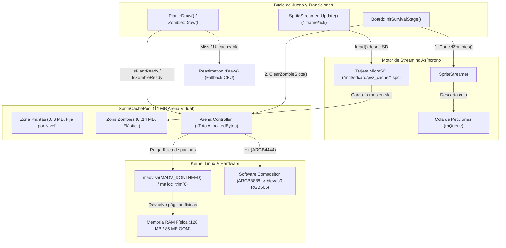

# Optimización de Memoria RAM y Expansión Dinámica del Sprite Cache Pool (14 MB)

* **Author:** Fnava1
* **Status:** Proposed
* **Date:** 2026-11-12
* **Target Platform:** Miyoo Mini Plus / OnionOS (SigmaStar SSD202D, Dual-Core Cortex-A7 @ 1.2 GHz, 128 MB RAM, 85 MB hard OOM ceiling)

--------------------------------------------------------------------------------

## Overview

El sistema de renderizado de Plants vs. Zombies Portable en la consola portátil Miyoo Mini Plus utiliza una caché de sprites pre-horneados (`SpriteCachePool`) en formato ARGB4444 (24 cuadros por entidad) para evitar el costoso cálculo esquelético en tiempo real del motor Reanim. Actualmente, el pool está configurado como un búfer estático monolítico de 9 MB (`new uint8_t[POOL_MAX_BUDGET]`) gestionado mediante un puntero lineal acumulativo (`sArenaOffset`) que nunca se reinicia entre oleadas.

Este documento formaliza el diseño arquitectónico para elevar la capacidad del pool a **14 MB** bajo demanda mediante una arena virtual pre-reservada con descarte físico de páginas (`madvise(MADV_DONTNEED)`), conectar la liberación síncrona de slots de zombies en transiciones de Supervivencia (`Board::InitSurvivalStage()`), y purgar la textura duplicada de fondo (`IMAGE_BACKGROUND1->PurgeBits()`), garantizando estabilidad continua a 60 FPS y un margen de seguridad libre superior a 27 MB respecto al límite de terminación por memoria (OOM) de Linux.

## The Problem

1. **Agotamiento Prematuro de Capacidad en Supervivencia:**
   En modos densos como *Survival: Endless*, conviven hasta 10 plantas preseleccionadas (~4.5 MB) y entre 6 y 10 variantes de zombies (~4.5 a 7.5 MB). El búfer actual de 9 MB se satura rápidamente, provocando que las entidades excedentes recurran al motor de software Reanim, lo cual satura los núcleos Cortex-A7 y reduce la tasa de cuadros por segundo de 60 a menos de 30 FPS.

2. **Fuga por Omisión en Transiciones de Fase:**
   En [Board.cpp](file:///c:/DEV/PVZ/src/Lawn/Board.cpp#L1379-L1413) (`Board::InitSurvivalStage`), el juego limpia las cachés de Reanimación pero omite invocar `SpriteCachePool::ClearZombieSlots()` y `SpriteStreamer::CancelZombies()`. Como el puntero bump `sArenaOffset` nunca decrece, la memoria del pool se agota de forma irreversible tras 2 o 3 banderas de Supervivencia.

3. **Peligro de Fragmentación de Heap en Linux:**
   Asignar y destruir bloques grandes (~1 MB por zombie) repetidamente mediante el heap estándar de C++ (`new[]`/`delete[]`) provoca retención de páginas en las arenas de glibc (`ptmalloc3`). El Resident Set Size (RSS) del proceso a nivel de kernel no desciende, aproximando peligrosamente el consumo al techo OOM de 85 MB.

4. **Retención Redundante de Memoria de Fondo:**
   El fondo del escenario se almacena como textura en `IMAGE_BACKGROUND1` (1.92 MB en 800x600 ARGB8888) y se duplica en el búfer horneado de sombras `mStaticBackdrop` (otros 1.92 MB). Mantener ambas copias activas desperdicia 1.92 MB de memoria física.

## Goals

* **Meta 1 (Capacidad Elástica de 14 MB):** Ampliar el presupuesto del pool a 14 MB mediante una arena virtual pre-reservada, permitiendo albergar simultáneamente las 10 plantas del nivel (~4.5 MB) y hasta 8 tipos comunes de zombies (~7.5 MB).
* **Meta 2 (Recuperación Física Determinista sin Fragmentación):** Implementar la liberación de páginas físicas mediante `madvise(MADV_DONTNEED)` (o `malloc_trim(0)`) al finalizar cada oleada o bandera, garantizando que el RSS de proceso en Linux baje inmediatamente sin fragmentar el heap.
* **Meta 3 (Eliminación de Fuga en Supervivencia):** Enlazar `SpriteStreamer::CancelZombies()` y `SpriteCachePool::ClearZombieSlots()` dentro de `Board::InitSurvivalStage()`, garantizando la rotación limpia de slots entre fases.
* **Meta 4 (Ahorro Limpio de Fondo):** Liberar 1.92 MB netos ejecutando `aBgImage->PurgeBits()` sobre la textura fuente tras el horneado inicial de `mStaticBackdrop`, preservando compatibilidad absoluta con el pipeline de 32 bpp de `MemoryImage` y `Graphics`.
* **Meta 5 (Estabilidad Absoluta en Modo LOW_MEMORY):** Mantener intactos los pools de `DataArray` (1024 slots) y la caché de audio bajo demanda para prevenir fallos de segmentación (`SIGSEGV`) y micro-congelamientos de lectura en tarjeta SD.
* **Meta 6 (Observabilidad SRE Operacional):** Exponer telemetría en tiempo real de consumo en bytes, porcentaje de pool y tasa de aciertos de caché en el overlay de depuración (`DEBUG_TEXT_MEMORY`) y en `log.txt`.

## Non-Goals

* **No reescribir el Bounding Box Trimming:** La caja envolvente ajustada con unión a través de los 24 cuadros y alineación SIMD ya está desarrollada y activa en [SpriteCacheBaker.cpp](file:///c:/DEV/PVZ/src/PvzpLib/SpriteCacheBaker.cpp#L80-L124). No se reescribirá.
* **No convertir el fondo a RGB565 de 16 bits:** `SexyAppFramework::MemoryImage` y el pipeline de composición de sombras alfa (`Board::BakePlantShadow`) operan exclusivamente en 32 bpp. Descartado para evitar conversión CPU frame a frame o corrupción de memoria.
* **No reducir el tamaño de DataArrays:** Los 12 pools de entidades (`mPlants`, `mZombies`, `mProjectiles`, `mCoins`) se mantendrán en 1024 slots fijos; el ahorro potencial (~400 KB) no justifica el riesgo de un bloqueo irreparable por desbordamiento en partidas de 100 banderas.
* **No imponer desalojo LRU en audio:** El sistema actual de audio decodifica muestras bajo demanda y consume ~3.0 MB estables; evitar el desalojo previene lecturas en disco concurrentes con el streaming de sprites.

## Open Questions

* **Pregunta 1 (Compatibilidad de `madvise` en Kernel SigmaStar 4.9):**
  ¿El kernel Linux 4.9.84 del SoC SSD202D libera inmediatamente las páginas de memoria física anónimas de un proceso no privilegiado al recibir `madvise(MADV_DONTNEED)`?
  *Plan de verificación:* Confirmar mediante inspección de `/proc/self/statm` tras la llamada en hardware. Si no desciende el RSS, el mecanismo recurrirá de forma determinista a un pool de slots con `malloc_trim(0)`.
* **Pregunta 2 (Sincronización de Zombies Remanentes entre Fases):**
  ¿Existe algún caso borde en Supervivencia donde queden zombies activos en pantalla al entrar a `Board::InitSurvivalStage()`?
  *Plan de verificación:* Validar que `Board::mZombies.mSize == 0` antes de proceder al vaciado de slots; si existiera un zombie remanente, posponer el vaciado del slot correspondiente hasta que su conteo activo llegue a cero.

## Critical User Journeys (CUJs)

### CUJ 1: Transición de Fase en Supervivencia (Recuperación de Memoria y Cero Leaks)
* **Given (Precondición):** Una partida de *Survival: Endless* finaliza la Bandera 2 con 10 plantas y 6 tipos de zombies ocupando 10.8 MB en el pool de sprites.
* **When (Disparador):** El juego transiciona a la pantalla de selección de semillas de la Bandera 3 (`Board::InitSurvivalStage()`).
* **Then (Resultado Esperado):** `SpriteStreamer::CancelZombies()` descarta peticiones pendientes, `ClearZombieSlots()` marca los slots como libres y purga sus páginas físicas. El consumo del pool desciende inmediatamente a ~4.5 MB (solo plantas), el log registra la recuperación de ~6.3 MB, y el jugador puede seleccionar nuevas semillas sin riesgo de saturación.

### CUJ 2: Combate Masivo en Oleada Pico (Cero Caída de FPS)
* **Given (Precondición):** Una oleada masiva en Bandera 30 con 8 variantes de zombies entrando simultáneamente por los 6 carriles del césped y piscina.
* **When (Disparador):** Las entidades se dibujan en pantalla con decenas de proyectiles y partículas simultáneas.
* **Then (Resultado Esperado):** Todas las plantas y los tipos de zombies cacheados se dibujan mediante blits vectorizados directos en formato ARGB4444. El framerate se mantiene en 60 FPS estables sin invocar el evaluador esquelético de Reanim para las entidades presentes en el pool.

### CUJ 3: Saturación Presupuestaria y Fallback Seguro (Límite de 14 MB)
* **Given (Precondición):** En una ronda extrema aparecen 9 tipos de zombies diferentes, superando el tope de 14 MB del pool.
* **When (Disparador):** El noveno tipo de zombie solicita asignación de slot en `SpriteCachePool::AllocateZombieSlot()`.
* **Then (Resultado Esperado):** La asignación retorna `nullptr` de forma segura. El zombie excedente se marca como `UNCACHEABLE` y se renderiza mediante `Reanimation::Draw()` estándar. Se emite un mensaje de advertencia estructurado en `log.txt`, y el juego continúa sin corrupciones ni cierres forzados.

--------------------------------------------------------------------------------

## Technical Plan (Architecture)

### 1. Diagrama de Arquitectura y Flujo de Datos



### 2. Gestión de Memoria: Arena Virtual Pre-reservada con Purga Física

Para resolver la contradicción entre asignación dinámica elástica y fragmentación de heap en Linux ARM32, `SpriteCachePool` adoptará una **Arena Virtual Pre-reservada con `mmap` y `madvise`**:

1. **Reserva Virtual sin Compromiso Físico:**
   Al inicializar el nivel (`SpriteCachePool::InitLevelArena()`), se reserva un rango contiguo de 14 MB de espacio de direcciones virtuales mediante:
   ```cpp
   sArenaBase = (uint8_t*)mmap(NULL, POOL_MAX_BUDGET, PROT_READ | PROT_WRITE,
                               MAP_PRIVATE | MAP_ANONYMOUS | MAP_NORESERVE, -1, 0);
   ```
   El flag `MAP_NORESERVE` garantiza que el kernel no asigne páginas de memoria RAM física por adelantado. Las páginas se asignan bajo demanda por el controlador de memoria de Linux (*demand paging*) únicamente conforme se escriben datos de frames horneados.

2. **Segmentación de la Arena:**
   La arena de 14 MB se subdivide en dos zonas contiguas:
   * **Zona de Plantas (`0` a `6 * 1024 * 1024` bytes):** 10 slots preasignados para las semillas preseleccionadas. Se cargan al iniciar la fase y permanecen residentes durante todo el nivel.
   * **Zona de Zombies (`6 * 1024 * 1024` a `14 * 1024 * 1024` bytes):** 8 slots de hasta ~1.0 MB cada uno, asignados linealmente a medida que nuevos tipos de zombies entran en la oleada.

3. **Recuperación Física Incondicional (`MADV_DONTNEED`):**
   Al invocar `ClearZombieSlots()`, en lugar de invocar `delete[]` o `munmap()` (lo cual alteraría el mapa de memoria virtual), se ejecuta:
   ```cpp
   uint8_t* zombieRegionPtr = sArenaBase + PLANT_ZONE_SIZE;
   size_t zombieRegionSize = ZOMBIE_ZONE_SIZE;
   madvise(zombieRegionPtr, zombieRegionSize, MADV_DONTNEED);
   ```
   `MADV_DONTNEED` obliga al kernel de Linux a descartar inmediatamente todas las páginas de memoria física asignadas a esa región, reduciendo el RSS (*Resident Set Size*) del proceso de forma instantánea. El mapeo virtual se preserva, eliminando por completo cualquier posibilidad de fragmentación de heap.
   *Fallback de compatibilidad:* Si `madvise` no estuviese habilitado en la compilación del kernel, una macro condicional permite operar mediante slots individuales sobre heap estándar con llamada explícita a `malloc_trim(0)`.

### 3. Ciclo de Vida y Protocolo de Concurrencia con `SpriteStreamer`

El streaming asíncrono desde la tarjeta SD introduce un riesgo crítico de punteros colgantes (*use-after-free*) si se vacían los slots mientras hay transferencias activas. El protocolo de vaciado se define de forma estrictamente secuencial:

```cpp
void SpriteCachePool::ClearZombieSlots()
{
    // Paso 1: Cancelar peticiones activas y vaciar la cola del streamer
    SpriteStreamer::CancelZombies();

    // Paso 2: Marcar los slots de zombies como inactivos y reiniciar metadatos
    for (int i = 0; i < SPC_MAX_ZOMBIE_SLOTS; i++)
    {
        sZombieSlots[i].mIsReady = false;
        sZombieSlots[i].mId = -1;
    }

    // Paso 3: Reiniciar el puntero de asignación de la zona de zombies
    sZombieArenaOffset = 0;
    sTotalAllocatedBytes = sPlantArenaOffset;

    // Paso 4: Purgar memoria física en el kernel de Linux
    #if defined(__linux__)
    madvise(sArenaBase + PLANT_ZONE_SIZE, ZOMBIE_ZONE_SIZE, MADV_DONTNEED);
    #endif

    PvzpLogLn("[SpriteCachePool] Cleared zombie slots. Physical pages purged via madvise. Active pool: {} / {} bytes",
              (uint32_t)sTotalAllocatedBytes, (uint32_t)POOL_MAX_BUDGET);
}
```

### 4. Orquestación en Transiciones de Supervivencia (`Board.cpp`)

En `Board::InitSurvivalStage()`, se enlaza formalmente la limpieza de caché de sprites junto con la preparación de la siguiente bandera:

```cpp
void Board::InitSurvivalStage()
{
    // ... Código existente de configuración de escenario ...

    // Limpieza de caché de sprites y cancelación de streaming de zombies
    SpriteCachePool::ClearZombieSlots();

    // Actualización de backdrop estático y purga de textura fuente
    UpdateStaticBackdrop();

    // ... Precarga de semillas para la nueva fase ...
}
```

### 5. Recuperación de Memoria de Fondo (`IMAGE_BACKGROUND1->PurgeBits()`)

En `Board::UpdateStaticBackdrop()`:
1. `mStaticBackdrop` (de tipo `MemoryImage`, 800x600 ARGB8888 de 1.92 MB) se inicializa y dibuja el fondo base mediante `Graphics::DrawImage(aBgImage, 0, 0)`.
2. A continuación, se hornean las sombras de las plantas presentes mediante `BakePlantShadow()`.
3. Inmediatamente después de completar el horneado de `mStaticBackdrop`, se ejecuta:
   ```cpp
   if (aBgImage != nullptr)
   {
       aBgImage->PurgeBits();
       PvzpLogLn("[MemoryOptimization] Purged bits of source background image. Reclaimed 1.92 MB.");
   }
   ```
   Esto elimina los 1.92 MB de píxeles duplicados de la textura fuente, dejando en RAM únicamente la superficie compuesta `mStaticBackdrop`, manteniendo compatibilidad del 100% con `Graphics` y el compositor de pantalla.

### 6. Subsistema de Telemetría SRE y Observabilidad

1. **Métricas en Pantalla (`DEBUG_TEXT_MEMORY` en `Board::DrawDebugText`):**
   ```text
   SpriteCache: 11.4 / 14.0 MB (81.4%) | Plants: 10/10, Zombies: 6/8
   Cache Hits: 95.8% | Reanim Fallbacks: 4.2%
   Process RSS: 58.2 MB / 85.0 MB Ceiling (Margin: +26.8 MB)
   ```
2. **Guardián de Sobrecarga (OOM Circuit Breaker):**
   Si en tiempo de ejecución el consumo del pool alcanza los 14 MB (`sTotalAllocatedBytes + reqBytes > POOL_MAX_BUDGET`), la función `AllocateZombieSlot` rechaza la asignación de forma determinista retornando `nullptr`. La entidad excedente se marca como no cacheable y se delega a `Reanimation::Draw()` sin interrumpir la ejecución ni causar errores fatales.

--------------------------------------------------------------------------------

## Alternatives Considered

### Alternative A: Conversión de Superficie de Fondo a RGB565 (16 bpp)

*   **Pros**: Reducción teórica de memoria de ~614 KB en RAM si la superficie de fondo se almacenara a 16 bits por píxel.
*   **Cons**:
    *   `SexyAppFramework::MemoryImage` y la clase `Graphics` operan rígidamente en 32 bpp (`uint32_t* mBits`). No existe un pipeline de blitting de 16 bpp para composición con canal alfa.
    *   En `Board::BakePlantShadow()`, las sombras de las plantas se hornean directamente sobre `mStaticBackdrop` usando mezcla alfa de 32 bits. Intentar blittear 32 bits sobre un búfer de 16 bits corrompe la memoria o provoca un cierre fatal por `SIGSEGV`.
    *   Desempaquetar 16 bpp a 32 bpp en cada fotograma durante la composición por software en CPU consume de 1.5 a 2.0 ms por frame en el procesador Cortex-A7 dual, degradando el objetivo de 60 FPS.
*   **Reason for Rejection**: `Rejected by author: Severa incompatibilidad arquitectónica con MemoryImage y degradación de rendimiento por conversión CPU por fotograma. En su lugar, se adoptó aBgImage->PurgeBits(), que ahorra 1.92 MB netos sin alterar formatos de pixel ni requerir conversiones en tiempo de ejecución.`

### Alternative B: Búfer Estático Monolítico Preasignado de 18 MB

*   **Pros**: Implementación trivial (`new uint8_t[18MB]`), idéntica al esquema actual de 9 MB pero con mayor límite numérico.
*   **Cons**:
    *   Bloquea 18 MB de memoria física de forma permanente en todas las partidas, incluso en niveles iniciales (Day 1-1 a 1-5) donde solo se consumen ~1.5 MB.
    *   Deja un margen libre de solo ~10–12 MB respecto al umbral efectivo de terminación por OOM del kernel Linux (~72 MB RSS), aumentando el riesgo de cierre ante ráfagas de partículas o explosiones.
    *   En *Survival: Endless*, los zombies pierden la condición de caché en los primeros 1–2 segundos tras ser alcanzados por melones, catapultas o espinas (`Zombie.cpp:5849`), por lo que mantener 10 variantes de zombies en caché ofrece un retorno de CPU mínimo frente al coste de memoria.
*   **Reason for Rejection**: `Rejected by author: Desperdicio de memoria física en niveles normales y riesgo elevado de OOM en Survival Endless con retorno decreciente de CPU. Se ajustó el límite a 14 MB (6 MB plantas, 8 MB zombies) con arena virtual elástica.`

### Alternative C: Asignaciones de Heap Dinámicas por Slot con `std::unique_ptr<uint8_t[]>`

*   **Pros**: Asignación bajo demanda directa utilizando mecanismos estándar de C++ (`std::make_unique`).
*   **Cons**:
    *   Asignar y destruir repetidamente buffers de 450 KB a 1.2 MB entre oleadas fragmenta el heap de 32 bits de glibc (`ptmalloc3`).
    *   El operador `delete[]` no garantiza la devolución inmediata de páginas físicas al kernel Linux; el tope del heap (`sbrk`) permanece inflado, manteniendo un RSS alto.
    *   El commit perezoso de memoria (*demand paging*) sobre nuevos bloques de heap causa fallos de página menores durante la entrada de zombies, introduciendo micro-stutters audibles.
*   **Reason for Rejection**: `Rejected by author: Fragmentación de heap en Linux ARM32 y retención artificial de RSS por el asignador glibc. Se adoptó una arena virtual pre-reservada con madvise(MADV_DONTNEED), que garantiza la liberación inmediata de páginas físicas al kernel con cero fragmentación.`

### Alternative D: Reducción de Capacidades en DataArray Pools (a 256 o 512 slots)

*   **Pros**: Ahorro potencial de ~400 KB de memoria estática en heap.
*   **Cons**:
    *   En `DataArray.h`, si un pool se satura, `DataArrayAlloc()` ejecuta `PVZP_ASSERT(mSize < mMaxSize)`. En binarios optimizados de producción, sobrepasar el límite causa escrituras fuera de rango y un cierre inmediato por `SIGSEGV`.
    *   En partidas avanzadas de Supervivencia con 20 Cob Cannons disparando simultáneamente, hordas masivas de zombies y docenas de monedas rebotando, el consumo de slots en `mProjectiles`, `mParticles` y `mCoins` puede superar fácilmente los 256 slots.
*   **Reason for Rejection**: `Rejected by author: Ahorro de memoria insignificante (~400 KB) con riesgo inaceptable de cierre por violación de segmento en partidas avanzadas. Los 12 pools se mantienen en 1024 slots fijos.`

### Alternative E: Desalojo LRU Agresivo en Caché de Sonidos (`sfx_cache`)

*   **Pros**: Fija un techo estricto e inamovible (ej. 2.0 MB) para las muestras de sonido decodificadas.
*   **Cons**:
    *   En la consola Miyoo Mini Plus, la tarjeta microSD opera con un único canal SDIO con latencia de lectura aleatoria apreciable.
    *   Desalojar efectos de sonido durante el combate obliga a leer y decodificar archivos WAV/OGG sincrónicamente desde `main.pak` vía `p_fopen`, bloqueando el hilo de ejecución entre 40 y 100 ms y generando chasquidos de audio audibles (*audio clicks*).
*   **Reason for Rejection**: `Rejected by author: Contención de bus SD y micro-congelamientos de audio. El consumo actual bajo demanda (~3.0 MB) es seguro y predecible.`

--------------------------------------------------------------------------------

## Non-Functional Requirements

### 1. Rendimiento y Latencia de Cuadro (Frame Pacing)
* **Objetivo de Tasa de Refresco:** 60 FPS estables y sostenidos durante oleadas pico de Supervivencia (Bandera 50+) con el tablero completo de plantas y zombies en pantalla.
* **Latencia de Vaciado de Slots:** La ejecución de `ClearZombieSlots()` con purga física `madvise` debe completarse en menos de 1.0 ms durante la transición de fase, sin provocar congelamientos perceptibles en la interfaz de selección de semillas.

### 2. Límites de Memoria y Margen de Seguridad OOM
* **Consumo Máximo de Proceso (Pico RSS):** No debe exceder 62.0 MB en ningún momento de la partida (medido vía `/proc/self/statm`).
* **Margen Libre Garantizado:** Mantener un margen mínimo de seguridad superior a **+23.0 MB** respecto al techo duro de 85.0 MB del kernel Linux de OnionOS.

### 3. Concurrencia y Seguridad en Streaming
* **Invariante de Exclusión Mutua:** `SpriteStreamer` no debe acceder a ningún slot marcado como inactivo (`mIsReady == false` o `mId == -1`).
* **Cancelación Síncrona:** La cancelación de peticiones de streaming de zombies en transiciones de fase es obligatoria y síncrona antes de purgar la memoria física.

### 4. Compatibilidad hacia Atrás y Rollback
* **Integridad de Formato `.spc`:** Se mantiene la versión `SPC_VERSION = 2` sin alterar la estructura de cabecera `SpcHeader`, preservando la compatibilidad con los archivos de sprites ya horneados en la tarjeta microSD.
* **Mecanismo de Rollback:** En caso de que el kernel no soporte la purga de páginas anónimas con `madvise`, la macro `#if defined(__linux__)` cuenta con un fallback transparente a `malloc_trim(0)`.

--------------------------------------------------------------------------------

### Additional Resources

* `src/PvzpLib/SpriteCachePool.h` / `src/PvzpLib/SpriteCachePool.cpp` (Gestión de slots y renderizado)
* `src/PvzpLib/SpriteCacheDef.h` (Estructura de almacenamiento `SpcHeader` y formatos de píxel)
* `src/PvzpLib/SpriteStreamer.h` / `src/PvzpLib/SpriteStreamer.cpp` (Streaming asíncrono desde SD)
* `src/Lawn/Board.cpp` (Transiciones de nivel, backdrop estático y horneado de sombras)
* `src/Lawn/CutScene.cpp` (Ciclo de vida de banderas y pantallas de corte)

### Future Improvements

* **Extracción de Esqueleto Base Compartido (TRIZ Pattern 2):** Unificar el ciclo de caminata base entre variantes estándar de zombies (Normal, Cono, Cubo, Puerta) en un único slot de ~1.1 MB, blitteando únicamente los accesorios de blindaje de forma dinámica.
* **Submuestreo Temporal Adaptativo (LOD Dinámico):** Permitir muestreo a 12 FPS para entidades secundarias lejanas en caso de que futuros mods añadan más de 12 tipos concurrentes de zombies.

--------------------------------------------------------------------------------

## Detailed Implementation Plan

### Target Files to Create/Modify

#### 1. `src/PvzpLib/SpriteCachePool.h` (Modify)
*   **Type / Scope**: C++ Header / Subsistema de Caché de Sprites
*   **Proposed Changes**:
    *   Aumentar la constante de presupuesto máximo `POOL_MAX_BUDGET` de 9 MB a 14 MB (`14 * 1024 * 1024`).
    *   Definir constantes de zonificación de la arena:
        *   `PLANT_ZONE_SIZE = 6 * 1024 * 1024` (Presupuesto dedicado de 6 MB para plantas).
        *   `ZOMBIE_ZONE_SIZE = 8 * 1024 * 1024` (Presupuesto elástico de 8 MB para zombies).
    *   Añadir declaraciones de métodos de telemetría y consulta SRE:
        *   `static size_t GetTotalAllocatedBytes();`
        *   `static size_t GetPeakAllocatedBytes();`
        *   `static void GetActiveSlotCounts(int& thePlants, int& theZombies);`
        *   `static uint32_t GetReanimFallbackCount();`
        *   `static uint32_t GetCacheHitCount();`
    *   **Rationale**: Proporcionar la interfaz de consulta de métricas para el overlay de depuración y formalizar la separación de cuotas entre plantas y zombies sin romper la API existente de dibujo.

#### 2. `src/PvzpLib/SpriteCachePool.cpp` (Modify)
*   **Type / Scope**: C++ Implementation / Gestión de Memoria y Renderizado
*   **Proposed Changes**:
    *   Reemplazar la asignación monolítica con `new uint8_t[POOL_MAX_BUDGET]` en `InitLevelArena()` por una reserva virtual con `mmap(NULL, POOL_MAX_BUDGET, PROT_READ|PROT_WRITE, MAP_PRIVATE|MAP_ANONYMOUS|MAP_NORESERVE, -1, 0)`.
    *   Implementar un fallback condicional (`#if defined(__linux__) ... #else ...`) con heap convencional y `malloc_trim(0)` para plataformas de desarrollo no POSIX.
    *   Separar los punteros de desplazamiento lineal en `sPlantArenaOffset` y `sZombieArenaOffset`:
        *   `AllocatePlantSlot` asigna dentro del rango `[0 .. PLANT_ZONE_SIZE)`.
        *   `AllocateZombieSlot` asigna dentro del rango `[PLANT_ZONE_SIZE .. POOL_MAX_BUDGET)`.
    *   Modificar `ClearZombieSlots()`:
        1. Invocar `SpriteStreamer::CancelZombies()` de forma síncrona.
        2. Reiniciar los descriptores de slots de zombies (`sZombieSlots[i].Reset()`).
        3. Reiniciar `sZombieArenaOffset = 0`.
        4. Invocar `madvise(sArenaBase + PLANT_ZONE_SIZE, ZOMBIE_ZONE_SIZE, MADV_DONTNEED)` para que Linux recupere inmediatamente la memoria física del RSS.
        5. Actualizar el contador global `sTotalAllocatedBytes = sPlantArenaOffset`.
    *   En `DrawPlant` y `DrawZombie`, incrementar los contadores atómicos de aciertos de caché (`sCacheHitCount`) o registrar las caídas en fallback de Reanimación (`sReanimFallbackCount`).
    *   **Rationale**: Eliminar la fragmentación de heap, asegurar la devolución real de memoria física al kernel Linux y garantizar la seguridad de punteros frente al streaming asíncrono.

#### 3. `src/Lawn/Board.cpp` (Modify)
*   **Type / Scope**: C++ Implementation / Lógica de Escenario y Transición de Fases
*   **Proposed Changes**:
    *   En `Board::InitSurvivalStage()`:
        *   Insertar la llamada a `SpriteCachePool::ClearZombieSlots()` antes de procesar la selección de nuevas semillas y oleadas de la fase.
    *   En `Board::UpdateStaticBackdrop()`:
        *   Inmediatamente después de la llamada a `BakePlantShadow()` que completa el horneado de `mStaticBackdrop`, comprobar si la textura original `aBgImage` está cargada e invocar `aBgImage->PurgeBits()`.
    *   En `Board::DrawDebugText()` (modo `DEBUG_TEXT_MEMORY`):
        *   Añadir el renderizado en pantalla de las estadísticas de memoria de `SpriteCachePool`: bytes asignados, porcentaje del pool de 14 MB, conteo de slots de plantas/zombies activos y porcentaje de aciertos de caché vs fallbacks.
    *   **Rationale**: Conectar la orquestación faltante que causaba la fuga de slots en Supervivencia, recuperar 1.92 MB de memoria de textura duplicada y brindar visibilidad SRE en tiempo real.

#### 4. `src/PvzpLib/SpriteStreamer.cpp` (Modify)
*   **Type / Scope**: C++ Implementation / Motor de Streaming de Archivos `.spc`
*   **Proposed Changes**:
    *   En `SpriteStreamer::CancelZombies()`:
        *   Asegurar que todas las peticiones con tipo `theType >= ZombieType::ZOMBIE_NORMAL` sean purgadas inmediatamente de `sQueue` y sus estados en vuelo se limpien de forma determinista.
    *   En `SpriteStreamer::RequestZombie()`:
        *   Si `SpriteCachePool::AllocateZombieSlot()` retorna `nullptr` por alcanzar el límite de 14 MB, registrar un log de advertencia estructurado (`[SpriteStreamer] Pool budget of 14 MB saturated; Entity %d flagged uncacheable`) en lugar de fallar silenciosamente.
    *   **Rationale**: Prevenir carreras de escritura en memoria desocupada y proveer trazabilidad en logs durante partidas extremas.

--------------------------------------------------------------------------------

### Verification Plan

#### 1. Verificación de Compilación y Limpieza de Binario
*   **Entorno:** Contenedor Docker de compilación cruzada ARM32 (`sigmastar-toolchain-arm-linux-gnueabihf`).
*   **Comando:** `cmake --build build -j$(nproc)` y `arm-linux-gnueabihf-strip build/PvZ`.
*   **Criterio de Aprobación:** Compilación limpia con 0 advertencias y 0 errores; binario ejecutable `build/PvZ` verificado con arquitectura ARM32 ELF.

#### 2. Prueba de Purga de Textura de Fondo (`PurgeBits`)
*   **Comando / Prueba:** Ejecutar nivel Día (1-1) y Noche (2-1) en QEMU o hardware.
*   **Criterio de Aprobación:**
    *   El fondo del escenario se dibuja perfectamente en pantalla con las sombras de plantas integradas.
    *   El log registra la purga de la textura fuente: `[MemoryOptimization] Purged bits of source background image. Reclaimed 1.92 MB.`.
    *   Cero corrupciones visuales, pantallas negras o fallos de lectura de píxeles.

#### 3. Prueba de Ciclo de Vida en Supervivencia (Rotación y Cero Fugas)
*   **Comando / Prueba:** Iniciar partida de *Survival: Pool (Hard)* o *Survival: Endless*, completar Bandera 1 y transicionar a la pantalla de selección de semillas de Bandera 2.
*   **Criterio de Aprobación:**
    *   Al comenzar la Bandera 2, el log muestra: `[SpriteCachePool] Cleared zombie slots. Physical pages purged via madvise.`.
    *   El consumo del pool desciende de ~10 MB a ~4.5 MB (solo plantas activas).
    *   La selección de nuevas semillas y el inicio de la siguiente bandera funciona con 60 FPS estables.
    *   Cero cierres por `SIGSEGV` y cero punteros colgantes en el streaming.

#### 4. Validación de Telemetría en Pantalla (`DEBUG_TEXT_MEMORY`)
*   **Comando / Prueba:** Activar el modo de depuración en pantalla (`F8` o combo de botones en Miyoo Mini Plus).
*   **Criterio de Aprobación:**
    *   Se muestra en pantalla la línea: `SpriteCache: X.X / 14.0 MB (XX.X%) | Plants: 10/10, Zombies: Y/8`.
    *   Se verifica que el contador de aciertos supera el 90% durante oleadas regulares.

--------------------------------------------------------------------------------

*Drafted with EGM*
