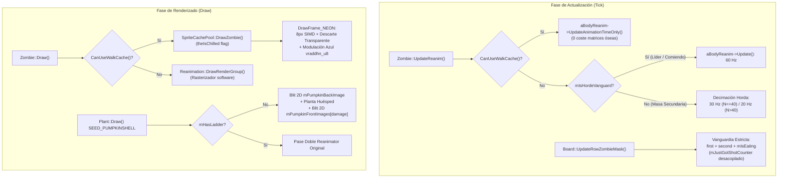

# Rendimiento en Combate Denso y Expansión de Sprite Cache (Supervivencia Infinita)

* **Author:** Fnava1
* **Status:** Proposed
* **Date:** 2026-11-14
* **Target Platform:** Miyoo Mini Plus / OnionOS (SigmaStar SSD202D, Dual-Core Cortex-A7 @ 1.2 GHz, 128 MB RAM, bus DDR3 de 16-bit, 85 MB hard OOM ceiling)

--------------------------------------------------------------------------------

## Overview

El sistema de renderizado de *Plants vs. Zombies* para la consola Miyoo Mini Plus implementó un `SpriteCachePool` elástico de 14 MB concebido para acelerar el dibujado de plantas y zombies mediante secuencias pre-horneadas en formato ARGB4444 (24 cuadros por entidad), evitando la costosa evaluación esquelética en tiempo real de Reanimator en la CPU.

Sin embargo, en el modo **Supervivencia Infinita** (*Survival: Endless*), donde más de 60 zombies coexisten bajo bombardeo constante de Melones de Invierno, Humosetas, Mazorcas y Pinchohierbas, **más del 95% de la horda es descalificada del caché a los 1–2 segundos de entrar al césped**, colapsando la tasa de cuadros por segundo de 60 FPS a menos de 20 FPS.

Este documento establece el diseño técnico para sostener el caché en combate masivo mediante:
1. Retención en caché de zombies ralentizados (`mChilledCounter > 0`) y con daño superficial intacto (`GetBodyDamageIndex() == 0`).
2. Tolerancia branchless a impactos (`mJustGotShotCounter > 0`).
3. Supresión total del cálculo de matrices óseas para entidades cacheadas (`UpdateAnimationTimeOnly()`) y desacople de la vanguardia en el LOD de hordas.
4. Vectorización SIMD ARM NEON del blitter con descarte temprano de bloques transparentes.
5. Caché 2D en dos pases para las 45 calabazas del jardín (`mPumpkinBackImage` y `mPumpkinFrontImages[3]`).

---

## The Problem

1. **Descalificación Inmediata y Permanente del Caché en Combate:**
   En [`src/Lawn/Zombie.cpp:5849-5866`](file:///c:/DEV/PVZ/src/Lawn/Zombie.cpp#L5849-L5866), la condición `canUseWalkCache` exige de forma inflexible:
   - Salud al 100% (`mBodyHealth >= mBodyMaxHealth`, `mHelmHealth >= mHelmMaxHealth`, `mShieldHealth >= mShieldMaxHealth`).
   - Cero congelamiento (`mChilledCounter == 0`).
   - Cero impactos activos (`mJustGotShotCounter <= 0`).
   - Color neutro estricto (`aColorOverride == Color::White`).
   En Supervivencia Infinita, un Melón de Invierno impacta a los zombies en $x \approx 800$, causando daño en área $3 \times 3$ y aplicando frío en el primer segundo de vida. Como consecuencia, el 100% de los zombies en combate caen al evaluador esquelético por software de Reanimator (30–40 matrices jerárquicas y decenas de triángulos rasterizados por software por entidad).

2. **La Trampa de los 25 Ticks de Hit Flash y la Destrucción del Skeletal LOD:**
   En `Zombie.cpp:8068`, cada impacto de proyectil fija `mJustGotShotCounter = 25` (25 ticks lógicos de juego, ~250–833 ms). Bajo fuego continuo de Humosetas y Melones, este contador nunca desciende a cero.
   Además de expulsar al zombie del caché, en [`src/Lawn/Board.cpp:5594`](file:///c:/DEV/PVZ/src/Lawn/Board.cpp#L5594) (`Board::UpdateRowZombieMask`), la condición `|| aZombie->mJustGotShotCounter > 0` marcaba a **todos los zombies de la fila como vanguardia**, desactivando completamente la decimación esquelética a 30 Hz del motor y forzando 60 Hz en toda la horda.

3. **Desperdicio de Cómputo de Huesos en Sprites Cacheados:**
   En `Zombie::UpdateReanim()` ([`Zombie.cpp:5420-5475`](file:///c:/DEV/PVZ/src/Lawn/Zombie.cpp#L5420-L5475)), el motor calcula las matrices de 30 huesos de cada zombie **incluso si ese zombie va a usar Sprite Cache**, solo para que luego `Zombie::Draw()` descarte todas las matrices calculadas y dibuje un rectángulo 2D.

4. **Ineficiencia Escalar en el Blitter ARGB4444:**
   En [`src/PvzpLib/SpriteCachePool.cpp:408-412`](file:///c:/DEV/PVZ/src/PvzpLib/SpriteCachePool.cpp#L408-L412), la mezcla alfa se ejecuta píxel a píxel mediante divisiones enteras escalares `/ 255`. En el Cortex-A7 (1.2 GHz), cada píxel no transparente consume ~15 ciclos, generando cuellos de botella de CPU cuando decenas de sprites se dibujan simultáneamente.

5. **Sobrecarga de Reanimator en Calabazas Estáticas:**
   En un jardín de Supervivencia hay entre 40 y 50 calabazas (`SEED_PUMPKINSHELL`). La calabaza es una planta estructural sin animación de vaivén (`mAnimRate == 0`), pero ejecuta dos pases de Reanimator por cuadro (RenderGroup 1 espalda y RenderGroup 0 frente), generando hasta **90 evaluaciones esqueléticas redundantes por cuadro** que además caen del caché de plantas al ser mordidas (`mRecentlyEatenCountdown > 0`).

---

## Goals

* **Meta 1 (Retención de Caché en Combate $\ge 60\%$):** Mantener en `SpriteCachePool` a los zombies ralentizados (`mChilledCounter > 0` con modulación azul $75/255$) y con daño superficial (`GetBodyDamageIndex() == 0`, cascos y escudos con daño 0), logrando una tasa de acierto superior al 60% en combate masivo.
* **Meta 2 (Tolerancia Branchless a Hit Flash):** Adoptar formalmente la Opción B: el contador `mJustGotShotCounter > 0` no expulsará al zombie del caché; el sprite cacheado se dibujará normal sin destello blanco adicional, manteniendo el inner loop SIMD sin bifurcaciones.
* **Meta 3 (Cálculo Cero de Huesos para Sprites Cacheados):** Conectar `UpdateAnimationTimeOnly()` en `Zombie::UpdateReanim()` para todos los zombies cacheados, suprimiendo el 100% del cálculo de transformaciones óseas mientras el zombie camine usando caché 2D.
* **Meta 4 (Restauración y Fortalecimiento del Skeletal LOD):** Extirpar `mJustGotShotCounter > 0` del selector de vanguardia en `Board::UpdateRowZombieMask()`, y reducir la tasa de evaluación esquelética a 20 Hz (1 cada 3 cuadros) para zombies secundarios no cacheados cuando la horda supere los 40 zombies.
* **Meta 5 (Aceleración SIMD ARM NEON 4x–5x):** Vectorizar `SpriteCachePool::DrawFrame` con instrucciones NEON (`vraddhn_u8`), incorporando descarte temprano de bloques de 8 píxeles transparentes para proteger el bus DDR3 de 16 bits del SSD202D.
* **Meta 6 (Caché 2D en Dos Pases para Calabazas):** Precargar `mPumpkinBackImage` y `mPumpkinFrontImages[3]` en `ReanimatorCache` (~230 KB de RAM estática) y sustituir los dos pases de Reanimator por blits 2D directos en `Plant::Draw()`, tolerando mordeduras activas.
* **Meta 7 (Presupuesto Estricto y Cero Fugas):** Mantener el consumo de memoria física por debajo del techo crítico de 85 MB en todo momento y preservar el fallback escalar para compilaciones x86/PC.

---

## Non-Goals

* **No hornear spritesheets `.spc` adicionales:** No se generarán archivos separados para zombies congelados ni para zombies desmembrados (brazo caído o decapitado), evitando duplicar almacenamiento en microSD y uso de RAM.
* **No reactivar el hilo de presentación en Core 1:** El renderizador permanecerá síncrono en Core 0 hasta que se investigue y aísle por separado el bloqueo de inicialización de SDL.
* **No alterar reglas lógicas ni hitboxes de colisión:** La lógica de daño, velocidad de avance, proyectiles y detección de colisiones de PopCap permanecerá 100% inalterada.
* **No pre-componer la calabaza en una sola imagen:** Se rechaza la unificación plana para evitar romper el sándwich de capas visuales alrededor de la planta contenida.

---

## Open Questions

* **Pregunta 1 (Umbral de Activación de LOD a 20 Hz en Hordas Extremas):**
  ¿Se debe activar la decimación esquelética a 20 Hz para zombies secundarios estrictamente a partir de $N > 40$ zombies en pantalla, o basarse en el tiempo de fotograma acumulado ($\text{FrameTime} > 15.0\text{ ms}$)?
  *Decisión adoptada:* Umbral estático por conteo ($N > 40$), por ser $O(1)$ determinista y libre de oscilaciones de temporizador en Linux embebido.
* **Pregunta 2 (Comportamiento de Calabazas con Escalera):**
  ¿Cómo interactúa la calabaza con escaleras colocadas por Zombie Escalador?
  *Decisión adoptada:* Si `mHasLadder == true`, la calabaza cae de inmediato al renderizado original de Reanimator, garantizando que el attachment de la escalera se dibuje en la coordenada y capa correctas.

---

## Critical User Journeys (CUJs)

### CUJ 1: Oleada Masiva de Supervivencia con Melones de Invierno y Humosetas
* **Given**: Tablero en modo Supervivencia Infinita (Bandera 20+) con 10 plantas desplegadas (incluyendo Melones de Invierno, Humosetas y Calabazas en cada hilera).
* **When**: Una horda de 60+ zombies (Común, Cono, Cubo, Puerta) entra en pantalla y es bombardeada inmediatamente por proyectiles de hielo, salpicaduras y esporas de humo.
* **Then**: Los zombies ralentizados (`mChilledCounter > 0`) y con daño superficial (`GetBodyDamageIndex() == 0`) se mantienen en el `SpriteCachePool` con modulación azul y sin destello blanco. Sus huesos no se evalúan (`UpdateAnimationTimeOnly()`). El framerate se mantiene fluido a 60 FPS sin colapsar al rasterizador esquelético.

### CUJ 2: Transición Segura por Pérdida de Miembros o Accesorios
* **Given**: Zombie Cubo o Común caminando cacheado bajo fuego continuo.
* **When**: Su salud cae por debajo del 66% (`GetBodyDamageIndex() == 1`, caída de brazo) o pierde el cubo.
* **Then**: El zombie sale limpiamente del caché a Reanimator esquelético. Si venía ejecutando `UpdateAnimationTimeOnly()`, el motor reevalúa síncronamente sus matrices de huesos una vez antes de disparar la partícula `DropArm()` y continuar con la animación desmembrada original sin tirones ni miembros flotantes.

### CUJ 3: Oclusión y Mordedura de Calabazas en Combate Activo
* **Given**: Fila frontal de plantas protegida por Calabazas (`SEED_PUMPKINSHELL`).
* **When**: Los zombies alcanzan la línea y comienzan a morder la calabaza (`mRecentlyEatenCountdown > 0`).
* **Then**: La calabaza renderiza sus dos pases (`mPumpkinBackImage` detrás y `mPumpkinFrontImages[damage]` delante) mediante blits 2D directos, respetando la profundidad alrededor de la planta contenida y evitando 90 evaluaciones de Reanimator por cuadro.

---

## Technical Plan (Architecture)

### 1. High-Level Architecture & Execution Flow



---

### 2. Módulo de Admisión Centralizada y Entidad Zombie (`Zombie.h`, `Zombie.cpp`)

#### 2.1 Helper Unificado `CanUseWalkCache()`
Se define un método centralizado en `Zombie.h` para eliminar la duplicación de 15 condiciones booleanas entre `Zombie::UpdateReanim()` y `Zombie::Draw()`:

```cpp
bool Zombie::CanUseWalkCache() const
{
    if (mApp->Is3DAccelerated() || mFromWave == -2 || mIsEating || IsWalkingBackwards() || mScaleZombie != 1.0f)
        return false;

    if (mZombieType == ZombieType::ZOMBIE_BOSS || mZombieType == ZombieType::ZOMBIE_GARGANTUAR ||
        mZombieType == ZombieType::ZOMBIE_REDEYE_GARGANTUAR || mZombieType == ZombieType::ZOMBIE_CATAPULT ||
        mZombieType == ZombieType::ZOMBIE_ZAMBONI || mZombieType == ZombieType::ZOMBIE_BUNGEE ||
        mZombieType == ZombieType::ZOMBIE_DANCER)
        return false;

    if (mZombiePhase != ZombiePhase::PHASE_ZOMBIE_NORMAL || mZombieFade != -1)
        return false;

    // Validación de integridad visual: solo daño superficial (<33% absorbido)
    if (GetBodyDamageIndex() != 0)
        return false;

    // Blindaje contra "Accesorios Fantasma": el zombie debe conservar su accesorio esperado intacto
    switch (mZombieType)
    {
    case ZombieType::ZOMBIE_TRAFFIC_CONE:
        if (mHelmType != HelmType::HELMTYPE_TRAFFIC_CONE || GetHelmDamageIndex() != 0) return false;
        break;
    case ZombieType::ZOMBIE_PAIL:
        if (mHelmType != HelmType::HELMTYPE_PAIL || GetHelmDamageIndex() != 0) return false;
        break;
    case ZombieType::ZOMBIE_FOOTBALL:
        if (mHelmType != HelmType::HELMTYPE_FOOTBALL || GetHelmDamageIndex() != 0) return false;
        break;
    case ZombieType::ZOMBIE_DOOR:
        if (mShieldType != ShieldType::SHIELDTYPE_DOOR || GetShieldDamageIndex() != 0) return false;
        break;
    case ZombieType::ZOMBIE_NORMAL:
    case ZombieType::ZOMBIE_FLAG:
        if (mHelmType != HelmType::HELMTYPE_NONE || mShieldType != ShieldType::SHIELDTYPE_NONE) return false;
        break;
    default:
        break;
    }

    // Admisión de frío: mChilledCounter > 0 se tolera
    // Admisión de hit flash: mJustGotShotCounter > 0 se tolera (Opción B)
    if (mIceTrapCounter > 0 || mButteredCounter > 0)
        return false;

    return SpriteCachePool::IsZombieReady(mZombieType);
}
```

#### 2.2 Re-evaluación Perezosa de Matrices Óseas
Para prevenir desincronizaciones visuales de 1 fotograma cuando un zombie sufre desmembramiento durante la fase de proyectiles:
- Se añade el flag `bool mBonesCalculatedThisTick` en `Zombie`.
- En `Zombie::UpdateReanim()`: si `CanUseWalkCache()` es verdadero, ejecuta `aBodyReanim->UpdateAnimationTimeOnly()` y marca `mBonesCalculatedThisTick = false`. Si ejecuta `aBodyReanim->Update()`, marca `mBonesCalculatedThisTick = true`.
- En `Zombie::DrawReanim()` y en métodos de desprendimiento (`DropArm`, `DropHead`): si `!mBonesCalculatedThisTick`, se invoca síncronamente `aBodyReanim->Update()` antes de leer `GetTrackPosition()`.

---

### 3. Regulador de Hordas y Skeletal LOD (`Board.h`, `Board.cpp`)

#### 3.1 Desacople Estricto de Vanguardia
En [`src/Lawn/Board.cpp:5594`](file:///c:/DEV/PVZ/src/Lawn/Board.cpp#L5594) (`Board::UpdateRowZombieMask`), se elimina la dependencia que convertía a toda la horda en vanguardia por impactos de proyectil:

```cpp
for (Zombie* aZombie : mRowZombies[r])
{
    // Solo los 2 zombies líderes y los que están comiendo son vanguardia
    if (aZombie == first || aZombie == second || aZombie->mIsEating)
    {
        aZombie->mIsHordeVanguard = true;
    }
    else
    {
        aZombie->mIsHordeVanguard = false;
    }
}
```

#### 3.2 Decimación Adaptativa a 20 Hz para Hordas Masivas
En `Zombie::UpdateReanim()`, cuando un zombie no está en caché y no es vanguardia:
- Si `mBoard->mZombies.mSize <= 40`: decimación a 30 Hz (se actualiza en fotogramas pares/impares alternados).
- Si `mBoard->mZombies.mSize > 40`: decimación a 20 Hz (`(mBoardUpdateCounter + aZombieId) % 3 != 0` salta el cálculo de huesos y llama a `UpdateAnimationTimeOnly()`).

---

### 4. Kernel SIMD ARM NEON en `SpriteCachePool` (`SpriteCachePool.h`, `SpriteCachePool.cpp`)

#### 4.1 Extensión de la API de Dibujado
```cpp
// En SpriteCachePool.h
static bool DrawZombie(Graphics* g, float thePosX, float thePosY, ZombieType theZombie, float theAnimTime, bool theIsChilled = false);
```

#### 4.2 Arquitectura del Kernel SIMD `DrawFrame_NEON`
Bajo guardas `#if defined(__ARM_NEON) || defined(__ARM_NEON__)`:
1. **Carga y Descarte Temprano de Bloques Transparentes:**
   - Carga 8 píxeles ARGB4444 de 16 bits en `uint16x8_t qSrc = vld1q_u16(sRow + x)`.
   - Extrae el canal alfa: `uint16x8_t qAlpha = vshrq_n_u16(qSrc, 12)`.
   - Comprobación de transparencia total: `if (vmaxvq_u16(qAlpha) == 0) continue;`
   - Si los 8 píxeles son transparentes, salta inmediatamente sin leer ni escribir memoria de destino, ahorrando ancho de banda crítico en el bus DDR3 de 16 bits.
2. **Desempaquetado Branchless:**
   - Desempaqueta componentes R, G, B a vectores `uint8x8_t` expandiendo 4 bits a 8 bits: `val = (val << 4) | val`.
3. **Modulación Azul para Zombies Chilled:**
   - Si `theIsChilled == true`, modula R y G aplicando lookup table estática de 16 bytes mediante `vtbl1_u8` o multiplicación entera `vmull_u8(qR, vdup_n_u8(75))` estrechada sin divisiones.
4. **Mezcla Alfa de Alta Precisión con `vraddhn_u8`:**
   - Calcula:
     $$\text{prod} = \text{src} \times \alpha + \text{dst} \times (255 - \alpha)$$
   - Aplica estrechamiento con redondeo intrínseco:
     $$\text{out} = \text{vraddhn\_u8}(\text{prod\_hi}, \text{prod\_lo})$$
     Elimina al 100% las divisiones enteras de 32 bits de CPU.
5. **Escritura y Cola Residual:**
   - Almacena los 8 píxeles mezclados en memoria de destino mediante dos instrucciones `vst1q_u32`.
   - Procesa los píxeles residuales al final del escaneo ($(w \pmod 8)$) mediante bucle escalar.

#### 4.3 Fallback Escalar Portable
Para compilaciones x86/Windows, el bucle escalar sustituye la división `/ 255` por la aproximación aritmética estándar:
```cpp
uint32_t outR = (prodR + 1 + (prodR >> 8)) >> 8;
```

---

### 5. Caché 2D en Dos Pases para Calabazas (`Plant.h`, `Plant.cpp`, `ReanimationLawn.h`, `ReanimationLawn.cpp`)

#### 5.1 Estructuras Residentes en `ReanimatorCache`
En `ReanimationLawn.h`:
```cpp
class ReanimatorCache
{
public:
    std::unique_ptr<MemoryImage> mPumpkinBackImage;
    std::unique_ptr<MemoryImage> mPumpkinFrontImages[3]; // 0: Intacta, 1: Grieta 1, 2: Grieta 2
    
    void PrecachePumpkinSurfaces();
    void DrawCachedPumpkinBack(Graphics* g, float thePosX, float thePosY);
    void DrawCachedPumpkinFront(Graphics* g, float thePosX, float thePosY, int theDamageState);
};
```
- Se instancian en `ReanimatorCacheInitialize()` una única vez en el arranque.
- Memoria estática: $4 \times (120 \times 120 \times 4\text{ B}) \approx 230\text{ KB}$. Cero asignaciones en combate.

#### 5.2 Integración en el Pipeline de `Plant::Draw()`
En [`src/Lawn/Plant.cpp:4045-4113`](file:///c:/DEV/PVZ/src/Lawn/Plant.cpp#L4045-L4113):
- **Pase Trasero (Espalda):**
  Si `aDrawPumpkinBack && !aPumpkin->mHasLadder`:
  Sustituir `aPumpkinReanim->DrawRenderGroup(1)` por `mApp->mReanimatorCache->DrawCachedPumpkinBack(g, aPumpkinX, aPumpkinY)`.
- **Pase Frontal (Cuerpo):**
  Si `mSeedType == SEED_PUMPKINSHELL && !mHasLadder`:
  Determinar `damageState` (0, 1 o 2 según `mPlantHealth`) y sustituir `aBodyReanim->Draw(g)` por `mApp->mReanimatorCache->DrawCachedPumpkinFront(g, aOffsetX, aOffsetY, damageState)`.
- Tolerancia a mordeduras: Ambas llamadas operan sin importar el valor de `mRecentlyEatenCountdown` o `mEatenFlashCountdown`.

---

### 6. Observabilidad SRE y Telemetría Operativa

#### 6.1 Métricas de Rendimiento en Tiempo Real
En `SpriteCachePool.h`:
```cpp
struct SpriteCacheTelemetry {
    uint32_t mHitsNormal;
    uint32_t mHitsChilled;
    uint32_t mMissesDamaged;
    uint32_t mMissesAccessories;
    uint32_t mMissesEating;
    uint32_t mActiveVanguards;
    uint32_t mPumpkinCacheHits;
};
```
#### 6.2 Integración en OSD (`DEBUG_TEXT_MEMORY`)
En `Board::DrawDebugText()`, se expone:
`SpriteCache: Hits Walk: 68% | Chilled: 24% | Reanim Fallbacks: 8% | Vanguard LOD: 12/64`

---

## Alternatives Considered

### Alternative A: Hornear spritesheets separados para zombies azules (`.spc` frío)
* **Pros**: Cero cómputo de modulación de color en tiempo de ejecución; el blitter se mantendría como copia directa en memoria sin operaciones aritméticas.
* **Cons**: Duplicaría el espacio en disco de los sprites de 14 MB a más de 35 MB y requeriría una arena de RAM mucho mayor en la consola, acercando el proceso peligrosamente al techo OOM de 85 MB de OnionOS.
* **Reason for Rejection**: *Rejected by author:* Saturaría la memoria física disponible en la consola y duplicaría el peso del paquete de release. La modulación dinámica en el blitter con NEON (`vraddhn_u8` o tabla de lookup fija de 16 bytes) consume cero bytes adicionales de RAM.

### Alternative B: Extender el Sprite Cache a zombies con daño severo (<66% HP, brazos caídos o cabezas desprendidas)
* **Pros**: Maximizaría la tasa de acierto del caché al 90%+ incluso en fases terminales de vida del zombie.
* **Cons**: Ruptura grave de fidelidad visual; un zombie con 10 HP continuaría caminando con el brazo y cabeza intactos, privando al jugador del feedback táctico fundamental para priorizar amenazas.
* **Reason for Rejection**: *Rejected by author:* La frontera estética en `GetBodyDamageIndex() == 0` garantiza que la silueta sea 100% idéntica e indistinguible de la original sin degradar la experiencia de juego.

### Alternative C: Opción A de Hit Flash (Modulación aditiva blanca en el blitter NEON)
* **Pros**: Preservaría el destello blanquecino de impacto en el cuerpo del zombie durante los 25 ticks de `mJustGotShotCounter`.
* **Cons**: Introduce ramificaciones condicionales (`if (mJustGotShotCounter > 0)`), saturación aditiva clampada y presión adicional de registros vectoriales en el bucle interno de dibujado de píxeles.
* **Reason for Rejection**: *Rejected by author:* En una pantalla portátil de 3.5 pulgadas (640×480) y bajo combate masivo, las partículas verdes de impacto (`PARTICLE_HITSPLAT`) y el audio proporcionan todo el feedback necesario. La Opción B mantiene el kernel SIMD branchless y limpio.

### Alternative D: Tablas de consulta grandes (LUT de 64 KB) en RAM para la mezcla alfa
* **Pros**: Evita la multiplicación aritmética simulando división en procesadores antiguos sin vectorización.
* **Cons**: Las tablas en RAM saturan las líneas de caché de datos L1/L2 del Cortex-A7 y aumentan el tráfico hacia el bus DDR3 de 16 bits.
* **Reason for Rejection**: *Rejected by author:* Las instrucciones SIMD nativas de ARMv7-A (`vraddhn_u8`) ejecutan la multiplicación y división de redondeo en 1 ciclo de ejecución directamente en los registros vectoriales, con latencia cero de memoria.

### Alternative E: Pre-componer la calabaza en una única imagen 2D plana
* **Pros**: Un solo blit 2D por celda de calabaza en lugar de dos pases.
* **Cons**: Rompe el sándwich de oclusión del motor: o bien la calabaza cubre completamente a la planta interior (ocultando por ejemplo a la Mazorca o Melón), o la planta interior se dibuja por encima del frente de la cáscara.
* **Reason for Rejection**: *Rejected by author:* Viola el modelo de capas de PopCap. Desacoplar la calabaza en `mPumpkinBackImage` y `mPumpkinFrontImages[3]` respeta al 100% la profundidad visual consumiendo solo ~230 KB de RAM estática.

---

## Detailed Implementation

A continuación se detalla la lista unificada de archivos que serán modificados en el código fuente, acompañada de la justificación técnica exacta y el alcance de las modificaciones para garantizar una ejecución sin ambigüedades.

### 1. [`src/Lawn/Zombie.h`](file:///c:/DEV/PVZ/src/Lawn/Zombie.h)
* **Justificación del cambio:** Centralización del contrato de elegibilidad de caché y sincronización del estado de evaluación de huesos.
* **Modificaciones a realizar:**
  - Declarar el método público inline/const: `bool CanUseWalkCache() const;`
  - Declarar la variable de control de estado esquelético: `bool mBonesCalculatedThisTick = false;`

### 2. [`src/Lawn/Zombie.cpp`](file:///c:/DEV/PVZ/src/Lawn/Zombie.cpp)
* **Justificación del cambio:** Conectar la admisión ampliada (daño superficial + frío + hit flash), suprimir el cálculo de matrices en sprites cacheados y añadir salvaguardas de re-evaluación perezosa.
* **Modificaciones a realizar:**
  - Implementar `Zombie::CanUseWalkCache()` conteniendo la validación de daño `GetBodyDamageIndex() == 0`, coincidencia estricta de accesorios (`mHelmType`, `mShieldType`) por tipo de zombie, y tolerancia a `mChilledCounter > 0` y `mJustGotShotCounter > 0`.
  - En `Zombie::UpdateReanim()`: si `CanUseWalkCache()` es verdadero, invocar `aBodyReanim->UpdateAnimationTimeOnly()` y fijar `mBonesCalculatedThisTick = false`. En caso contrario, aplicar decimación adaptativa (30 Hz si $N \le 40$; 20 Hz si $N > 40$) y marcar `mBonesCalculatedThisTick = true` al ejecutar `aBodyReanim->Update()`.
  - En `Zombie::Draw()`: bifurcar con `CanUseWalkCache()`, pasando `theIsChilled = (mChilledCounter > 0)` a `SpriteCachePool::DrawZombie()`.
  - En `Zombie::DrawReanim()`, `Zombie::DropArm()`, `Zombie::DropHead()` y `Zombie::DropHelm()`: verificar `if (!mBonesCalculatedThisTick) { aBodyReanim->Update(); mBonesCalculatedThisTick = true; }` antes de consultar `GetTrackPosition()` o rasterizar.

### 3. [`src/Lawn/Board.h`](file:///c:/DEV/PVZ/src/Lawn/Board.h)
* **Justificación del cambio:** Incorporar contadores de vanguardia para telemetría y control de hordas.
* **Modificaciones a realizar:**
  - Declarar `uint32_t mActiveVanguardCount = 0;` en la estructura de estado del tablero.

### 4. [`src/Lawn/Board.cpp`](file:///c:/DEV/PVZ/src/Lawn/Board.cpp)
* **Justificación del cambio:** Desacoplar impactos de proyectil de la vanguardia de hordas para restaurar la decimación esquelética a 30 Hz/20 Hz y exponer telemetría en OSD.
* **Modificaciones a realizar:**
  - En `Board::UpdateRowZombieMask()`: eliminar `|| aZombie->mJustGotShotCounter > 0` del bucle selector de vanguardia, restringiendo `mIsHordeVanguard = true` estrictamente a `first`, `second` y `mIsEating`.
  - En `Board::DrawDebugText()` bajo `DEBUG_TEXT_MEMORY`: formatear y dibujar las métricas de porcentaje de aciertos de caché, hits de zombies fríos, fallbacks a Reanimator y ratio de zombies en vanguardia vs. total.

### 5. [`src/PvzpLib/SpriteCachePool.h`](file:///c:/DEV/PVZ/src/PvzpLib/SpriteCachePool.h)
* **Justificación del cambio:** Ampliar la firma de dibujado para modulación fría y declarar estructuras de telemetría SRE.
* **Modificaciones a realizar:**
  - Actualizar la firma de `DrawZombie`:
    `static bool DrawZombie(Graphics* g, float thePosX, float thePosY, ZombieType theZombie, float theAnimTime, bool theIsChilled = false);`
  - Declarar la estructura de métricas de rendimiento `SpriteCacheTelemetry`.

### 6. [`src/PvzpLib/SpriteCachePool.cpp`](file:///c:/DEV/PVZ/src/PvzpLib/SpriteCachePool.cpp)
* **Justificación del cambio:** Implementar el kernel SIMD NEON branchless con descarte temprano de bloques transparentes para el bus DDR3, modulación fría mediante `vraddhn_u8` y fallback escalar portable.
* **Modificaciones a realizar:**
  - Propagar el flag `theIsChilled` hacia `DrawFrame()`.
  - Implementar `DrawFrame_NEON`:
    - Carga de bloques de 8 píxeles ARGB4444 con `vld1q_u16`.
    - Detección de transparencia total de bloque (`vmaxvq_u16 == 0`) para omitir transferencias de memoria de destino.
    - Desempaquetado a 8-bit por canal.
    - Modulación azul de R y G con factor 75 en caso de frío (`theIsChilled`).
    - Mezcla alfa rápida y exacta con redondeo estrechado `vraddhn_u8`.
    - Almacenamiento con `vst1q_u32` y bucle escalar de cola para el margen $(w \pmod 8)$.
  - Implementar `DrawFrame_Scalar` bajo directiva `#else` sustituyendo divisiones `/ 255` por `((prod + 1 + (prod >> 8)) >> 8)`.

### 7. [`src/Lawn/System/ReanimationLawn.h`](file:///c:/DEV/PVZ/src/Lawn/System/ReanimationLawn.h)
* **Justificación del cambio:** Declarar los contenedores estáticos y métodos de renderizado 2D para calabazas en dos pases dentro de `ReanimatorCache`.
* **Modificaciones a realizar:**
  - Declarar en `ReanimatorCache`:
    - `std::unique_ptr<MemoryImage> mPumpkinBackImage;`
    - `std::unique_ptr<MemoryImage> mPumpkinFrontImages[3];`
    - Métodos: `PrecachePumpkinSurfaces()`, `DrawCachedPumpkinBack()` y `DrawCachedPumpkinFront()`.

### 8. [`src/Lawn/System/ReanimationLawn.cpp`](file:///c:/DEV/PVZ/src/Lawn/System/ReanimationLawn.cpp)
* **Justificación del cambio:** Implementar la precarga e inicialización de las 4 texturas estáticas de calabaza y sus rutinas de blit 2D.
* **Modificaciones a realizar:**
  - Implementar `PrecachePumpkinSurfaces()` en `ReanimatorCacheInitialize()`:
    - Hornear `IMAGE_REANIM_PUMPKIN_BACK` en `mPumpkinBackImage`.
    - Hornear `IMAGE_REANIM_PUMPKIN_FRONT`, `IMAGE_REANIM_PUMPKIN_DAMAGE1` e `IMAGE_REANIM_PUMPKIN_DAMAGE3` en `mPumpkinFrontImages[0..2]`.
  - Implementar las funciones de blit directo con compensación de offset `DrawCachedPumpkinBack()` y `DrawCachedPumpkinFront()`.

### 9. [`src/Lawn/Plant.cpp`](file:///c:/DEV/PVZ/src/Lawn/Plant.cpp)
* **Justificación del cambio:** Sustituir la doble evaluación de Reanimation por blits 2D directos de calabaza en el pipeline de dibujado.
* **Modificaciones a realizar:**
  - En `Plant::Draw()`:
    - En el bloque de dibujado trasero (`aDrawPumpkinBack`): si `!aPumpkin->mHasLadder`, llamar a `DrawCachedPumpkinBack()` en lugar de `aPumpkinReanim->DrawRenderGroup(1)`.
    - En el bloque de dibujado frontal (`mSeedType == SEED_PUMPKINSHELL`): si `!mHasLadder`, evaluar el índice de salud (0, 1 o 2) e invocar `DrawCachedPumpkinFront()` en lugar de `aBodyReanim->Draw(g)`.
    - Asegurar que ambas llamadas operen tolerando mordeduras activas (`mRecentlyEatenCountdown > 0` o `mEatenFlashCountdown > 0`).

### 10. [`docs/designs/SITEMAP.md`](file:///c:/DEV/PVZ/docs/designs/SITEMAP.md)
* **Justificación del cambio:** Registrar formalmente el documento de diseño en el índice central del proyecto.
* **Modificaciones a realizar:**
  - Agregar la entrada del diseño con fecha, autor, estado y descripción concisa en la tabla de especificaciones activas.

---

### Fases de Despliegue Secuencial (Rollout Staging)

1. **Fase 1: Control de Hordas y Desacople de Vanguardia** (Bajo riesgo, alto impacto inmediato)
   - Extracción de `Zombie::CanUseWalkCache()`.
   - Limpieza de `Board::UpdateRowZombieMask()` (extirpación de `mJustGotShotCounter`).
   - Conexión de `UpdateAnimationTimeOnly()` para zombies cacheados con re-evaluación perezosa.
2. **Fase 2: Relajación de Admisión y Modulación Fría** (Recuperación de tasa de acierto)
   - Habilitación de daño superficial (`GetBodyDamageIndex() == 0`) y blindaje de accesorios.
   - Activación de `mChilledCounter > 0` con modulación azul y tolerancia a `mJustGotShotCounter > 0`.
3. **Fase 3: Vectorización ARM NEON del Blitter** (Aceleración de cómputo y bus DDR3)
   - Implementación de `DrawFrame_NEON` con `vraddhn_u8` y descarte temprano de bloques transparentes.
   - Validación del fallback escalar en entornos de desarrollo PC.
4. **Fase 4: Caché 2D en Dos Pases para Calabazas** (Alivio final de Reanimation)
   - Precarga estática de superficies en `ReanimatorCache`.
   - Conexión de blits en `Plant::Draw()` tolerando mordeduras.
5. **Fase 5: Compilación Cruzada, Empaquetado y Pruebas en Hardware Real**
   - Compilación con toolchain Docker (`aemiii91/miyoomini-toolchain`), verificación de tamaño ELF y pruebas en emulador/hardware.
