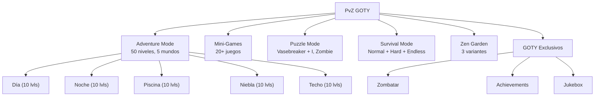
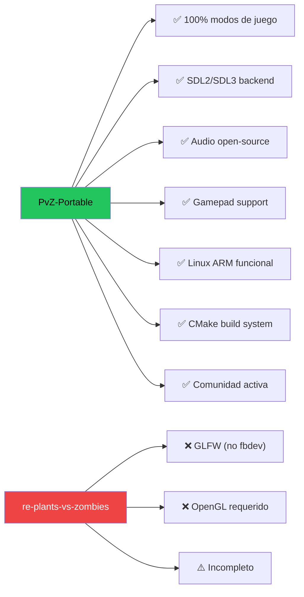
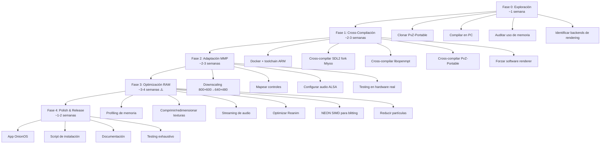
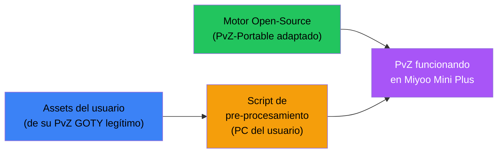

# 🌻 Port de Plants vs. Zombies GOTY a Miyoo Mini Plus — Análisis y Ruta de Trabajo

## Resumen Ejecutivo

El port de Plants vs. Zombies GOTY a la Miyoo Mini Plus es **técnicamente viable pero significativamente más desafiante que Zuma Deluxe**. PvZ es un juego ~5× más exigente en todos los frentes: ~1,500-3,500+ quads renderizados por frame (sistema Reanim esqueletal), partículas avanzadas, y una resolución nativa de 800×600 que **no coincide** con la pantalla de 640×480.

El proyecto **[PvZ-Portable](https://github.com/wszqkzqk/PvZ-Portable)** es la base ideal e indiscutible:

1. 🔥 **Reimplementación cross-platform completa** de PvZ GOTY — 100% modos funcionales
2. 🔥 **Ya corre en handhelds ARM** — porteado a Anbernic, TrimUI, Powkiddy vía PortMaster
3. 🔥 **Ya corre en Linux y Android (ARM64/ARMv7)** con SDL2/SDL3 + gamepad
4. 🔥 **Audio resuelto** — BASS reemplazado por SDL-Mixer-X + libopenmpt
5. ⚠️ **Resolución 800×600 → 640×480** requiere downscaling (factor 0.8×)
6. 🔴 **RAM: el blocker principal** — PvZ usa ~100-200 MB vs. 80-95 MB disponibles en la MMP

> [!IMPORTANT]
> Este análisis plantea una ruta **100% legal**: motor open-source + assets del usuario. Modelo "Bring Your Own Data" como ScummVM, DevilutionX y OpenMW.

> [!NOTE]
> **Contexto actual en la MMP:** PvZ ya se juega en la Miyoo Mini Plus vía **emulación DS (DraStic)** o la versión **J2ME (Java Mobile)**. Un port nativo del PC GOTY sería la primera vez que la versión completa corre directamente en el hardware — un logro comparable al port de Stardew Valley.

> [!WARNING]
> **A diferencia de Zuma Deluxe, este port NO es trivial.** La RAM (128 MB total, ~80-95 MB usables) es el factor decisivo. PvZ GOTY requiere 512 MB recomendados. Se necesita reducir el consumo en un **50-70%** mediante pre-procesamiento de assets y optimización agresiva.

---

## 1. Análisis de Hardware — Miyoo Mini Plus (Referencia)

| Especificación | Detalle |
|---|---|
| **CPU** | SigmaStar SSD202D — **Dual-Core** ARM Cortex-A7 @ 1.2 GHz |
| **RAM** | 128 MB DDR3 (SiP) — **~80-95 MB disponibles** para apps |
| **GPU** | ❌ Sin GPU 3D — Motor 2D GE/GOP (BitBLT, alpha blending HW, scaling) |
| **Pantalla** | 3.5" IPS LCD — **640×480** (VGA) @ 60Hz |
| **Almacenamiento** | 16MB SPI NOR Flash + MicroSD (hasta 512GB+) |
| **Audio** | Speaker mono + jack 3.5mm stereo, ALSA |
| **WiFi** | 2.4 GHz 802.11 b/g/n |
| **SO** | Linux 4.9.84 (OnionOS / MiniUI / Allium) |
| **Arquitectura** | ARMv7-A con NEON SIMD + VFPv4 FPU |
| **Controles** | D-pad, A/B/X/Y, L1/L2/R1/R2, Start/Select, Menu |

### Comparación: Requisitos Originales vs. Hardware Disponible

| Requisito | PvZ GOTY (2009) | Miyoo Mini Plus | Estado |
|---|---|---|---|
| CPU | 1.2 GHz Pentium III | Dual Cortex-A7 @ 1.2 GHz | ⚠️ Comparable — necesita optimización |
| RAM | 512 MB (1 GB recomendado Vista/7) | 128 MB (~80-95 usables) | 🔴 **~5× insuficiente sin optimización** |
| Resolución | 800×600 | 640×480 | ⚠️ Requiere downscaling 0.8× |
| GPU | DirectX 8, 128MB VRAM | Software renderer + 2D GE | ⚠️ Sin 3D HW — todo en CPU |
| Disco | ~120 MB (GOTY) | MicroSD | ✅ Sin problema |
| Audio | BASS (DirectSound) | ALSA + SDL2 | ✅ Compatible |

> [!CAUTION]
> **La RAM es el blocker #1.** PvZ GOTY necesita 512 MB recomendados y el dispositivo solo tiene 80-95 MB disponibles. Este es el desafío central de todo el proyecto.

---

## 2. Análisis del Juego — Plants vs. Zombies GOTY

### Stack Técnico Original
- **Motor:** SexyApp Framework v1.3x (PopCap Games Framework)
- **Nombre interno:** Clase principal `LawnApp` (prefijo "Lawn" en toda la codebase)
- **Lenguaje:** C++ (C++03, compilado con MSVC 2005/2008)
- **API Gráfica:** DirectDraw 7 / Direct3D 8 con fallback software
- **Audio:** **BASS Audio Library** (Un4seen) — propietaria
- **Resolución:** 800×600 fija (4:3)

### Sistemas Propietarios Complejos (Únicos de PvZ)

#### 🎭 Reanim (Sistema de Animación Esqueletal)
- Formato propietario `.reanim` / `.reanim.compiled`
- Define huesos jerárquicos, keyframes de transformación, y referencias a sprites
- **Cada planta y zombie tiene múltiples animaciones** (idle, ataque, comer, caminar, morir)
- Renderiza sprites compuestos de múltiples partes transformadas por frame
- **Es el sistema más CPU-intensivo del juego**
- No existe en Zuma ni en Insaniquarium — es único de PvZ

#### 💥 TodParticleSystem (Partículas Avanzadas)
- Sistema de partículas definido por archivos XML
- Emisores con: velocidad, vida útil, color, gravedad, textura, tamaño variable
- Usado masivamente: generación de soles, salpicaduras de guisantes, fuego, hielo, restos de zombies, relámpagos, niebla
- Más complejo que las partículas simples de Zuma

### Formatos de Assets
| Tipo | Formato | Notas |
|---|---|---|
| **Recursos** | `.pak` (PakLib PopCap) | Archivo principal: `main.pak` |
| **Imágenes** | PNG (RGBA 32-bit) + JPEG con alpha mask (`_`) | Muchos sprite sheets y fondos |
| **Música** | **`.mo3`** (tracker comprimido, BASS) | Compositora: Laura Shigihara |
| **Efectos** | WAV 16-bit (22/44.1 kHz) | Cientos de efectos |
| **Animaciones** | `.reanim` / `.reanim.compiled` | Sistema esqueletal propietario |
| **Partículas** | `.xml` (TodParticleSystem) | Definiciones de emisores |
| **Niveles** | `.xml` (waves, stats, configuración) | Datos de gameplay |
| **Saves** | Binario `.dat` | Datos de usuario |
| **Fuentes** | PNG sheets + `.txt` descriptores | Múltiples estilos |

> [!NOTE]
> **Dato técnico interesante:** El video de créditos ("Zombies on Your Lawn") **NO es un archivo de video**. Es renderizado **en tiempo real** por el motor Reanim con rigs de personajes animados y coreografía scripted. Esto significa que no necesitas un codec de video — pero sí que el Reanim system funcione correctamente.

### Complejidad Técnica: PvZ vs. Zuma Deluxe

| Aspecto | Zuma Deluxe | PvZ GOTY | Factor |
|---|---|---|---|
| **Quads renderizados/frame** | ~60-120 sprites | **1,500-3,500+ quads** (cada zombie/planta = 10-25 partes esqueléticas) | **25-30× más** |
| **Sistema de animación** | Rotación/escalado simple | **Reanim esqueletal multi-parte** (jerárquico, transforms por hueso por frame) | Exponencialmente más complejo |
| **Partículas** | Sparkles, explosiones | **TodParticleSystem**: niebla volumétrica, nubes nucleares, fuego, decapitaciones | Orden de magnitud más |
| **Lógica de juego** | Match-3 chain | **IA, pathfinding, economía, 48+ tipos de plantas, 26+ tipos de zombies** | 5-10× más complejo |
| **Memoria de texturas** | ~10-20 MB | **~40-80 MB** (incluye atlas de Reanim, Zombatar, fondos) | 3-4× más |
| **Canales de audio** | ~5-10 | **20-30+** simultáneos | 3× más |
| **Resolución** | 640×480 ✅ | **800×600** ⚠️ | +56% más píxeles |
| **Footprint total RAM** | ~20-40 MB | **~100-200 MB** | **5× más** |
| **CPU requerida** | 500 MHz PIII | **1.2 GHz PIII/PIV** | 2.4× más demanding |

### Modos de Juego (GOTY Edition)



---

## 3. Evaluación de Proyectos Base

### 🏆 Proyecto Recomendado: PvZ-Portable

| Aspecto | Detalle |
|---|---|
| **Repo** | [`wszqkzqk/PvZ-Portable`](https://github.com/wszqkzqk/PvZ-Portable) |
| **Tipo** | Decompilación + source port cross-platform |
| **Lenguaje** | C++ (C++17/20 modernizado) |
| **Motor** | SexyAppFramework modernizado → SDL2/SDL3 + OpenGL |
| **Build system** | CMake + Ninja |
| **Completitud** | ✅ Muy alta — todos los modos funcionales |
| **Plataformas** | Windows, Linux (x86_64, ARM64), macOS, Android, Switch |
| **PortMaster** | ✅ **Ya empaquetado** (`pvz_portable`) — Anbernic RG35XX+/H/SP, RG353, TrimUI, Powkiddy RGB30, etc. |
| **Audio** | ✅ BASS reemplazado por SDL-Mixer-X + libopenmpt |
| **Gamepad** | ✅ D-pad cursor + mapeo completo |
| **Assets** | BYOD — usuario copia `main.pak` + `properties/` |
| **Licencia** | Open-source (MIT o similar) |
| **Actividad** | ✅ Muy activo (2025-2026) |
| **¿MMP?** | ❌ **No soportado** — PortMaster requiere GLES + aarch64 + ≥512 MB RAM |

### Proyectos Alternativos Evaluados

El ecosistema open-source de *Plants vs. Zombies* se divide en tres ramas históricas:

1. **Línea de Descompilación (C++ / MSVC / CMake):**
   - **Kopie (0.9.9.1029)**: Primera descompilación asm/C++, preservada por `ruslan831`.
   - **Quality of the Lawn (QotL)**: Fork de `Electr0Gunner` enfocado en widescreen y QoL (hoy descontinuado y archivado).
   - **Patoke / re-plants-vs-zombies**: Descompilación activa apuntando al 100% de paridad con la versión **Steam GOTY** (Zombatar, logros). Reemplaza DirectX 7 con GLFW/OpenGL.
   - **LawnProject / ResoddedFramework**: Sucesor moderno y limpio de QotL hecho para la comunidad de modding. Usa CMake, OpenGL/SDL_Renderer y OpenAL.
   - **InLiothixi / stabledecompile**: Descompilación avanzada que usa **SDL3**, FFmpeg y PortAudio; rescata contenido cortado/beta.

2. **Línea de Reimplementación Limpia / Source Ports:**
   - **wszqkzqk/PvZ-Portable** ⭐: Reimplementación limpia en C++20 con SexyAppFramework modernizado sobre SDL2 + OpenGL ES 2.0. Base oficial del paquete PortMaster.

3. **Reimplementaciones en Motores Ajenos (Clones):**
   - Python/Pygame (`wszqkzqk/pypvz`, `marblexu/PythonPlantsVsZombies` con +4k estrellas), TypeScript/Phaser (`evilgaoshu/PvZ`), Go/Ebitengine (`gonewx/pvz`), Godot (`game-a11y/PvZ-Godot`). Son clones independientes que no usan `main.pak`.

| Proyecto | Enfoque | Motor / Backend | Completitud | ¿Apto para MMP? | Veredicto |
|---|---|---|---|---|---|
| **[`PvZ-Portable`](https://github.com/wszqkzqk/PvZ-Portable)** ⭐ | Source Port C++20 | SDL2/SDL3 + GLES 2.0 | 100% (GOTY) | ✅ Base óptima (requiere tuning RAM/GLES) | **USAR ESTE** |
| [`Patoke/re-plants-vs-zombies`](https://github.com/Patoke/re-plants-vs-zombies) | Descompilación GOTY | GLFW + OpenGL | Alta | ❌ GLFW no tiene fbdev directo | Excelente referencia de código |
| [`LawnProject/ResoddedFramework`](https://github.com/LawnProject/ResoddedFramework) | Modding Engine | SDL_Renderer + OpenAL | Alta | ⚠️ Enfocado en Windows x86/x64 | Referencia para herramientas PAK |
| [`InLiothixi/stabledecompile`](https://github.com/InLiothixi/stabledecompile) | Descompilación extendida | SDL3 + PortAudio | Muy Alta | ⚠️ SDL3 experimental en ARMv7 | Referencia para SDL3 |
| [`headshot2017/re-plants-vs-zombies`](https://github.com/headshot2017/re-plants-vs-zombies) | Fork para consolas | SDL2 + OpenGL | Jugable | ⚠️ Probado en RGB30 (requiere GPU Mali) | Precedente en consolas portátiles |
| Clones Python/Godot/Web | Clones educativos | Pygame/Godot/Phaser | Variable | ❌ No usan assets originales | Descartados |

### ¿Por qué PvZ-Portable es la elección indiscutible?



> [!NOTE]
> **No existe un competidor real para dispositivos portátiles.** PvZ-Portable es el único proyecto que cumple todos los requisitos: completitud 100%, paridad de partidas guardadas con el PC original, SDL2, audio MO3 resuelto y arquitectura CMake moderna.
>
> **Hallazgos técnicos críticos dentro de PvZ-Portable:**
> 1. **Bandera `-DLOW_MEMORY=ON` (Agregada en sept/oct 2026):** Activa streaming de archivos PAK en bloques de 8KB, decodificación diferida (lazy) de efectos de sonido, y purga texturas de la RAM del CPU una vez cargadas en GPU. Reduce el consumo normal de **~537 MB RSS a ~403 MB RSS**.
> 2. **Alerta para Miyoo Mini Plus:** Aun con `-DLOW_MEMORY=ON`, **~403 MB sigue excediendo los 95 MB de RAM utilizables**. Esto demuestra que la versión estándar para PortMaster de Anbernic crashearía de inmediato por OOM en la MMP. Requiere obligatoriamente nuestra estrategia de reducción de texturas y assets offline.
> 3. **Backend Gráfico:** Utiliza **OpenGL ES 2.0** vía GLAD/EGL. En la MMP (sin GPU), se debe compilar contra el renderizador de software de SDL2 o implementar un wrapper framebuffer.
> 4. **Controles:** El motor upstream no incluye navegación por cruceta por defecto (usa ratón/touch). En PortMaster esto se resolvió envolviendo el ejecutable con `gptokeyb`. En OnionOS deberemos configurar `gptokeyb` o parchar los eventos SDL nativos.

---

## 4. Ruta de Trabajo Propuesta

> [!IMPORTANT]
> Esta ruta asume que PvZ-Portable compila y ejecuta correctamente en Linux x86. El desafío principal es la **cross-compilación para ARMv7** y la **optimización agresiva de memoria** para caber en 80-95 MB de RAM.



### Fase 0: Exploración y Auditoría (1 semana)

1. **Clonar PvZ-Portable:**
   ```bash
   git clone https://github.com/wszqkzqk/PvZ-Portable.git
   cd PvZ-Portable
   ```

2. **Compilar y ejecutar en PC** para verificar que funciona:
   - Estudiar el `CMakeLists.txt` — dependencias, flags, backends
   - Identificar cómo se selecciona el renderer (OpenGL vs software)
   - Verificar que existe un **modo de software rendering**
   - Si no existe: evaluar la dificultad de implementarlo

3. **Auditoría crítica de memoria:**
   - Ejecutar PvZ-Portable en PC con `valgrind` o herramientas de profiling
   - Medir el consumo real de RAM en diferentes escenarios:
     - Menú principal
     - Nivel de día (pocos zombies)
     - Survival Endless (máximo estrés: 200+ entidades)
     - Zen Garden (muchas texturas de plantas)
   - **Este dato define si el port es viable o si requiere recortes**

4. **Documentar la arquitectura:**
   - Cómo carga los assets (¿todo al inicio o bajo demanda?)
   - Cómo funciona el sistema Reanim internamente
   - Cómo funciona el TodParticleSystem
   - Dónde están los puntos de entrada de rendering

### Fase 1: Cross-Compilación para ARMv7 (2-3 semanas)

1. **Configurar entorno Docker:**
   ```bash
   docker pull aemiii91/miyoomini-toolchain
   ```

2. **Cross-compilar dependencias:**
   - SDL2 (fork Miyoo: `steward-fu/sdl2` o `XK9274/sdl2_miyoo`)
   - SDL2_image + libpng + libjpeg + zlib
   - SDL2_mixer + libogg + libvorbis
   - **libopenmpt** (para playback de `.mo3`) — verificar que compila para ARMv7
   - Cualquier otra dependencia identificada en Fase 0

3. **Crear toolchain file de CMake:**
   ```cmake
   set(CMAKE_SYSTEM_NAME Linux)
   set(CMAKE_SYSTEM_PROCESSOR arm)
   set(CMAKE_C_COMPILER arm-linux-gnueabihf-gcc)
   set(CMAKE_CXX_COMPILER arm-linux-gnueabihf-g++)
   set(CMAKE_C_FLAGS "-march=armv7-a -mtune=cortex-a7 -mfpu=neon-vfpv4 -mfloat-abi=hard -O2")
   set(CMAKE_CXX_FLAGS "${CMAKE_C_FLAGS}")
   ```

4. **Desactivar OpenGL — forzar software renderer:**
   - Buscar en el código dónde se inicializa OpenGL
   - Configurar CMake para compilar **sin** soporte OpenGL
   - Verificar que el fallback a SDL2 software renderer existe y funciona
   - Si no existe: implementar rendering via `SDL_CreateSoftwareRenderer` o surfaces directas

5. **Primera compilación ARM exitosa** — resolver todos los errores de compilación

### Fase 2: Adaptación para Miyoo Mini Plus (2-3 semanas)

#### 2.1 Downscaling de Resolución (800×600 → 640×480)

Este es un problema técnico no trivial con múltiples estrategias:

| Estrategia | Descripción | Pros | Contras |
|---|---|---|---|
| **A: Render a 800×600, escalar al output** | Renderizar internamente a 800×600 y usar `SDL_RenderSetLogicalSize` para escalar a 640×480 | Cero cambios en game code, aspecto idéntico | Costo de RAM extra (framebuffer 800×600), peor rendimiento |
| **B: Render directo a 640×480** | Modificar coordenadas de rendering con factor 0.8× | Mejor rendimiento, menor uso de RAM | Requiere modificar código de rendering, posibles glitches |
| **C: Render a 800×600, crop a 640×480** | Recortar bordes (80px horizontal, 60px vertical por lado) | Simple | Pierde contenido visible — no viable para PvZ |

**Recomendación: Estrategia A primero** (funcionar), luego **optimizar a B** si el rendimiento lo requiere.

```
Estrategia A (initial):
┌─────────────────────┐
│ Render interno      │
│ 800 × 600           │ → SDL_RenderSetLogicalSize → ┌─────────────┐
│                     │                               │ Output      │
└─────────────────────┘                               │ 640 × 480   │
                                                      └─────────────┘
Factor: 0.8× (ambos ejes, misma relación 4:3)
```

#### 2.2 Mapeo de Controles

PvZ es originalmente un juego de **mouse + click**. El mapeo a D-pad/botones es crítico para la experiencia:

```
D-pad / (Analógico si existiera)  → Mover cursor virtual por la cuadrícula
Botón A                           → Click izquierdo (plantar, recoger sol, confirmar)
Botón B                           → Click derecho / cancelar selección
Botón X                           → Pala (shovel) — toggle
Botón Y                           → Siguiente planta en la barra
L1 / R1                           → Navegar barra de plantas (izq/derecha)
L2                                → Velocidad de cursor lenta (precisión)
R2                                → Velocidad de cursor rápida
Start                             → Pausa / Menú
Select                            → Almanaque / Info
```

> [!TIP]
> PvZ-Portable ya tiene soporte de gamepad. Revisa su mapping existente y adáptalo a los botones específicos de la MMP. Lo más probable es que solo necesites ajustar el archivo de configuración.

#### 2.3 Audio
- `SDL_AUDIODRIVER=alsa`
- Verificar playback de `.mo3` con libopenmpt en ARM
- Ajustar sample rate si hay problemas de rendimiento (reducir a 22050 Hz si es necesario)
- **Considerar la posibilidad de tener que recortar el audio** como hizo el port de Stardew Valley si la RAM no alcanza

#### 2.4 Testing Inicial
- Transferir binario + libs + assets a la MicroSD
- Script de lanzamiento básico:
  ```bash
  #!/bin/sh
  export LD_LIBRARY_PATH="./libs:$LD_LIBRARY_PATH"
  export SDL_VIDEODRIVER=fbdev
  export SDL_AUDIODRIVER=alsa
  ./PvZ
  ```
- **Verificar que arranca** — probablemente va a crashear por OOM (Out of Memory) aquí

### Fase 3: Optimización de Memoria y Rendimiento (3-4 semanas) ⚠️ FASE CRÍTICA

> [!WARNING]
> Esta es la fase que determina si el port es viable. PvZ necesita ~100-200 MB y solo hay ~80-95 MB disponibles. Se requiere reducir el consumo de RAM en un **50-60%**.

#### 3.1 Presupuesto de RAM

```
Memoria total:                       128 MB
├── Linux kernel + drivers           ~30-35 MB
├── Framebuffer (640×480×4×2)       ~2.4 MB
└── DISPONIBLE PARA EL JUEGO        ~80-95 MB

Target de consumo del juego:         ~70-85 MB
├── Texturas en memoria              ~20-35 MB  (reducido de ~40-80 MB)
├── Reanim data                      ~5-10 MB
├── Audio buffers (SFX pre-load)     ~3-8 MB   (reducido, o streaming)
├── Música (streaming buffer)        ~1-2 MB
├── Game state + lógica              ~5-10 MB
├── SDL2 + renderer + libs           ~5-8 MB
├── Partículas + temporales          ~2-5 MB
└── MARGEN DE SEGURIDAD              ~5-10 MB
```

#### 3.2 Estrategias de Reducción de Memoria

##### A. Texturas — El mayor consumidor (~40-80 MB → target ~20-35 MB)

| Técnica | Ahorro Estimado | Dificultad |
|---|---|---|
| **Reducir resolución de texturas** al 80% (match con pantalla) | 36% | Baja — script de pre-procesamiento |
| **Convertir RGBA a RGB565** donde no se necesite alpha | 50% en esas texturas | Media |
| **Carga bajo demanda** por mundo (día/noche/pool/fog/roof) | Muy significativo | Media |
| **Descargar texturas** de mundos no activos | Significativo | Media |
| **Compartir texturas** entre entidades similares | Moderado | Baja |
| **Comprimir en memoria** (ETC1/S3TC emulado) | Variable | Alta |

##### B. Audio (~15-30 MB → target ~5-10 MB)

| Técnica | Ahorro | Dificultad |
|---|---|---|
| **Streaming de música** (no precargar completa) | ~5-10 MB | Baja — SDL2_mixer soporta streaming |
| **Reducir sample rate** SFX a 22050 Hz | 50% en SFX | Baja — script de conversión |
| **Cargar SFX bajo demanda** por nivel | Significativo | Media |
| **Mono en vez de stereo** donde sea posible | 50% en esos SFX | Baja |
| **Última opción: eliminar audio** (como Stardew) | Máximo | No deseado |

##### C. Reanim y Partículas

| Técnica | Ahorro | Dificultad |
|---|---|---|
| **Reducir frames de animación** Reanim | Moderado | Media — afecta calidad visual |
| **Limitar partículas máximas** | Ahorra CPU + RAM | Baja |
| **Pool de objetos** para entidades | Evita fragmentación | Media |
| **Reducir entidades en Survival Endless** | RAM + CPU | Baja — cap artificial |

> [!TIP]
> **Estrategia recomendada de pre-procesamiento:** Crear un script en tu PC que tome los assets originales del usuario y los optimice para la MMP:
> - Redimensionar todas las texturas al 80% (matching con la pantalla 0.8×)
> - Convertir música `.mo3` → OGG a bitrate reducido (96-128 kbps)
> - Reducir sample rate de WAV a 22050 Hz
> - Esto se ejecuta **una sola vez** al instalar el juego

#### 3.3 Optimización del Software Renderer

| Técnica | Impacto | Dificultad |
|---|---|---|
| **NEON SIMD** para blitting y alpha blending | Muy Alto | Alta |
| **Dirty rectangles** — solo re-renderizar lo que cambió | Alto | Media-Alta |
| **Reducir overdraw** — no dibujar sprites ocultos/fuera de pantalla | Medio | Media |
| **Pre-multiplicar alpha** al cargar sprites | Medio | Baja |
| **SigmaStar 2D GE** (BitBLT hardware) via SDL2 | Potencialmente alto | Alta |
| **Reducir profundidad de color** a RGB565 | Bajo-Medio | Baja |
| **Batch rendering** — agrupar sprites por textura | Medio | Media |

#### 3.4 Optimización de CPU

- Compilar con `-O2 -flto` (Link-Time Optimization)
- `-mtune=cortex-a7` para scheduling óptimo
- Mover audio mixing al segundo core (el SSD202D es dual-core)
- Precalcular tablas trigonométricas y lookup tables
- Target: **30 FPS estable** (20+ FPS en worst-case Survival Endless)

### Fase 4: Polish y Release (1-2 semanas)

1. **Empaquetar como App de OnionOS:**
   ```
   App/
   └── PvZ/
       ├── config.json          # Metadata
       ├── icon.png             # Icono 64×64
       ├── launch.sh            # Script de lanzamiento
       ├── PvZ                  # Binario ARM
       ├── libs/                # Librerías SDL2
       ├── optimize_assets.sh   # Script de pre-procesamiento (PC)
       └── README.md            # Instrucciones para el usuario
   ```

2. **Script de pre-procesamiento (PC)** que:
   - Valida que el usuario tiene los archivos correctos de PvZ GOTY
   - Redimensiona texturas al 80%
   - Convierte audio a formato optimizado
   - Empaqueta todo listo para copiar a la MicroSD

3. **Testing exhaustivo:**
   - [ ] Todos los 50 niveles de Adventure
   - [ ] Mini-Games (especialmente los intensivos: Zombotany, Column Like You See 'Em)
   - [ ] Survival Endless — verificar estabilidad a largo plazo (¿crash por OOM?)
   - [ ] Zen Garden — muchas texturas de plantas
   - [ ] Zombatar — ¿incluir o excluir por memoria?
   - [ ] Audio — ¿funciona todo o hay que recortar?

4. **Publicar:**
   - GitHub (código del port/adaptación)
   - Reddit: r/MiyooMini, r/SBCGaming
   - Discord de OnionOS
   - Foros de GBATemp

---

## 5. Limitantes de Hardware y Soluciones

### 🔴 Limitante 1: RAM Insuficiente (80-95 MB disponibles vs. ~100-200 MB necesarios)

**Nivel de riesgo: ALTO — Este es el factor decisivo del proyecto.**

| Escenario | RAM Estimada | Estado |
|---|---|---|
| Menú principal | ~40-50 MB | ✅ Viable |
| Nivel de Día (pocos zombies) | ~60-80 MB | ⚠️ Justo con optimización |
| Nivel de Piscina/Niebla (muchos sprites) | ~80-120 MB | 🔴 Requiere optimización agresiva |
| Survival Endless (200+ entidades) | ~120-200 MB | 🔴 Posiblemente inviable sin recortes |

**Soluciones (en orden de prioridad):**
1. Pre-procesar texturas al 80% (script automático)
2. Carga bajo demanda por mundo — descargar assets de mundos no activos
3. Streaming de música (no precargar)
4. Reducir sample rate de SFX
5. Pool de objetos y cap de entidades
6. **Último recurso:** Eliminar audio (como Stardew Valley Miyoo)

### ⚠️ Limitante 2: Resolución (800×600 → 640×480)

**Nivel de riesgo: MEDIO — Resolvible con downscaling.**

| Aspecto | Impacto | Solución |
|---|---|---|
| Render interno | Necesita escalar | `SDL_RenderSetLogicalSize(640, 480)` |
| Texto/UI | Puede verse pequeño | Verificar legibilidad al 80% |
| Hitboxes | No cambian (lógica independiente de render) | ✅ Sin impacto |
| Framebuffer extra | 800×600 buffer = 1.9 MB extra | Aceptable |

La relación de aspecto es idéntica (4:3 → 4:3), por lo que no hay distorsión. El factor 0.8× es uniforme y limpio.

### ⚠️ Limitante 3: Sin GPU — Software Rendering

**Nivel de riesgo: ALTO — PvZ renderiza 1,500-3,500+ quads por frame.**

Cada planta y zombie consta de 10-25 partes esqueléticas del sistema Reanim, cada una es un quad con transform individual. Esto es **25-30× más** que Zuma Deluxe.

| Escenario | Quads Estimados | FPS Estimado (sin opt.) | FPS con NEON + opts |
|---|---|---|---|
| Menú principal | ~100-200 | ~50-60 FPS | ~60 FPS |
| Nivel de Día simple | ~800-1,500 | ~20-30 FPS | ~30-40 FPS |
| Nivel de Pool/Niebla | ~1,500-2,500 | ~10-20 FPS | ~20-30 FPS |
| Survival Endless (lleno) | ~3,000-5,000+ | ~5-10 FPS | ~10-20 FPS ⚠️ |

**Soluciones:**
- NEON SIMD para blitting masivo
- Dirty rectangles (el tablero es mayormente estático)
- Limitar partículas en niveles intensos
- Motor 2D GE de SigmaStar si es accesible
- Reducir FPS target a 30 (o 20 en worst-case)

### ⚠️ Limitante 4: Controles (Mouse → D-pad)

**Nivel de riesgo: BAJO — PvZ-Portable ya tiene soporte de gamepad.**

PvZ se basa en un grid fijo (9×5 o 9×6 con piscina). El cursor virtual + snapping a celdas del grid funciona muy bien con D-pad:

| Control Original | Adaptación |
|---|---|
| Mouse mover → seleccionar celda | D-pad snap a celdas del grid |
| Click izq → plantar/recoger | Botón A |
| Drag → mover plantas (Zen Garden) | D-pad + A hold |
| Recoger soles (click rápido) | A o auto-collect QoL |

> [!TIP]
> **Feature QoL recomendada:** Implementar "auto-collect soles" (como se hizo en Insaniquarium) — los soles se recogen automáticamente tras unos segundos. Esto mejora enormemente la experiencia en gamepad.

### ⚠️ Limitante 5: CPU — Reanim + Partículas + Lógica

**Nivel de riesgo: MEDIO.**

El dual-core Cortex-A7 @ 1.2 GHz es comparable al Pentium III requerido, pero el Reanim system y las partículas son CPU-intensive:

| Solución | Impacto |
|---|---|
| Mover audio al Core 2 | Libera Core 1 para game + render |
| Optimizar Reanim con NEON | Reduce costo de animaciones |
| Cache de frames Reanim renderizados | Tradeoff RAM↔CPU |
| Reducir tick rate de partículas | Ahorra CPU |

---

## 6. Herramientas Necesarias

### 🛠️ Hardware
| Herramienta | Propósito |
|---|---|
| **Miyoo Mini Plus** | Testing en hardware real |
| **MicroSD** (32GB+ clase 10) | Almacenamiento |
| **PC con Linux** (recomendado) o Windows/macOS | Desarrollo y cross-compilación |
| **Cable USB-C** | Transferencia y carga |
| **Copia legítima de PvZ GOTY** | Assets del juego |

### 💻 Software de Desarrollo
| Herramienta | Propósito |
|---|---|
| **Docker Desktop** | Entorno de build reproducible |
| **Miyoo Mini Toolchain** | `aemiii91/miyoomini-toolchain` (Docker) |
| **GCC ARM Cross-Compiler** | `arm-linux-gnueabihf-gcc` (GCC 8.2+) |
| **CMake + Ninja** | Build system (PvZ-Portable usa CMake) |
| **Git** | Control de versiones |
| **VS Code** | IDE con extensiones C++, CMake Tools, Docker |
| **Valgrind / Massif** | Profiling de memoria (en x86 para auditoría) |

### 📚 Frameworks y Librerías (cross-compilar para ARM)
| Librería | Propósito |
|---|---|
| **SDL2** (fork Miyoo) | Rendering, input, windowing — `steward-fu/sdl2` o `XK9274/sdl2_miyoo` |
| **SDL2_image** | Carga de PNG/JPEG |
| **SDL2_mixer** / **SDL_mixer_ext** | Audio |
| **libopenmpt** | Playback de `.mo3` (tracker modules) — reemplazo de BASS |
| **libpng, libjpeg, zlib** | Decodificación de imágenes |
| **libogg, libvorbis** | Audio OGG Vorbis |

### 🤖 Herramientas de IA
| Herramienta | Uso Específico |
|---|---|
| **Claude (Anthropic)** | Adaptar código C++ para ARM, resolver errores de cross-compilación, optimizar rendering NEON SIMD, generar scripts de pre-procesamiento |
| **AI Code Assistant (Cursor, Copilot, Antigravity)** | Asistencia en C++/SDL2/CMake, debugging, optimización de memoria |

### 🖼️ Herramientas de Pre-procesamiento de Assets
| Herramienta | Propósito |
|---|---|
| **ImageMagick** / **FFmpeg** | Redimensionar texturas al 80%, convertir formatos |
| **SoX** | Convertir sample rate de WAV (44.1→22.05 kHz) |
| **FFmpeg** | Convertir `.mo3` → OGG si libopenmpt no es viable |
| **QuickBMS** / **PvZ PAK tools** | Extraer y reempaquetar archivos `.pak` |
| **Python 3** | Scripts de automatización del pipeline de assets |

### 📱 Software del Dispositivo
| Software | Propósito |
|---|---|
| **OnionOS** ([github.com/OnionUI/Onion](https://github.com/OnionUI/Onion)) | Firmware custom con Package Manager, WiFi, SSH |
| **SSH** (via WiFi) | Testing remoto sin extraer MicroSD |
| **FTP/SFTP** | Transferencia rápida de binarios |
| **htop / top** (en el dispositivo) | Monitorear uso de RAM en tiempo real |

---

## 7. Enfoque Legal



### ✅ Lo que TÚ creas y distribuyes:
- Binario ARM del motor (compilación de PvZ-Portable)
- Scripts de configuración y lanzamiento
- Script de pre-procesamiento de assets (redimensionar texturas, convertir audio)
- Documentación de instalación

### ❌ Lo que NO distribuyes:
- Ningún archivo de PvZ (imágenes, sonidos, música, datos)
- El nombre "Plants vs. Zombies" en branding del proyecto
- Logos o marca de PopCap/EA

### ⚠️ Consideración especial:
PvZ es una **IP mucho más valiosa** que Zuma para EA. Aunque los proyectos de decompilación como PvZ-Portable existen sin problemas legales aparentes, el riesgo de atención legal es ligeramente mayor. Mantener el modelo BYOD estricto es esencial.

---

## 8. Comparación con el Port de Zuma Deluxe

| Aspecto | Zuma Deluxe → MMP | PvZ GOTY → MMP |
|---|---|---|
| **Resolución** | 640×480 = pantalla ✅ | 800×600 → 640×480 ⚠️ |
| **RAM requerida** | ~30-50 MB ✅ | ~100-200 MB 🔴 |
| **Sprites simultáneos** | ~50-80 | ~200-500+ |
| **Sistema de animación** | Rotación simple | Reanim esqueletal ⚠️ |
| **Complejidad de partículas** | Baja | Alta (TodParticleSystem) |
| **Audio** | BASS → libopenmpt | Mismo — ya resuelto |
| **Gamepad** | Ya implementado | Ya implementado |
| **Proyecto base** | Zuma Portable ✅ | PvZ-Portable ✅ |
| **Dificultad del port** | 🟢 Baja-Media | 🟡 **Media-Alta** |
| **Viabilidad** | 🟢 Muy Alta | 🟡 **Alta con optimización agresiva** |
| **Tiempo estimado** | 2-6 semanas | **4-10 semanas** |
| **¿Necesita recortes?** | No | **Probablemente sí** (texturas/audio) |

---

## 9. Estimación de Esfuerzo y Viabilidad

| Factor | Evaluación |
|---|---|
| **Viabilidad técnica** | 🟡 **Alta con reservas** — depende de la optimización de RAM |
| **Viabilidad legal** | 🟢 **Alta** — modelo BYOD bien establecido |
| **Dificultad** | 🟡 **Media-Alta** — cross-compilación + optimización agresiva de memoria |
| **Mayor riesgo** | 🔴 **RAM** — si no se puede reducir a <85 MB, el port no es viable con audio |
| **Con asistencia de IA** | 🟢 **Significativamente más fácil** — Claude + precedentes (Balatro, Stardew MMP) |
| **Tiempo estimado** | **4-10 semanas** (dependiendo de cuánta optimización de RAM se necesite) |
| **Peor caso** | Port funcional pero sin audio (como Stardew Valley MMP) |
| **Mejor caso** | Port completo con audio a 30 FPS con texturas reducidas |

---

## 10. Primeros Pasos Concretos (Esta Semana)

### Día 1-2: Setup
- [ ] **Obtener** PvZ GOTY ([Steam](https://store.steampowered.com/app/3590/Plants_vs_Zombies_GOTY_Edition/) o EA App — **no disponible en GOG**)
- [ ] **Instalar** OnionOS en la MicroSD de tu Miyoo Mini Plus
- [ ] **Instalar** Docker Desktop

### Día 2-3: Exploración del Código
- [ ] **Clonar** PvZ-Portable:
  ```bash
  git clone https://github.com/wszqkzqk/PvZ-Portable.git
  cd PvZ-Portable
  ```
- [ ] **Leer** el README y el `CMakeLists.txt` completo
- [ ] **Compilar** en PC y ejecutar con tus archivos de PvZ GOTY
- [ ] **Identificar:** ¿Tiene modo de software rendering? ¿Cómo se activa?

### Día 3-4: Auditoría de Memoria (CRÍTICO)
- [ ] **Ejecutar** PvZ-Portable con profiling de memoria:
  ```bash
  valgrind --tool=massif ./PvZ
  ms_print massif.out.* | head -100
  ```
- [ ] **Medir** consumo en: menú, nivel día, nivel pool, survival
- [ ] **Documentar** los resultados — esto define la viabilidad

### Día 5-7: Primer Intento de Cross-Compilación
- [ ] **Configurar** Docker toolchain:
  ```bash
  docker pull aemiii91/miyoomini-toolchain
  ```
- [ ] **Compilar** SDL2 (fork Miyoo) dentro del Docker
- [ ] **Crear** toolchain file de CMake
- [ ] **Intentar compilar** PvZ-Portable para ARM — documentar errores
- [ ] **Usar IA** (Claude/Antigravity) para resolver errores de compilación

### Comunidades
- [ ] Discord de **OnionOS** — preguntar por experiencias con PvZ-Portable en ARM
- [ ] **Issues** del repo PvZ-Portable — buscar si alguien ya intentó ARMv7
- [ ] Reddit: **r/MiyooMini**, **r/SBCGaming**
- [ ] Foros de **GBATemp**

> [!TIP]
> **La auditoría de memoria del Día 3-4 es el paso más importante de todo el proyecto.** Si PvZ-Portable consume < 100 MB con assets completos, el port es muy viable. Si consume > 150 MB, necesitarás el pipeline de pre-procesamiento de assets obligatoriamente. Si consume > 200 MB, puede que necesites eliminar audio como hizo Stardew Valley.

> [!NOTE]
> **Sobre la estrategia de IA:** A diferencia de Zuma (donde el trabajo es mayormente cross-compilación), PvZ requiere optimización activa de código C++ (reducción de memoria, NEON SIMD, etc.). Usa un LLM como pair programmer constante — alimenta el código del renderer, el Reanim system, y los perfiles de memoria para que sugiera optimizaciones específicas.
